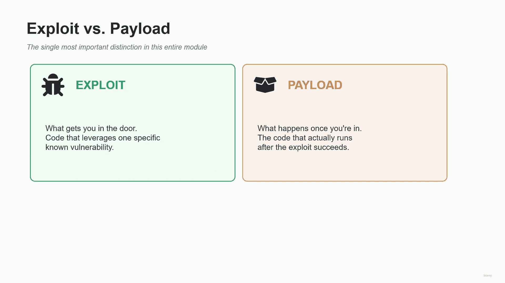
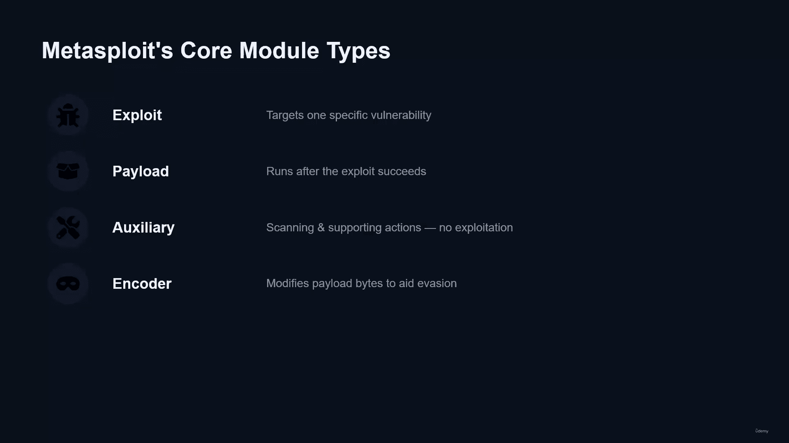
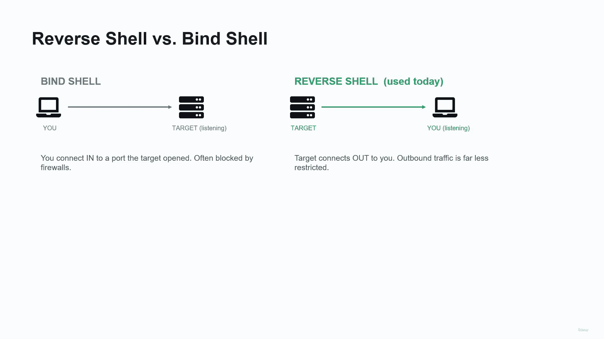

# Ethical Hacking & Penetration Testing with Kali Linux：41：Metasploit 核心概念：利用程序、有效载荷与模块 🖥️


在本节课中我们将要学习Metasploit框架的核心结构与基本概念。我们将重点理解利用程序、有效载荷、辅助模块以及编码器这几个部分是如何协同工作的。除此之外，还会讲解反向shell与绑定shell的区别，并强调在实验环境中合规使用工具的重要性。这节课是从“发现弱点”转向“真正利用弱点”的关键转折点，掌握这些内容能让你在后续的实操讲解中不再感到困惑。


## 1. 为什么这一节课很重要

在此之前，我们已经学习了侦察、扫描和漏洞评估。那些内容的目的都是为了找到目标系统中的安全问题。今天我们要做的不是继续寻找弱点，而是开始实际利用这些弱点。Metasploit正是帮助我们完成这一转变的工具，它也是专业渗透测试人员在日常付费项目中使用最广泛的行业标准漏洞利用框架。

为了让你运行每一条命令时都明白其背后的逻辑，而不是把它当成魔法，我们需要先建立一个关于Metasploit内部架构的正确心智模型。理解框架是如何组织的，是后续所有实操的基础。


## 2. Metasploit的核心模块类型

Metasploit的组织方式围绕着少数几种核心模块类型。我希望你能真正理解每一种模块的作用，而不仅仅是记住它们的名称。以下是这些核心模块类型：

- 利用程序（Exploit）
- 有效载荷（Payload）
- 辅助模块（Auxiliary Module）
- 编码器（Encoder）


## 3. 什么是利用程序

利用程序是一段专门针对特定软件中特定已知漏洞的代码。它的唯一目的是利用该漏洞，在目标系统上获得初始访问权限。

请回顾VSFTPD后门这个例子。我们在第5模块通过Nmap版本检测发现过它，也在第6模块通过OpenVAS自动化扫描发现过它。Metasploit中有一个专门为这个确切缺陷编写的预构建利用模块。

Metasploit库中的每个利用模块都只针对某个特定软件中的一个特定漏洞，或者一个紧密相关的漏洞家族。利用程序的核心作用可以用下面这个简单公式来概括：

```
访问权限 = 利用程序（Exploit）
```

这意味着，利用程序负责把你带进目标系统的大门。


## 4. 什么是有效载荷



有效载荷与利用程序本身有着真正的区别。在继续之前，必须把这个区别说得清清楚楚。利用程序负责让你进门，而有效载荷则是进入门内后实际发生的事情。

你可以这样理解：

- 利用程序负责撬锁
- 有效载荷是门打开后你实际要做的事情

一个常见的有效载荷类型是反向shell。它是一段代码，能在目标机器上给你一个真正的交互式命令行，让你直接运行命令，就像坐在那台机器自己的键盘前一样。有效载荷的作用可以用下面这个公式表达：

```
进入目标后的操作 = 有效载荷（Payload）
```


## 5. 辅助模块与编码器

除了利用程序和有效载荷，Metasploit还包含辅助模块。以下是这部分内容的简要介绍：

- 辅助模块：不一定会利用任何漏洞，而是执行有用的支持操作，例如扫描目标，或检查目标是否存在漏洞而不实际利用它。
- 编码器：修改有效载荷的代码，帮助其绕过某些基础检测机制。

不过需要诚实地说明的是，现代安全工具在识破基础编码方面，已经比几年前强得多了。因此编码器不能被当作绝对可靠的隐藏手段。


## 6. Metasploit的历史与规模



让我们也简单了解一下Metasploit的背景和规模，这样你就能更好地明白自己正在使用什么。Metasploit最初是一个开源项目，后来发展成为整个行业中使用最广泛的漏洞利用框架。今天它由Rapid7维护，包含成千上万个现成的利用模块，涵盖从古老的历史漏洞到真正最近的安全披露。所有模块都可以通过一个统一的界面搜索和使用，而这就是我们即将一起打开的界面。


## 7. 反向shell与绑定shell

在动手实操之前，还有一个概念直接影响今天课程的展开方式，那就是反向shell与绑定shell的区别。

绑定shell直接在目标机器上打开一个监听端口，然后你从攻击机连接到它。反向shell则正好相反，目标机器会主动向外发起连接，连接到你的攻击机。

在现实世界的专业渗透测试项目中，反向shell要常见得多。原因很简单：防火墙通常对离开网络的外出连接更为宽松，而对进入网络的入站连接则限制更严。目标的防火墙可能会阻止你向内连接，但不太可能阻止同一个目标向外连接到你。今天我们在第二个实际示例中，将会使用这个反向shell模式。


## 8. 伦理与合规边界

我想用贯穿本课程的同样伦理框架来结束这节理论课，因为这一点在这里比迄今为止的任何地方都更重要。我们即将运行的每一种技术，都专门针对我们自己的实验室Metasploitable机器。这是一个故意构建、专门为了学习而被利用的系统。

将这些确切命令用于你不拥有、或没有明确书面授权测试的任何系统，会直接从教育跨越到严重的刑事犯罪。请将所有操作都限制在我们的实验室内，就像我们从第1、2课以来一直所做的那样。


## 9. 本节小结与下节预告

好了，利用程序让你进入目标系统，有效载荷决定进入后会发生什么，辅助模块支持整个过程，而反向shell是我们今天将使用的模式。



下节课，我们将第一次打开Metasploit，并去寻找我们需要的确切利用模块。


## 总结


本节课中我们一起学习了Metasploit的核心模块结构，包括利用程序、有效载荷、辅助模块和编码器的区别与作用；理解了反向shell与绑定shell的连接方式差异；也明确了在实验环境中合规使用工具的伦理边界。这些概念是后续所有Metasploit实操的理论基础。
