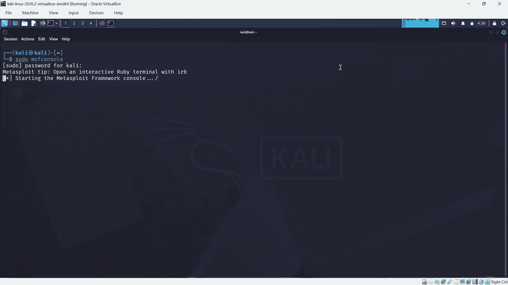
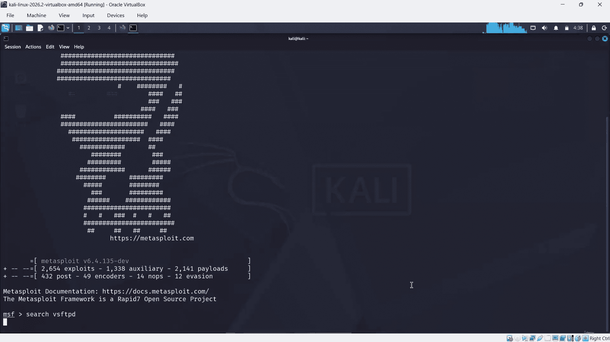
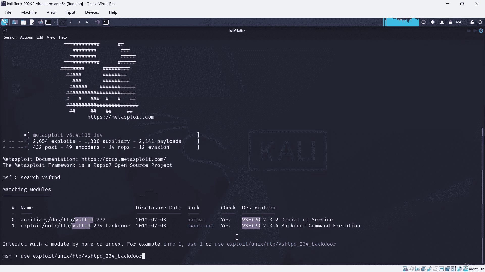
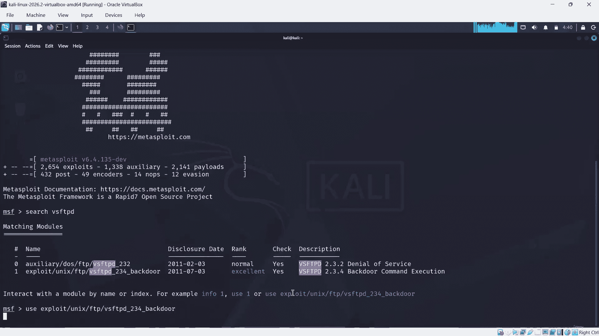
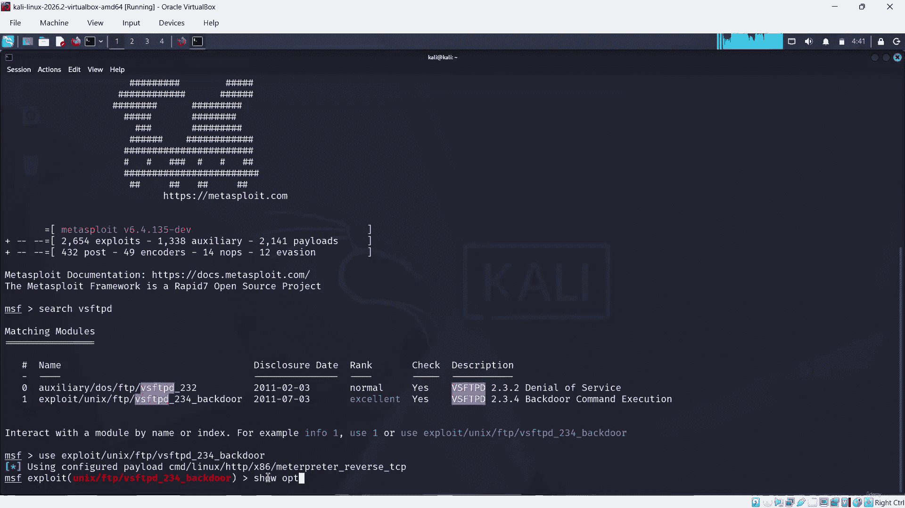
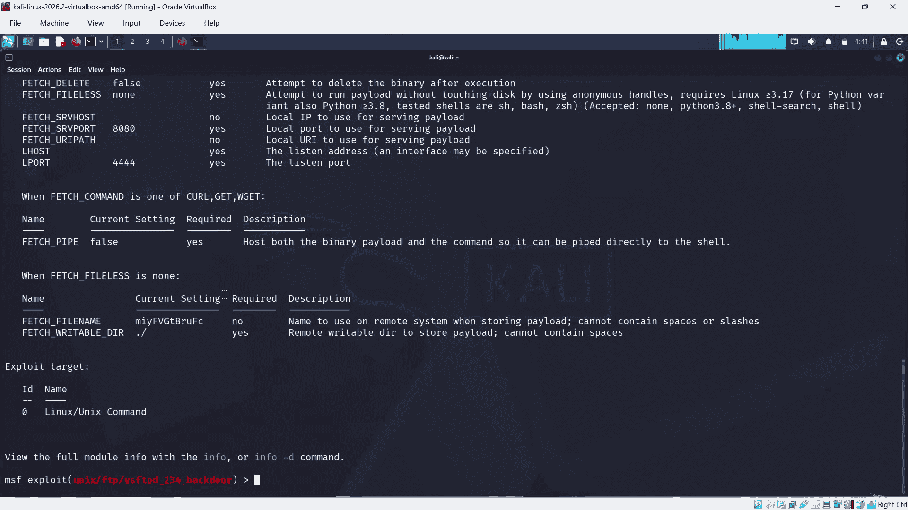
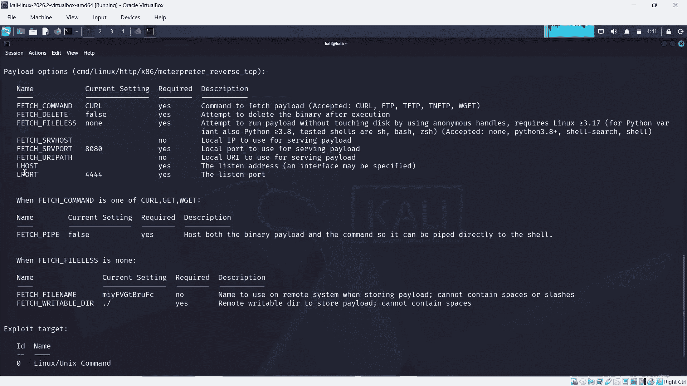
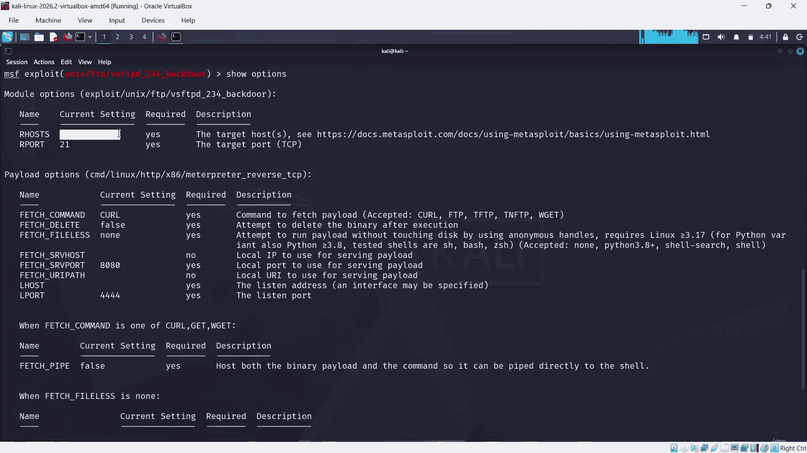

# 道德黑客与渗透测试：42：启动 Metasploit 并搜索漏洞利用 🚀

在本节课中，我们将学习如何启动 Metasploit 框架，并在其中搜索针对特定漏洞的利用模块。我们会一起打开 Kali Linux 终端，运行 Metasploit 控制台，找到 FTP 服务的后门漏洞，并了解模块搜索结果里各个列的含义。最后，我们会选定要使用的模块，并查看它需要配置哪些关键参数，为下一节实际发起攻击打好基础。


## 第一节：确认虚拟机运行状态 🖥️

在动手操作之前，我们需要先确认实验环境里的两台虚拟机都已经正常启动。其中一台是我们用来发起攻击的控制机，也就是 Kali Linux 虚拟机；另一台是作为被攻击目标的靶机，通常是 Metasploitable 虚拟机。只有这两台都处于运行状态，后面的步骤才能顺利进行，否则终端里连不上目标机器，整个渗透测试练习就无法继续下去。


在我的实验环境中，两台虚拟机目前都已经处于运行状态。我现在位于 Kali Linux 的终端界面，准备启动 Metasploit。请按照下面的步骤操作，确保自己的环境也处于相同状态。




以下是启动前需要确认的要点：

- Kali Linux 虚拟机已开机，终端可以正常输入命令
- 目标虚拟机 Metasploitable 已开机，网络连接正常
- 两台虚拟机处于同一网络环境，可以相互 ping 通


完成上述确认后，我们就可以进入 Kali 终端启动 Metasploit 了。下一节我们将看到如何打开控制台，并观察加载过程中的横幅信息。


## 第二节：启动 Metasploit 控制台 🐚

上一节我们确认了虚拟机运行状态，本节中我们来看看如何启动 Metasploit 的交互式命令环境。


在 Kali 终端里，我们需要以管理员权限启动 msfconsole。具体操作是输入 sudo 然后空格，接着输入 msfconsole，回车后系统会要求输入密码，输入完成后等待加载即可。启动命令如下：

```bash
sudo msfconsole
```


命令执行后，屏幕会出现加载界面，请耐心等待。加载过程中你会注意到一个横幅出现，这就是 Metasploit 欢迎用户的方式，通常包含一段随机的 ASCII 艺术图案，以及一些统计信息，比如当前加载了多少个漏洞利用模块、辅助模块和有效载荷模块。


这个数字非常惊人，通常单漏洞利用模块就超过 2000 个。这能让你直观感受到，在这个单一的控制台后面，隐藏着多么庞大的攻击模块库。等加载完成，你就会看到 msf 提示符，接下来的模块学习都将在这个环境中进行。


## 第三节：理解 Metasploit 的交互环境 🧩

启动完成后，你会看到 Metasploit 自己的交互式命令行界面。这个环境与我们之前一直使用的普通 Kali 终端完全分开，拥有自己的一组命令和提示符，专门用于管理漏洞利用、扫描和后渗透操作。


接下来的所有模块搜索、配置和执行，都将在这个提示符下完成。你可以把它理解为 Metasploit 内部的“操作系统”，所有关于渗透测试的指令都在这里输入。




下一节我们将尝试在这个控制台里搜索具体的漏洞利用模块。


## 第四节：搜索特定漏洞利用模块 🔍

在实际渗透测试中，我们通常已经知道目标运行的服务和版本，这时候需要在 Metasploit 的庞大模块库里找到对应的漏洞利用代码。本节我们就来演示如何搜索 vsftpd 后门漏洞。


在本课程中，我们之前已经通过两种不同的工具看到过 vsftpd 后门的标志，现在直接在 Metasploit 里搜索它。输入以下命令并回车：

```bash
search vsftpd
```


执行后，需要等待搜索结果返回。Metasploit 会扫描整个模块库，找出所有与 vsftpd 相关的条目。


以下是搜索完成后你可能会看到的输出示例：

```text
Matching Modules
================

   #  Name                                  Disclosure Date  Rank    Description
   -  ----                                  ---------------  ----    -----------
   0  exploit/unix/ftp/vsftpd_234_backdoor  2011-07-03       excellent  VSFTPD v2.3.4 Backdoor Command Execution
```


## 第五节：解析搜索结果列与排名 📊

上一节我们得到了搜索结果，本节中我们来看看这些输出列到底代表什么，以及排名列为什么很重要。


搜索结果表格包含以下几列：

- 模块编号：用于后续快速选择模块的索引号
- 完整模块路径：模块在 Metasploit 库中的位置
- 披露日期：该漏洞被公开的时间
- 排名：表示该漏洞利用的可靠程度
- 简短描述：对模块功能的简要说明


其中，排名列非常值得理解，因为在你未来的渗透测试职业生涯中，每一次搜索结果里都会出现它。排名如 excellent 或 great，表示该漏洞利用比较可靠，不太可能导致目标服务崩溃。排名较低的模块，可能不可靠，或者需要非常精确的条件才能正常工作。对于初学者，我通常建议在有选择的情况下，优先使用排名较高的模块，因为它们在第一次尝试时更容易成功。


下一节我们将选定具体的模块，并进入该模块的配置界面。


## 第六节：选定漏洞利用模块 ⚙️

有了搜索结果后，我们需要告诉 Metasploit 要使用哪个具体的模块。使用 use 命令，后面跟上完整的模块路径，这样初学者更容易看清自己选的是什么。




输入以下命令并回车：



```bash
use exploit/unix/ftp/vsftpd_234_backdoor
```


命令执行成功后，你会注意到提示符发生了变化。它不再显示普通的 msf 提示符，而是显示这个特定模块的名字，确认我们正在该漏洞利用模块内部工作，而不是在 Metasploit 的最顶层提示符下。


选定模块后，下一步就是查看它需要配置哪些选项，才能实际运行。


## 第七节：查看模块所需配置项 🛠️



模块选定之后，在运行之前，我们需要知道它需要哪些参数。输入 show options 或简写 options，可以查看该模块需要配置的字段列表。


执行以下命令：



```bash
show options
```




屏幕会显示一个表格，列出所有需要设置的选项。其中最重要的一个字段叫做 RHOST，代表远程主机，目前是空的。这个字段告诉 Metasploit 具体要攻击哪台机器的 IP 地址，核心关系可表示为：

```
RHOST = 目标机器 IP 地址
```

对于几乎所有漏洞利用模块来说，正确配置 RHOST 都是最关键的一步。


下一节课我们将配置这个 RHOST 字段，真正运行漏洞利用，并在 Metasploit 中拿到我们的第一个确认 shell。


## 第八节：课程总结 📝

本节课中，我们一起学习了启动 Metasploit 控制台的方法，并观察了加载过程中的横幅和模块统计信息。我们搜索了 vsftpd 后门漏洞利用模块，解析了搜索结果中的模块编号、路径、披露日期、排名和描述，并理解了为什么应该优先选择排名较高的模块。接着，我们选定了 exploit/unix/ftp/vsftpd_234_backdoor 模块，并使用 show options 查看了它需要配置的字段，重点掌握了 RHOST 远程主机地址的重要性。




下一节课，我们将填写 RHOST，发起真正的漏洞利用攻击，获取目标系统的 shell 权限。

