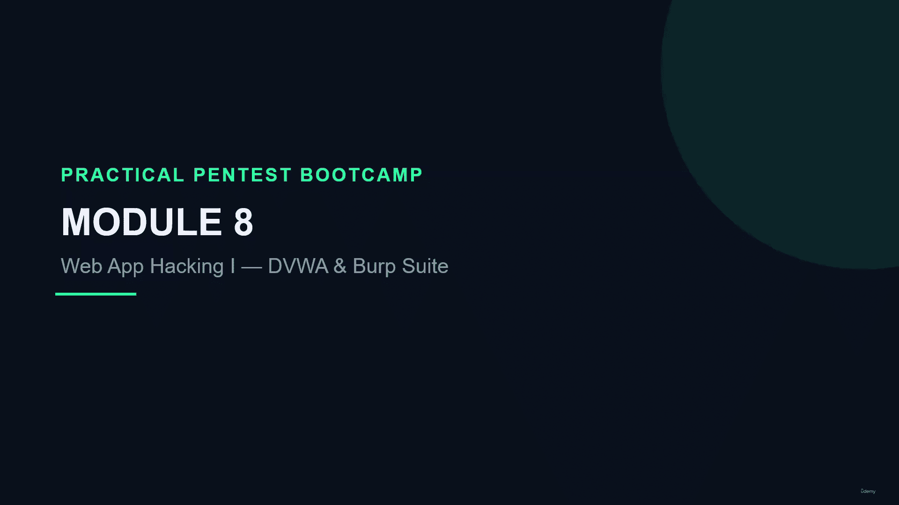
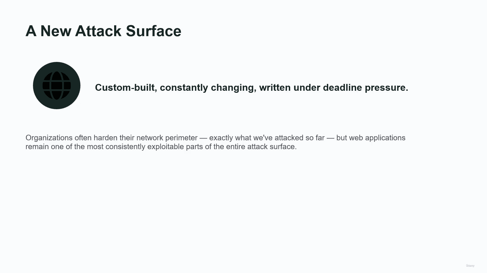
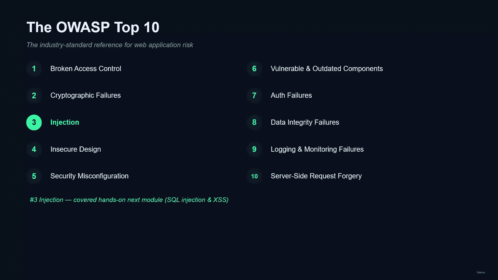
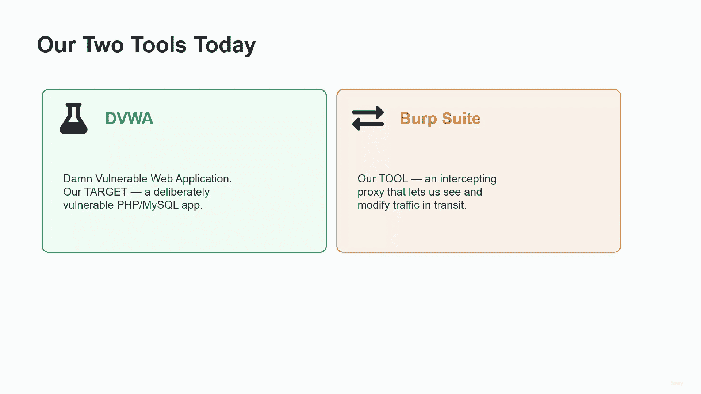
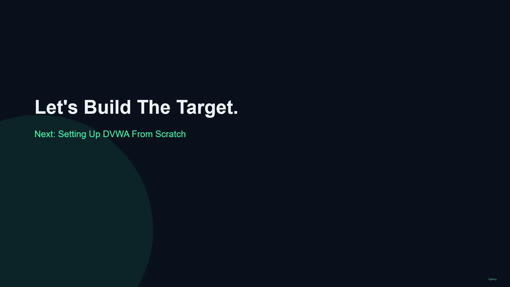

# Web安全渗透测试：8.1：Web攻击面与OWASP Top 10 🛡️




## 课程概述

在本节课中，我们将一起学习Web应用安全的核心概念，重点理解什么是Web攻击面，以及OWASP Top 10这个行业标准风险列表。我们还会认识两个即将用到的重要工具：DVWA作为练习目标，Burp Suite作为查看网络流量的透镜，为下一节从头搭建实验环境打好基础。


## 从网络层转向应用层

上一节我们介绍了网络层和操作系统层面的攻击手法，本节中我们来看看完全不同的领域：浏览器内部和应用层，大量真实世界的安全泄露就发生在这里。

迄今为止本课程所做的一切都停留在网络层和操作系统层面，主要关注开放端口、服务版本，以及直接利用目标机器本身的漏洞。这种思路在之前的实验室练习中已经非常熟悉。

现在的转变意味着一个全新的思维模式，不再是面对服务器上的开放端口，而是面对运行在浏览器里的Web应用程序。这个新的攻击面对渗透测试人员来说至关重要，因为现代组织的大量安全事件恰恰源于应用层而非网络层。

用一个简单的公式来表示这个转移：

```text
攻击面转移 = 网络层 (开放端口 / 服务版本 / 直接利用机器) → 应用层 (浏览器 / Web应用程序)
```




## 为什么这个转变如此重要

组织在加固网络边界方面已经积累了不少经验，今天的大多数公司在修补服务、正确配置防火墙这类基础工作上做得相当不错。这些防护措施正是我们在之前实验室中反复攻击的目标，但现实中的企业往往已经在这些方面下了功夫。

而Web应用程序与网络基础设施截然不同。它们通常是定制构建、不断变化，并且由在截止日期压力下工作的人类开发者编写。代码被匆忙写出来、功能频繁更新、业务逻辑复杂多变，这些特点叠加在一起，使得Web应用在实践中成为任何组织攻击面上最容易被持续利用的部分之一。

即使一家公司的网络层安全性确实很稳固，防火墙配置得当、补丁更新及时，其Web应用依然可能因为开发层面的问题而成为薄弱环节。这就是为什么我们需要把注意力从单纯的端口和服务转移到Web应用程序本身的原因。

引入一个在未来职业生涯中会被反复提及的框架，它就是OWASP Top 10。


## OWASP Top 10行业标准

OWASP代表Open Web Application Security Project（开放Web应用安全项目），这是一个非营利组织，定期基于全球安全专业人员和组织提供的真实世界数据，发布按重要性排序的最关键Web应用安全风险列表。

这份列表并非随意编制，而是Web应用安全领域的行业标准参考点。你会在合规要求、招聘启事，以及几乎所有严肃的Web安全专业对话中反复看到它，因此了解它的内容对从业者至关重要。

虽然本课程中我们只会直接动手利用其中一两个类别，但我希望你在完成本讲时，至少能认出列表中的每一个名称，并建立初步的概念印象。

以下是OWASP Top 10的完整列表：

1. 访问控制损坏：用户可以访问本不应该触及的数据或功能。
2. 加密失败：保护敏感数据的加密薄弱或完全缺失。
3. 注入：不可信的输入到达能够操纵系统行为的地方，这正是下一模块我们将通过SQL注入进行动手实践的内容。
4. 不安全设计：安全缺陷内嵌于应用程序的基本架构中，而非特定的实现错误。
5. 安全配置错误：服务或应用程序处于不安全的默认状态。
6. 易受攻击和过时的组件：运行带有已知未修补缺陷的软件，这个概念在漏洞扫描模块中已经深入讲解过。
7. 识别和身份验证失败：登录和会话处理中的弱点。
8. 软件和数据完整性失败：在没有正确验证的情况下信任代码或数据。
9. 安全日志和监控失败：即使攻击已经发生，也无法检测到。
10. 服务器端请求伪造：诱导服务器代表攻击者发出非预期的请求。


## 模式识别胜过死记硬背

一次性吸收这么多内容确有难度，我不期望你听一遍就完全记住所有术语，也没有必要强行背诵。我真正希望你培养的是模式识别能力，能够在后续的动手实践中，将每个攻击正确归类到这个列表中。

下一模块我们将动手利用注入和跨站脚本漏洞，到时候你不仅要懂得如何执行攻击，还要清楚每个攻击实际代表哪个更广泛的风险类别。这种分类思维比单纯记住工具命令更有长期价值。


## DVWA：安全的练习目标

现在让我们谈谈今天将要设置的两个工具，首先是DVWA，全称Damn Vulnerable Web Application（该死的易受攻击Web应用程序）。

它是一个基于PHP和MySQL的Web应用程序，故意构建以包含一整套常见漏洞，并设有多个可调节的难度等级。DVWA确实是整个初级到中级Web安全教育领域中使用最广泛的训练目标，原因很简单：它足够真实，可以教授真实的渗透测试技术，同时又安全合法，因为它就是专门为了被攻击而设计的。

用代码形式概括DVWA的核心特征：



```python
# DVWA 工具特征
name = "DVWA"
full_name = "Damn Vulnerable Web Application"
language = "PHP"
database = "MySQL"
purpose = "故意包含常见Web漏洞"
difficulty = "多级可调节"
target_audience = "Web安全初学者与中级学习者"
```

它不是真实企业网站，而是一个专门为教学搭建的靶场，攻击它不会触犯法律，非常适合初学者在安全的环境中积累经验。


## Burp Suite：流量拦截与修改工具

与DVWA不同，Burp Suite不是攻击目标，而是一个拦截代理工具。要理解它的作用，先来看看正常情况下浏览器与Web服务器的通信过程。

通常你的浏览器直接与Web服务器对话，你从不看到两者之间的原始流量。Burp Suite就位于这段对话的中间，让你在请求离开浏览器之前查看并修改每一个请求，也能在响应到达你之前查看并修改每一个响应。

用简单的流程表示它的工作位置：

```text
浏览器 → Burp Suite 拦截代理 → Web服务器
       ↑ 可查看并修改请求 / 响应
```

这确实是Web应用渗透测试人员整个工具箱中最重要的工具之一。它把浏览器从一个被动的页面查看工具，变成了主动的安全测试仪器，是后续Web渗透测试中不可或缺的设备。


## 环境搭建前的诚实提醒

在进入本讲的实践操作之前，给大家一个快速而诚实的提示：从零开始设置DVWA涉及多个真实的安装步骤，需要安装Web服务器、数据库和PHP，然后再下载并配置DVWA本身。

这在下一节课中将花费一定的实际设置时间，独立步骤比本课程中大多数讲座都要多。但请放心，每个步骤本身都很简单，我会和你一起逐步讲解每一个环节，确保没有遗漏。


## 下一节课预告



好了，Web攻击面和OWASP Top 10将成为我们今后学习Web安全时的共同词汇，DVWA作为我们的安全练习目标，Burp Suite作为我们查看网络流量本身的透镜。下一节课，我们将从头开始构建整个实验环境。


## 本节总结



本节课中我们一起学习了Web攻击面的概念，了解了从网络层到应用层的思维转变，梳理了OWASP Top 10的十大风险类别，并认识了DVWA和Burp Suite两个工具的基本作用。这些内容为下一节动手搭建实验环境奠定了基础。

