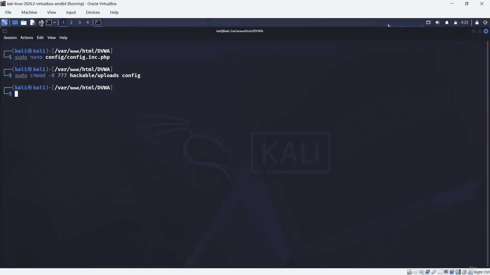
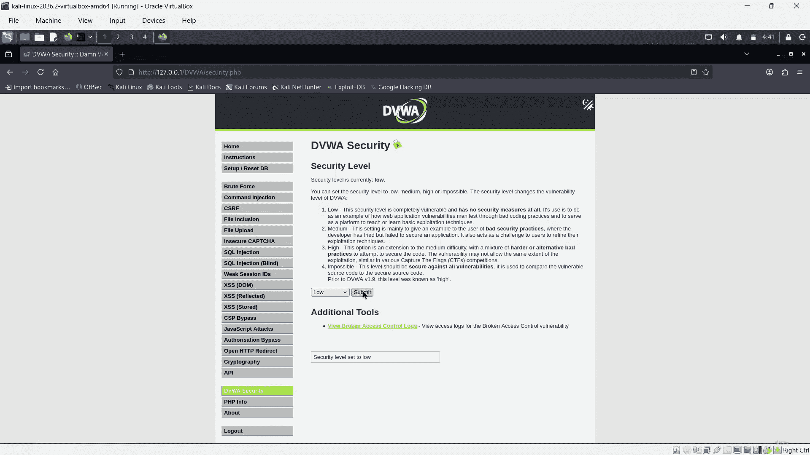

# 🛡️ Ethical Hacking & Penetration Testing with Kali Linux：47：搭建 DVWA 漏洞靶场

## 概述

在本节课中，我们将学习如何从零开始搭建 DVWA（Damn Vulnerable Web Application，可损坏的 Web 应用程序）。DVWA 是一个专门用于练习 Web 渗透测试的漏洞靶场，里面刻意留下了许多常见安全漏洞，适合新手在合法环境下练手。搭建过程需要真实网络连接，因为我们要安装软件包并从 GitHub 下载源代码。在开始之前，请确保你的 Kali 虚拟机已经开启了第二块网络适配器，并且主机只适配器也正常工作。

## 检查网络适配器

上一节我们介绍了 Kali 机器的基础网络配置，本节中我们来看看如何确认网络适配器是否正常。

搭建 DVWA 之前，首先要确认网络环境可用。安装软件和下载代码都需要联网，所以不能离线操作。请确保你的 Kali 虚拟机中，除了模块 4 中配置的主机只适配器之外，第二块网络适配器也处于激活状态。

如果你不确定当前状态，可以运行下面的命令来检查：

```bash
ip a
```

执行后，你应该能看到两个网卡，分别对应 `eth0` 和 `eth1`。其中 `eth0` 的 IP 地址通常是 `192.168.x.x` 这样的网段，而 `eth1` 的 IP 地址通常是 `10.0.x.x` 这样的网段。只要这两个地址都出现，就说明网络适配器已经正常启用，可以继续下一步了。

## 安装 Web 服务器与数据库组件

网络检查完成后，我们现在来安装运行 DVWA 所需的基础软件。

DVWA 是一个基于 Web 的应用程序，所以它需要一台 Web 服务器来提供页面，还需要一个数据库来存储用户账号、留言板内容等数据，同时还需要 PHP 来处理服务器端逻辑。我们下面会用 root 权限一次性安装所有需要的组件。

以下是安装命令：

```bash
sudo apt install apache2 mariadb-server php php-mysqli php-gd
```

这条命令里每个部分的作用如下：

- `apache2`：这是实际的 Web 服务器软件，负责把 DVWA 的页面发送到我们的浏览器里。
- `mariadb-server`：这是一个和 MySQL 兼容的数据库服务器，DVWA 需要它来保存数据，比如用户账号、留言板条目等等。
- `php`：DVWA 本身就是用 PHP 编写的，所以必须安装 PHP 编程语言环境。
- `php-mysqli`：这是 PHP 的数据库扩展，让 PHP 能够和 MySQL 或 MariaDB 数据库对话。
- `php-gd`：这是 PHP 的图像处理扩展，DVWA 需要它来生成某些图片。

别直接盲目复制粘贴，了解每个软件在干什么会对你后续排查问题很有帮助。

## 启动服务并设置开机自启

软件安装完成后，还需要把 Web 服务器和数据库服务启动起来，并且让它们在每次开机时自动运行。

我们先启动这两个服务，命令如下：

```bash
sudo systemctl start apache2 mariadb
```

接下来，为了避免每次上课都要手动启动一次，我们还要把它们设置成开机自启：

```bash
sudo systemctl enable apache2 mariadb
```

执行完这两条命令后，Apache 和 MariaDB 就会在后台运行，并且以后每次启动 Kali 时都会自动开启，省去不少麻烦。

## 下载 DVWA 源代码

服务环境已经就绪，现在我们来下载 DVWA 本身的源代码。

首先进入 Apache 默认的 Web 根目录，这是它用来存放网页内容的标准位置：

```bash
cd /var/www/html
```

然后从 DVWA 的官方 GitHub 仓库克隆源代码：

```bash
sudo git clone https://github.com/digininja/DVWA.git
```

执行完毕后，你会看到一个名为 `DVWA` 的文件夹出现在当前目录下。进入这个文件夹：

```bash
cd DVWA
```

## 配置数据库连接文件

代码下载好之后，DVWA 需要知道怎么连接到我们刚才安装的数据库。它自带一个配置模板文件，我们需要把它复制一份并做相应修改。

执行以下命令来复制配置模板：

```bash
sudo cp config/config.inc.php.dist config/config.inc.php
```

这里我们使用了 root 权限来拷贝文件，确保有足够的权限写入配置目录。

## 创建数据库和专用用户

配置文件复制好以后，下一步是在数据库里为 DVWA 创建专属的数据库和用户。虽然在实验室里直接用 root 账号也能跑通，但最佳实践是给每个应用单独创建数据库账号，这样更安全。

登录 MariaDB 命令行：

```bash
sudo mysql
```

登录进去后，依次执行下面的 SQL 语句：

```sql
CREATE DATABASE dvwa;
CREATE USER 'dvwa'@'localhost' IDENTIFIED BY 'password';
GRANT ALL PRIVILEGES ON dvwa.* TO 'dvwa'@'localhost';
FLUSH PRIVILEGES;
EXIT;
```

简单解释一下每条语句的作用：

- `CREATE DATABASE dvwa;`：创建一个名为 `dvwa` 的数据库。
- `CREATE USER 'dvwa'@'localhost' IDENTIFIED BY 'password';`：创建一个名为 `dvwa` 的用户，只允许从本机连接，密码设为 `password`。你可以改成别的密码，但一定要记住自己设的是什么。
- `GRANT ALL PRIVILEGES ON dvwa.* TO 'dvwa'@'localhost';`：把 `dvwa` 数据库的全部权限授给刚才创建的 `dvwa` 用户。
- `FLUSH PRIVILEGES;`：让权限修改立即生效。
- `EXIT;`：退出 MariaDB 命令行。

## 修改 DVWA 配置文件

数据库和用户都准备好了，现在要告诉 DVWA 使用哪个用户名和密码来连接数据库。

用 nano 编辑器打开刚才复制好的配置文件：

```bash
sudo nano config/config.inc.php
```

打开文件后，找到数据库配置部分，把用户名和密码字段改成我们刚才设置的内容。比如：

```php
$_DVWA[ 'db_user' ] = 'dvwa';
$_DVWA[ 'db_password' ] = 'password';
```

修改完成后，按下 `Ctrl + O` 再回车保存，然后按 `Ctrl + X` 退出 nano 编辑器。

## 设置文件夹权限

配置文件改好以后，DVWA 还需要能写入几个特定的文件夹才能正常工作，比如存放上传文件的目录和配置目录。

执行以下命令给这些文件夹设置读写权限：

```bash
sudo chmod -R 777 hackable/uploads
sudo chmod -R 777 config
```

这里的 `777` 表示给所有人分配读、写、执行全部权限。虽然在生产环境中这样做风险很大，但在练习靶场里方便快捷，足以让我们继续后面的步骤。



## 通过浏览器完成安装

命令行部分都完成了，现在可以用浏览器打开 DVWA 的安装界面，完成最后的初始化。

打开 Firefox 浏览器，在地址栏输入：

```
http://127.0.0.1/DVWA/setup.php
```

注意路径里的 `DVWA` 必须是大写，否则可能会找不到页面。进入页面后，点击“Create / Reset Database”按钮，创建或重置数据库表结构。

操作完成后，浏览器应该会自动跳转到 DVWA 的登录页面。默认凭据如下：

- 用户名：`admin`
- 密码：`password`

使用这组默认凭据登录即可进入 DVWA 主界面。

## 调整安全等级

登录进去之后，在正式开始练习之前，还有一个非常关键的步骤，就是调整 DVWA 的安全等级。

在 DVWA 界面中找到“DVWA Security”选项卡，点击进入，将安全级别设置为 `Low`，然后点击“Submit”提交。

以下是为什么要把安全级别设为 Low 的原因：

- Low 级别会故意关闭 DVWA 内置的大部分保护机制，给我们提供一个真正存在漏洞的练习目标。
- 随着你技术逐渐成熟，可以把安全级别调高，去练习面对更逼真、防御更完善的漏洞版本。

这个设置会影响本模块以及后续模块的所有实验，所以务必在现在就处理好。

## 本节总结



本节课中，我们一起学习了如何从零开始搭建 DVWA 漏洞靶场。具体包括检查网络适配器、安装 Apache2、MariaDB 与 PHP 等基础组件、启动并设置服务开机自启、从 GitHub 下载 DVWA 源代码、复制并编辑数据库配置文件、在 MariaDB 中创建专用数据库和用户、设置文件夹权限、通过浏览器完成数据库初始化，最后使用默认凭据登录并把安全等级调至 Low。下一节课我们将设置 Burp Suite 作为拦截代理，开始观察浏览器与这个靶场之间的流量。

