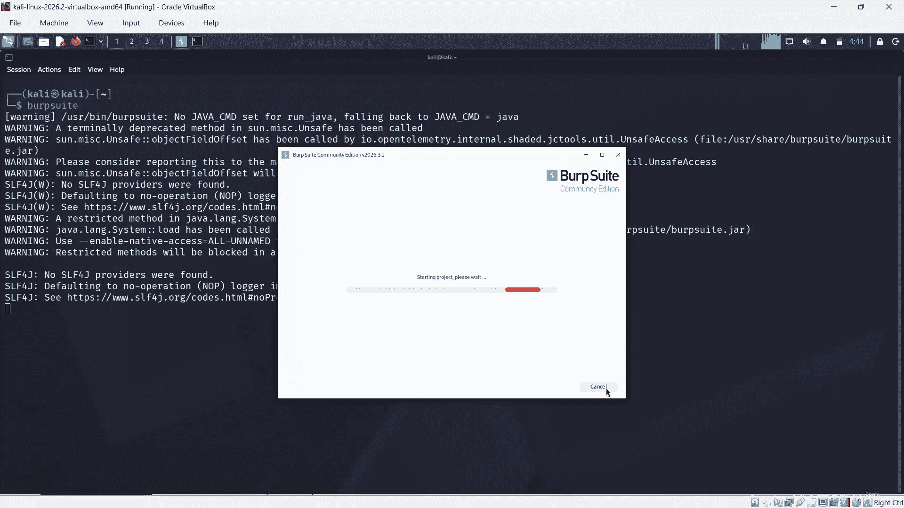
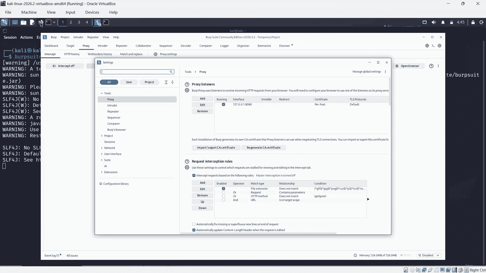
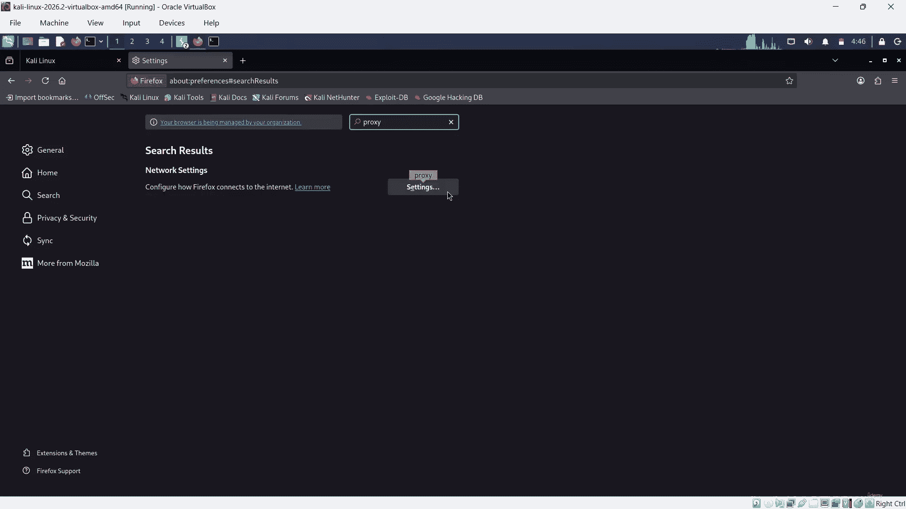
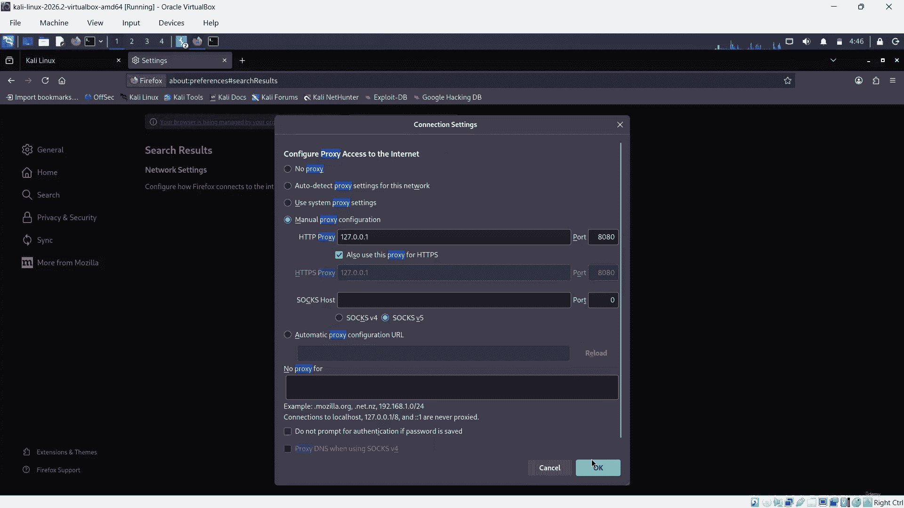
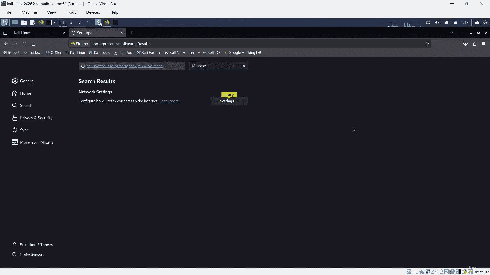
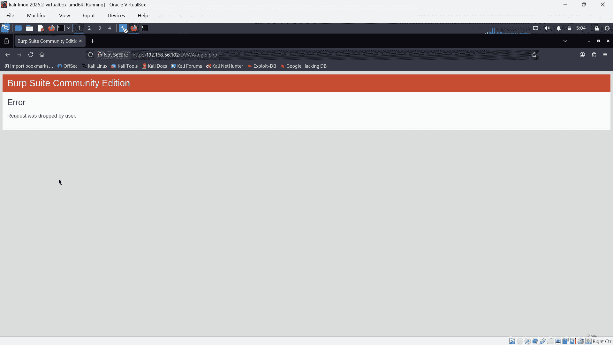

# Udemy - Ethical Hacking & Penetration Testing with Kali Linux：48：Configuring Burp Suite as a Proxy 🛡️

## 概述

在本节课中，我们将学习如何在 Kali Linux 上启动 Burp Suite Community 版本，并将其配置为拦截代理。我们还会配置 Firefox 浏览器，让它把流量发送给 Burp Suite。完成本节后，你将能够捕获和查看浏览器发出的 HTTP 请求。

## 启动 Burp Suite



Burp Suite Community 版本已经预装在 Kali 系统中。你可以从应用程序菜单中打开它，或者在终端里输入命令并回车。

启动命令如下：

```bash
burpsuite
```

启动后程序会开始加载，你需要等待界面完全显示出来。

以下是首次启动时需要完成的设置步骤：

- 点击接受许可协议。
- 选择临时项目，因为我们不需要保存本次会话。
- 接受默认配置，直接点击启动。
- 等待 Burp Suite 完全加载。

## 配置代理监听



上一节我们介绍了如何启动 Burp Suite，本节中我们来看看如何确认它的监听地址。打开 Burp Suite 主界面，进入 Proxy 选项卡，然后选择 Intercept 子选项卡。默认情况下拦截功能已经开启。



接下来检查代理设置。Burp Suite 的监听地址和端口号如下：

```text
127.0.0.1:8080
```

这表示 Burp Suite 正在本机回环地址的 8080 端口监听。保持默认配置即可，不需要修改。



需要注意的是，Burp Suite 只是在那里监听，如果不告诉浏览器把流量经过它，它本身不会做任何事情。

## 在 Firefox 中配置代理



上一节我们确认了 Burp Suite 的监听设置，本节中我们来看看如何让 Firefox 把流量发送给它。打开 Firefox 设置，搜索代理设置，然后选择手动代理配置。

以下是需要填写的代理信息：

- HTTP 代理：127.0.0.1
- 端口：8080
- 勾选“同时对 HTTPS 使用此代理”

保存设置后，浏览器发出的每一个请求都会先经过 Burp Suite，然后才会离开你的机器。

## 拦截流量

配置完成后，回到 Burp Suite，确保 Intercept 开关已经打开。此时我们可以产生一些流量，观察请求是否被捕获。

以 DVWA 登录页面为例，使用 Kali 的 IP 地址访问，网址如下：

```text
192.168.56.102/DVWA/login.php
```

访问后你会发现 Firefox 页面还没有打开，而是处于等待状态。这时切换回 Burp Suite，你可以看到它已经捕获到了原始 HTTP 请求。

如果你点击 Forward，请求会被放行，页面就会正常加载。如果你点击 Drop，请求会被丢弃，用户会看到错误页面。这样 Burp Suite 就已经成功配置，并正在拦截我们的流量了。

## 下一课预告

下一节课，我们将做比单纯转发请求更有趣的事情。我们会捕获一次真实的登录提交，并使用 Burp Suite 的 Repeater 工具来修改和重新发送请求。

## 总结



本节课中我们一起学习了如何启动 Burp Suite、确认代理监听地址、在 Firefox 中配置手动代理，以及如何拦截和放行 HTTP 请求。现在你已经掌握了把浏览器流量引导到 Burp Suite 进行拦截的基本方法。

