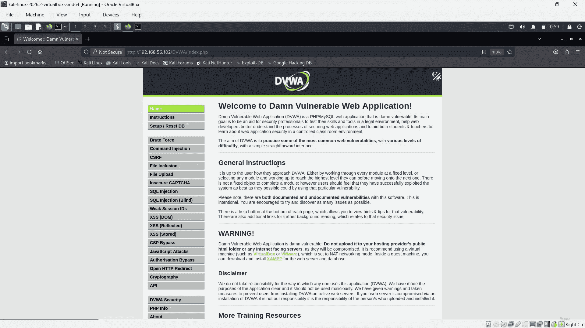

# Kali Linux Web 渗透测试：01：🎯 课程概述与学习目标


在本节课中，我们将一起学习如何使用 Burp Suite 中的 Repeater 功能，来截获并修改网页登录请求。这是一个非常实用的网络安全技能，也是后续进行 SQL 注入和跨站脚本攻击测试的基础。我们会先确保测试环境处于未登录状态，然后在浏览器中提交登录表单，让 Burp 把这个请求拦截下来。接着我们会把请求发送到 Repeater 面板，修改其中的用户名参数，再次发送，观察服务器返回什么样的响应。通过这个过程，你能直观地看到明文 HTTP 协议下的密码传输风险，也能掌握不需要反复在浏览器里填表就能测试不同输入的高效方法。下面我们就开始正式的教学内容。

# Kali Linux Web 渗透测试：02：🚪 确保登出 DVWA 与开启 Burp 拦截

上一节我们介绍了本节课的整体目标，本节中我们来看看如何准备好测试环境。

在捕获任何请求之前，我们需要确认自己当前处于完全登出的状态。如果你在上一节课之后仍然登录在 DVWA 里，请立刻点击左侧边栏中的登出按钮。这一步看起来很简单，但实际上非常重要。因为如果浏览器里还绑定着一个已经验证通过的会话 Cookie，那么哪怕你在登录表单里输入错误的账号密码，或者后来手动修改了请求内容，服务器也可能直接把你当成合法用户放行。这样一来，后面我们修改请求参数的实验就毫无意义了，因为服务器根本不会去检查你提交的用户名和密码。只有先登出，才能保证我们即将捕获的请求是一次真正的未认证登录尝试。接下来，请确认 Burp Suite 的拦截功能仍然处于开启状态，这样浏览器发出的登录请求就会被 Burp 暂停下来，等待我们查看。

以下是本节需要确认的操作步骤。

- 点击 DVWA 左侧边栏的 Logout 按钮，完成登出。
- 检查 Burp Suite 的 Intercept 开关是否处于开启状态。
- 确认浏览器不再携带有效的 DVWA 会话 Cookie。

# Kali Linux Web 渗透测试：03：🌐 在浏览器中提交登录表单

上一节我们介绍了如何登出并开启拦截，本节中我们来看看如何在浏览器中提交登录请求。

登出完成并且 Burp 拦截已开启后，我们就可以在 Firefox 浏览器中打开 DVWA 页面了。页面加载出来之后，不要急着点击登录，先重新加载一次页面，确保当前没有残留的登录状态。然后在用户名输入框里填入 admin，在密码输入框里填入 password，最后点击登录按钮。这时候你会发现页面似乎卡住了，没有立刻跳转到仪表盘，这其实是正常现象，因为 Burp 已经把这个登录请求拦截住了，没有把它转发给服务器。请不要关闭页面，也不要重复点击登录，保持当前状态，我们接下来要去 Burp 里查看这个被拦截的请求长什么样。

# Kali Linux Web 渗透测试：04：🔍 查看被拦截的登录请求

上一节我们介绍了如何在浏览器中提交登录表单，本节中我们来看看 Burp 捕获到的请求具体包含什么内容。

现在请切换到 Burp Suite 的 Proxy 选项卡，你应该能看到一个被暂停的 HTTP 请求。与上一节课我们分析的简单页面加载请求不同，这次捕获到的是一个 POST 请求。请把请求内容滑动到最底部，你就能看到实际提交的表单数据，也就是用户名和密码。这些信息以完全明文的形式展现在你面前，没有任何加密或混淆。这正是我们在模块 2 里使用 Wireshark 捕获未加密网络流量时遇到的那个明文传输漏洞。DVWA 默认使用明文 HTTP 运行，因此会暴露出完全相同的安全弱点。不同的是，这次你不是在被动地观察网络流量，而是直接通过一个专门针对 Web 应用主动测试的工具来查看和处理请求。

以下是本节捕获请求的关键特征。

- 请求方法为 POST，而不是 GET。
- 用户名和密码位于请求体的最底部。
- 凭据以明文形式传输，任何中间节点都可以直接读取。

核心概念描述如下。

```
HTTP 请求方法：POST
表单数据示例：username=admin&password=password
传输协议：http:// 而非 https://
```

# Kali Linux Web 渗透测试：05：🔄 将请求发送到 Burp Repeater

上一节我们介绍了如何查看被拦截的登录请求，本节中我们来看看如何把请求发送到 Repeater 进行编辑。

既然我们已经拿到了这个登录请求，接下来可以尝试一些新操作了。请在被捕获的请求内容区域任意位置点击右键，然后从菜单中选择“发送到 Repeater”（Send to Repeater）。操作完成后，请切换到 Burp Suite 的 Repeater 选项卡，你就会看到刚才捕获的那条请求静静地躺在一个可编辑的面板里。这确实是整个 Burp Suite 中最实用的工作流程之一。Repeater 让我们可以拿到任何被捕获的请求，随意修改其中的任意部分，比如参数值、请求头，甚至是 URL 路径本身，然后把修改后的版本重新发送出去，并观察服务器返回的响应。整个过程不需要回到浏览器里手动重新填写整个表单，节省了大量时间。

以下是将请求发送到 Repeater 的操作要点。

- 右键点击捕获到的请求内容。
- 选择 Send to Repeater 选项。
- 切换到 Repeater 选项卡查看可编辑的请求面板。

核心概念描述如下。

```
Repeater 工作流：捕获请求 → 发送到 Repeater → 修改请求内容 → 点击 Send → 查看响应
```

# Kali Linux Web 渗透测试：06：✏️ 在 Repeater 中修改请求参数

上一节我们介绍了如何将请求发送到 Burp Repeater，本节中我们来看看如何修改其中的用户名参数。

现在我们可以实际尝试修改请求里的内容了。请在 Repeater 面板的请求体中找到用户名参数，也就是 username 字段。把原来的 admin 改成别的内容，例如 wrong user，然后点击发送按钮。发送完成后，请查看出现的响应面板。你应该会看到与成功登录完全不同的内容，很可能是一个错误提示，或者是登录表单被重新显示出来，而不是 DVWA 的实际仪表盘。这说明服务器正确地拒绝了我们修改后的无效凭据，验证了我们的修改真的生效了，而不是被浏览器缓存或会话给覆盖掉了。

以下是修改请求参数的具体步骤。

- 在 Repeater 请求体中找到 username 参数。
- 将值从 admin 改为 wrong user。
- 点击 Send 按钮发送修改后的请求。

核心概念描述如下。

```
修改前：username=admin
修改后：username=wrong user
```

# Kali Linux Web 渗透测试：07：📥 发送修改后的请求并查看响应

上一节我们介绍了如何在 Repeater 中修改请求参数，本节中我们来看看如何分析服务器返回的响应结果。

修改并发送请求之后，Repeater 会立即显示服务器返回的响应内容。你可以对比一下，之前成功登录时会看到 DVWA 的仪表盘页面，而现在因为我们提交了错误的用户名，服务器返回的应该是登录失败提示，或者是重新渲染的登录表单。这个现象非常直观地证明，我们在 Repeater 里对请求所做的修改，确实被服务器收到了并做出了相应的处理。接下来，请回到 Burp 的 Proxy 选项卡，暂时关闭拦截功能。这样做是为了防止在后续探索过程中，每个请求都需要手动点击转发，影响操作效率。

# Kali Linux Web 渗透测试：08：🔒 关闭拦截并重新登录 DVWA

上一节我们介绍了如何查看修改请求后的服务器响应，本节中我们来看看如何恢复正常的测试状态。

在结束本节课之前，我们需要用正确的凭据重新登录 DVWA，这样后续模块的环境就准备就绪了。请在浏览器中再次输入用户名 admin 和密码 password，然后完成登录。这样我们就可以带着一个正常的已登录会话进入下一节课了。这一步看似是收尾工作，但实际上很重要，因为接下来的 SQL 注入和跨站脚本测试都需要在一个稳定的 DVWA 环境中进行。

# Kali Linux Web 渗透测试：09：📚 课程总结与下一模块预告

上一节我们介绍了如何关闭拦截并重新登录 DVWA，本节中我们来回顾本节课所学的全部内容，并展望下一节课。

本节课我们一起构建了对 Web 应用攻击面的真实理解，学习了 OWASP Top 10 作为共同的安全词汇，搭建了本地运行的 DVWA 靶场，并正确配置了 Burp Suite 作为拦截代理，还亲手使用 Repeater 捕获并操纵了真实的登录请求。下一节课我们将把这些知识直接付诸实践，手动利用 SQL 注入漏洞导出整个用户数据库，并使用跨站脚本漏洞在页面中注入可执行的代码。这两个漏洞类别是整个网络安全领域中最具有影响力的两类，我们将使用刚才一起搭建好的 DVWA 环境和 Burp Suite 技能来完成实验。下节课见。



本节课中我们一起学习了如何使用 Burp Repeater 截获并修改登录请求，理解了明文 HTTP 传输的风险，并掌握了无需重复填表即可测试不同输入的高效工作流。

