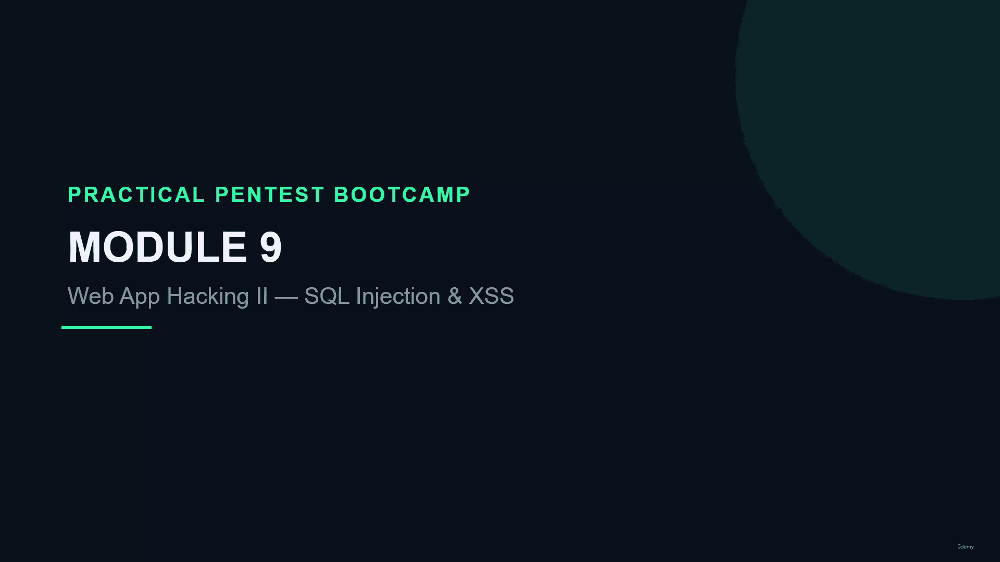
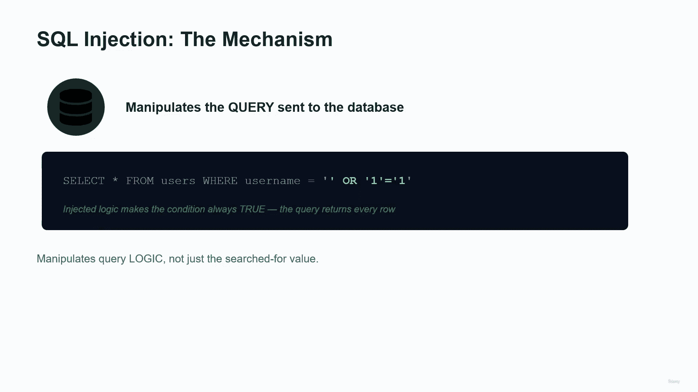
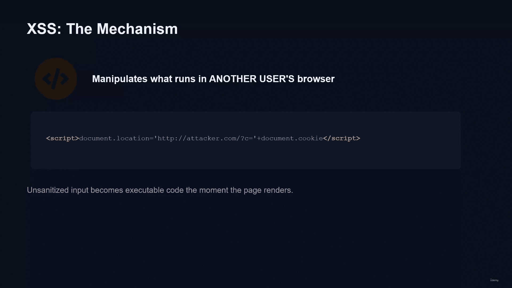
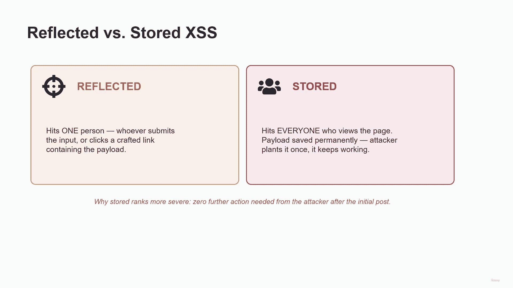
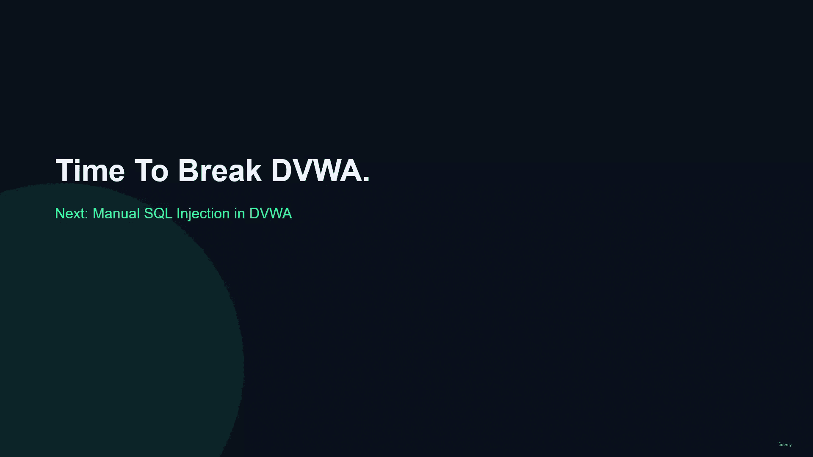

# 🛡️ Udemy - Ethical Hacking & Penetration Testing with Kali Linux：50：SQL注入与XSS详解



## 本节课概述

在本节课中，我们将一起学习Web安全领域中两种最经典的攻击方式，分别是SQL注入和跨站脚本攻击。这两种攻击在整个领域的历史上非常出名，并且直到今天，在真实的生产系统中依然随处可见。尽管这些漏洞已经存在几十年了，但它们仍然是攻击者经常利用的目标。我们将使用上一节一起搭建好的DVWA和Burp Suite环境，进行动手实践，直接攻破DVWA。

## SQL注入的核心原理

上一节我们介绍了渗透测试环境的搭建方法，本节中我们先来看看SQL注入是如何工作的。绝大多数Web应用程序都需要把数据存储在数据库中，而且应用程序与数据库的对话是使用一种名为SQL的语言来完成的，SQL的全称是结构化查询语言。当应用程序需要获取数据时，它会构建一条SQL查询语句。很多应用程序会把用户输入的内容直接作为文本插入到查询语句中。

SQL注入的本质是应用程序没有正确地把实际的SQL命令结构与用户提供的数据分隔开。如果攻击者能够注入在SQL中具有特殊含义的字符，比如单引号或者OR关键字，直接放进查询语句里，那么就可以从根本上改变查询语句真正执行的操作。攻击者不仅仅是为查询提供一个搜索值，而是直接改变了查询的逻辑结构。这才是几乎所有SQL注入攻击的核心机制，操纵的是查询的逻辑，而不是仅仅操纵它的数据。

为了让你更直观地理解，我举一个简化的例子。假设应用程序在后台构建这样的查询语句。

```sql
SELECT * FROM users WHERE username = '用户输入的内容';
```

如果一个正常用户在登录框里输入admin，查询语句就会变成针对这个特定用户名的正常搜索。但是，如果攻击者输入类似单引号加上or one equals one的内容，那么整个查询语句的逻辑结构就会被改变。原本的“查找这个特定用户”变成了“查找所有用户”，因为注入的条件恒成立。

```sql
SELECT * FROM users WHERE username = '' OR 1=1 --';
```

以下是SQL注入成功后可能带来的后果。



- 完全绕过登录表单，无需密码即可进入系统。
- 提取整个数据库的内容，包括用户名、密码哈希和个人信息等。
- 在严重情况下，直接修改或删除数据库中的数据。

还要记得我们上一节提到的OWASP Top 10名单，注入漏洞排在第三位，而SQL注入正是这个类别中最具代表性的旗舰示例。

## XSS的核心原理

在讲完SQL注入之后，我们继续来看看完全不同的另一种机制，即跨站脚本攻击，也就是XSS。虽然XSS经常和SQL注入一起被提及，但它们的工作原理完全不同。SQL注入操纵的是数据库查询，而XSS操纵的是网页在另一个用户浏览器中显示和执行的内容。



XSS发生的情况是，应用程序把用户输入直接显示在页面上，却没有事先正确地中和其中的HTML或JavaScript字符。如果攻击者能够让自己的JavaScript代码在另一个用户的浏览器会话中真正执行，就能做出非常严重的事情。例如，窃取该用户的会话Cookie，从而劫持其登录会话，或者把用户重定向到恶意网站，还可以在用户不知情的情况下替其执行操作。

我希望你理解XSS的两个具体类别，因为我们今天将会分别动手利用它们，而且二者之间的区别对于理解现实世界中的危害程度非常重要。

以下是反射型XSS的特点。

- 恶意输入会在响应同一请求的页面中立即反射回来。
- 攻击只影响提交该恶意输入的特定人员，或者被诱骗点击包含该内容的特制链接的人。

以下是存储型XSS的特点。



- 恶意输入会被永久保存在服务器上，比如在评论字段、留言板帖子或用户简介中。
- 恶意内容随后会提供给之后访问该页面的每一个访问者。
- 攻击者无需任何进一步操作，一个静静放在热门论坛帖子中的存储型XSS负载，有可能在任何人注意到之前就影响数千名访问者。

## 与OWASP Top 10的关系及实验环境说明

SQL注入直接属于注入类别，而XSS在早期的OWASP Top 10列表中曾经有自己独立的类别，因为它的危害足够显著。在我们上一节讲解的当前版本中，XSS同样被包含在更广泛的风险类别之中。

在动手实践之前，还有一个实际的注意事项。在本模块的整个过程中，我们都将使用低安全级别的DVWA，这与我们在模块8中配置的方式完全一样。低安全级别故意禁用了DVWA内置的输入净化和保护机制，为我们提供了一个真正脆弱的练习目标。你需要清楚，这与一个安全性良好的现代应用程序相比是故意不现实的，但恰恰是此时的重点所在。你需要先看到这些攻击能够干净利落地成功，理解其原始机制，然后才能准备好去面对现实世界中那些拥有部分不完善防御的应用程序。

## 本节小结

本节课中，我们一起学习了SQL注入和跨站脚本攻击的基本原理。SQL注入操纵的是查询语句，而XSS操纵的是在别人浏览器中执行的内容。反射型XSS一次只攻击一个人，而存储型XSS会攻击所有访问该页面的人。我们还回顾了OWASP Top 10框架，并确认了实验将使用低安全级别的DVWA进行。

## 下一节预告



下一节课中，我们将只使用一个单引号和一些SQL逻辑，就把DVWA的登录系统彻底攻破。

