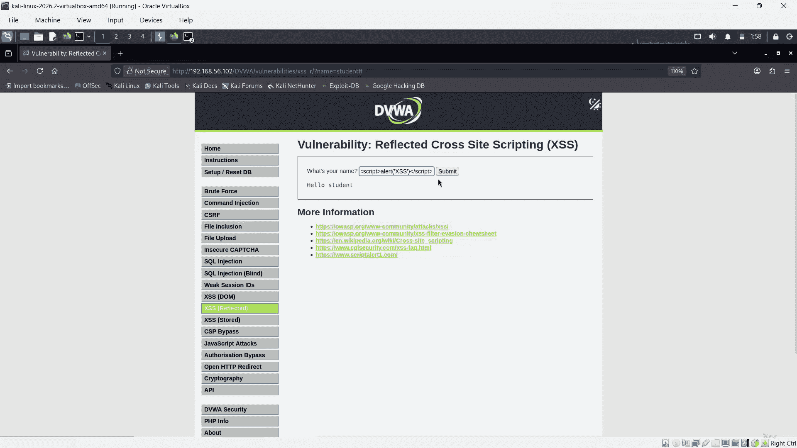
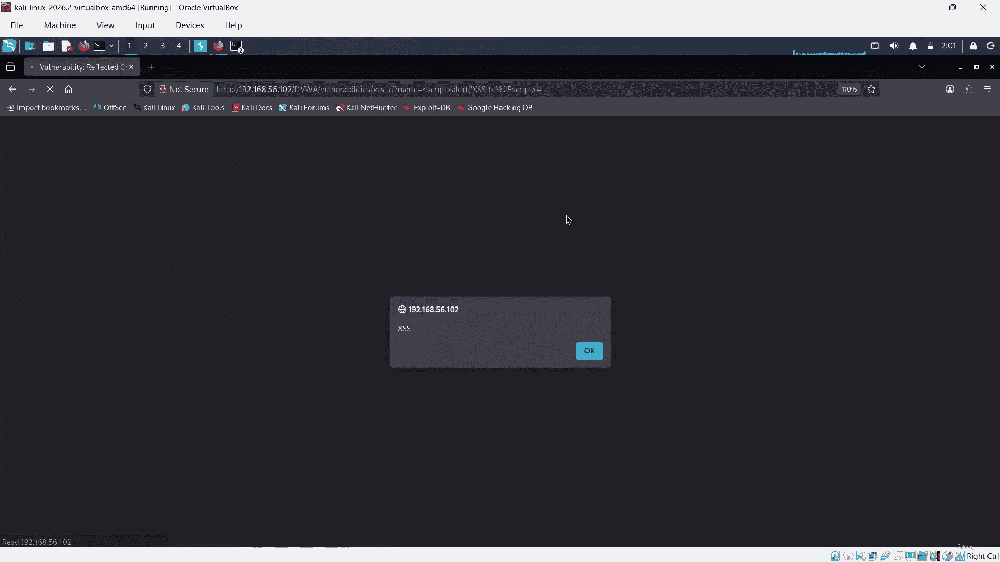
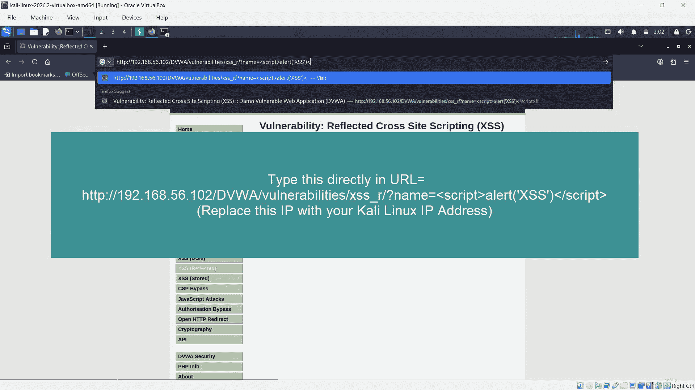
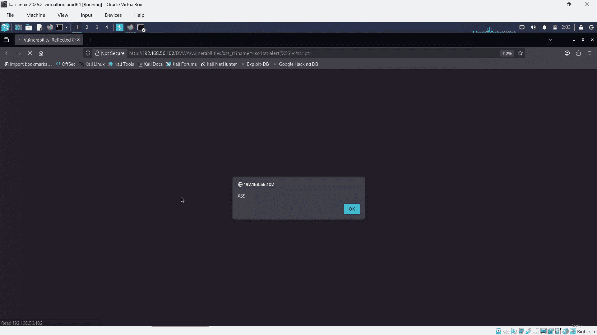

Web渗透测试与Kali Linux：53：反射型跨站脚本攻击（Reflected XSS）🌐

在本节课中我们将要学习反射型跨站脚本攻击，也就是 Reflected XSS。我们会把注意力完全从数据库操作转移到浏览器端的攻击上来，先认识最常见的反射型 XSS 漏洞，再看看它是如何在网页里执行恶意脚本的，最后通过地址栏参数演示攻击者实际会怎么利用这个问题。

上一节课我们主要讲解了数据库相关的漏洞利用，本节中我们来看看浏览器侧的安全问题。在 DVWA 靶场里找到 XSS reflected 页面，进入之后你会看到一个非常简单的表单，页面会要求你输入姓名，然后在屏幕上显示一条友好的问候语，而且会把你输入的内容原样放进问候语里。

以下是正常输入的完整操作步骤：

- 在名字输入框里填入 student
- 点击提交按钮
- 查看页面返回的问候语



页面会回显一句 Hello student，这说明应用程序把我们输入的文本原原本本地显示出来了，没有做任何改动，属于正常预期的行为，没有任何异常情况出现。

接下来我们把正常的名字换成一段测试用的脚本代码。在输入框里输入以下载荷：

```html
<script>alert('XSS')</script>
```

提交之后，浏览器会直接弹出一个 JavaScript 警告框，里面显示 XSS。这个警告框就证明了我们输入的脚本被当成了真正的代码在页面里执行，而不是被当成普通文本显示。

那么刚才到底发生了什么呢？应用程序把我们输入的内容直接插进了 HTML 页面，却没有把小于号和大于号这些定义 HTML 标签的特殊字符进行过滤或转义。浏览器拿到这段 HTML 之后，看到里面真实存在一个 script 标签，就会老老实实地执行标签里面的 JavaScript 代码。本例中只是一个无害的弹窗，但攻击者完全可以把这里换成任何别的脚本。

可以把这个漏洞触发过程简单理解为以下公式：

用户输入 → 原样插入 HTML → 浏览器解析并执行脚本

弹窗看起来无害，但实际上这只是冰山一角。攻击者的真实载荷可能会悄悄读取当前页面的会话 Cookie，也就是通过 JavaScript 的 document.cookie 属性拿到 Cookie 值，然后立刻把这些被窃取的 Cookie 发送到攻击者控制的服务器上，受害者在屏幕上完全感觉不到任何异常。

攻击者常用的窃取方式包括以下几种：

- 在页面里运行恶意 JavaScript 代码
- 调用 document.cookie 获取会话凭证
- 把被窃取的 Cookie 发送到攻击者控制的远程服务器

攻击者拿到这个会话 Cookie 之后，就有可能在不需要知道受害者真实密码的情况下，冒充受害者的整个登录会话，进行未授权的操作。



那为什么特别把它叫做反射型 XSS 呢？因为这个攻击只会影响当前提交恶意输入的那个人，也就是发起这个请求的用户本人。如果要用来攻击真正的受害者，攻击者通常需要构造一个带有恶意载荷的链接，把载荷直接嵌进 URL 里，然后通过钓鱼邮件、伪造的客服消息，或者受害者信任的其他渠道，诱导受害者点击这个链接。



接下来我们不再使用表单，而是直接在浏览器地址栏里构造带参数的 URL，把同样的脚本载荷放进去。

访问这个特制链接后，浏览器会再次弹出同样的警告框，而且完全不需要填写任何表单。这正是真实钓鱼式攻击所依赖的机制。

我们刚才在表单里完成的操作，这次直接在 URL 地址栏里实现了一样的效果，脚本内容没有任何变化，只是输入位置从表单字段移到了地址栏参数里。



好了，本节课中我们一起学习了反射型跨站脚本攻击的基本原理，演示了如何在 DVWA 的 XSS reflected 页面里注入脚本，分析了浏览器为何会执行恶意代码，讨论了窃取会话 Cookie 带来的危害，并说明了攻击者如何通过精心构造的恶意链接诱导受害者点击。下一节课我们将学习更危险的变体，即存储型 XSS，它的载荷不需要受害者点击特殊链接就会触发。
