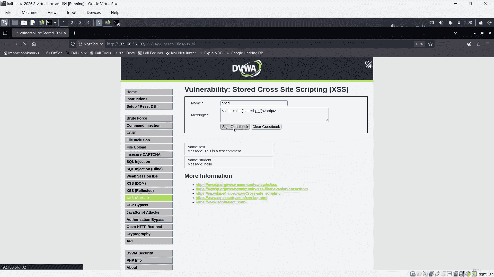
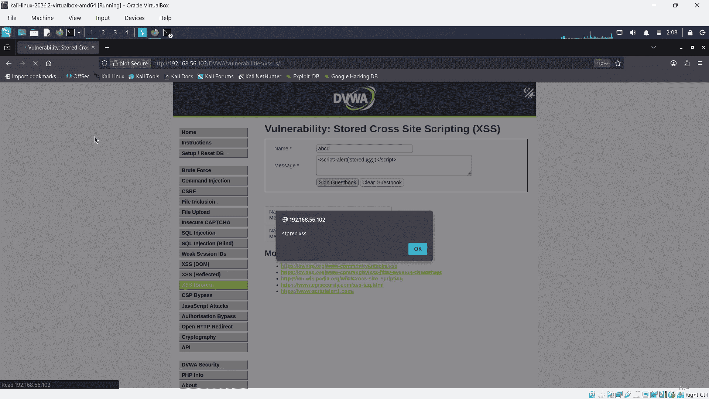
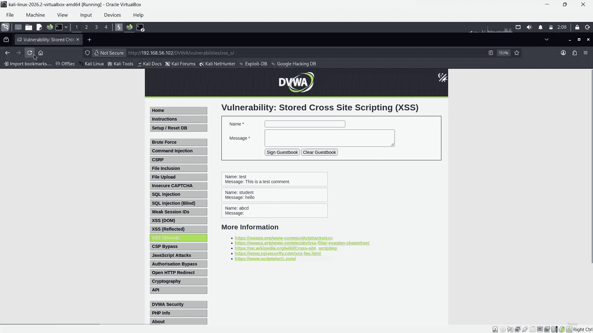
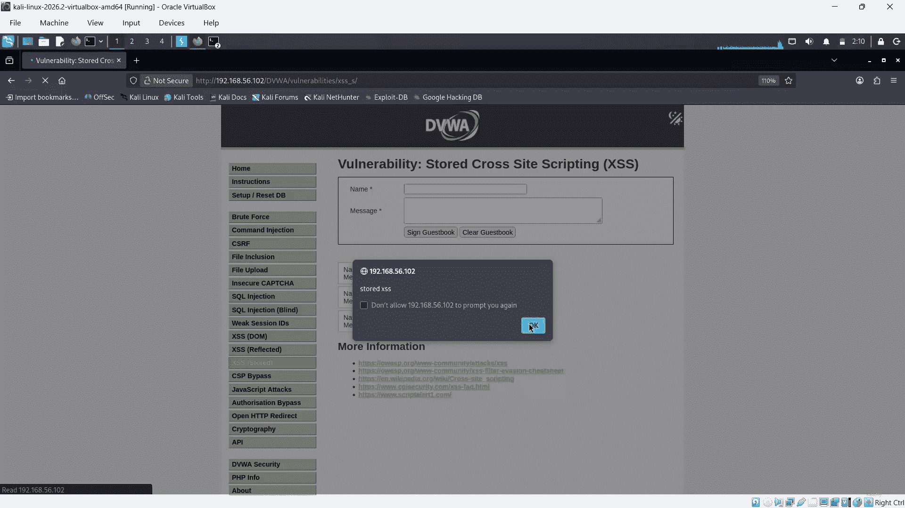
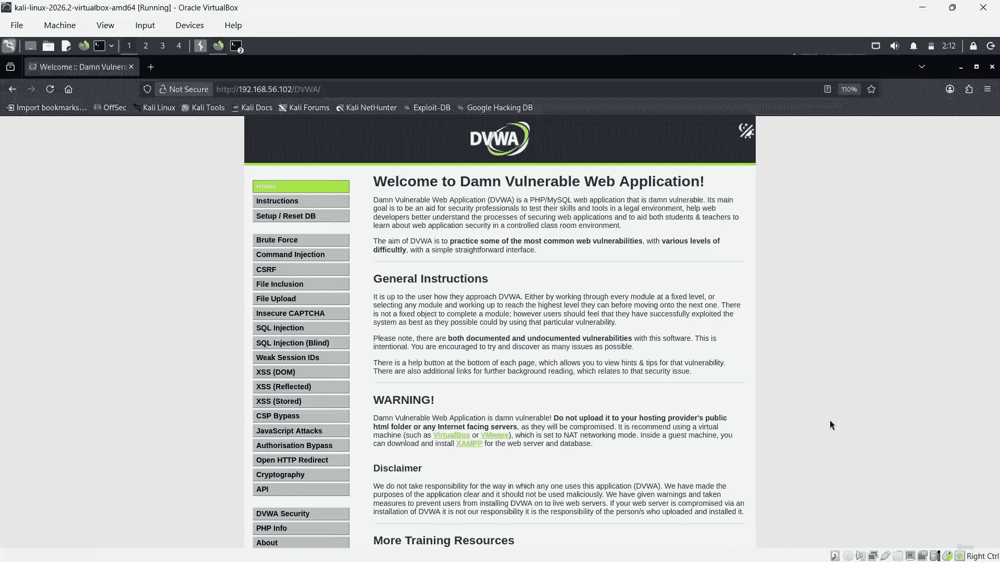

# Kali Linux 道德黑客与渗透测试：54：存储型跨站脚本（Stored XSS） 🕷️

在本节课中，我们将学习存储型跨站脚本漏洞，也就是 Stored Cross-Site Scripting。这是我们上一节课探讨过的反射型跨站脚本的更危险变体。你将了解如何在 DVWA 的留言本功能中注入恶意脚本，观察浏览器如何自动执行代码，并理解为什么这种漏洞在实际渗透测试中威胁更大。我们还会学习如何清理测试数据，保持专业操作习惯。

接下来，我们先来认识一下什么是存储型跨站脚本，以及它和刚才学过的反射型跨站脚本有什么本质区别。

存储型跨站脚本是一种将恶意脚本永久保存在目标系统中的攻击方式。攻击者只需将脚本提交一次，之后所有访问该页面的用户都会在浏览器中自动执行这段代码，而不需要再点击任何精心构造的链接。与之形成对比的反射型跨站脚本，则需要受害者主动点击包含恶意载荷的链接才能触发。我们可以用下面这个简单的伪代码流程来描述存储型跨站脚本的工作原理：

```text
攻击者提交恶意脚本 → 脚本被保存到数据库 → 普通用户访问页面 → 服务器从数据库读取脚本 → 脚本插入页面 HTML → 浏览器自动执行脚本
```



下面是反射型与存储型跨站脚本的主要区别对比：

- 触发方式：反射型需要点击恶意链接，存储型只需访问页面即可自动触发。
- 影响范围：反射型通常只攻击单个点击链接的用户，存储型会攻击所有访问该页面的用户。
- 持久性：反射型脚本不会被保存，存储型脚本会持久保存在服务器中。
- 攻击成本：反射型需要诱导每个受害者点击，存储型只需投放一次即可长期生效。





接下来，我们进入 DVWA 环境，实际演示如何利用存储型跨站脚本。DVWA 是一个内置了多种漏洞练习场景的靶场，其中的留言本功能非常适合用来展示这种攻击。

留言本页面包含一个简单的表单，分别有姓名字段和留言字段。当用户提交内容后，条目会被永久保存，并且任何之后访问这个页面的人都能看到这些条目。下面是我们在演示中会用到的脚本载荷示例：

```html
<script>alert('Stored XSS')</script>
```

操作步骤如下：

- 在 DVWA 中导航到存储型跨站脚本页面，也就是留言本功能。
- 先提交一条普通内容，例如姓名填写 student，留言填写 hello，确认条目正常显示在留言本下方。
- 确认这条普通条目会一直保留在页面上，直到有人手动删除它为止。
- 接着再次提交表单，姓名正常填写，例如 ABC D，在留言字段中输入同样的脚本载荷，例如 <script>alert('Stored XSS')</script>。
- 提交表单，观察浏览器是否立即弹出警告框。

提交恶意脚本之后，我们会看到浏览器立即弹出警告框，这和反射型跨站脚本的表现很像。不过这里有一个真正关键的区别，就是当我们刷新页面之后，警告框会再次自动出现，而这次完全不需要重新提交表单。

发生这种情况的原因很好理解。我们的恶意载荷现在已经永久保存在 DVWA 的数据库中，变成了一条存储的留言本条目。每次页面对任何访问者加载时，应用程序都会从数据库中读取这条条目，并直接把它插入到页面的 HTML 代码里。这和反射型示例中处理姓名字段的方式类似，只不过现在这个过程会自动对每个人发生，并且可以无限期持续，而不需要攻击者诱导任何人点击特制的链接。

现在我们来认真思考一下，为什么存储型跨站脚本在实际的漏洞评估中比反射型跨站脚本严重得多。



想象一下，如果这个完全相同的脚本载荷出现在一个热门公共论坛的帖子里，或者一个繁忙网站的产品评论区、评论回复中，而不是我们这个小小的 DVWA 留言本里。查看该页面的每一个访客，哪怕是成千上万甚至更多人，都会在浏览器中静默执行这段载荷。攻击者在初次发布之后，不需要再做任何额外的事情。攻击者只需要策划一次，这个漏洞就会无限期地对所有人持续生效。

在结束本模块之前，我们还需要清理一下测试过程中留下的内容。

你可以查看留言本条目，然后点击界面上的清空留言本按钮，把测试数据全部删除。不过不同版本的 DVWA 界面可能有所不同，如果你的版本里没有直接删除条目的功能，那对我们的实验练习来说也完全没问题。只需要记住，在真实的渗透测试环境中，清理这种测试载荷是非常重要的专业礼仪，不能把垃圾数据留在客户的系统里。

至此，我们关于手动 SQL 注入和跨站脚本的整个模块就全部结束了。让我们回顾一下本节课以及整个模块的核心内容。

我们一起学习了 SQL 注入，包括手动基于联合查询的数据提取，以及使用 sqlmap 进行全自动化利用。我们还实操了反射型跨站脚本和存储型跨站脚本，并真正理解了存储型跨站脚本代表同一底层缺陷的更严重变体。核心载荷示例如下：

```html
<script>alert('Stored XSS')</script>
```



在下一模块中，我们将转向密码攻击，利用我们今天已经接触过的凭据和哈希值，使用 Hydra、John the Ripper 和 Hashcat 等工具来实际破解它们。我们在那里见。

