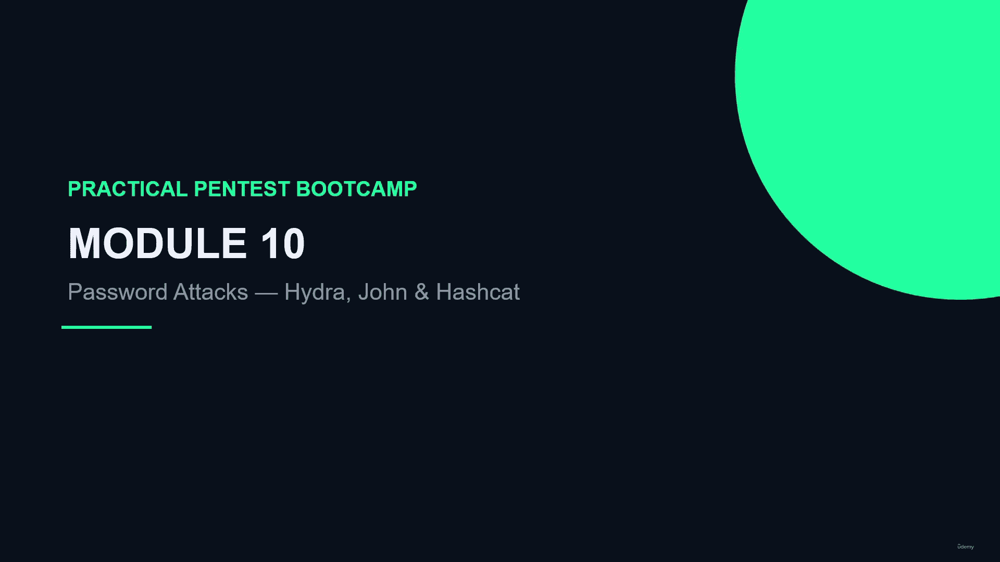
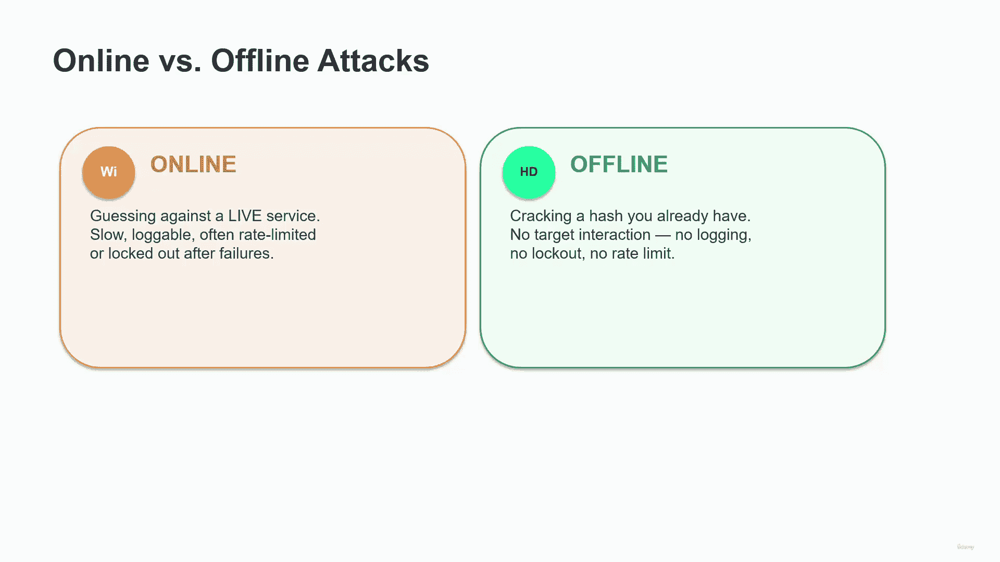
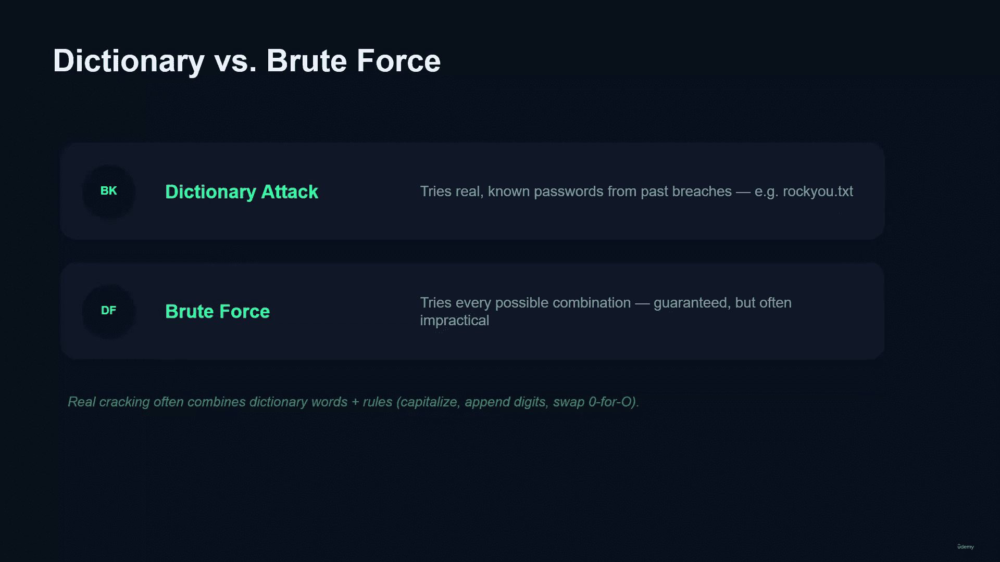
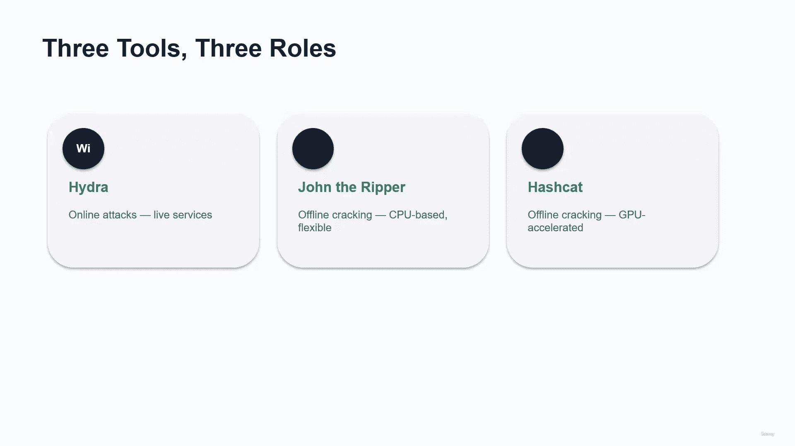

# 道德黑客与Kali Linux渗透测试：55：密码攻击理论 - 在线与离线、字典与暴力破解 🔐


在本节课中，我们将学习密码攻击的核心理论。密码至今仍然是安全领域中真正的第一个现实世界弱点，尽管本课程涵盖了其他所有内容。我们将以三种不同方式破解密码：在线、离线和GPU加速。我希望你明白真正的专业人士在什么情况下会选择每种特定方法，而不仅仅是如何运行每个工具。还会介绍为什么在开始破解之前，必须先完成哈希识别这一步骤。所有内容都会用大白话解释，确保初学者也能看懂。


## 一、在线攻击与离线攻击




以下是两种攻击模式的详细对比。


在线攻击指的是针对正在运行的活动服务进行密码猜测。例如，尝试登录真实的SSH服务器，或者像模块9中攻击过的网页登录表单。每一次猜测都必须穿过网络，等待目标服务返回响应，下一次猜测才能开始。


在线攻击的核心流程可以用下面这个公式描述：


```
在线攻击 = 猜测密码 -> 通过网络发送 -> 等待目标服务响应 -> 进行下一次猜测
```


这种方式天生缓慢，而且非常容易被发现。活跃服务会记录失败登录尝试，许多服务在几次失败后会限制访问频率，或者直接锁定账户。这正是真实目标可能配置的防御行为，也就是说，在线攻击天然带有噪音，不适合隐蔽渗透。


离线攻击完全不同，威力也大得多。这意味着你已经拿到了真实的密码哈希，就像上一节通过SQL注入从DVWA数据库提取的哈希一样。现在你在自己的机器上尝试破解这个哈希，完全不与目标的活跃系统进行任何交互。


离线攻击的核心流程可以用下面这个公式描述：


```
离线攻击 = 获取密码哈希 -> 在本地机器上破解 -> 不与目标系统交互
```




这一阶段没有速率限制，没有账户锁定，目标这边没有任何登录行为。因为目标在破解阶段已经不再参与。这就是为什么在专业渗透测试中，通过SQL注入等方式获取密码哈希被视为重大发现，它把缓慢、嘈杂、易被检测的攻击，转变为快速、静默、完全不可检测的攻击。


## 二、字典攻击与暴力破解


接下来看实际的破解方法，主要有两种根本不同的思路。


字典攻击使用预构建的候选密码列表。这些列表通常包含真实世界中人们实际使用的常见密码，来源于多年来发生的真实数据泄露。该领域最著名的词表叫做rockyou.txt，包含多年前某公司泄露的数百万个真实密码。Kali Linux预装了这个词表，因为即使在今天，它对真实目标仍然非常有效。人们继续重复使用那些极其可预测的密码。


字典攻击的核心逻辑可以用下面这个公式描述：


```
字典攻击 = 遍历预构建密码列表 -> 逐一尝试 -> 匹配成功则破解
```


相比之下，暴力破解完全不依赖任何预置列表。它在你指定的参数范围内，比如字符集和长度，系统地尝试每一种可能的字符组合，一次一个。理论上，给予无限时间，这能保证最终成功。但是，每增加一个字符，可能的组合总数都会爆炸式增长。针对强哈希，哪怕有强大算力支持，暴力破解超过几个字符也很快变得完全不切实际。


暴力破解的核心逻辑可以用下面这个公式描述：


```
暴力破解 = 系统尝试所有字符组合 -> 受字符集和长度限制 -> 时间随长度指数级增长
```


在实际操作中，大多数成功的密码破解其实使用字典攻击，通常还会结合所谓的规则。规则是对每个词表单词应用的系统化自动变体，例如首字母大写，末尾附加几位数字，或者常见字符替换，比如把字母o替换为数字0，或者大写字母O。这比纯字典攻击或纯暴力破解单独使用，更高效地反映了真实人类的密码创建行为。




## 三、三种工具的具体定位


下面正式介绍今天要用的三种工具，让你在实际操作前了解每个工具的具体角色。


以下是三种工具的简要介绍：


- Hydra：专门用于在线攻击，比如针对运行中的活跃服务主动猜测凭据。
- John the Ripper：成熟灵活的离线破解工具，完全在CPU上运行，适合处理大量不同的哈希格式。
- Hashcat：也是离线破解工具，但专门针对GPU的原生并行处理能力构建。对于合适的哈希类型，它可以比单靠CPU运行的John快得多。


## 四、哈希识别的重要性


动手实操前，还有一个理论点必须讲清楚，即哈希识别。


不同系统和应用使用不同的哈希算法，比如MD5、SHA1、BCrypt等，关键的是，你必须告诉破解工具你正在处理的确切算法。如果搞错了，工具会静默失败，产生零个破解结果。这不是因为词表错了，而仅仅是因为你让它针对完全错误的算法进行测试。我们将在Hashcat课程中直接点名讨论这个问题。




好了，我们回顾一下在线与离线、字典与暴力破解，以及三款各适用特定场景的工具。下一节课我们将从最嘈杂、最老派的方法开始，使用Hydra对活跃的SSH登录进行暴力破解。


在本节课中，我们一起学习了密码攻击的核心理论，包括在线攻击与离线攻击的根本区别，字典攻击与暴力破解的不同适用场景，Hydra、John the Ripper和Hashcat三种工具的具体定位，以及破解前必须完成的哈希识别步骤。


