🔐 道德黑客与 Kali Linux 渗透测试：第 57 课：使用 John the Ripper 破解哈希


在本节课中，我们将学习如何使用 John the Ripper 对离线密码哈希进行破解。我们会把上一节从 DVWA 数据库中提取出来的哈希值保存到一个干净的文本文件里，然后使用字典文件尝试恢复明文密码，最后查看破解结果并了解 John 内部的记录机制。整个流程看起来虽然只有几步，但它串联起了从漏洞利用到密码恢复的完整过程，对理解真实世界的攻击路径非常有帮助。


## 📝 准备哈希文件

上一节我们介绍了如何通过 SQL 注入从数据库中提取密码哈希，本节中我们来看看如何把这些哈希整理成 John the Ripper 能够识别的格式。这一步看起来很简单，但实际上非常重要，因为如果文件格式不正确，John 就无法正常读取，后续的破解工作也就无法进行。

以下是制作哈希文件的具体步骤，请按照顺序操作：

- 打开终端并启动 nano 编辑器
- 创建一个名为 dvwa_hashes.txt 的新文件
- 将提取出来的哈希值逐行粘贴进去，每行只保留一个哈希，不要带用户名
- 保存文件并退出编辑器

在 John 的基本模式下，它期望读取的是一个纯粹的哈希列表，所以不需要附加任何用户名信息。

创建文件的命令如下：

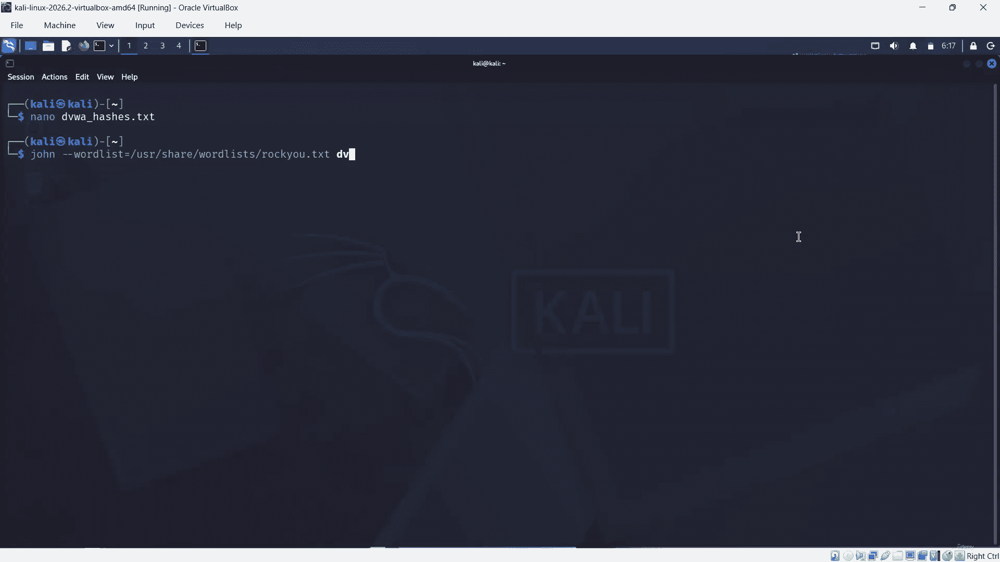

```bash
nano dvwa_hashes.txt
```


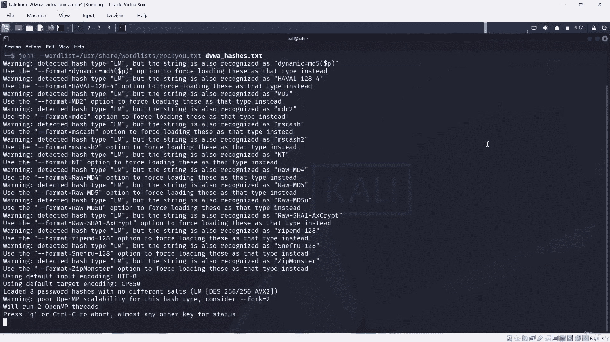

## 🚀 运行 John the Ripper 进行离线破解

接下来我们要对刚才创建的哈希文件运行 John the Ripper，开始离线密码破解。离线破解的意思是说，我们不再需要连接到目标网站或应用程序，而是直接在本地机器上用字典文件去猜测密码，这样既更快，也不会留下太多网络痕迹。

以下是使用 rockyou 字典进行破解的命令：

```bash
john --wordlist=/usr/share/wordlists/rockyou.txt dvwa_hashes.txt
```

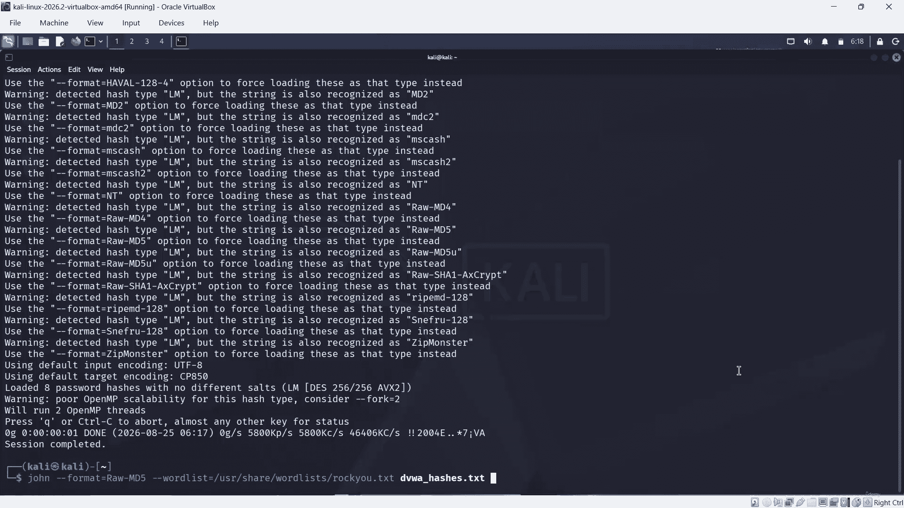

运行之后，你可以观察屏幕输出，John 会尝试将字典中的每个密码与哈希文件中的条目进行比对。


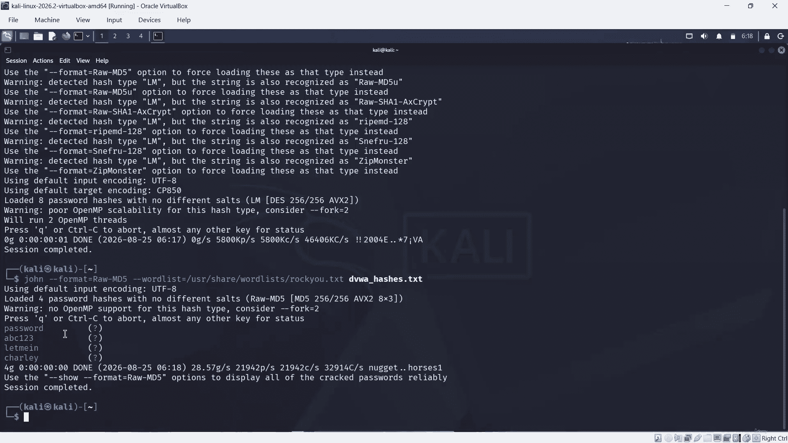

## ⚙️ 指定哈希格式

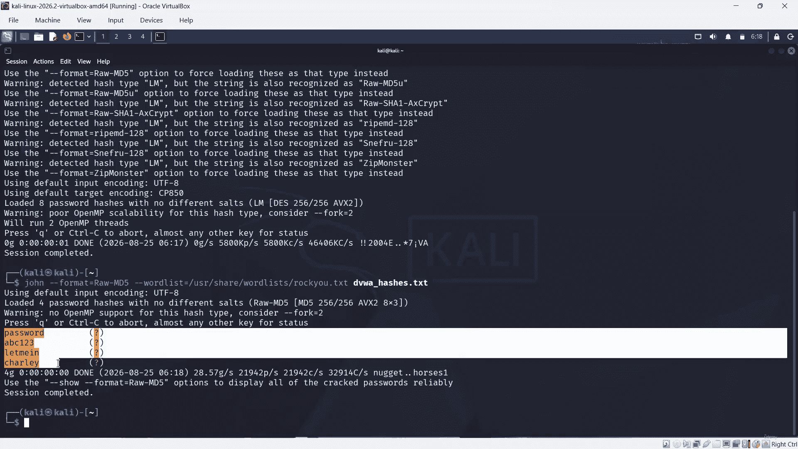

John 初次运行时可能会把这些哈希误认为是 LM 格式，但实际上这些哈希是 MD5 格式。为了让 John 正确识别，我们需要明确指定哈希格式，否则它可能会按照错误的算法去比对，导致破解失败。

以下是带格式参数的破解命令：

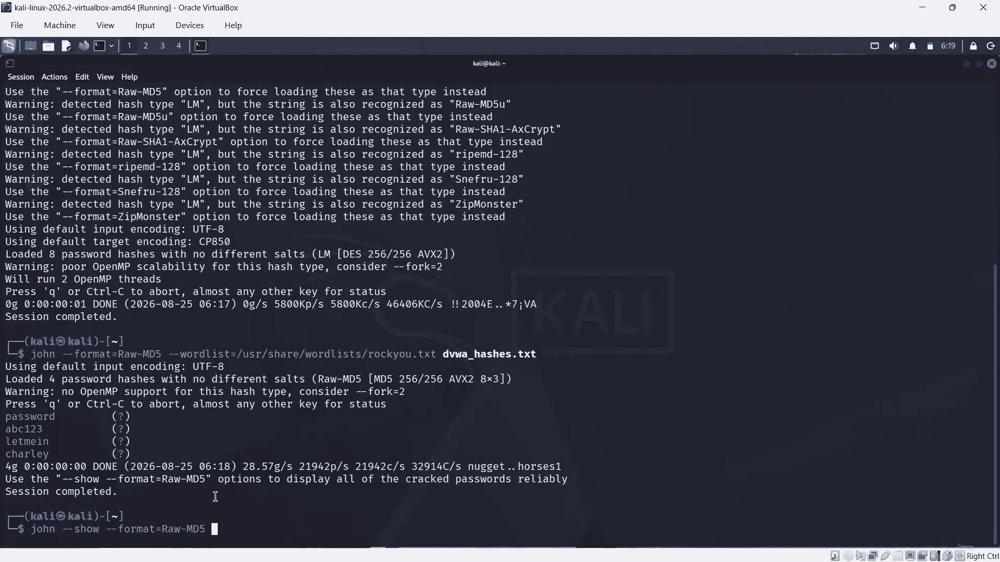

```bash
john --format=raw-md5 --wordlist=/usr/share/wordlists/rockyou.txt dvwa_hashes.txt
```

--format=raw-md5 告诉 John 将输入的哈希当作原始 MD5 来处理，这样它才能正确地与字典中的候选密码进行匹配。


## 🔍 查看破解结果

破解过程完成后，John 会直接在屏幕上实时打印出成功匹配的明文密码。如果你想完整地查看所有已经破解出的结果，可以使用 John 的 show 命令，这个命令会把之前破解出来的明文全部列出来，方便你核对。

以下是查看结果的命令：

```bash
john --show --format=raw-md5 dvwa_hashes.txt
```

执行这个命令后，屏幕会显示每一行哈希对应的明文密码。在本例中，共有四个密码哈希被成功破解，剩下零个未破解的哈希。


## 🔗 回顾完整攻击链条

这时候你可以停下来，真正体会一下我们在这门课程中构建起来的完整攻击链条。回到第 9 课，我们使用 SQL 注入专门从一个本不该被直接访问的数据库里提取了这些哈希值。而现在，我们拿到这些哈希之后，在完全离线的环境里，不再与目标应用程序产生任何交互，就恢复出了背后的真实明文密码。注入、提取、离线破解，这条端到端的攻击路径是整个网络安全领域中最常见、后果也最严重的真实攻击方式之一，而你现在已经亲自执行了其中的每一个步骤。


## 💾 理解 John 的 pot 文件机制

接下来我们有必要了解 John 内部的工作原理，因为这会影响你在实际使用中对该工具的预期。如果你不了解这个机制，可能会困惑为什么第二次运行同样的命令时，John 似乎不再输出任何结果。

John 会把已经破解成功的哈希记录在一个名为 john.pot 的文件里。这个文件的完整路径位于用户主目录下，即 ~/.john/john.pot。

这意味着，如果你再次针对同一个哈希文件运行 John，它不会浪费时间重新破解那些已经成功找到的密码。

以下是 pot 文件的路径：

```bash
~/.john/john.pot
```

如果你希望强制 John 重新破解一遍，就需要先删除这个 pot 文件，让 John 认为没有任何哈希被破解过。

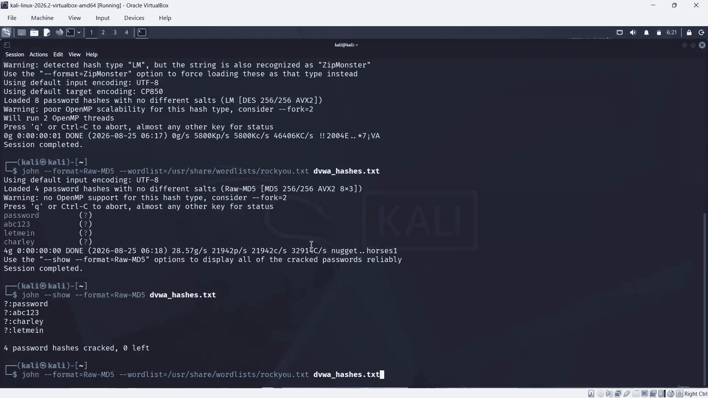

以下是删除命令：

```bash
rm ~/.john/john.pot
```

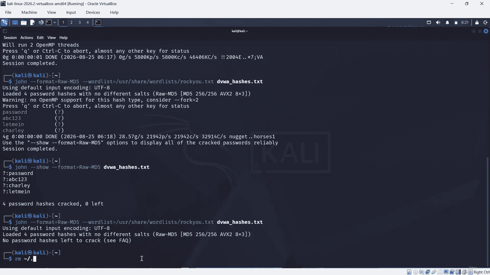

删除之后，再次运行相同的 John 命令，它就会从头开始再次破解这些哈希。


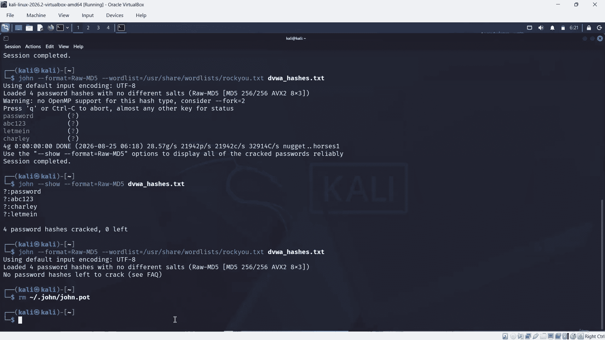

## 🔮 下节课预告

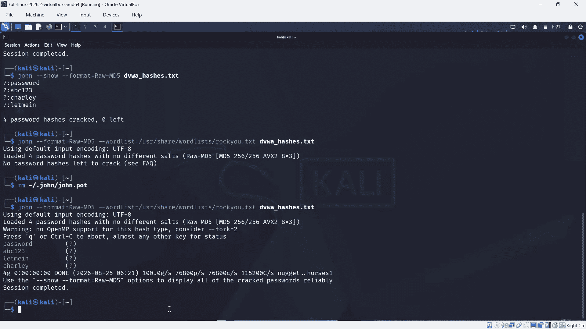

下一节课，我们将沿用同样的离线破解思路，但会使用 hashcat 这个工具，把计算负载从 CPU 切换到 GPU，从而大幅提升破解速度，处理更复杂的哈希类型也会更加高效。


## 📚 本节总结

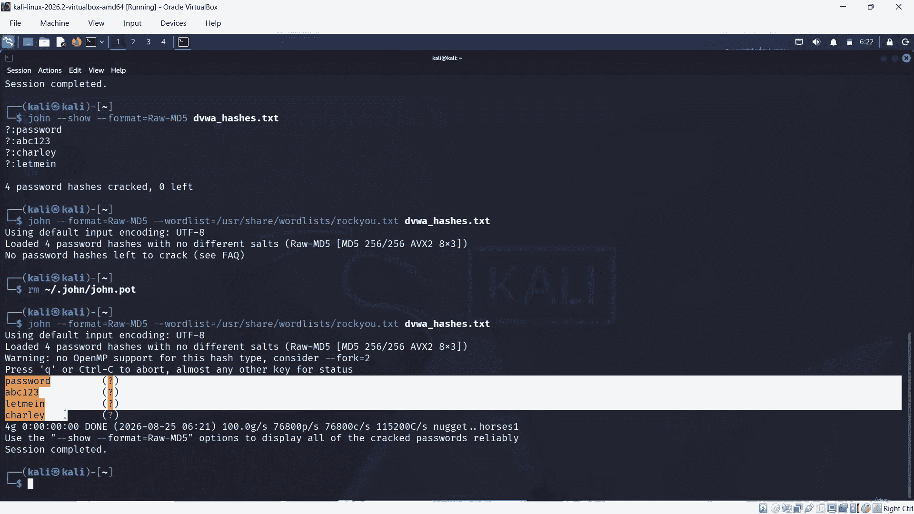

本节课中，我们一起学习了如何使用 John the Ripper 破解哈希。具体包括：把提取出的哈希保存到独立文件、运行字典攻击、指定正确的哈希格式、使用 show 命令查看破解结果、理解 john.pot 文件的缓存机制，以及回顾从 SQL 注入到离线破解的完整攻击链条。希望通过这节课，你能对离线密码破解的整个流程有更直观的认识。

