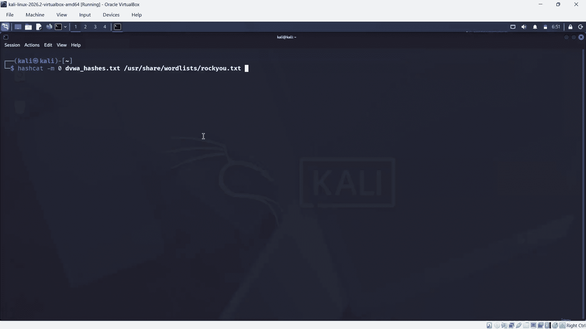
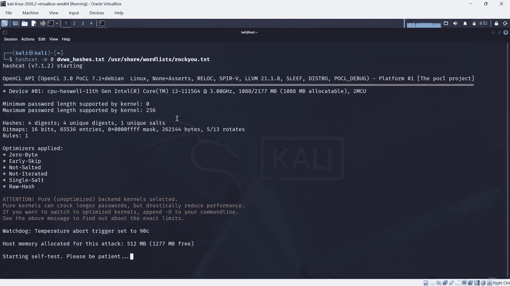
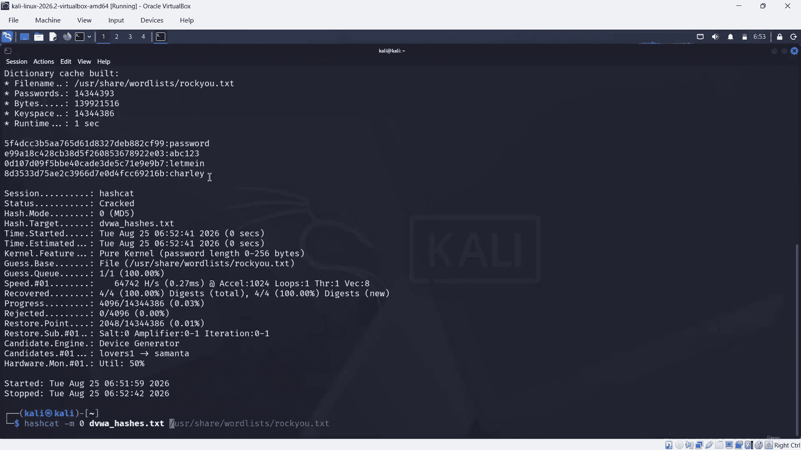
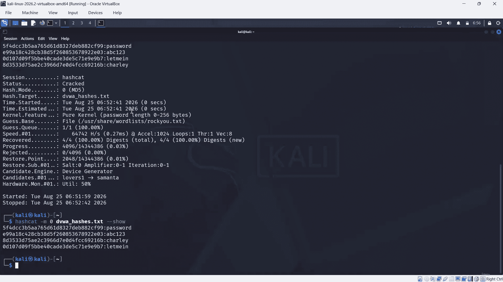

# 道德黑客与渗透测试：58：使用 Hashcat 进行 GPU 加速破解 🚀

在本节课中，我们将学习如何使用 Hashcat 对离线哈希进行加速破解。我们会复用上一节课生成的哈希文件，构建 hashcat 命令，重点解释 -m 参数的含义，并运行工具查看破解结果。最后还会讨论 GPU 破解的原理、虚拟机中的性能限制，以及慢速哈希算法 bcrypt 的特点。

## 准备哈希文件

在开始破解之前，我们需要一份哈希文件作为输入。我们将复用上一节课中已经生成的那个完全相同的哈希文件，不需要重新抓取或重新导出。这样可以让我们专注于 hashcat 的使用方法，而不是在文件准备上浪费时间。

以下是准备好的文件路径示例：

- DVWA 哈希文件
- 字典文件 rockyou.txt

## 构建 hashcat 命令

接下来我们来构建 hashcat 的破解命令。假设你的哈希文件名称为 DVWA_hashes.txt，完整的命令如下：

```bash
hashcat -m 0 DVWA_hashes.txt /usr/share/wordlists/rockyou.txt
```

这条命令告诉 hashcat 使用哪个哈希文件，以及使用哪个字典进行破解。字典文件中包含大量常见密码，hashcat 会逐个尝试，直到找到匹配项。

## 理解 -m 参数

这里有一个初学者最容易混淆的地方，就是 -m 标志的含义。我希望你能彻底理解它，而不是盲目地复制一个数字。

-m 参数指定了确切的哈希模式，也就是说，它告诉 hashcat 应该针对哪种算法进行测试。例如：

- 0 对应 raw MD5，也就是 DVWA 默认使用的存储密码格式
- 其他数字对应 SHA1、SHA256 等不同算法

这个部分非常重要，它直接关联到本模块开头的理论课程。

## 错误模式的后果

如果你搞错了模式编号，比如本该使用 MD5 却指定成了 SHA1，会发生什么情况？

hashcat 不会大声报错，也不会清楚地警告你有不匹配的情况。相反，它会正常运行到底，然后报告破解数量为零。即使你的字典里确实包含正确的密码，也无法破解。



这种模式不匹配是初学者使用 hashcat 时最常见的错误。我希望你能真正记住这一点，因为在实际渗透测试任务中，如果不及时发现这个问题，可能会浪费大量时间。

以下是检查哈希格式的几种方法：

- 使用 hashcat 自带的标识助手
- 查阅可信的在线哈希识别参考



如果你不确定目标到底使用什么哈希格式，可以先通过这些方式确认，再决定 -m 参数填什么。

## 运行 hashcat 并查看输出

现在我们可以运行命令，并观察输出结果了。运行过程中，hashcat 会显示详细的实时统计信息，包括：



- 当前的运行状态指示器
- 每秒尝试的哈希数量，也就是破解速度
- 字典文件的进度情况

你需要耐心等待，让工具把字典跑完或者找到匹配项为止。

## 查看破解结果

破解完成后，我们可以查看结果。输出中会显示哈希值和对应的明文密码，例如 write one、2、3、4 等等。

如果你想以更整洁的方式查看已经破解出的密码，可以使用 --show 参数：

```bash
hashcat -m 0 DVWA_hashes.txt --show
```

这会以哈希和明文格式把正确的密码展示出来，方便你直接拿去使用。

## 为什么选择 GPU 破解

现在我们来聊聊，为什么 Hashcat 会成为行业内进行离线破解的主流选择。

CPU 是为通用、高灵活性的计算设计而成的。相比之下，GPU 从底层设计之初就是为了同时执行海量简单且重复的计算。这种并行计算能力，恰恰就是密码哈希破解所需要的工作负载类型。

在弱哈希类型上，特别是未加盐的 MD5，像我们现在使用的这种，一台普通消费级 GPU 往往能显著胜过即使是强大的多核 CPU。具体提升倍数取决于硬件，有时候可以达到 10 倍甚至更多。

核心关系可以简单表示为：

```
破解速度 ≈ 并行核心数量 × 单核计算速度
```

## 虚拟机中的性能限制

不过，我要诚实地告诉你一个真实的限制，不想过度夸大 GPU 的效果。

在我们的 VirtualBox 虚拟机里，通常无法直接访问宿主机的真实 GPU 硬件。虚拟化环境一般无法像原生裸金属安装那样传递 GPU 加速能力。

所以你现在屏幕上看到的速度，很可能接近于 CPU 级别的表现，尽管我们实际上运行的是面向 GPU 的 hashcat 工具。

在真实的专业破解环境中，安全人员通常会在专门配备强大 GPU 的裸金属机器上运行 hashcat，有时甚至一台机器上装有多个 GPU，纯粹为了这个破解工作负载。

我希望你真正理解这个区别，不要以为自己屏幕上看到的数字就是 hashcat 的真实性能上限。

## 慢速哈希算法：bcrypt

最后，值得了解的另一种更现代的哈希类型是 bcrypt。虽然我们今天没有亲手演示，但这是一个重要概念。

MD5 这种算法是为原生速度而设计的，而 bcrypt 之类的算法则是故意被设计成缓慢且计算开销高的。目的是为了抵抗像我们刚才运行的那种快速高吞吐破解尝试。

如果一个现代应用使用 bcrypt 而不是 MD5 来存储密码，即使使用完全相同的硬件和完全相同的字典，这种攻击也会变得非常缓慢，甚至接近于不切实际。

以下是两种算法的核心差异：

- MD5：计算速度快，容易被 GPU 大规模并行破解
- bcrypt：计算故意变慢，显著提高破解成本

## 下一节预告

下一节课，我们将结束本模块，学习从零开始构建自定义字典。专门用于那些像 rockyou 这样的通用字典根本包含不了目标密码的场景。

## 总结



本节课中我们一起学习了使用 Hashcat 进行 GPU 加速破解的基础操作，包括构建命令、设置 -m 参数、运行破解和查看结果，还了解了 CPU 与 GPU 的区别、虚拟机中的性能限制，以及 bcrypt 等慢速算法的特点。
