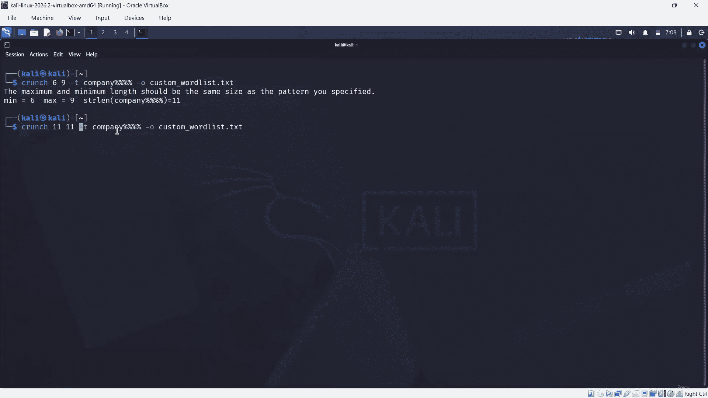
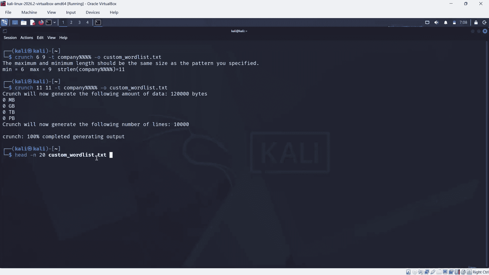
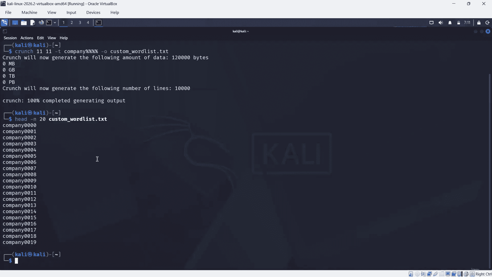

# 道德黑客与 Kali Linux 渗透测试：59：使用 Crunch 构建自定义字典 🔐


在本节课中，我们将学习如何使用 Kali Linux 预装的 Crunch 工具，亲手构建属于自己的自定义密码字典。课程会先说明为什么在面对真实组织目标时，仅靠 RockYou 这类通用字典通常不够，随后会在动用工具本身之前，把这部分背景讲清楚，确保你理解自定义字典的核心价值。接着，我们会通过一个简单的实际案例，演示如何根据之前侦察阶段收集到的公司名称、产品名称以及常见命名约定，生成一份具有针对性的密码列表。最后，还会展示如何将生成的字典直接交给 Hydra、John the Ripper 或 Hashcat 等工具使用，完成整个密码攻击流程的闭环。


## 为什么真实目标更需要自定义字典 🎯


上一节我们介绍了密码攻击的基础工具，本节中我们来看看为什么在真实渗透测试中，自定义字典往往比通用字典更重要。很多初学者习惯直接拿现成的泄露数据库字典去尝试，但在实际的组织环境里，这种做法成功率通常很低。

以下是自定义字典比通用字典更有效的主要原因：

- 真实世界中的组织目标，很少仅靠 RockYou 这类通用字典就能被攻破。
- 专业的密码破解工作，通常依赖于根据已经收集到的目标侦察信息，构建专门的自定义字典。
- 这些侦察信息包括公司名称、产品名称、常见命名约定，以及第四模块中收集的其他相关数据。


## Crunch 命令语法逐条拆解 🧩


在了解了自定义字典的必要性之后，本节中我们来看看 Crunch 工具的具体用法。Crunch 已经预装在 Kali Linux 中，无需额外安装，可以直接在终端调用。

以下是一个简单的示例命令，用于生成带有固定前缀和数字后缀的密码列表：

```bash
crunch 6 9 -t company%% -o custom_wordlist.txt
```

如果需要覆盖公司名称后接四位数字的情况，命令长度范围需要相应调整，例如：

```bash
crunch 11 12 -t company%%% -o custom_wordlist.txt
```

让我们把这个语法仔细拆开，逐条解释每一部分的含义：

- 第一个数字 6 表示生成密码的最小长度。
- 第二个数字 9 表示生成密码的最大长度。
- `-t` 标志用于指定一个精确的模板，而不是在长度范围内生成纯粹随机的组合。
- 模板中的 `company` 被视为固定文本，会出现在每一个生成的条目中。
- 每个百分号 `%` 代表一个单独的数字占位符，Crunch 会对其进行系统性的遍历。
- `-o custom_wordlist.txt` 表示将结果输出到名为 custom_wordlist.txt 的文件中。

根据这个命令，生成的密码会覆盖类似 company 12 或 company 99 这样的真实命名模式。如果你想增加位数，只需在模板中添加更多的百分号，同时把最小长度和最大长度相应调大即可，比如说改成 11 到 12 位，这两个数字只是最小值和最大值的边界，具体取决于你的目标模式需要多少位字符。


## 生成字典并查看前 20 条结果 📄


讲完命令语法之后，本节中我们来看看如何运行命令，并检查生成的字典内容。按下回车后，Crunch 会开始计算并生成所有符合条件的组合。



在示例中，程序提示将生成 10000 行内容，这意味着字典里包含一万个候选密码。通常我们不需要一次性查看全部内容，只需看前几条即可确认格式是否正确。

以下是查看前 20 条生成结果的命令：



```bash
head -n 20 custom_wordlist.txt
```

执行后，你会看到一份真正具有针对性的字典，它是围绕合理的真实世界命名模式构建的，而不是从某个无关的旧数据泄露事件中随机抓取的无关密码。


## 将自定义字典用于实际攻击 🚀


字典生成完成后，本节中我们来看看如何把它应用到之前模块中介绍的各种密码攻击工具中去。生成的文件可以直接作为输入，替代通用的 rockyou.txt。

这份自定义字典可以直接交给模块中讲过的任意工具使用，比如说用于在线实时攻击的 Hydra，或者用于离线哈希破解的 John the Ripper 和 Hashcat。使用方法与之前完全一致，只需要把字典文件路径指向 custom_wordlist.txt，而不是原来的 rockyou.txt，其余命令语法保持不变。


## 本模块核心要点回顾 🧠


在进入下一部分之前，本节中我们来总结一下整个密码攻击模块的核心教训。真实世界的密码破解，很少是简单地运行 rockyou 然后祈祷成功。

以下是本模块需要内化的关键要点：

- 在线攻击与离线攻击之间有着关键的区别。
- 字典攻击与暴力破解是两种不同的方法论。
- Hydra 可以用于对活跃的 FTP 登录进行暴力破解。
- John the Ripper 和 Hashcat 可以用于破解第 9 模块中提取的哈希值。
- 使用 Crunch 构建真正具有针对性的自定义字典，比盲目依赖通用字典更有效。

用公式概括这个方法论，可以表示为：

真实密码破解 = 侦察信息 → 构建针对性字典 → 选择合适工具（在线或离线，CPU 或 GPU 导向） → 方法性地应用，而不是随机向目标抛掷所有工具


## 下一模块预告 🔜


本节课的内容到此结束，下一节中我们将进入课程的高级主题，即 Active Directory 攻击入门，深入探讨众多真实组织实际运行的企业级 Windows 环境，我们下节课见。


## 本节课总结




在本节课中，我们一起学习了使用 Crunch 在 Kali Linux 中构建自定义密码字典的方法，掌握了在线攻击与离线攻击、字典攻击与暴力破解的区别，回顾了 Hydra、John the Ripper 和 Hashcat 的使用方式，并最终理解了真实密码破解依赖于侦察信息指导下的针对性字典构建，而不是盲目尝试通用密码列表。


