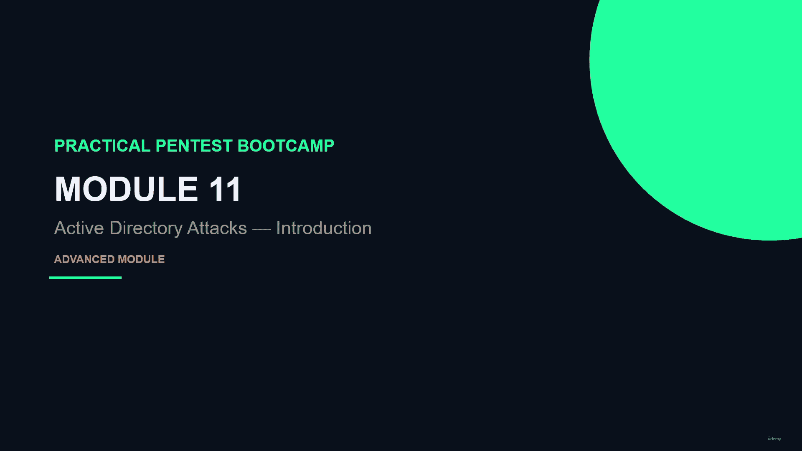
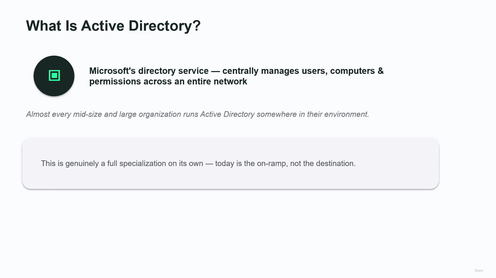
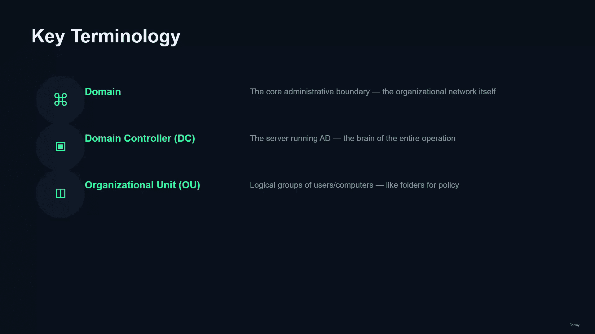
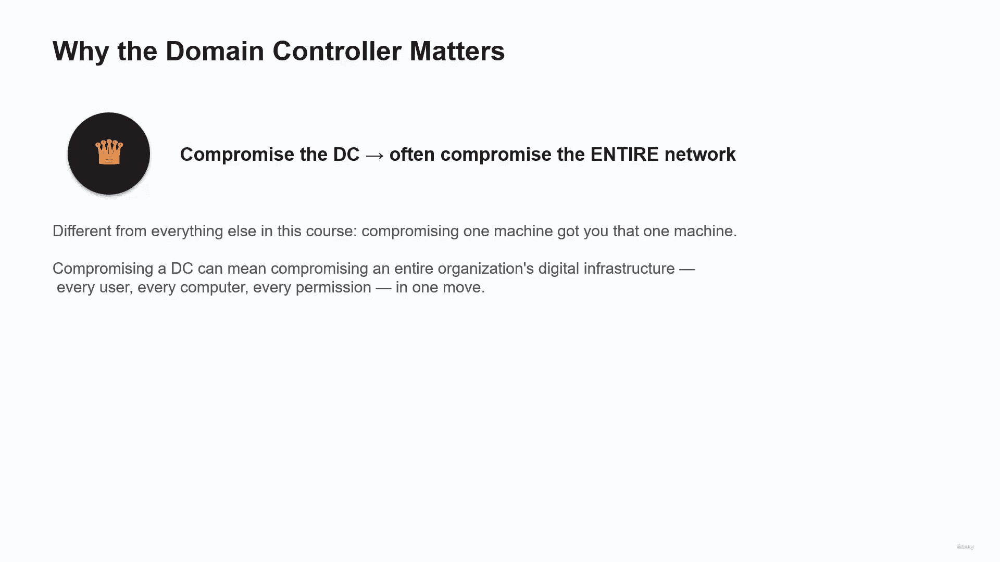
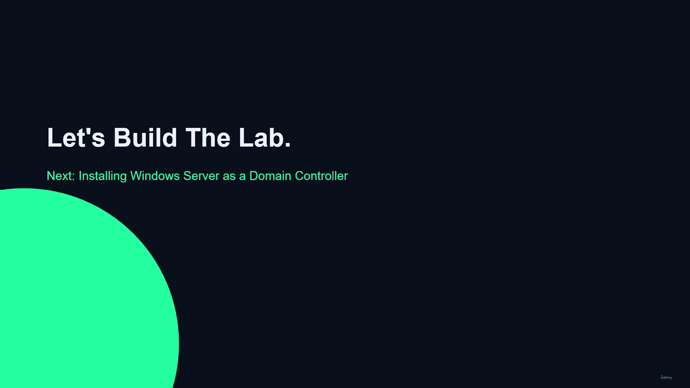

# 道德黑客与Kali Linux渗透测试：60：什么是活动目录及其为何是高价值目标 🔐

在本节课中，我们将学习活动目录的基础概念，理解它在企业网络中的作用，认识为什么域控制器是攻击者和渗透测试人员的高价值目标，并了解本节实验需要搭建的环境。


这是我们本课程的进阶模块。几乎每一个你在职业生涯中会遇到的中型和大型公司，在其环境中的某个地方都运行着活动目录。这意味着只要你未来进入职场，大概率都会接触到活动目录，所以理解它的工作方式非常重要。


在本课程迄今为止的所有内容中，我们所做的一切都停留在Linux和Web应用的世界里。我们之前的实验和演示，大部分时间都在处理Linux系统和Web漏洞，很少涉及Windows企业环境。


但今天，我们将以真正的入门级别，跨入Windows企业世界。这是一个全新的领域，虽然我们只做入门介绍，但足以让你打开活动目录安全这扇大门。


让我从一开始就诚实地设定预期，这样你才能带着正确的心态进入这个模块。我不想让你对本节课的内容有不切实际的想象，也不想让你觉得我们会在一小时内成为活动目录专家。


因为我希望你带着正确的心态进入这个模块。正确的心态意味着你知道自己正在学习的是一个入门基础，而不是完整的专业课程，之后还需要持续学习。


活动目录真的是这个领域中一个非常庞大的专业方向，有完整的专门课程。如果你想深入，可以花几个月甚至几年的时间来钻研。


整个职业生涯都可以围绕活动目录或AD安全专门构建。有些安全研究员整个职业生涯都在研究活动目录的攻防技术。


我们今天讲的内容是入门引路，是真正的动手基础，让你了解整体格局，认识常用术语，并能够在之后有意义地继续学习这个专业方向。我们不会涵盖所有高级技术，但会给你一个坚实的起点。


如果这是你想进一步追求的方向，那么本节课就是你的起点，之后可以继续深入学习。


现在让我们来定义活动目录，搞清楚它到底是什么。




活动目录是微软的目录服务。它是微软公司推出的一种用于网络中资源管理的服务，专门为Windows环境设计。


它运行在Windows Server上，集中管理用户。也就是说，所有的用户账户信息都存储在服务器上，而不是分散在各台电脑里。


以及整个组织网络中的计算机和权限。不仅管理用户，还管理哪些计算机可以加入网络，每个用户有什么权限。


与其让每一台电脑都维护自己独立的用户账户和密码列表。在没有活动目录的传统环境中，每台电脑都要自己记录一遍用户和密码，非常麻烦。


运行活动目录的组织拥有一个集中式系统，控制谁能登录哪些机器。管理员只需要在一个地方设置，就能控制整个网络的登录权限。


他们能访问什么资源，以及整个网络是如何组织的。集中式系统还决定了用户能访问哪些文件夹、打印机或数据库，并且定义了网络的整体结构。


以下是活动目录的核心定义表达：

```text
活动目录 = 微软目录服务，运行在 Windows Server 上
管理对象 = 用户、计算机、权限
对比 = 传统模式：每台电脑独立维护账户；活动目录：一个集中式系统统一控制
```


为了方便你后续学习，我们来建立一个关键术语的概念地图，因为你将在本模块剩余时间里不断听到这些词。




域。域是活动目录中的核心管理边界。


本质上就是组织网络本身，包含其中的所有用户、计算机和资源。你可以把域理解为整个公司的网络范围。


接下来是域控制器，域控制器（简称DC）是实际运行活动目录的那台服务器。如果没有域控制器，活动目录就无法运行。


它是整个操作的大脑，存储着域中每个用户、每台计算机的主数据库。所有的账户信息和权限数据都汇总在这里。


以及域中的每个权限。接下来是组织单位。组织单位，也就是OU。


是在域内组织用户和计算机到逻辑分组的一种方式。比如你可以把财务部门的人放在一个组里，技术部门的人放在另一个组里。


你可以把它想成文件夹，让组织可以为比如说。就像电脑里的文件夹一样，帮助管理员分类管理。


财务部门的电脑和工程部门的电脑应用不同的策略。管理员可以给不同文件夹里的电脑设置不同的安全规则。


以下是关键术语的关系表达：

```text
域 = 核心管理边界 = 组织网络本身，包含用户、计算机、资源
域控制器 (DC) = 运行活动目录的服务器 = 整个操作的大脑，存储主数据库
组织单位 (OU) = 逻辑分组方式 = 像文件夹一样组织用户和计算机，支持差异化策略
```




现在我们来聊聊为什么活动目录对真实攻击者和专业渗透测试人员来说，是一个真正的高价值目标。这是理解整个模块的关键。


核心洞察在于，如果你能够妥协域控制器本身。一旦攻击者控制了域控制器，后果就非常严重了。


你通常就能获得对它所管理的整个网络的实际控制权，包括每个用户账户。攻击者可以查看所有账户，甚至修改密码。


每台计算机、每个权限，所有这些都集中在那一个系统中。域控制器掌握着网络中几乎所有的钥匙。


这与本课程迄今为止攻击过的所有内容有根本的不同。此前妥协一台特定机器，只能获得对那台特定机器的访问权限。我们之前攻击的一台Web服务器或一台Linux主机，只能拿到那一台机器的权限。


但妥协域控制器可能意味着在一次决定性行动中，妥协整个组织的数字基础设施。一次攻击就可能让整个公司的网络都陷入危险。


以下是活动目录妥协的影响对比：

```text
普通机器被攻破 = 仅获得该单台机器的访问权限
域控制器被攻破 = 获得对整个域网络的实际控制权
```


这就是为什么在现实世界的攻击中，你读到过的，在新闻里。你在新闻报道中经常能看到相关的案例。


比如重大勒索软件事件、严重的企业数据泄露。这些大型安全事件，往往背后都有活动目录被攻破的身影。


活动目录妥协往往是实际的核心目标。攻击者可能通过其他途径进入网络，但最终想要控制的往往是活动目录。


即使攻击者最初的立足点来自完全不同的东西。比如攻击者最初只是通过一封钓鱼邮件进入了员工电脑。


比如一封钓鱼邮件打开了某个员工的笔记本电脑。这是很常见的初始入侵方式。


那个初始立足点很少是实际目标。攻击者拿到员工电脑之后，通常不会就此停止。


它是通往最终触及并妥协域控制器的第一步。员工电脑只是跳板，最终目标是域控制器。


我要诚实地告诉你，今天我们要讲的内容与一名真正的AD专家实际所做的工作之间存在差距。我不想夸大本节课的内容。


让我诚实地告诉你，关于我们今天要讲的内容与一名真正的AD专家实际所做的工作之间的范围差异。专家会做更复杂的事情。


今天，我们将枚举一个域，发现它的结构、其用户。我们会用Kali工具去探索域里面有什么。


以及其基本配置，使用直接从我们现有的Kali机器上运行的工具。不需要额外安装复杂的系统，就能在Kali上完成这些枚举操作。


我们将以一种经过精心控制且安全的方式。所有的演示都在我们自己的实验环境中进行，不会影响真实网络。


演示针对我们专门为本次演示创建的账户进行密码喷洒的概念。我们会创建一些测试账户，来展示密码喷洒是怎么工作的。


以下是密码喷洒的概念表达：

```text
密码喷洒 = 对多个账户尝试少量常用密码
目标 = 避免触发单个账户的登录失败锁定机制
```


我们今天不讲的内容，因为它确实超出了入门范围。有些高级技术我们留到以后再讲。


包括诸如kerberoasting之类的技术，即提取并破解服务账户凭据，使用专门工具如BloodHound。这些技术更适合进阶学习。


在大型复杂的活动目录环境中绘制复杂的攻击路径。BloodHound可以帮助可视化攻击路径，但这不在今天的范围内。


我会在本模块结束时简要再次提到这两者，作为这个专业方向实际发展方向的预览。到时候你会知道之后可以往哪个方向深入。


在进入本模块的实践环节之前，我需要带你完成一个与本课程其他所有内容都不同的真正重要的设置步骤。请你务必注意，这一步比之前的实验更复杂。




在进入本模块的实践环节之前。我们要准备好Windows环境才能开始动手。


我需要带你完成一个与本课程其他所有内容都不同的真正重要的设置步骤。以前的实验只需要Kali和Metasploitable，但这次不一样。


到目前为止的每一次实践讲座，都只使用了我们现有的Kali和Metasploitable虚拟机。之前的课程里，我们只需要这两台虚拟机就够了。


这个模式需要构建两台全新的机器，具体来说，是一台配置为域控制器的Windows Server评估版安装。你需要从微软下载Windows Server，并将其设置为域控制器。


另一台是加入同一域的Windows 10评估版机器。还需要一台Windows 10电脑，把它加入到刚才创建的域里面。


这两者都可以直接从微软免费下载评估版，在有限试用期内有效。微软提供免费试用版，够我们用就行。


这对于我们的目的来说已经足够。试用期虽然有限，但完成本节实验绰绰有余。


我要提前说明，这个设置过程比本课程中的任何其他内容都要复杂得多。请不要指望几分钟就能搞定。


以下是本节实验环境的搭建要求：

```text
机器一：Windows Server 评估版，配置为域控制器
机器二：Windows 10 评估版，加入同一域
来源：微软官方免费评估版下载，试用期有限但足够使用
注意：设置过程比之前的实验更复杂，请预留独立时间
```


安装完整的Windows Server操作系统，将其提升为域控制器。这涉及到操作系统安装和角色配置。


创建一些示例用户账户，然后单独安装Windows 10并将其加入该域。你还需要创建测试用户，并把Windows 10机器加入域。


我真诚建议为这个设置预留真实且独立的时间，完全在你正常的。不要把它和普通课程混在一起做。


课程时间之外。好了，设置步骤讲完了，我们回到理论部分。


活动目录集中控制整个网络。这就是它的核心特点，也是它成为攻击目标的原因。


域控制器是该环境中价值最高的目标。攻进域控制器，相当于攻进了整个网络的大脑。


今天我们正在为这个更大的专业方向构建真正的入门引路。本节课只是开始，之后还有更多内容可以学习。


下一节课。我们将继续深入。


假设你的实验环境已经搭建并准备就绪，我们将直接从Kali开始枚举这个域。下节课见。




在本节课中，我们一起学习了活动目录的基本定义，理解了域、域控制器和组织单位等核心术语，探讨了为什么域控制器是高价值攻击目标，明确了本节实验的范围与边界，并了解了需要搭建的Windows Server和Windows 10实验环境。

