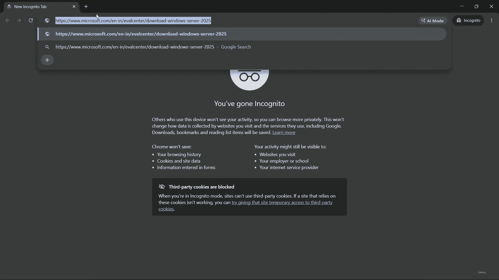
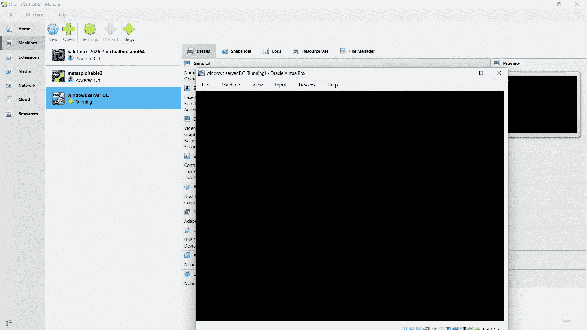
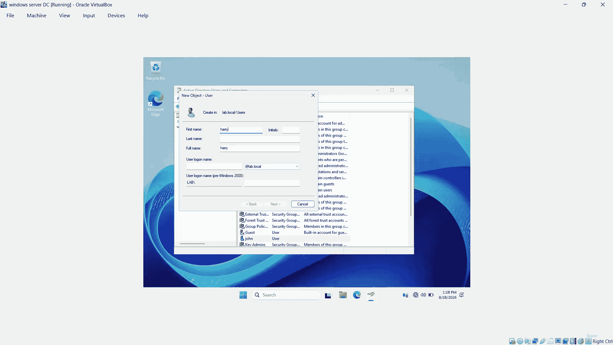

# 道德黑客与渗透测试：第61课：安装并配置Windows Server作为域控制器 🖥️

在本节课中，我们将学习如何在虚拟化环境中部署一台Windows Server，并将其配置为实验室域控制器。这台服务器将成为我们后续渗透测试环境中集中式身份验证的核心，用于管理域用户、计算机账户以及安全策略。整个过程包含系统安装、网络配置、角色安装和域控制器提升等多个步骤，虽然比较漫长，但每一环节都非常关键，初学者也能跟着完成。


## 下载Windows Server镜像文件

首先，我们需要获取Windows Server的安装镜像。微软官方提供一个功能齐全的评估版，有效期为180天，完全免费，专门用于学习和测试场景，非常适合我们搭建实验环境。



以下是下载步骤：

- 打开浏览器，访问微软官方的Windows Server评估版下载页面。
- 搜索关键词“Windows server evaluation download”，确保只点击来自微软官方的链接。
- 选择最新可用的Windows Server版本，点击下载按钮。
- 确认文件为ISO镜像，文件体积约为7.6GB，属于大文件，下载时间会根据网络速度而有所不同。

下载完成后，我们就得到了安装所需的ISO文件，接下来可以着手创建虚拟机了。


## 在VirtualBox中创建虚拟机

有了镜像文件之后，下一步是在VirtualBox里新建一台虚拟机，作为我们的Windows Server运行环境。这台虚拟机将承载整个域控制器服务，因此硬件配置不能太低。

以下是创建虚拟机的配置项：

- 虚拟机名称：Windows Server DC（DC代表域控制器）。
- 操作系统类型：Microsoft Windows，版本选择Windows Server 2025，64位。
- 内存大小：建议至少分配4GB，因为运行完整的Microsoft Server需要足够内存。
- 硬盘空间：初始设置50GB，如果条件允许可以扩展到60GB。
- 网络适配器：选择Host-only adapter（仅主机适配器），用于实验室内部网络隔离。

完成以上设置后，点击完成按钮，虚拟机就创建好了，但还不能直接启动，先要配置网络。


## 安装Windows Server操作系统

虚拟机创建完成后，我们需要启动它并进行操作系统安装。安装过程比较漫长，根据机器性能不同，可能需要30分钟到一个小时以上，建议耐心等待。

以下是安装过程中的关键选择：



- 语言、时间和货币格式：保持默认选项，点击下一步。
- 安装类型：选择“Install Windows server”。
- 许可协议：勾选同意协议，点击下一步。
- 版本选择：选择“Windows Server Standard Evaluation (Desktop Experience)”，即带桌面体验的标准评估版。
- 磁盘分区：可以对目标分区进行格式化，然后继续安装。
- 安装开始：点击Install按钮，等待系统文件拷贝和配置完成。

安装过程中，我们可以把这段时间用来理解正在构建的内容。从概念上讲，我们正在把一台普通的Windows Server安装，逐步转变为实验室域的集中式身份验证机构。安装完成后，虚拟机会自动重启。


## 设置管理员密码

重启之后，系统会提示设置本地管理员密码。这个密码在整个实验过程中会反复使用，所以必须设置一个你能记住的组合。

建议使用统一的管理员凭据，例如：

```text
用户名：Administrator
密码：Administrator123
```

设置完成后，点击完成，等待服务器管理器（Server Manager）仪表盘加载出来。此时，Windows Server桌面环境已经正式可用了。


## 配置静态IP地址

域控制器在网络中必须有固定的IP地址，否则其他计算机无法稳定地找到它进行身份验证。因此，我们需要为这台服务器配置静态IP，而不是依赖自动获取的动态IP。

以下是IP配置的具体参数：

- IP地址：192.168.56.10
- 子网掩码：255.255.255.0
- 网关：根据实验网络实际情况填写，Host-only环境下通常可不填或保留默认

配置方法是打开网络连接属性，找到IPv4协议，手动输入上面的地址。设置完成后，可以使用ipconfig命令验证新地址是否已经生效。确认静态IP应用成功后，我们就可以进入下一阶段的角色安装了。


## 安装Active Directory域服务角色

要让Windows Server成为域控制器，必须先安装Active Directory域服务（AD DS）角色。这个角色负责管理域内的用户、组和计算机对象，是域控制器的核心组件。

以下是安装角色的步骤：

- 打开Server Manager仪表盘。
- 点击“Add roles and features”（添加角色和功能）。
- 选择“Role-based or feature-based installation”，点击下一步。
- 在服务器角色列表中，勾选“Active Directory Domain Services”。
- 系统会提示添加所需的依赖功能，点击“Add features”确认。
- 一路保持默认选项，点击下一步直到开始安装。
- 等待角色安装完成，然后关闭安装向导。

角色安装完成后，服务器还没有自动成为域控制器，还需要进行提升操作。


## 将服务器提升为域控制器

安装完AD DS角色之后，下一步是把这台服务器正式提升为域控制器，并创建一个全新的域林。由于我们是从零开始搭建实验环境，选择添加新林是最合适的做法。

以下是提升过程中的关键设置：

- 部署配置：选择“Add a new forest”，添加新的域林。
- 根域名：lab.local（使用.local后缀，适合隔离实验环境，避免与真实公共域名冲突）。
- 目录服务还原模式密码（DSRM）：可以与管理员密码相同，例如Administrator123。
- 其余选项：全部保持默认，点击下一步直到开始安装。

安装完成后，服务器会自动重新启动。重启后登录界面会显示“lab\administrator”，而不是单纯的“administrator”，这说明机器已经成功成为lab.local域的域控制器。使用之前设置的管理员密码登录即可。


## 创建域用户账户

域控制器搭建完成后，我们可以在域中创建一些测试用户账户，用于后续的权限测试和渗透练习。这些账户存储在Active Directory中，可以在整个域内统一认证。

以下是创建用户的常见账户示例：

- John
- Harry
- ABC

创建方法是打开“Active Directory Users and Computers”控制台，在lab.local域下的Users文件夹上右键，选择新建用户，依次输入姓名、登录名和密码，完成后重复上述步骤为其他用户创建账户。所有用户的初始密码可以统一设置为Administrator123，方便后续管理。


至此，Windows Server作为域控制器的安装和配置工作全部完成。我们获得了一台拥有静态IP、安装了AD DS角色、并成功提升为lab.local域控制器的服务器，同时还创建了若干域用户账户。



在本节课中，我们一起学习了如何下载Windows Server评估版镜像，在VirtualBox中创建和配置虚拟机，安装操作系统，设置静态IP地址，安装Active Directory域服务角色，将服务器提升为域控制器，最后创建域用户账户。这些步骤为我们搭建一个完整的渗透测试实验室奠定了基础，后续可以在此域环境中开展各种安全测试和攻防演练。

