🖥️ Ethical Hacking & Penetration Testing with Kali Linux：62：安装 Windows 10 并加入域

在本节课中，我们将学习如何搭建第二台实验机器，具体是一台 Windows 10 客户端，并将其加入到上一节课创建好的 lab.local 域中。本节内容包括下载 Windows 10 系统镜像、在 VirtualBox 中创建虚拟机、完成系统安装、配置网络参数、验证域控制器连通性，最后执行域加入操作并使用域账户登录。我们会一步步演示每个操作，确保初学者也能跟得上。不着急，跟着步骤来就行。

## 一、下载 Windows 10 镜像

上一节我们已经搭建好了 Windows Server 域控制器，本节我们先来准备 Windows 10 客户端所需的安装文件。

和之前一样，你需要一份 Windows 10 ISO 镜像文件。如果你手头已经有，可以直接使用；如果没有，请打开浏览器，在 Google 上搜索 “Windows 10 Enterprise evaluation download”，并确保只打开微软官方链接。微软提供为期 90 天的 Windows 10 企业版评估版，专门用于这类测试和学习场景。如果你实在无法从任何渠道下载，可以在问答区发帖反映。

## 二、在 VirtualBox 中创建虚拟机

镜像准备好之后，接下来我们需要在 VirtualBox 里新建一台虚拟机来运行 Windows 10。

以下是创建虚拟机的主要步骤：

- 点击 “New” 新建虚拟机。
- 名称填写 “Windows”，类型选 Microsoft Windows，版本选 Windows 10 64 位。
- 内存建议分配 2 GB，如果你的物理机内存充足，可以设为 4 GB。
- 硬盘大小设为 50 GB。
- 完成后进入设置，网络适配器选择 “Host-only Adapter”（仅主机网络）。

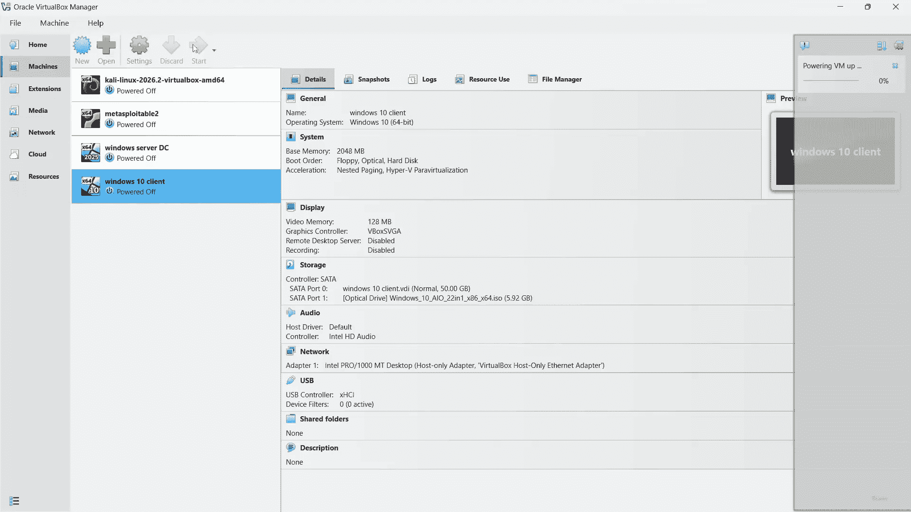

虚拟机的核心配置可以用下面的方式描述：

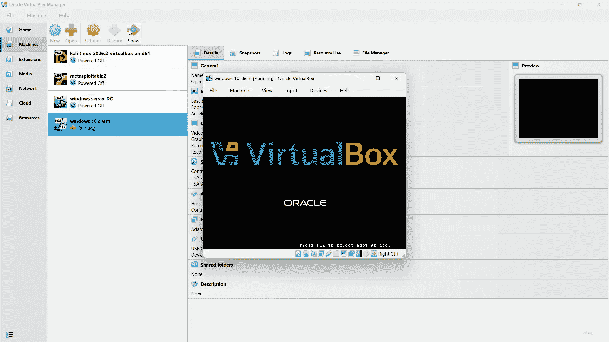

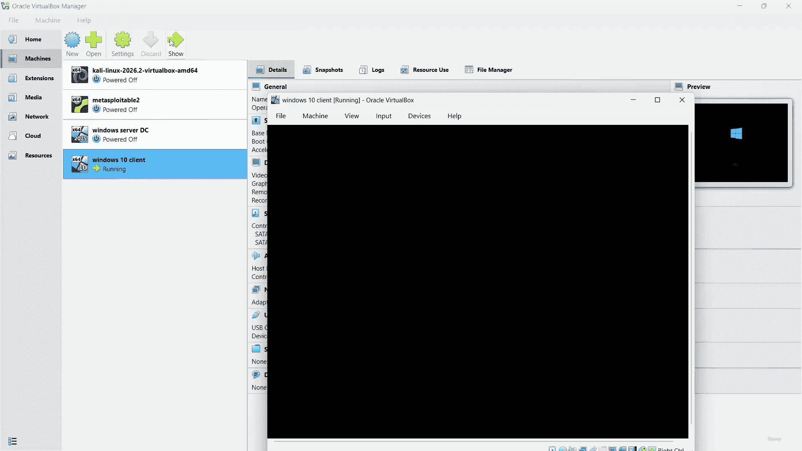

```text
内存 = 2 GB（或 4 GB）
硬盘 = 50 GB
网络适配器 = Host-only Adapter
```

配置完成后点击 “Finish” 完成创建。

## 三、安装 Windows 10 系统

虚拟机配置完成后，我们可以启动它并开始安装 Windows 10 操作系统。

以下是安装过程中的关键操作：

- 启动虚拟机，进入 Windows 安装程序。
- 语言和区域保持默认，点击 “Install Now”。
- 如果出现产品密钥界面，直接点击 “Skip” 跳过。
- 选择 “Windows 10 Enterprise” 版本。
- 接受许可协议。
- 安装类型选择 “Custom”（自定义安装）。
- 创建新虚拟磁盘分区，然后点击下一步继续安装。

安装需要一段时间，建议耐心等待。

## 四、理解域加入的概念

在系统安装的同时，我们有必要先搞清楚“加入域”到底在背后做了什么。

安装完成前，这台 Windows 10 机器处于独立工作组状态，也就是所谓的 standalone 或 workgroup 机器。它完全独立管理本地用户账户，对域控制器的存在一无所知。域加入是一项改变机器信任关系的过程，它告诉 Windows 10 不再自己验证身份，而是把身份认证请求提交给域控制器。这样一来，在域控制器上集中创建的域用户账户，就能登录到这台特定的客户端机器了。

域加入的核心逻辑可以用下面的方式描述：

```text
独立机器：本地账户管理，不认识域控制器
加入域后：身份认证交由域控制器，域用户可登录
```

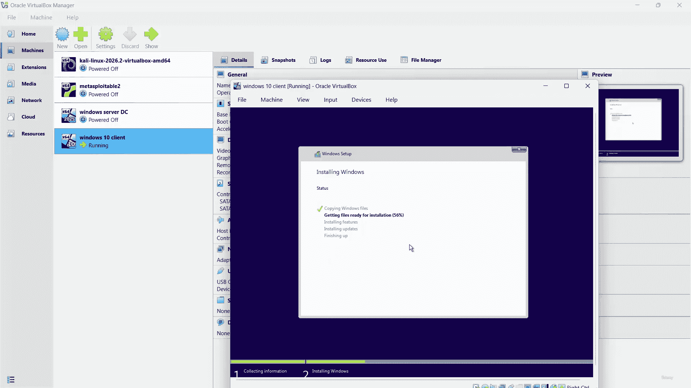

系统安装结束后，你会经历一遍初始设置，比如区域、键盘布局等。

## 五、首次设置与本地账户

大部分选项保持默认即可。有些安装向导会直接询问是否加入域，但如果这一步没有出现，也不用担心，你可以先创建一个普通本地用户完成安装，之后再手动加入域。为了演示，我们先创建一个本地管理员账户，用户名为 admin，密码为 admin@123，并设置 PIN 码为 123。完成后，我们继续进行网络配置。

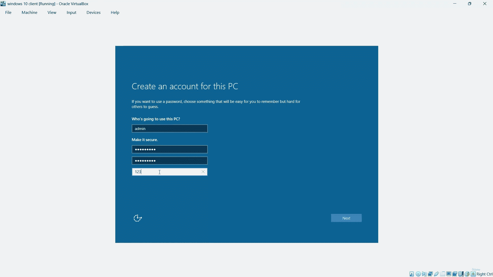

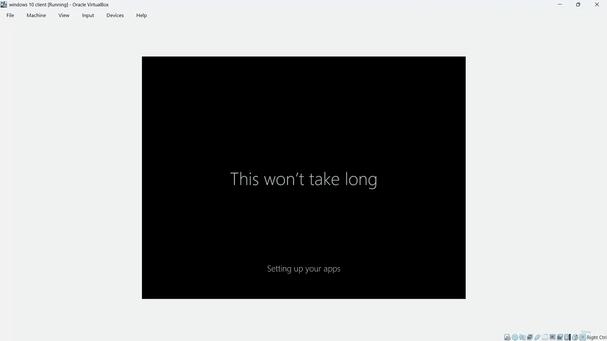

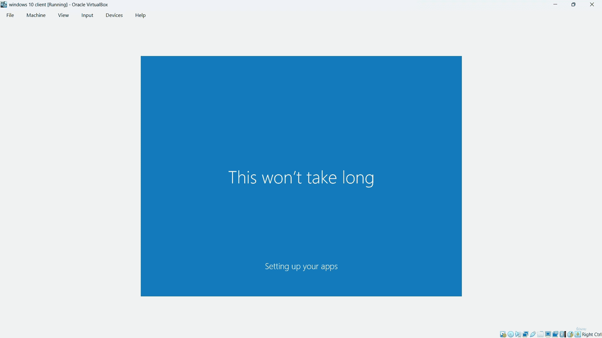

## 六、配置网络参数

在尝试加入域之前，必须先把网络配置好，尤其是 DNS 设置。

以下是网络配置的操作步骤：

- 打开 “网络连接”。
- 右键点击网络适配器，选择 “属性”。
- 双击 “Internet 协议版本 4 (TCP/IPv4)”。
- 选择 “使用下面的 IP 地址”。
- IP 地址填写 192.168.56.7。
- DNS 服务器填写域控制器的 IP 地址，即 192.168.56.10。

网络核心参数如下：

```text
IP 地址：192.168.56.7
首选 DNS 服务器：192.168.56.10
```

这部分非常关键，因为域加入完全依赖 DNS 能否正确把域名解析回域控制器。设置完成后点击确定并关闭所有窗口。

## 七、验证连通性

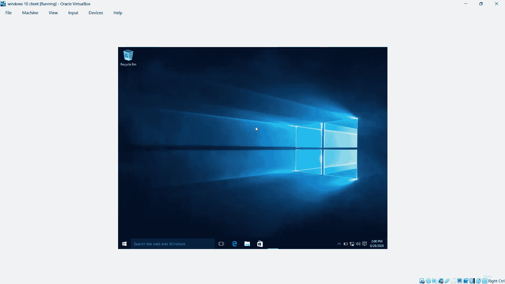

网络配置好之后，我们需要确认这台客户端真的能访问到域控制器。

以下是连通性测试的方法：

- 打开命令提示符。
- 输入 `ping 192.168.56.10`。
- 或者直接输入 `ping lab.local`。

连通性测试命令如下：

```
ping 192.168.56.10
ping lab.local
```

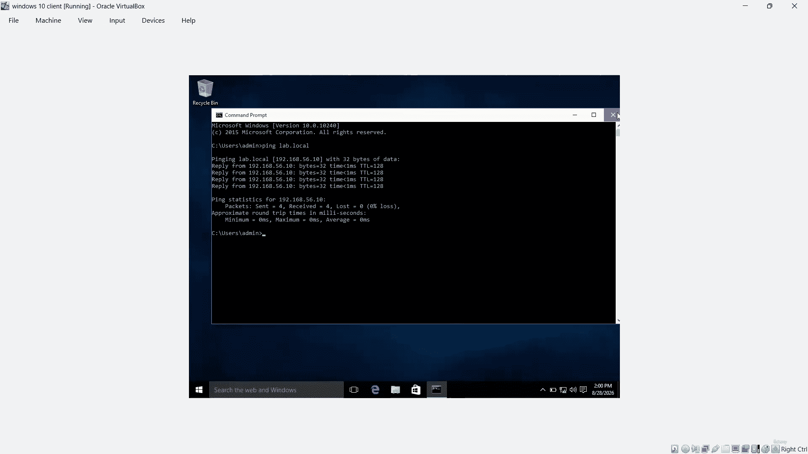

如果收到成功的回复，就说明 DNS 解析和网络连通性都正常了。这里之所以使用 lab.local 域名进行测试，正是因为我们正在验证 DNS 服务是否工作。

## 八、将机器加入域

连通性确认无误后，我们就可以正式把这台 Windows 10 加入 lab.local 域了。

以下是加入域的具体操作：

- 右键点击开始按钮，选择 “系统”。
- 点击 “高级系统设置”。
- 切换到 “计算机名” 选项卡。
- 点击 “更改”。
- 将成员身份从 “工作组” 改为 “域”。
- 域名填写 lab.local，然后点击确定。
- 输入域管理员账户和密码，用户名为 administrator，密码为 admin@123。

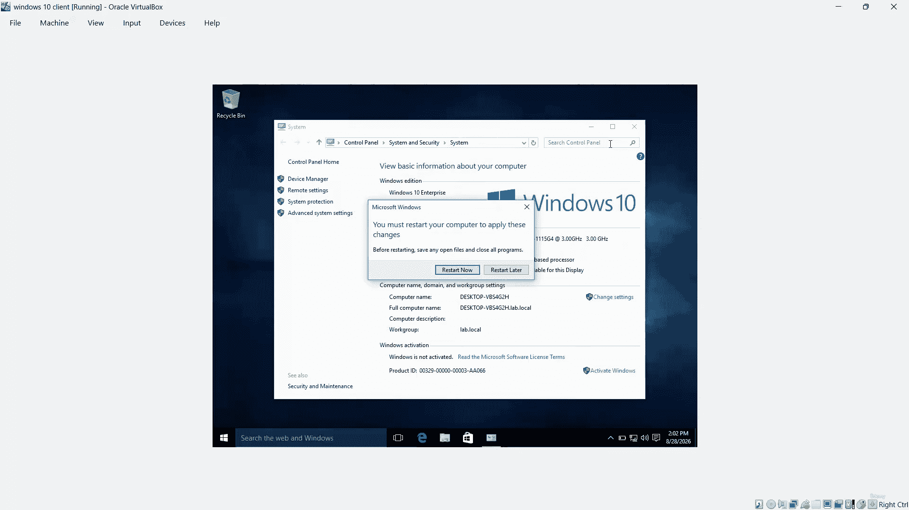

如果一切正常，系统会弹出欢迎消息，提示你已成功加入 lab.local 域。此时你需要重启计算机才能使更改生效。

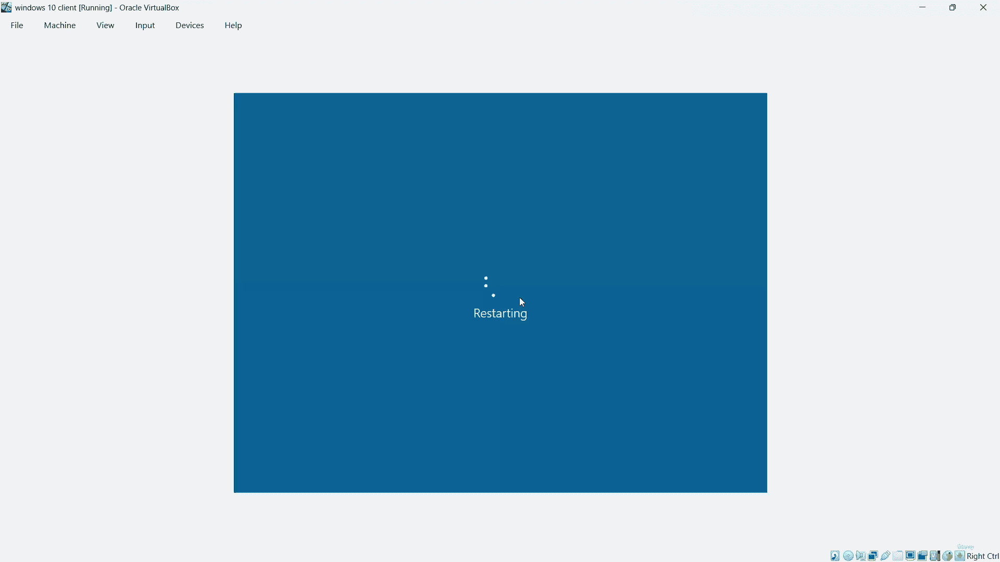

## 九、使用域账户登录

重启完成后，登录界面会出现一些变化，这时候就可以用域账户登录了。

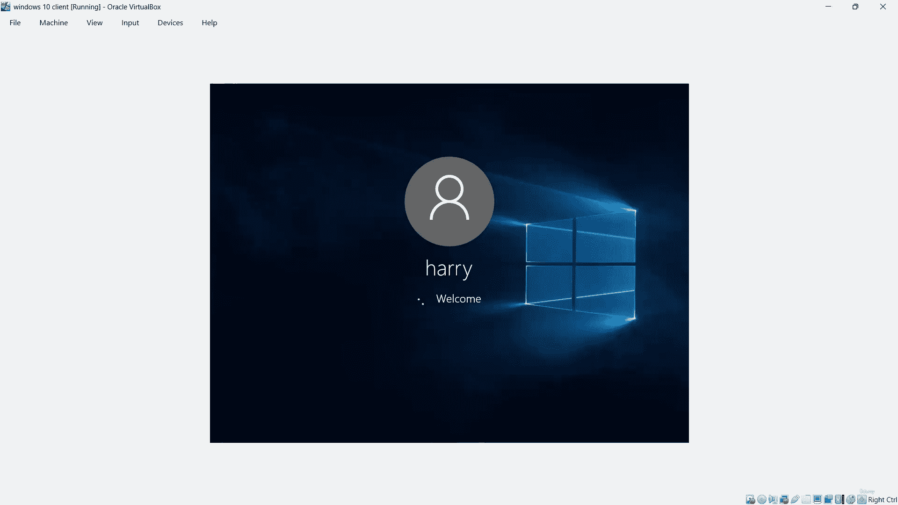

以下是域账户登录的步骤：

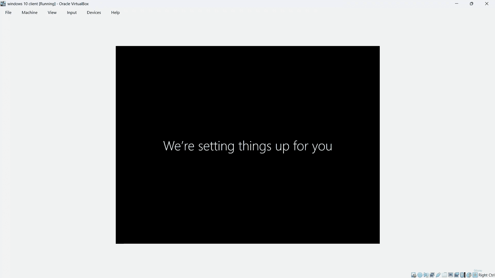

- 在登录界面选择 “其他用户”。
- 用户名填写 lab\harry。
- 密码填写对应的域账户密码。

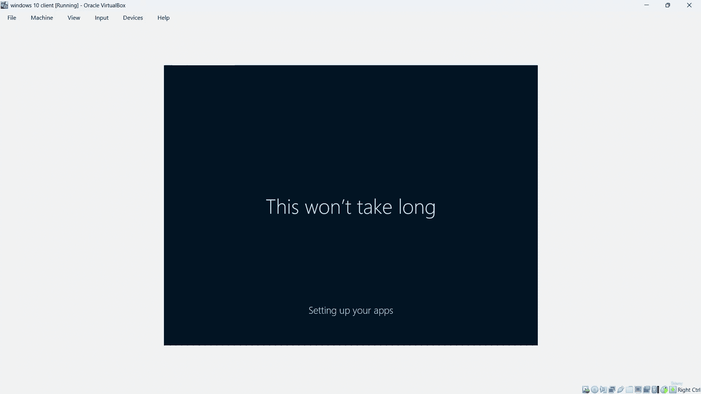

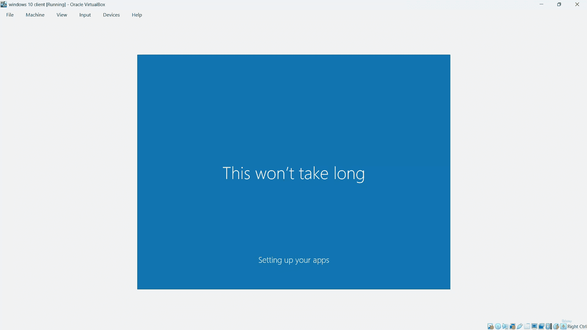

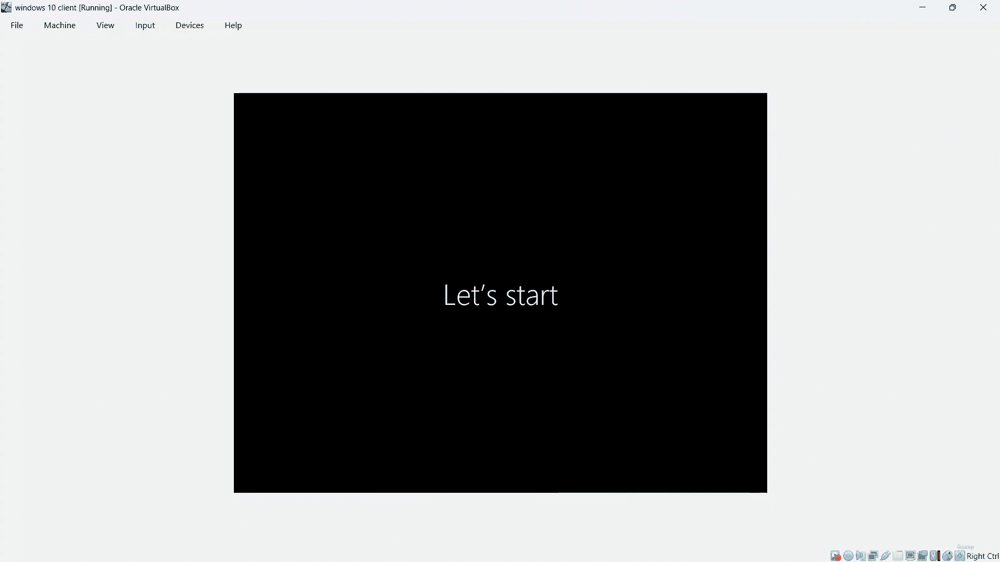

登录成功后，系统会显示欢迎信息，并提示正在为新用户进行初始设置。稍等片刻，桌面就会加载出来。

## 十、实验环境搭建完成

到这里，我们的实验环境就全部搭建好了。

现在一共有三台机器：Kali 作为攻击机，Windows Server 作为域控制器，以及刚才配置好的域加入 Windows 10 客户端。整个实验室环境已经就绪，可以用于后续的渗透测试练习。下一节课，我们将回到 Kali 机器，开始对刚才搭建好的这个域进行信息枚举。见证奇迹的时刻就要到了，下节课见。

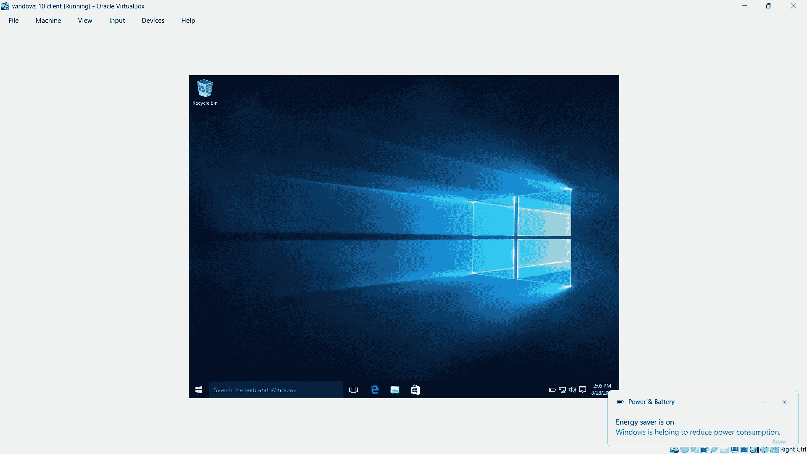

本节课中，我们一起学习了如何下载 Windows 10 评估版镜像、在 VirtualBox 中创建虚拟机、完成系统安装、配置静态 IP 和 DNS、验证与域控制器的连通性、将 Windows 10 加入 lab.local 域，最后使用域账户登录客户端。至此，基于 Active Directory 的三机实验环境已全部搭建完成，为后续的域渗透测试打下了基础。
