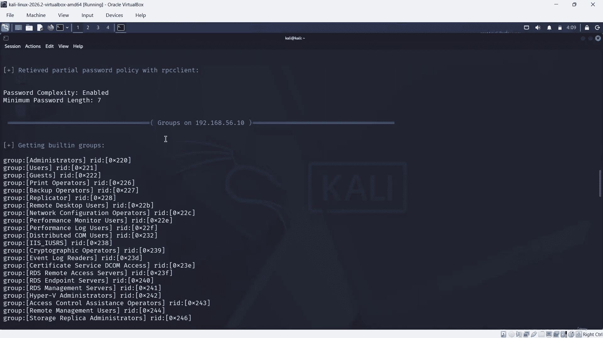
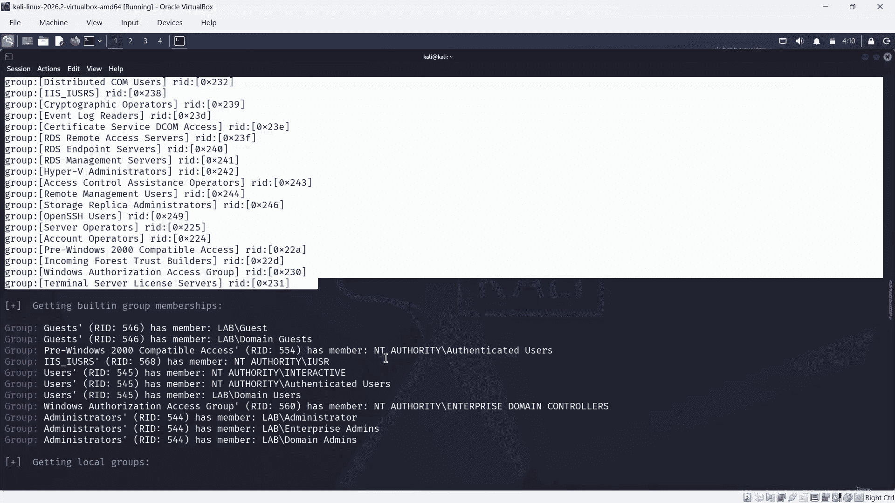
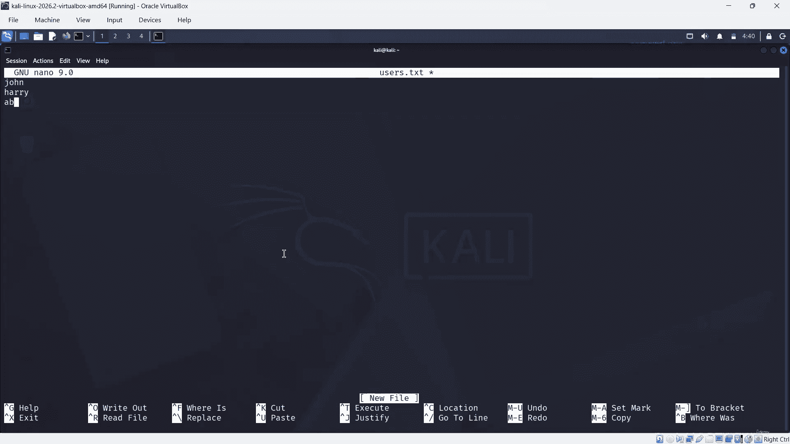

🛡️ 道德黑客与渗透测试实战（Kali Linux）：63：域枚举

在本节课中，我们将学习如何在Windows域环境中进行信息枚举。整个过程分为几个步骤，首先确认实验室里的三台虚拟机都正常运行并处于同一个网络，然后检查网络连通性，接着扫描域控制器开放的特定端口，利用带认证的枚举工具提取域内的用户、组和共享信息，最后整理出一个用户名列表，为后续的密码喷洒攻击做准备。即使你是第一次接触Active Directory，也能跟着这些步骤理解域环境是如何被渗透测试人员逐步摸清的。

## 实验室拓扑确认

在敲任何命令之前，我们需要先搞清楚实验环境长什么样。本模块需要同时运行三台虚拟机，它们分别承担不同的角色，并且必须连接在同一个仅主机网络中，也就是host-only网络。这与我们从第一模块开始一直使用的网络原理完全一致，不需要额外的网络配置。

以下是三台虚拟机的具体角色：

- 攻击机：安装了Kali Linux，用于发起扫描和枚举操作。

- 域控：配置为域控制器的Windows Server，运行Active Directory服务。

- 客户端：加入同一个域的Windows 10工作站，模拟域内普通电脑。

这三台机器都需要启动，并且只能在同一个内部网络里通信，这样我们的攻击机才能直接访问域控制器。

## 基础连通性检查

环境确认无误后，我们先做一个最基本的连通性测试。打开Kali终端，使用ping命令向域控制器发送探测包，查看目标主机是否在线。域控制器的IP地址是192.168.56.10。如果终端显示收到回复，说明网络通路正常，可以继续后续步骤。测试完成后，按Ctrl+C停止ping命令，避免持续发送数据包。

## 目标端口扫描

确认主机存活之后，我们需要找出这台机器上运行了哪些服务。针对Active Directory服务，我们扫描三个与域控制器密切相关的特定端口。使用nmap命令，指定端口88、389和445，目标IP地址是192.168.56.10。

以下是这三个端口分别对应的服务：

- 端口88：Kerberos认证协议，Active Directory用来在域内验证用户身份。

- 端口389：LDAP，轻量目录访问协议，用于查询和浏览目录结构、用户和组织单位。

- 端口445：SMB，用于文件共享以及大量Windows网络功能。

当一台机器同时开放这三个端口时，这是一个非常可靠的信号，表明该机器很可能就是Active Directory域控制器。即使在确认其他信息之前，我们也可以高度怀疑它的身份，并将其作为后续枚举的重点目标。

## 使用Nmap进行认证枚举





端口扫描只告诉我们服务开启与否，接下来我们需要深入了解域内有哪些信息。我们使用nmap工具对Windows系统进行枚举。通过提供管理员凭据进行认证枚举，可以获取未认证连接无法看到的信息，比如域内的详细配置和账户列表。

下面是示例命令：

```bash
nmap -A -U Administrator -p 'Admin123' 192.168.56.10
```

命令中的-A选项启用nmap的所有枚举检查；-U选项指定用户名；-p选项指定密码；最后是域控制器的IP地址。运行完成后，我们会得到域信息、操作系统信息、用户列表、组列表、共享资源和密码策略等内容。在渗透测试中，我们不需要逐行阅读全部输出，只关注能帮助我们理解目标环境的信息。

从输出中可以提取的关键信息包括：

- 域名：lab.local

- 已知用户名：ABC、Edmin、Gas、Harry、John等

- Windows系统及域的配置细节

这些信息让我们对目标域有了初步的全面认识，为接下来的深入查询打下基础。

## 使用NetExec LDAP枚举

SMB枚举已经给了我们很多信息，为了更直接地查询Active Directory，我们还可以使用LDAP协议。LDAP的全称是轻量目录访问协议，Active Directory使用它来存储和获取目录对象信息，比如用户、组、计算机和其他资源。这里我们使用NetExec的LDAP功能，向域控制器进行认证并执行目录枚举。

下面是示例命令：

```bash
netexec ldap 192.168.56.10 -u Administrator -p 'EdmundAdrate123'
```

命令中的ldap参数告诉NetExec我们要与LDAP服务通信；-u选项指定授权的管理员账户；-p选项指定密码；最后是域控制器的IP地址。执行成功后，会看到认证成功以及域控返回的域信息，这证明我们已经可以通过LDAP访问域控制器了。

认证通过后，我们可以针对性地查询目录中的特定对象。以下是可以枚举的主要对象：

- 用户：使用--users选项，从LDAP获取域用户信息。在我们的实验室中，返回的账号包括administrator、guest、john、harry、ABC以及服务账号。这为我们提供了一份有效的域用户名列表，可以用于后续的攻击向量分析。

- 组：使用--groups选项，获取域内组信息。组很重要，因为它们决定了域内权限是如何组织的。在真实渗透测试中，组成员身份可以帮助我们发现拥有提升权限或访问敏感资源的账号，从而确定权限提升的路径。

## 创建用户名列表



在收集完用户和组信息之后，我们需要把这些用户名保存下来，以便下一步使用。我们创建一个名为user.txt的文件，把从域中发现的专用演示账号写入其中，比如John、Harry和ABC。

下面是创建文件并写入内容的示例：

```bash
nano user.txt
```

文件内容如下：

```
John
Harry
ABC
```

验证文件内容后，我们得到一个包含三个演示用户名的文本文件。这个列表将在下一节课中用来演示受控的密码喷洒攻击，帮助我们理解如何利用已收集的用户信息进行进一步测试。

## 总结

本节课中，我们一起完成了Active Directory的基础枚举实践。首先确认了实验室拓扑和网络连通性，然后使用nmap扫描了88、389、445端口以识别域控制器，接着通过认证枚举收集了域、用户、组、共享和Windows配置信息，随后利用NetExec的LDAP功能查询了活动目录中的用户和组，最后整理出用户名列表。

这展示了一个典型的渗透测试工作流：不盲目攻击目标，而是先识别可用服务，枚举环境，收集有用信息，再根据这些信息指导后续测试。下一节课中，我们将使用这些用户名演示针对实验室专用账号的受控密码喷洒。
