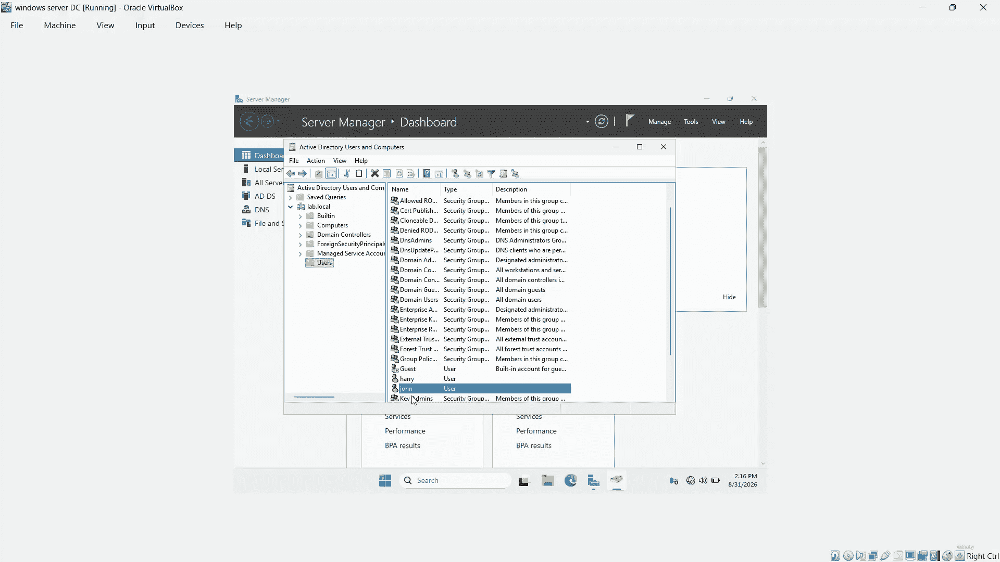
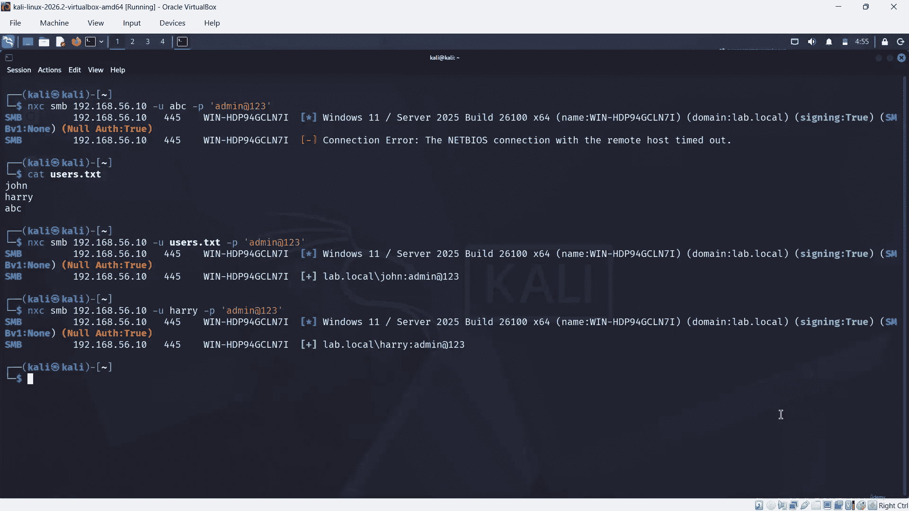

# 道德黑客与 Kali Linux 渗透测试:p64:🔓安全演示密码喷洒


在本节课中，我们将学习如何在受控的 Active Directory 实验室环境中安全地演示密码喷洒攻击。我们会先了解测试账户是如何创建的，然后使用 Kali Linux 中的工具验证单个账户凭据，接着展示如何用一个密码去尝试多个账户，最后讨论这种技术在渗透测试中的意义以及防御方法。所有操作都只在隔离的实验环境中进行，不会接触任何生产系统。


## 实验环境与测试账户

上一节我们完成了 Active Directory 枚举，并从域中收集了有效的用户名信息。本节中我们来看看如何把这些信息用于受控的身份验证测试。

以下是实验环境的主要组成部分：
- Windows 服务器作为域控制器。
- Active Directory 用户和计算机管理工具。
- 三个专门为本次演示创建的测试账户。

为了方便演示，讲师在域控制器中创建了三个专门的测试账户，分别是 ABC、Harry 和 John。这些账户仅用于本次实验练习，不存在于任何生产环境中。为了演示密码重用问题，这三个账户被故意配置了完全相同的实验室密码，即 admin Adrate 1,2,3。账户创建完成后，我们就可以切换到 Kali Linux 开始后续步骤了。




## 单个账户身份验证

在开始密码喷洒之前，我们需要先确认 SMB 身份验证能否正常工作，以及选定的测试账户是否可用。

以下是验证步骤的说明：
1. 打开 Kali Linux 终端。
2. 使用 nxc 工具配合 SMB 协议发送身份验证请求。
3. 指定目标域控制器的 IP 地址，即 192.168.56.10。
4. 使用其中一个测试账户的用户名和密码进行单独测试。

执行的命令如下：

```bash
nxc smb 192.168.56.10 -u ABC -p 'admin Adrate 1,2,3'
```

命令中的各部分含义如下：
- `nxc` 是使用的工具名称。
- `smb` 指定使用 SMB 协议。
- `192.168.56.10` 是域控制器的 IP 地址。
- `-u ABC` 指定要测试的用户名。
- `-p 'admin Adrate 1,2,3'` 指定要测试的密码。

运行命令后，我们可以看到身份验证成功。这意味着该测试账户的凭据是有效的，并且 SMB 协议能够正常与域控制器进行通信。这个已知的好凭据为后续的密码喷洒演示提供了可靠的基准。


## 密码喷洒的核心概念

在运行密码喷洒之前，有必要先弄清楚它和传统暴力破解的根本区别。

以下是两种攻击方式的对比：
- 传统暴力破解：针对一个用户名，尝试多个不同的密码。
- 密码喷洒：针对多个用户名，尝试同一个密码。

用公式表示如下：

```
暴力破解 = 1 个用户名 + N 个密码
密码喷洒 = N 个用户名 + 1 个密码
```

举个例子，假设目标用户是 John。传统暴力破解可能会尝试密码 1、密码 12、密码 123 等，全部只针对 John 这一个账户。而密码喷洒则会选定一个常见或弱密码，比如 admin123，然后分别尝试在 ABC、John、Harry 等多个账户上使用这个同一个密码。这样做的目的是找出多个账户之间是否重复使用了同一个弱密码或常用密码。


## 执行密码喷洒演示

现在我们来执行受控的密码喷洒演示。测试范围严格限制在本次实验专门创建的账户上。

以下是执行密码喷洒的步骤：
1. 确认上一节中创建的用户名列表文件 users.txt 已经准备就绪。
2. 文件中包含三个测试账户的用户名，分别是 ABC、Harry 和 John。
3. 使用 nxc 工具，将用户列表文件作为输入，只测试一个密码。

执行的命令如下：

```bash
nxc smb 192.168.56.10 -u users.txt -p 'admin Adrate 1,2,3'
```

命令中的变化在于，`-u` 选项不再指向单个用户名，而是指向用户名列表文件 users.txt，而 `-p` 选项提供我们要测试的单个密码。运行命令后，nxc 会针对文件中的每个用户名尝试 SMB 身份验证。

由于我们故意给这三个测试账户设置了相同的密码，预期结果是所有三个账户的身份验证都会成功。输出结果会告诉我们，提供的密码是否被特定账户接受。需要强调的是，我们并不是在针对单个账户尝试大量密码，而是在用一个密码去测试多个账户，这正是密码喷洒与传统暴力破解的本质区别。


## 结果分析与攻击意义

密码喷洒在 Active Directory 渗透测试中具有重要意义。很多组织都有密码策略，要求密码长度或复杂度达到一定标准。但是，密码复杂度本身并不能保证用户选择的是独特且不可预测的密码。

用户可能会根据公司名称、季节、年份或其他容易猜测的模式来选择密码。密码喷洒可以帮助渗透测试人员评估某个候选密码是否在多个账户中被重复使用。在真实的渗透测试中，这些结果需要根据规约进行记录和处理。

从防御角度来看，组织可以通过强密码策略、多因素身份验证、身份验证监控以及检测异常身份验证模式的控制措施来降低这种风险。渗透测试人员在执行任何身份验证测试之前，也必须了解组织的账户锁定策略和测试规约，以免造成意外的账户锁定或业务中断。


## 与上一节内容的衔接

本节的实践与上一节有直接的关联。在上一节中，我们执行了 Active Directory 枚举，获得了域中用户的相关信息，并将专门的测试用户名整理到了 users.txt 文件中。本节则是将这些信息应用到受控的身份验证测试中。

整个工作流程可以概括为：首先进行枚举，然后识别用户名，接着创建用户名列表，之后进行受控身份验证测试，最后识别有效凭据。这是渗透测试不同阶段相互连接的一个很好示例。


## 单独验证另一个账户

为了进一步确认密码喷洒的结果，我们可以单独验证另一个测试账户。

以下是验证 Harry 账户的步骤：
1. 使用相同的实验室密码。
2. 将用户名更改为 Harry。
3. 再次运行 nxc 命令查看身份验证结果。

执行的命令如下：

```bash
nxc smb 192.168.56.10 -u Harry -p 'admin Adrate 1,2,3'
```

运行结果同样显示身份验证成功。这证实了我们在密码喷洒中观察到的结果，即该密码确实对多个测试账户生效。


## 环境清理与恢复

这些测试账户是专门为本次实验和培训环境创建的，必须与生产环境保持隔离。当练习不再需要时，应该禁用或删除这些演示账户。此外，也可以通过恢复 Virtual Box 快照，将实验室环境重置到最初的干净状态，确保没有任何测试痕迹残留。


## 本节总结

本节课中，我们一起学习了如何在隔离的 Active Directory 实验室中安全地演示密码喷洒。首先，我们在实验室中创建了专门的测试账户；接着，使用 SMB 协议验证了其中一个账户的凭据；然后，利用枚举阶段创建的用户名列表，演示了用一个密码测试多个用户名的密码喷洒过程。



需要记住的核心概念是暴力破解与密码喷洒的区别：暴力破解通常是一个用户名加上多个密码，而密码喷洒是多个用户名加上一个密码。在我们的实践中，这种技术仅针对为这个隔离实验室专门创建的账户使用。至此，密码喷洒的入门演示就全部完成了。

