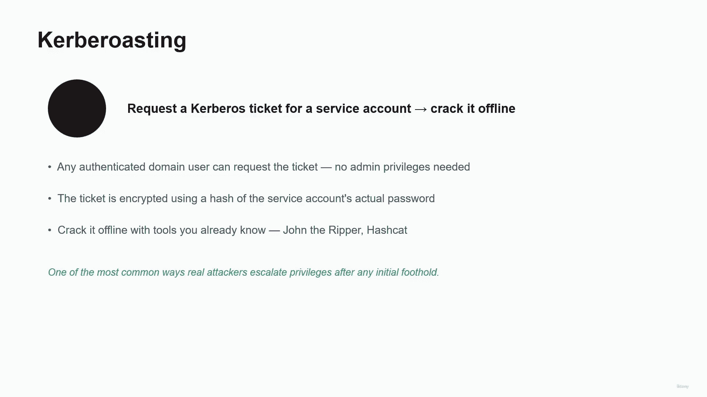
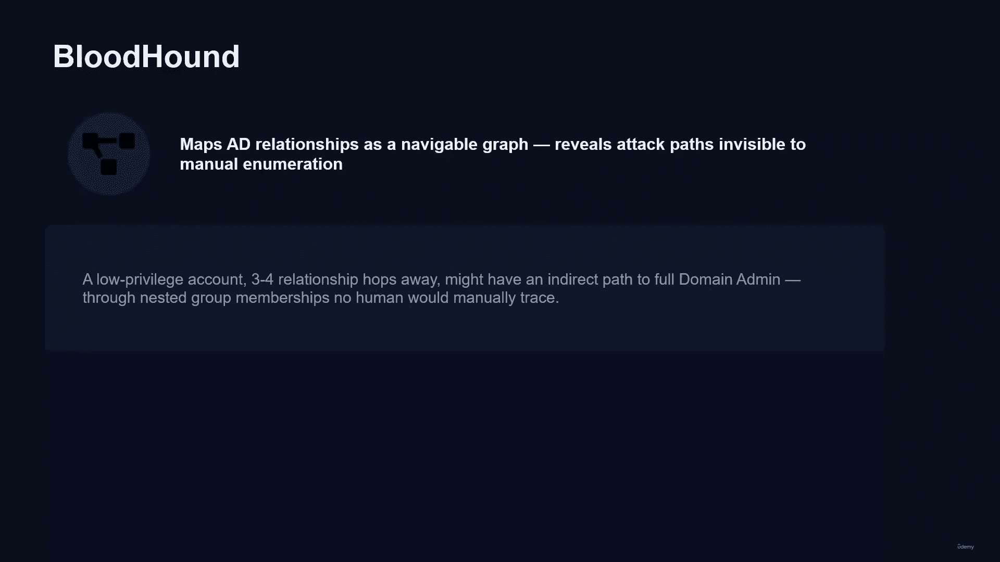
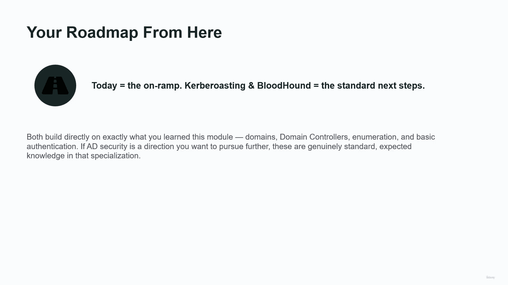
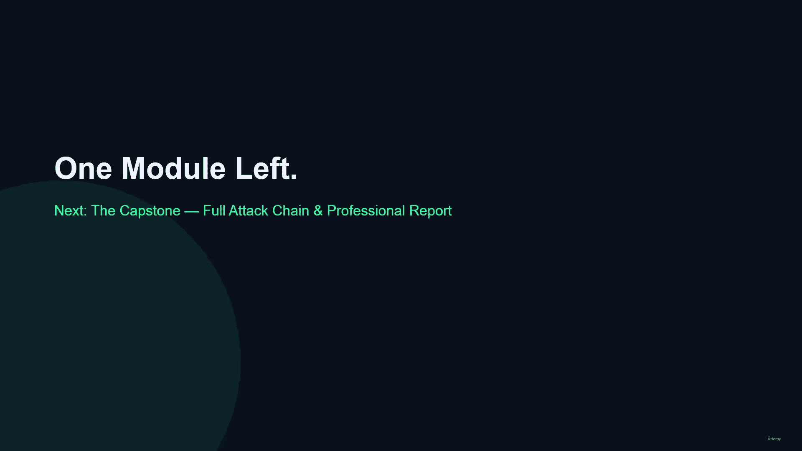

# 🔐 Kali Linux渗透测试与道德黑客：65：接下来是什么 Kerberoasting与BloodHound

## 📚 本节概述

在本节课中，我们将学习这个高级模块结束后，课程内容到底还能往哪个方向继续深入。具体来说，我会先把两个在Active Directory进阶安全学习中非常重要的名字介绍给你，一个是叫作Kerberoasting的攻击技术，另一个是叫作BloodHound的分析工具。我不会在这一节里把它们的完整操作步骤一步一步演示出来，因为每个话题都值得单独花很多时间讲解，已经超出了这个入门模块能合理覆盖的范围。不过，了解它们的名字和大致原理，对你以后继续学习会很有帮助。我们也会把本模块之前学过的核心知识点快速回顾一遍，最后展望课程结束时的实战大练习。

## 🔍 为什么要提前了解这两个方向


上一节我们介绍了Active Directory的基本认证机制，本节中我们来看看课程结束后，具体还能学习哪些进阶内容。

我想先说明一下，我这里只会从概念上简单描述这两种技术，并不会带你走一遍完整的实操流程。这两个话题都真的值得单独开一节课甚至好几节课来讲，远不是一个入门模块能在短时间内把所有细节讲清楚的。所以你不需要在这里就立刻掌握怎么动手去做，只需要知道它们存在、解决什么问题，以及和我们已经学过的知识有什么联系，就足够了。

## 🎫 Kerberoasting：基于服务票据的离线密码破解

第一个技术叫做Kerberoasting。在Active Directory里，有些账户不是给真人使用的，而是专门用来运行系统服务的。这类服务账户通常会附带一个叫做服务主体名称的标识，英文缩写是SPN，它和运行在88号端口的Kerberos认证协议有关，这个端口我们在模块最早的实战课里就见过。

Kerberoasting的核心思路可以用下面这个简单公式来理解：

```
攻击者请求服务账户的Kerberos票据 -> 票据使用该服务账户密码哈希加密 -> 攻击者把票据带走离线破解 -> 得到服务账户明文密码
```



关键点在于，任何已经通过域身份验证的普通用户，都可以发起这种票据请求，完全不需要域管理员权限。拿到加密票据之后，攻击者可以把它带到自己的机器上离线破解，不用担心触发域控的账户锁定机制。

以下是Kerberoasting攻击的关键步骤概览：

- 使用已有域用户凭证登录内网环境
- 向域控请求带有SPN的服务账户Kerberos票据
- 导出返回的加密票据
- 使用John the Ripper或hashcat等工具进行离线哈希破解
- 破解成功后获得该服务账户的明文密码

这就是为什么Kerberoasting是攻击者在域内获得初步立足点后，提升权限最常见、最可靠的方法之一。它直接复用了我们在模块10里学过的John the Ripper和hashcat工具，所以上手门槛不高，危害却很大。

## 🩸 BloodHound：Active Directory关系图谱分析工具

刚才我们讲完了Kerberoasting这个具体技术，本节中我们再来看看BloodHound，它是一个工具而不是单一的攻击手段。

在真实的企业环境里，尤其是大型组织，Active Directory可能变得极其庞大和复杂。环境里可能有成千上万个用户账户，成千上万台计算机，还有层层嵌套的组成员关系和权限依赖。人工靠我们之前练习过的原始枚举方法，几乎不可能理清楚所有关系，更找不出隐藏的攻击路径。

BloodHound解决这个问题的方式是，以程序化方式收集所有原始关系数据，然后把这些数据可视化成一个可以导航的图谱。这个图谱专门用来突出那些不明显的攻击路径，比如说：

- 看起来权限很低的某个普通用户账户
- 经过三四次组成员或权限关系的跳转
- 最终可能间接获得完整域管理员访问权限



如果没有这种系统化的可视化分析，这样的攻击路径在实际中几乎是不可见的。

## 🗺️ 这两个知识点如何衔接已学内容

我之所以特意提到这两个名字，而不是直接跳过，是希望你离开这个模块时，能带着准确、真实的学习路标继续前进。

如果你在完成本课程后，决定继续深入Active Directory安全领域，那么Kerberoasting和BloodHound就是任何在这个方向工作的人都应该掌握的标准知识。它们都直接建立在我们本模块学过的基础概念之上，包括域、域控制器、枚举方法，以及底层的认证机制。



## 🔁 本模块知识回顾

在进入最后总结之前，我们先把这个高级模块学过的内容再梳理一遍。

我们学习了Active Directory到底是什么，以及为什么攻破域控制器可能意味着整个组织基础设施一次性被攻破。我们用Nmap和Adsearch枚举了一个真实域，在不需要任何预先凭证的情况下，发现了用户、共享和域结构。我们还演示了如何针对专门创建的测试账户，安全地进行密码喷洒攻击。最后，我们预览了Kerberoasting和BloodHound，作为想要深入这个专业方向的学习者的准确下一步。

## 🏁 课程结尾与下一节展望

本模块的最后一节课是下一节，也就是我们的课程大练习。届时我们将从零开始，完成一条完整的端到端攻击链，期间不会对工具语法进行手把手指导，然后把发现的所有内容整理成一份专业风格的渗透测试报告。我们下节课见。

## 📝 本节总结



本节课中我们一起学习了高级模块收尾时的后续学习方向，重点介绍了Kerberoasting技术和BloodHound工具，回顾了Active Directory基础、域枚举和密码喷洒等核心内容，并展望了课程最后的端到端实战与报告编写环节。

