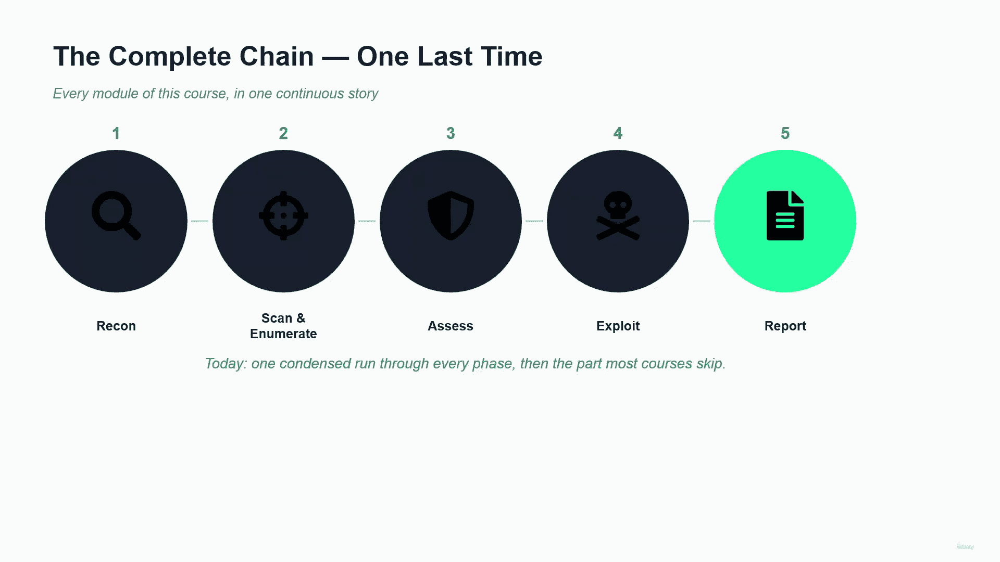
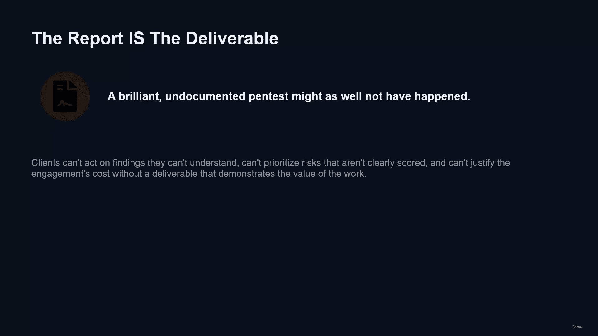
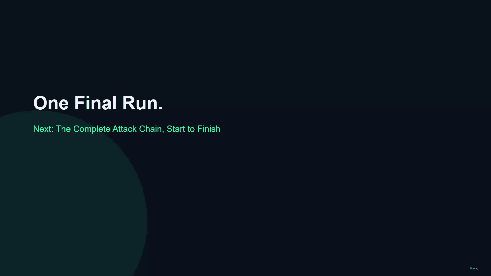

# Kali Linux 道德黑客与渗透测试实战：66：为什么这个结业项目很重要 🎯

在本节课中，我们将学习整个课程的最后一块内容。今天的任务非常明确，主要包含两个部分。第一部分是从头到尾独立完成一次完整的攻击链，过程中不再提供工具语法的逐步指导。第二部分是按照真正专业人员的方式，把整个渗透测试过程写成一份正式报告。

我想诚实地说明，之所以把今天的课程安排成这样，是因为这个安排背后的理由真的很重要。很多学习者在学完所有工具之后，容易忽略把这些工具串联起来的能力，也容易忽略把结果交给客户的能力。今天我们就专门来弥补这两个缺口。

接下来我们先来回顾一下，在整个课程中我们一起构建的完整方法论链条。今天的课程之所以重要，正是因为它把之前学过的每一个知识点，都串联成了一个连贯的完整故事。我们不再是零散地学习十一个不同的模块，而是把它们看作一个整体。

以下是课程中涵盖的主要阶段：

- 侦察阶段，使用 Whois、Google 搜索技巧和 theHarvester 等工具，去了解目标的基本信息。
- 扫描与枚举阶段，使用 Nmap 发现目标上哪些端口是开放的，哪些服务正在运行。
- 漏洞评估阶段，使用 OpenVAS 等工具，把开放的端口转化为有实际得分的安全发现。
- 漏洞利用阶段，使用 Metasploit 直接攻击这些发现，把理论上的漏洞变成真正的访问权限。
- Web 应用攻击阶段，使用 SQL 注入和跨站脚本攻击等手段，针对网站程序本身进行测试。
- 密码破解阶段，使用 Hydra、John the Ripper 和 Hashcat 等工具，尝试破解密码和哈希值。
- 高级阶段，进入 Active Directory 环境，学习域内渗透的相关知识。

这个攻击链可以用一个简单的公式来表示：

渗透测试攻击链 = 侦察 → 扫描与枚举 → 漏洞评估 → 漏洞利用 → 报告编写

在这个公式中，每一个箭头都代表一个必须完成的步骤，任何一步缺失都会导致整个测试不完整。

在今天的课程中，我们将按照这个链条，跑一遍浓缩版的完整攻击过程。跑完之后，我们还要做一件大部分初级课程完全跳过的事情，那就是编写结业报告。

接下来我要直截了当地说明，为什么报告写作值得拥有一个独立的讲座板块。而不是仅仅作为课程末尾简短的附加内容。在真实的专业实践中，报告通常就是客户支付费用所得到的实际交付物。

我们可以把整个渗透测试过程，从客户的商业角度来看，分成两部分。第一部分是实际的黑客攻击工作，也就是整个课程中最有趣的部分，但从客户的角度来看，这本质上只是调研阶段。第二部分才是报告，报告才是客户高层管理人员真正阅读的内容，报告才会被分发给技术团队用于修复漏洞，报告还可能被引用在合规文档中，而且，报告才是真正证明这笔开支合理、证明整个项目有价值的依据。

这里有一个非常重要的职业道理，我想留给你们。一次技术上无懈可击的渗透测试，如果文档编写得不好，从客户的实际角度来看，这项工作可能等于没有做过。因为客户无法采取他们无法理解的发现，无法优先处理没有明确评分的风险，而且，如果最终交付的成果不能清晰展示工作所带来的价值，他们甚至无法证明最初批准这笔预算是正确的。

相反，一份写得真正好的报告，哪怕只记录了比较有限的发现，也能展现真正的专业素养，并建立起那种能让首次合作的客户变成回头客的信任关系。

之所以在整个课程中让你们保存实际的命令输出，也是出于同样的实际考虑。比如模块五中保存的 Nmap 扫描结果，模块六中导出的 OpenVAS PDF 报告，这些都不是无意义的练习。在你们当时可能没有意识到，但实际上，你们正在构建自己的证据链，这正是一次真实的专业渗透测试所要求的。

今天的结业报告，将会变成一份真正的作品集作品。这是你们以后可以拿去展示给潜在雇主或客户的东西，它能证明你们不仅仅知道如何运行工具，还能够清晰、专业地传达技术发现，并且让非技术背景的决策者也能看懂，并据此采取行动。

好了，内容到这里就讲完了。下节课我们将针对 Metasploitable 2 运行最终的浓缩攻击链，高效地完成我们在整个课程中分别练习过的每一个阶段。

本节课中我们一起学习了为什么结业项目很重要，回顾了完整的渗透测试方法论链条，探讨了报告写作在专业实践中的核心地位，并了解了如何将命令输出转化为证据链和作品集作品。
