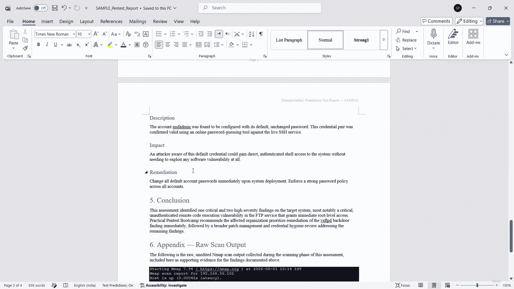
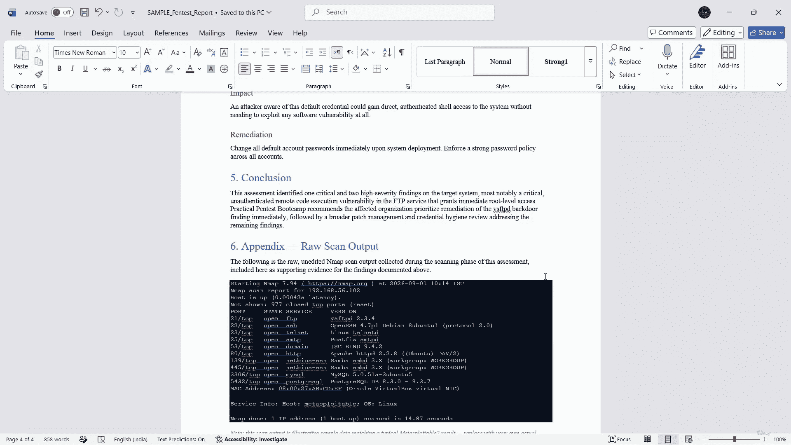
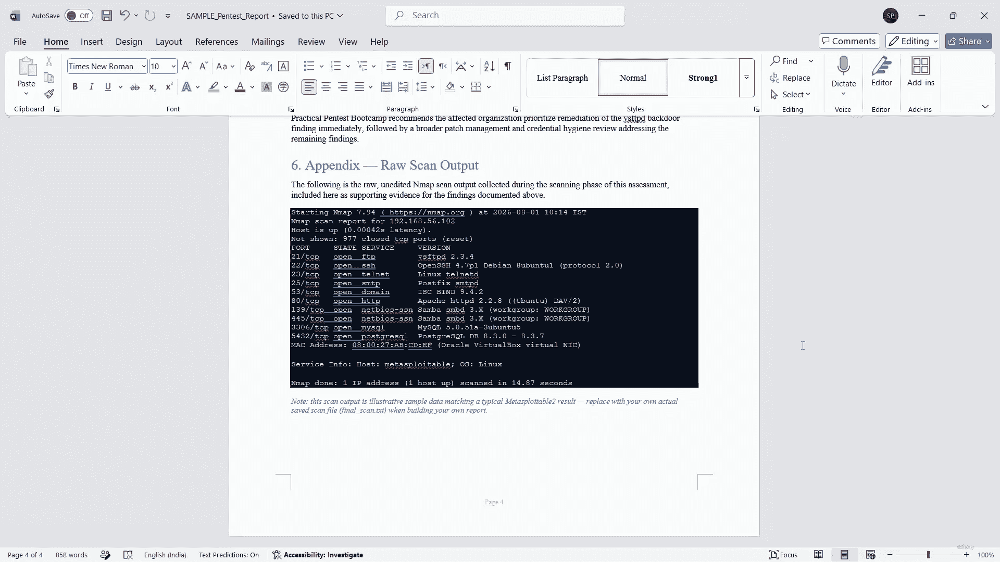

# 🛡️ Ethical Hacking & Penetration Testing with Kali Linux：68：完整渗透测试报告逐节解析

在本节课中，我们将要学习如何逐节查看一份真实完整的渗透测试报告。通过这一节，你可以在自己动手撰写报告之前，先对一份真实的渗透测试报告长什么样子有清晰具体的认识。课程中展示的示例报告，是基于我们在上一节课中一起利用的完全相同的 VSFTPD 漏洞构建完成的，并且还额外增加了一两个发现，这样你就能看出一份发现表包含多行内容时，实际阅读效果是什么样子。


本节我们先从报告的最顶部开始来看。标题页的设计故意保持简单，只包含报告标题、对评估的一句话描述、报告准备对象、报告编写人、日期以及目标系统。这里没有什么复杂的内容，但你要注意它看起来干净专业，这一点非常重要，因为当客户打开这份文档时，第一印象至关重要。


接下来我们来看执行摘要部分。我希望你能和我一起大声把这段话读一遍，因为语气和内容同样重要。在本次评估过程中，在目标环境的 FTP 服务中发现了一个严重漏洞，该漏洞允许未经授权的完全管理员访问受影响的系统，强烈建议立即进行修复。整段话只有两句话，不出现任何工具名称，也不包含任何命令语法。这是因为有些高层利益相关者可能只会完整阅读这一个部分，所以这部分必须能够完全独立地站得住脚。


上一节我们介绍了执行摘要，本节中我们来看看范围与方法论部分。这一部分详细记录了到底测试了什么，以及如何测试，会按名称引用我们的五阶段方法论，并列出目标系统、测试环境、测试时间窗口以及授权依据。这部分内容能够保护你和客户双方，因为它清晰界定了实际评估的边界。


以下是关于发现摘要部分的说明。这是整份文档中最有用的章节之一。你可以快速浏览这个表格，每一行紧凑地包含发现名称、严重程度、受影响的主机和 CVE 参考编号，并且按严重程度进行颜色编码。客户的领导层只需扫一眼这一个表格，就能立刻了解整体风险状况，而不需要先阅读任何一段技术细节。


然后我们进入详细发现部分，这是整份文档真正的技术核心，所以你必须认真看。每个发现都重复使用同样的四部分结构。以下是详细发现部分的四个组成部分：

1. 描述
2. 复现步骤
3. 影响
4. 修复建议

我们可以把这个结构写成下面这样。

```
发现结构 = 描述 + 复现步骤 + 影响 + 修复建议
```

让我们把这个发现完整读一遍。在描述部分，目标 FTP 服务运行的是 ProFTPD 1.3.3c 版本，该版本包含一个已知的后门漏洞，一旦被触发，未经过身份验证的远程攻击者就可以在受影响的系统上获得具有 root 级别权限的命令行 shell。关于复现步骤部分，我希望你注意一个具体的地方：步骤必须精确且带编号，详细到另一位合格的测试人员或客户自己的内部安全团队，都能按照这些确切步骤，独立验证这个发现本身。这就是这一部分需要达到的标准。再看影响部分，它专门将我们的原始技术事实，也就是 root 级别 FTP 访问权限，转化为真正的业务后果，例如数据泄露、系统被进一步攻陷，以及向其他系统横向移动。这才是真正能促使客户尽快优先修复问题的语言。同样的四部分结构，会在我们的其他两个发现，也就是第 4.2 节和第 4.3 节中重复出现，结构完全一致。






最后我们来看结论部分，会简要总结整体风险态势，随后是附录部分，里面存放着原始未经编辑的扫描输出结果。这些原始证据支撑着整份文档中提出的每一个主张。到这里，一份完整专业的报告就从头到尾讲解完毕了。在下一节课中，我们将使用上一节课中自己攻击链的真实发现，来构建你自己的这份报告版本。




本节课中我们一起学习了完整渗透测试报告的每一部分，包括标题页、执行摘要、范围与方法论、发现摘要、详细发现，以及结论和附录。你现在已经了解了一份专业报告应该包含什么内容，以及每个部分的写作要点，为接下来动手编写自己的渗透测试报告打下了基础。

