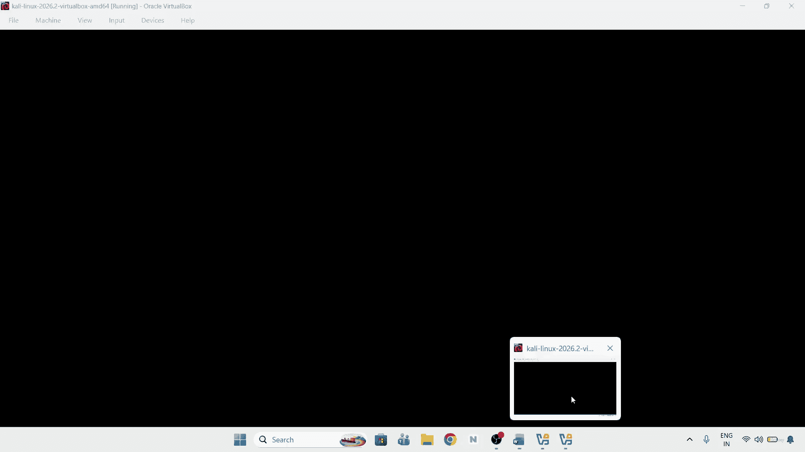
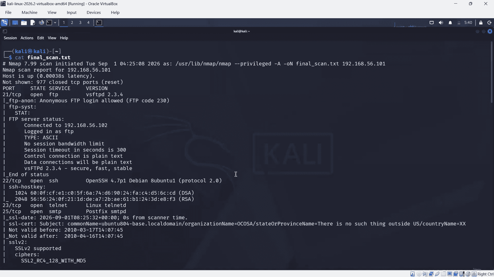
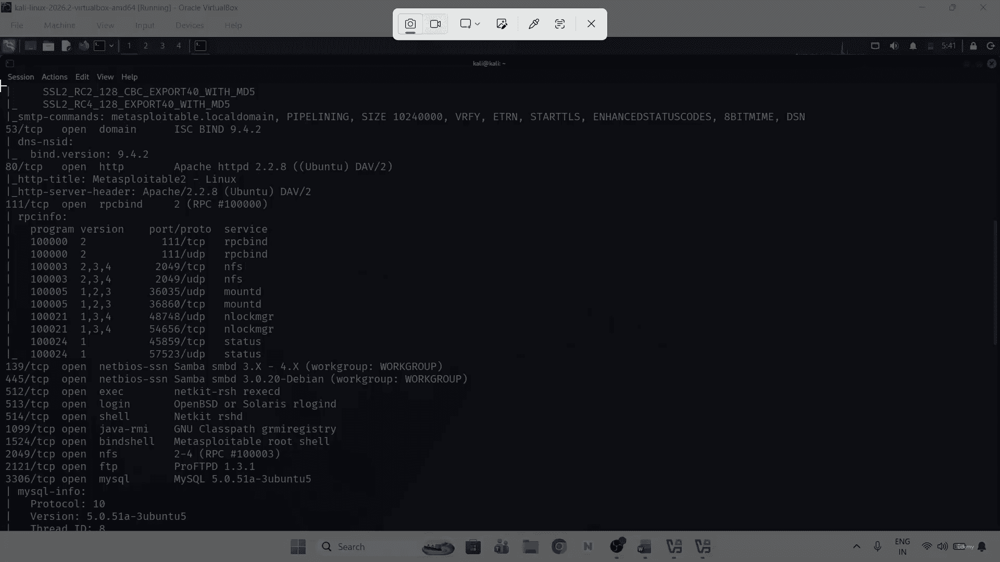
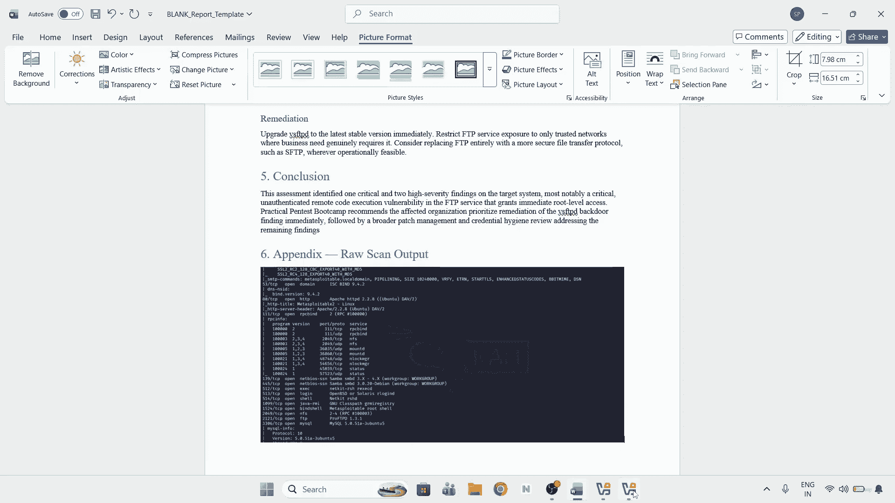
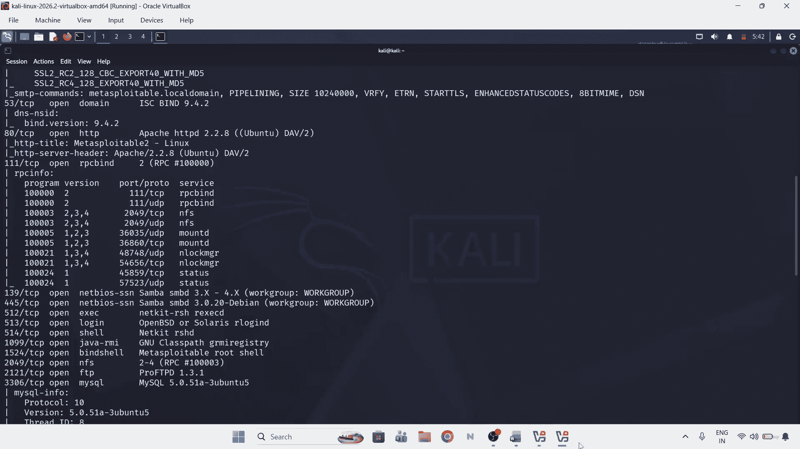
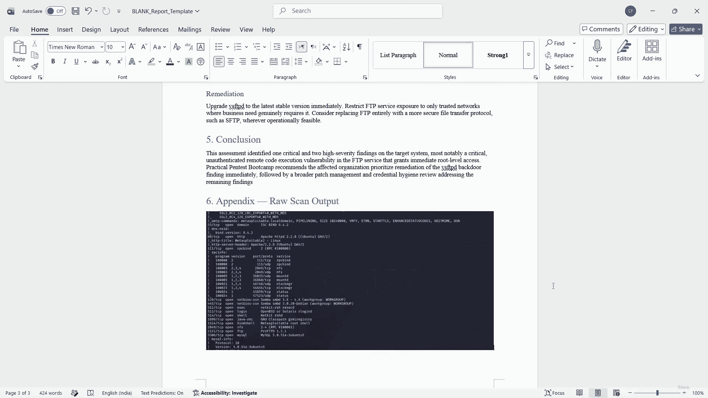

# Udemy - Ethical Hacking & Penetration Testing with Kali Linux：69：构建你自己的报告 📄

## 课程概述 📚

在本节课中，我们将学习如何使用Kali Linux搭建属于自己的渗透测试报告。我们会参考之前讲解过的示例报告，结合空白模板，逐步完成一份专业风格的渗透测试报告。

报告的内容可以用下面这个简单的公式来理解：

```
最终报告 = 可以重复使用的通用模板语言 + 特定于本次测试的独特细节
```

也就是说，那些在每次渗透测试中都不会变的通用文字，可以直接复制粘贴；而那些只有你本次测试才有的信息，比如目标IP、测试日期、你亲自抓到的截图，则需要亲自填写。下面我们就一步步来看具体怎么做。

---

## 准备报告模板与示例 📂

本节我们来看看报告制作的基础准备工作。

讲师打开了两个文档，一个是空白报告模板，另一个是已经写好的示例报告。我们手头的VSFTPD漏洞发现，与示例报告中已经记录的内容在实质上完全一致。这意味着我们可以高效地直接复制示例中的措辞到自己的文档里，只需要输入那些真正属于你本次测试的独特细节。

以下是报告制作的核心思路：

- 示例报告中通用的语言可以直接复制使用
- 需要亲自填写的内容包括你的姓名、评估日期、目标系统以及你亲自抓取的证据
- 重复使用经过验证的写法，并不是偷懒，而是专业渗透测试人员的常规操作

在真实的专业工作中，有经验的渗透测试人员会习惯性地重复利用自己过去针对已知漏洞所写的内容，而不是每次都从零开始重新解释同一个漏洞。分清哪些内容可以安全重复使用，哪些内容必须反映你自己的实际工作，本身就是一项真正的专业技能。

---

## 编写报告标题页 📋

有了模板和示例之后，下一步我们来填写报告的标题页。

讲师会将空白报告附带在本节课中，你可以下载后使用。我们先从标题页开始，参照示例报告复制整体结构，然后只输入少量的特定细节。

以下是标题页需要填写的项目：

- 报告标题：从示例报告中直接复制粘贴
- 编制人姓名：输入你自己的名字
- 编制对象：说明这份报告是为谁准备的
- 评估日期：填写报告完成的日期
- 目标系统：填写被测试的目标IP地址，例如 `192.168.56.101`

标题页看似简单，但它是整份报告的门面，填写准确能让读者一眼看出这是针对哪个目标、在什么时间完成的评估。

---

## 撰写执行摘要 📝

完成标题页后，我们继续向下，来到执行摘要部分。

示例报告中括号里的说明是给学生看的，你可以直接删掉，然后根据实际情况填写所需内容。为了节省时间，我们可以直接把示例报告中的执行摘要文本复制过来，不需要强行重新写一遍。

执行摘要的作用是让管理层或非技术人员快速了解本次渗透测试的整体情况和主要发现，所以这里的语言可以保持通用，不必刻意修改。

---

## 设定范围与方法论 🔍

接着，我们进入范围与方法论部分。

这里只需要做少量的修改，主要是把目标系统替换成你本次测试的实际IP地址，并填写对应的日期。其余部分可以保持不变，不需要大动。

范围与方法论说明了本次测试覆盖了哪些系统、采用了什么样的测试方法，是报告中不可或缺的一部分。

---

## 制作发现表 📊

接下来是发现表部分，也就是报告中记录漏洞清单的地方。

在发现表中，讲师只做了一处编辑，就是针对VSFTPD这一条发现。你需要填写发现名称、目标IP地址、开放端口以及对应的CVE参考编号。

以下是发现表中需要填写的关键字段：

- 发现名称：你发现的漏洞名称，例如VSFTPD相关漏洞
- 目标IP：被攻击系统的IP地址，例如 `192.168.56.101`
- 端口号：漏洞所在的服务端口，例如 `21`
- CVE编号：漏洞的唯一标识编号，因为每个漏洞都是独特的

注意，表格中的其他行如果不涉及你的发现，可以暂时保留或根据需要处理。

---

## 撰写详细发现部分 📄

有了发现表之后，我们继续进入详细发现部分。

这里我们可以直接把示例报告中的第4.1条发现完整复制过来，包括漏洞描述、复现步骤、影响分析和修复建议。不过在复现步骤里，有一些细节必须改成你自己的测试环境信息。

需要替换的关键信息如下：

- 远程主机：即被测试的目标IP地址
- 本地主机：即你用来发起测试的Kali Linux机器IP地址，例如 `192.168.56.102`


其余内容可以保持不变。详细发现部分是报告的技术核心，写清楚了之后，其他人就能按照你的步骤重现这个漏洞。



---

## 撰写结论与附录 📎



最后，我们来处理结论和附录两个部分。



结论部分可以直接从示例报告中复制，不需要额外修改。附录部分是报告的最后一章，我们不再从示例文件复制，而是直接从Kali Linux的扫描结果中获取内容。

你可以使用以下命令查看之前保存的扫描文件：





```bash
cat final_scan.txt
```

对于附录中的证据材料，你有两种选择：一种是直接复制粘贴文本内容，另一种是截取Kali Linux界面的截图，然后将截图插入报告中。讲师在这里选择了截图的方式，把Kali Linux的扫描结果图片附在报告里。

附录的作用是提供原始证据，让报告的结论更具说服力。

---

## 课程总结 🎓

在本节课中，我们一起学习了如何基于空白模板和示例报告，高效地构建一份完整的渗透测试报告。我们完成了标题页、执行摘要、范围与方法论、发现表、详细发现、结论以及附录等所有主要部分。



这份报告融合了你亲自输入的特定信息，以及针对已知漏洞的通用语言，正是经验丰富的专业渗透测试人员在实际工作中的常见做法。下一节课将是本课程的最后一章，我们会对所学内容进行诚恳的反思，并探讨之后该如何继续前进。
