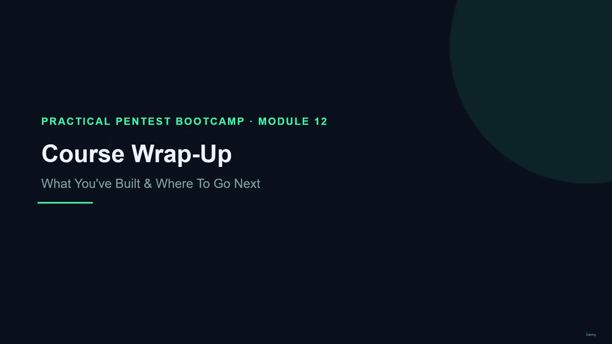
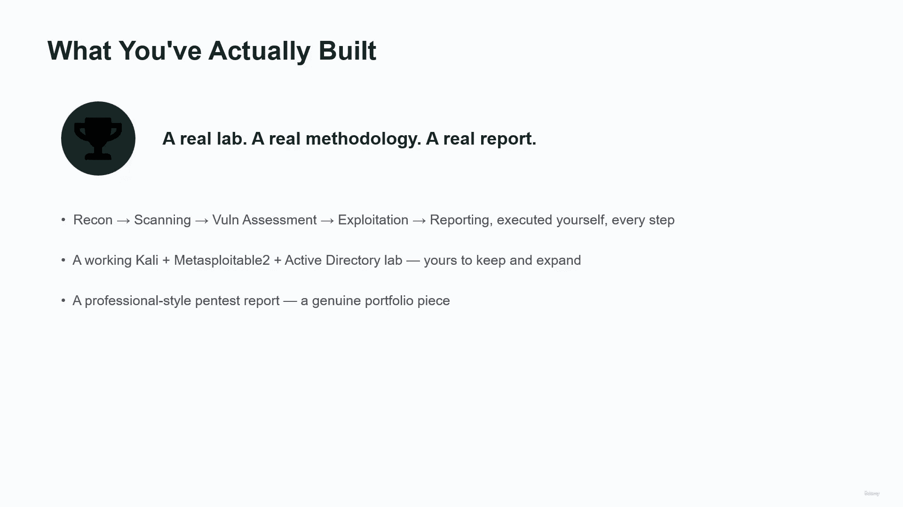
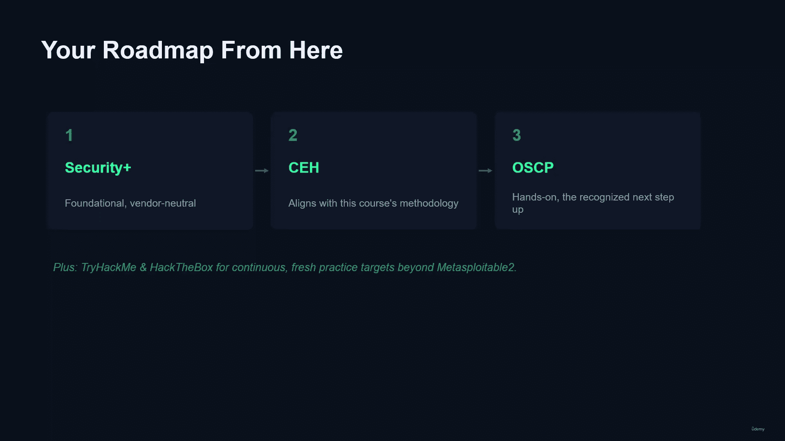
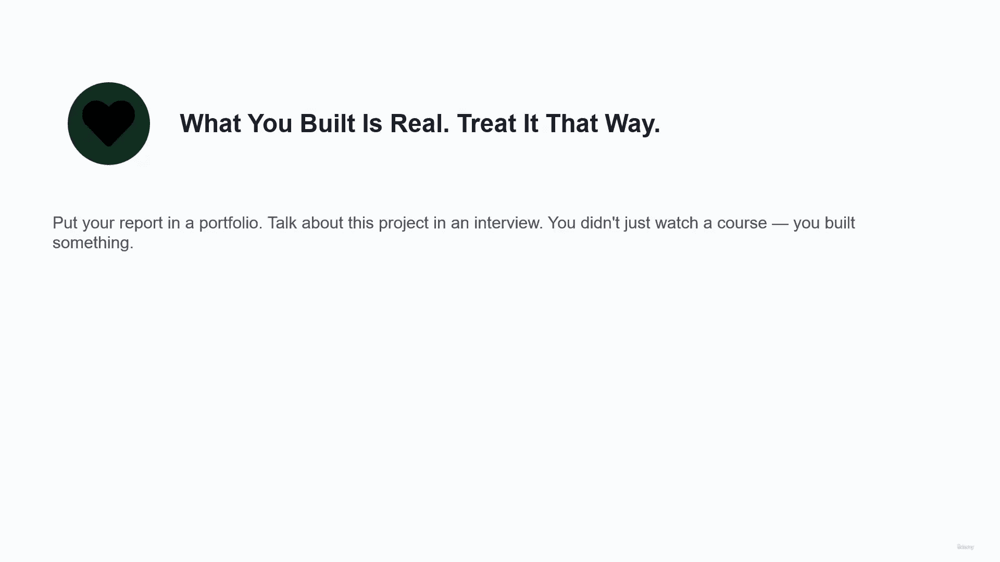
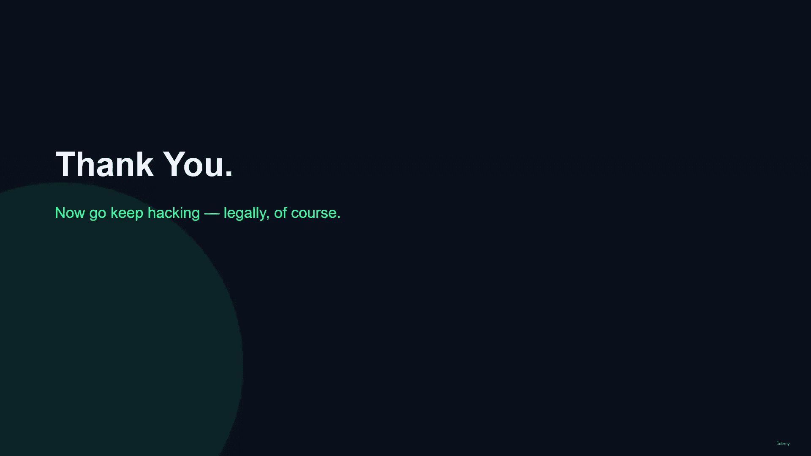

# 道德黑客与渗透测试：第70章：课程收官与后续方向 🎯

在本节课中，我们将一起回顾整个课程的学习成果，梳理你在过去12个模块中实际搭建的环境和完成的实操任务，并探讨课程结束后可以如何继续成长。这不仅是最后一堂课，也是对你之前所有努力的一次正式总结，而不是在最后一个实操步骤之后草草结束。


## 一、课程学习概述



接下来的内容会分几个部分展开。我们会先看看你从零开始到底建立了什么样的渗透测试实验环境，然后回顾你亲手完成的完整攻防流程。接着，我会和你分享未来学习中真正值得长期坚持的核心思维，而不是单纯记忆某个工具的命令。最后，我会给出几条具体可执行的后续建议，并提醒你如何把本课程的成果转化为实际竞争力。


## 二、你从零开始搭建的实验环境

你一开始只有一台空白笔记本电脑，而且手头没有任何现成的黑客实验室。经过12个模块的学习，你已经亲自构建起一套完整可用的渗透测试环境。这套环境包含Kali Linux及其相关功能包，之后你还搭建了一个真实的活动目录域，里面有Windows Server域控制器和一台加入域的Windows 10客户端。这套实验环境现在就保存在你的机器上，属于你个人，你可以无限期地保留、扩展，并在课程结束后继续使用。

以下是你在课程中搭建的关键环境组件：

- Kali Linux操作系统及其工具集
- Windows Server域控制器
- 加入域的Windows 10客户端主机
- 可重复使用的内网渗透实验室


## 三、你亲手完成的完整渗透测试流程

你不仅仅是旁观别人演示，而是在每一个步骤上都亲自动手完成了完整的真实世界渗透测试方法论。这套流程可以用下面的公式来表示：

```text
渗透测试流程 = 信息收集 → 漏洞扫描 → 漏洞利用 → 权限获取 → 后渗透测试 → 清理痕迹 → 编写报告
```

具体来说，你经历了以下每一个阶段：

- 使用whois、DNS枚举和theHarvester进行信息收集
- 使用Nmap进行多种类型和配置的端口与服务扫描
- 使用OpenVAS进行漏洞评估，并学会根据CVSS评分阅读和优先处理风险
- 使用Metasploit框架进行漏洞利用，多次获得真实的root权限
- 针对真实存在漏洞的目标应用，手动执行SQL注入和跨站脚本攻击
- 使用三种不同工具开展密码攻击，每种工具适用于不同的真实场景
- 接触活动目录，初步进入企业级网络环境
- 编写一份按照付费客户预期标准撰写的完整渗透测试报告


## 四、方法论比具体工具更重要

我要诚实地告诉你一件重要的事情：这门课程为你打下了扎实的基础，但网络安全领域非常庞大，而且一直在快速变化。课程中遇到的具体工具版本、默认行为以及绕过方案，随着时间的推移都会继续发生变化，就像这12个模块里已经出现过的变化一样。

从长远来看，真正重要的技能不是死记硬背今天的精确命令文本，而是你建立起来的方法论本身，以及我们共同养成的系统化思维方式。这个底层流程可以简单总结如下：

```text
核心原则 = 先信息收集，再扫描，再利用漏洞，最后务必文档记录
```

不管五年后哪些工具流行，这个基本流程都会保持价值。




## 五、课程后的具体学习建议

我不想只是泛泛地说“继续学习”，而是想给你一些真正具体且可操作的下一步方向。

如果你打算走认证路径，那么CompTIA Security+是一个扎实的基础起点，前提是你还没有同等经验；而CEH认证与我们在这门课中覆盖的方法论非常契合。

如果你希望继续动手提升实战能力，那么TryHackMe和Hack The Box这两个平台提供大量新鲜的合法练习目标，远远超出了Metasploitable的范围。同时，你自己机器上的实验室依然能够教你更多东西。

以下是你可以立即尝试的后续行动：

- 下载另一个故意存在漏洞的虚拟机镜像
- 不看脚本指导，完全独立地对这台新目标运行相同的渗透测试方法论
- 在自己的实验室里重复每一个步骤，直到能够熟练完成




## 六、你的成果具有真实价值

最后，我真诚地想说一句：你在上一节课编写的那份报告，以及你在这门课中搭建的整个实验环境，都是真实的、可触摸的实际技能证明。

你可以把这份报告放进作品集，在求职面试中谈论这个具体项目，也可以在与自由职业客户沟通时展示。你不仅仅是看完了一门课程，你是亲手构建了真实的东西。请从现在起，按这种方式看待自己的成果。




## 七、课程总结

本节课中，我们一起学习了如何回顾课程中搭建的渗透测试环境，复盘了从信息收集到报告编写的完整实操流程，探讨了方法论比工具版本更持久的核心价值，并列出了认证与实战平台等后续学习路径。



感谢你坚持完成了全部12个模块。现在去构建下一个项目，并且请始终记住：获得授权，合乎道德，严格按照我们在整个课程中一起实践的方式行事。

