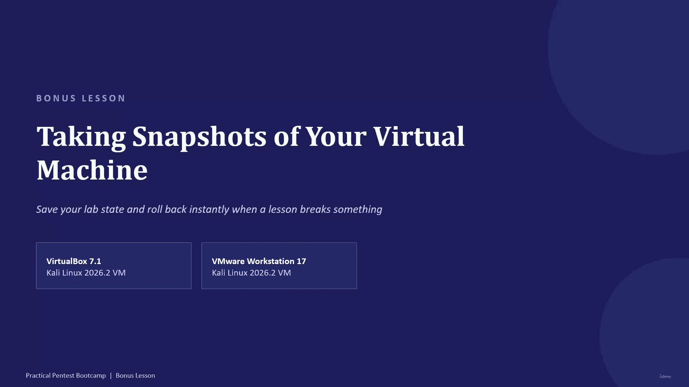
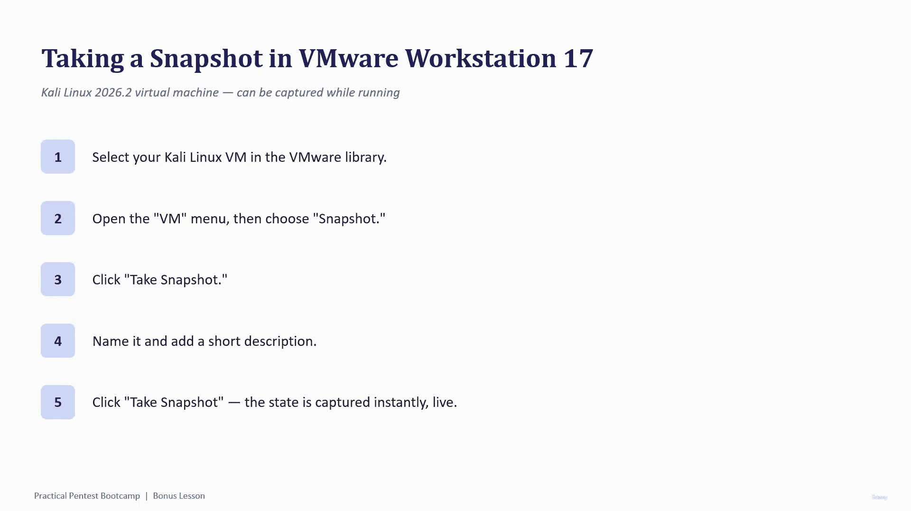
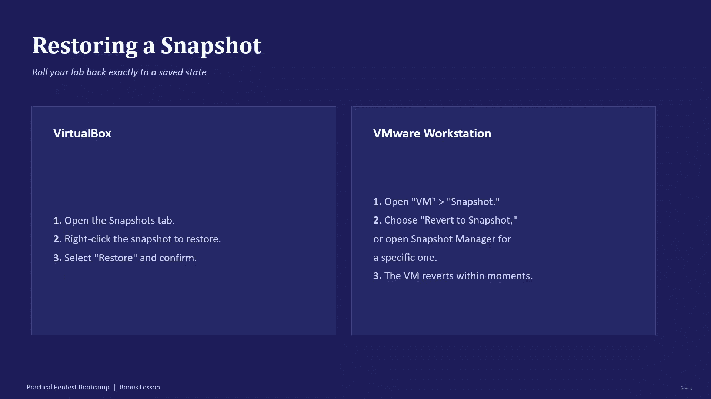
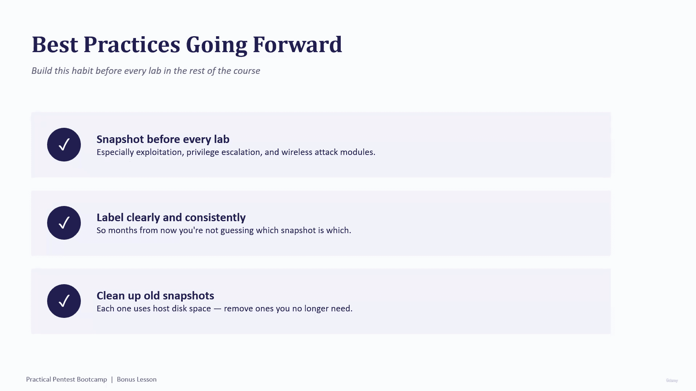

Ethical Hacking & Penetration Testing with Kali Linux：71：虚拟机快照 📸

在本节课中，我们将学习如何为Kali Linux虚拟机创建快照，理解快照的作用，掌握在VirtualBox和VMware中拍摄与恢复快照的具体步骤，并养成在每个实验前拍快照的好习惯，这样即使实验搞坏了系统，也能快速恢复，不需要重新安装操作系统。



---

什么是虚拟机快照

上一节我们介绍了Kali Linux渗透测试环境的基本搭建，本节中我们来看看如何保护这个环境，避免在实验中不小心把系统搞崩溃。

如果你一直跟着课程练习，尝试各种漏洞利用，安装不同的工具，或者故意在Kali Linux实验室里破坏一些东西，那么你一定知道，虚拟机环境非常容易被搞乱。一旦某个配置改错了，或者某个工具安装失败导致系统不稳定，你可能需要花几个小时甚至重新安装整个操作系统。

快照的概念可以用下面这个公式来描述：

```
快照 = 虚拟机在时间点 T 的完整状态
     = {所有文件, 所有设置, 所有已安装工具}
```

你可以把它想象成电子游戏里的存档点。当你在这一个时间点之后做了某些操作，如果结果不好，你不需要从头开始重装操作系统，只需要回滚到这个快照，所有内容就会恢复到保存时的样子，连每一个文件、每一个设置、每一个安装的工具都会原样返回。

---

什么时候必须拍快照

在学习渗透测试的过程中，有一些关键时刻拍摄快照几乎是强制性的。以下是这些关键时刻：

- 全新安装Kali Linux完成后，在安装任何额外软件之前拍摄一次快照。
- 设置完所有核心工具并完成更新之后拍摄一次快照，这样你随时都有一个干净且可直接使用的基准线。
- 在开始任何风险较高的实验之前拍摄快照，例如测试权限提升漏洞、进行无线攻击，或者任何会修改系统文件和网络设置的操作。

如果这些实验不小心把系统弄坏了，你只需要把虚拟机恢复到之前的快照，就不用浪费几个小时重新搭建环境。

---

在VirtualBox 7.1中创建快照

既然大多数同学使用的是Kali Linux最新版对应的VirtualBox 7.1，我们就先来看看在这个虚拟化软件里如何拍快照。整个过程不复杂，只需要按照下面的步骤操作即可。

以下是创建快照的步骤：

第一步，确保你的虚拟机处于关机状态或者暂停状态。当然，VirtualBox也支持在虚拟机运行时直接拍快照，但为了保险起见，建议先关机或暂停。

第二步，打开VirtualBox Manager主界面，在左侧面板中找到并选择你的操作系统，也就是你的Kali Linux虚拟机。

第三步，点击窗口上方附近的“快照”选项卡，你会看到一个相机图标。

第四步，点击这个相机图标按钮。此时会弹出一个小窗口，要求你给快照命名，并且可以添加一个可选的描述。建议使用清晰的名称，比如“clean install”或者“before wireless lab”，这样以后一看就知道这个快照保存的是什么状态。

第五步，点击确定按钮。几秒钟之后，VirtualBox就会保存虚拟机的完整状态。

---

在VMware Workstation Pro 17中创建快照

如果你使用的是VMware Workstation Pro 17而不是VirtualBox，创建快照的过程同样简单，只是菜单位置和界面外观有一些区别。以下是具体的操作流程：

首先，确保你的Kali Linux虚拟机已经选中，然后点击顶部的“VM”菜单。

接下来，在VM菜单内部找到“Snapshot”选项，然后点击“Take Snapshot”。

和之前一样，系统会提示你给快照命名并添加描述。点击确定后，VMware会立即捕获当前的虚拟机状态。

VMware在这里有一个优势，就是你可以在虚拟机正在运行的时候直接拍快照，不需要先暂停任何东西。这在你想要捕获某个非常特定的中段会话状态时非常有用。

---



如何回滚快照

拍快照只是第一步，真正关键的是知道出了问题之后如何回滚。无论你使用的是VirtualBox还是VMware，恢复流程都很简单。

以下是在VirtualBox中回滚快照的方法：

回到刚才的快照选项卡，右键点击你想要恢复的那个快照，然后选择“Restore”。确认操作之后，你的虚拟机就会完全恢复到那个保存的状态。

以下是在VMware中回滚快照的方法：

进入顶部的“VM”菜单，然后选择“Snapshot”，接着点击“Revert to Snapshot”。如果你有多个快照并且想要选择某一个特定的，也可以使用快照管理器来完成。

无论用哪个软件，几秒钟之内，你的整个实验环境就会回到保存时的样子，不需要你手动进行任何清理工作。



---

养成拍快照的好习惯

在本节课的最后，我想建议你养成一个简单的习惯：从现在开始，在本课程的每一个实验之前，都先拍摄一次快照。特别是那些涉及漏洞利用、权限提升或者无线攻击的实验，更不要忘记。

以下是一些命名和管理建议：

- 给快照起清晰且一致的名字，这样几个月后你不需要猜测每个快照代表什么。
- 定期清理不再需要的旧快照，因为每个快照都会占用主机的磁盘空间。

有了这个习惯，你就可以在本课程的每一个实验中自由尝试，完全不必担心永久把环境弄坏。

---



本节课中我们一起学习了虚拟机快照的基本概念，掌握了在VirtualBox 7.1和VMware Workstation Pro 17中创建快照的步骤，了解了如何回滚快照以恢复环境，并且认识到在渗透测试实验前养成拍快照习惯的重要性。

