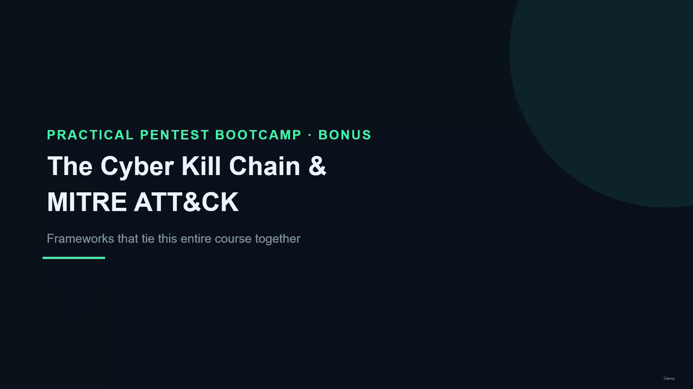
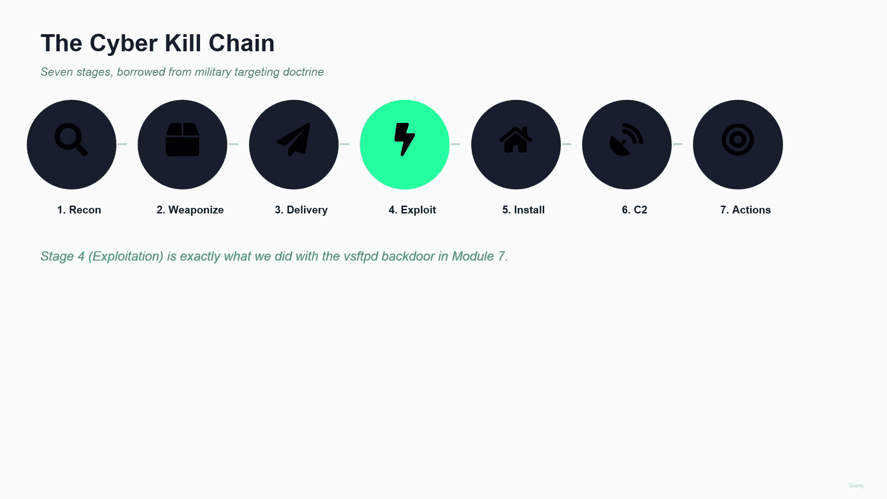
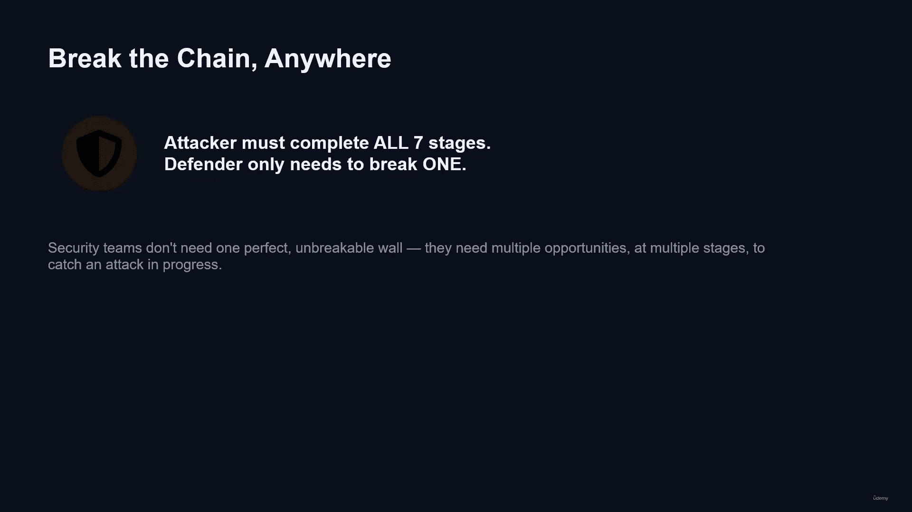
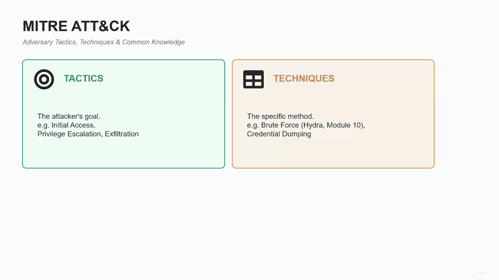
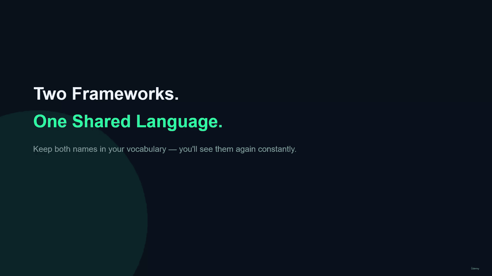

# 道德黑客与 Kali Linux 渗透测试：72：网络杀伤链与 MITRE ATT&CK 🛡️

在本节课中我们将要学习两个在网络安全职业生涯中会反复出现的框架，分别是网络杀伤链和 MITRE ATT&CK。本节课实际上是一节额外的附赠课程，我希望借此介绍两个行业标准框架，把你之前学过的所有渗透测试知识串联起来。你在整个职业生涯中都会不断看到这两个名字，所以我不希望你只是认识它们，而是希望你真正理解它们的含义。



在本课程的前面部分，我们已经学习了很多具体的渗透测试工具和攻击技术。本节中我们来看看如何将这些零散的知识点组织成一个完整的攻击框架。

## 网络杀伤链的由来与核心思想

网络杀伤链最初是由洛克希德·马丁公司开发的框架。这个框架的概念借鉴自军事目标打击理论，它把一次完整的网络攻击分解为 7 个不同的阶段。之所以要详细讲解这七个阶段，是因为你会发现，其中几乎每一个阶段都与我们在课程中一起完成的实验内容高度相关。

以下是网络杀伤链的七个阶段，我们逐一来看：

- 阶段 1 是侦察，在直接接触目标之前收集目标信息。这正是第 4 模块中我们进行的主机查找、DNS 枚举和 Google 高级搜索技巧。
- 阶段 2 是武器化，将特定漏洞利用代码与可交付的载荷结合在一起，把这两者耦合成实际可以投递的攻击载荷。
- 阶段 3 是投递，将武器化载荷实际送达目标，无论是通过钓鱼邮件、恶意网站，又或者在本课中直接通过网络访问。
- 阶段 4 是利用，也就是漏洞被实际触发的那一刻，这正是我们在第 7 模块中针对 VSFTPD 后门所做的操作。
- 阶段 5 是安装，在被攻陷系统上建立持久访问权限，这样攻击者在连接断开时不会失去立足点。
- 阶段 6 是命令与控制，简称 C2，建立回到攻击者的持续通信通道，让他们能够远程继续下达指令。
- 阶段 7 是目标行动，实际完成攻击者的最终目标，无论是数据窃取、进一步横向移动还是系统破坏。

网络杀伤链背后的防御理念非常关键，可以用下面的公式来表示：

```
攻击成功 = 阶段 1 ∧ 阶段 2 ∧ 阶段 3 ∧ 阶段 4 ∧ 阶段 5 ∧ 阶段 6 ∧ 阶段 7
防御成功 = 存在某个阶段 i，使得 阻断(阶段 i) 成立
```



简单来说，攻击者必须成功完成每一个阶段才能达成目标，但防御者只需要在任何一个阶段成功打断攻击链，就能阻止整个攻击。这意味着安全团队不需要一堵完美无缺的绝对防线，而是需要在多个阶段拥有多次机会，来发现并阻止正在进行的攻击。

## 什么是 MITRE ATT&CK

了解完网络杀伤链之后，我们继续来看另一个在实际工作中出现频率更高的框架。现在让我们来谈谈 MITRE ATT&CK，这是一个细节更多、更现代的框架，你在真实的专业工具中会不断遇到它。在招聘信息和行业讨论中，杀伤链提供了 7 个宽泛阶段，而 ATT&CK 拼写为 A-T-T-&-C-K，代表对抗策略、技术与通用知识。它把攻击行为分解为一个规模极大、持续更新、面向公众开放的具体策略与技术集合，所有内容均基于真实世界中观察到的攻击者行为，由 MITRE 公司维护。



让我来解释它的结构，这一点很重要。在这个框架中，策略代表攻击者在特定阶段的战术目标，比如初始访问、权限提升或数据外泄。技术则是实现该策略的具体细分方法，这里变得非常详细。

以下是 MITRE ATT&CK 中策略与技术的关系示例：

```
策略：凭证访问
技术：暴力破解 (T1110.0)
技术：凭证转储
```

在“凭证访问”策略下，你会找到包括暴力破解攻击在内的具体技术，这正是我们在第 10 模块中使用 Hydra 做过的操作。还有凭证转储，概念上与第 11 模块中预览的 Kerberoasting 技术相关。

## 为什么安全团队离不开 MITRE ATT&CK

这个框架在真实的专业实践中变得不可或缺，原因有以下几点：

- 安全团队使用 ATT&CK 来绘制自身的防御覆盖图，逐一检查每种技术，查看是否具备针对每种技术的检测或防护能力。
- 渗透测试人员和红队使用它来规划真实结构化的演练，模拟真实世界中的攻击者行为，而不是一系列随意的不相关动作。
- 威胁情报团队将其作为共同的通用词汇，使得完全不同的组织、完全不同的安全工具和完全不同的报告，都能使用同一个通用唯一标识符来引用完全相同的具体技术。

## 本课程内容与两大框架的对应关系



有了这两个框架的基础，我们现在来看看本课程的具体内容是如何对应上去的。我希望你从本节课中带走一个真正实用的收获。本课程中我们一起完成的几乎所有内容，都能清晰地对应到这两个框架上。

以下是课程内容与两大框架的对应关系：

- 侦察工作对应杀伤链阶段 1 以及多个 MITRE ATT&CK 侦察技术。
- 利用工作对应杀伤链阶段 4，以及具体的 ATT&CK 初始访问和执行技术。
- 密码攻击直接对应 ATT&CK 的“凭证访问”策略。

理解这一点不仅仅是学术练习。在真实的专业报告中，引用发现背后的具体 ATT&CK 技术 ID，例如 T1110.0 用于暴力破解，能够立即向技术娴熟的读者传达精确性和可信度。这正在逐渐成为专业报告中预期的标准。

这就是网络杀伤链与 MITRE ATT&CK。两个框架为课程中的其他所有内容提供结构和共同语言。今后请将这两个名字牢记在心，你会不断地再次遇到它们。



本节课中我们一起学习了网络杀伤链的七个阶段，理解了攻击者必须完成所有环节而防御者只需断掉一环的防御理念，还学习了 MITRE ATT&CK 的策略与技术结构，以及如何在专业报告中引用 ATT&CK 技术编号。
