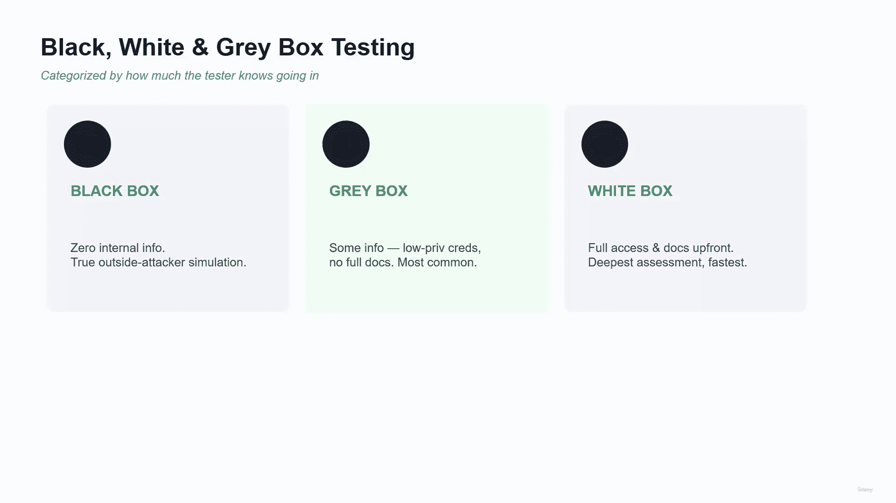
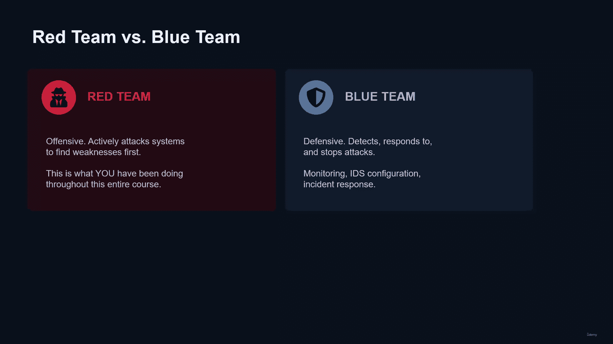
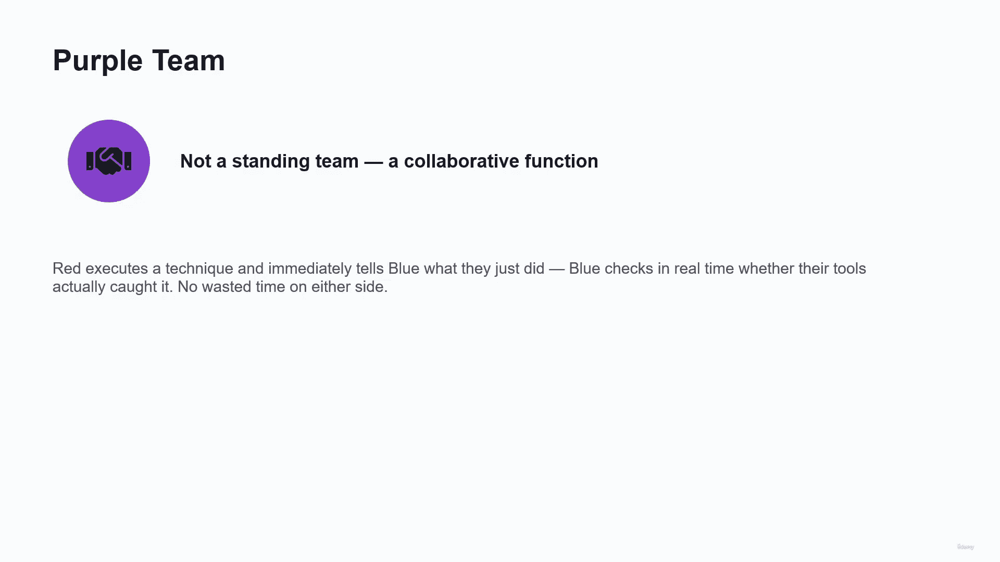
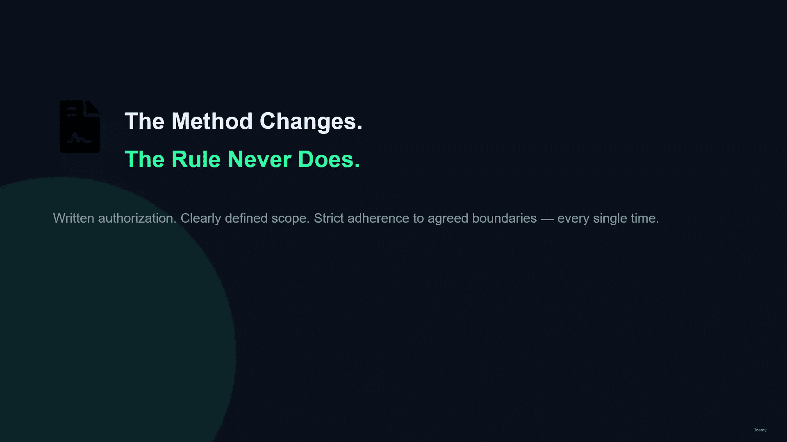

# Udemy - Ethical Hacking & Penetration Testing with Kali Linux：73：渗透测试类型与团队角色🔍


在本节课中，我们将学习渗透测试的主要分类方式，以及在专业安全工作中经常提到的红队、蓝队、紫队三种团队角色。这些概念是渗透测试领域的基础词汇，几乎在每一次面试和每一次项目范围确定通话中都会出现。无论你是刚开始学习Kali Linux，还是准备进入安全行业，理解这些术语都能帮助你更清晰地了解测试工作是如何开展的，以及不同角色之间如何协作。掌握这些基础词汇，能让你在未来的工作中更快地与同事和客户进行有效沟通。


## 第一节：按信息量划分的测试类型

首先，我们来看看按照测试人员在开始之前获得多少目标信息来划分的测试类型。这是理解渗透测试范围的最基本方式，也决定了测试人员需要花多少时间在侦察阶段，以及最终报告的深度会有什么不同。以下是三种主要的测试类型：


### 黑盒测试

黑盒测试意味着测试人员几乎完全不了解目标系统的内部信息。这里没有网络拓扑图，没有登录凭据，也没有源代码。这种模式真正模拟的是外部攻击者，攻击者除了可能知道公司名称之外，对内部一无所知。

这是对真实外部威胁最真实的模拟方式，但也是最耗时的方式，因为项目中很大一部分时间都要花在侦察和发现阶段上，这正是我们在第四模块中一起完成的那类工作。


### 白盒测试

白盒测试处于整个光谱的完全另一端。在这种模式下，测试人员从一开始就获得完整的内部访问权限和信息，比如网络拓扑图、源代码、架构文档，有时甚至是有效凭据。

这种方法牺牲了一些外部攻击者的真实感，但作为交换，它允许在相同的时间预算内进行更深入、更全面的评估。因为不需要花时间在纯粹的发现阶段上，测试人员可以直接专注于漏洞分析和利用。


### 灰盒测试

灰盒测试故意位于两者之间。测试人员获得一些信息，但并不是全部信息。这可能意味着拥有低权限用户凭据，但没有架构图或部分网络文档，也没有源代码访问权限。



在实际的专业工作中，灰盒测试是行业内最常用的方法，因为它在现实感和效率之间取得了实用的平衡，既足够真实可以参考，又足够高效可以放进合理的项目时间表和预算中。


测试信息量与现实感的关系可以用下面这个简单公式表示：

```
测试信息量：黑盒测试 < 灰盒测试 < 白盒测试
现实感程度：黑盒测试 > 灰盒测试 > 白盒测试
```


## 第二节：安全团队的角色划分

了解完测试类型之后，我们继续聊聊团队角色。在安全行业的职业生涯中，你会不断听到这些颜色代码名称，因此有必要知道每个角色具体负责什么。这三种角色在实际项目中经常一起出现，但职责完全不同，混淆它们会导致沟通误解。以下是三种常见的团队角色：


### 红队（攻击方）



红队是进攻方，也就是课程中我们一直在练习的角色。红队成员主动攻击系统，就像我们之前针对可漏洞虚拟机和活动目录实验室所做的那样，目的是在真正的恶意攻击者先发现之前，找出可以被利用的弱点。红队的工作重点是模拟真实攻击，验证系统能否抵御外部和内部威胁。


### 蓝队（防御方）

蓝队是防御方，负责实际检测、响应和阻止攻击，无论这些攻击来自红队演练还是真实世界的对手。蓝队的工作包括配置入侵检测系统、主动监控安全日志，以及为出现真正问题时建立正式的事件响应流程，这些在本课程中我们没有直接进行过动手实践。蓝队需要时刻保持警觉，确保组织的资产在任何时候都受到保护。


### 紫队（协作方）

紫队在大多数组织中并不是一个独立的常设团队，更好地理解为一种协作职能，或者有时是红队和蓝队直接公开合作的临时结构，而不是传统的对抗安排，即红队无预警攻击、蓝队完全盲目检测。



在真正的紫队演练中，红队可能会执行一个特定技术，并立即告诉蓝队他们刚刚做了什么，让蓝队实时检查现有检测工具是否真的捕获到了它。这通常是组织快速弥补真实安全漏洞的最快、最高效的方式之一，因为双方都不会浪费时间在猜测对方的行为上。


## 第三节：课程内容与法律边界的联系

接下来，我把这些概念和你在本课程中已经做的事情联系起来，并再次强调最重要的法律边界。无论你未来打算从事哪个方向，都必须清楚测试工作的合法前提，否则任何技术操作都可能变成违法行为。以下是几个关键的联系点：


你在整个课程中亲自完成的所有工作——侦察、扫描、利用、密码攻击——都明确属于红队进攻安全工作。如果这门课程让你产生共鸣，并且你想继续深入这个领域，红队和渗透测试角色是自然而然的直接下一步。

但我也希望你知道，蓝队防御角色同样有价值，往往同样具有智力挑战性，而且目前在行业中需求非常大。理解攻击是如何运作的，也就是你在整个课程中学到的内容，也会让你成为更强大、更有效的蓝队防御者，而不仅仅是更强大的攻击者。攻防两个方向都需要扎实的基础，而本课程为你提供了这个基础。

最后一个实际注意事项，直接关联到模块1中关于授权和接入规则的讨论。无论使用黑盒、白盒还是灰盒测试类型，无论涉及哪种团队结构，模块1中的那条绝对规则都没有任何例外地适用：

```
必须有书面授权，明确定义范围，并严格遵守约定边界
```

测试方法论可能会改变，但这一基础的伦理和法律要求永远不会改变。这是所有安全专业人员必须牢记的底线。


## 本节总结



本节课中，我们一起学习了渗透测试按信息量分为黑盒、白盒、灰盒三种类型，以及红队、蓝队、紫队三种团队角色。你在未来的安全职业生涯中会不断听到这六个术语，掌握它们是理解专业渗透测试工作的第一步。希望这节课能帮你建立清晰的概念框架，为后续的学习和实践打下坚实基础。

