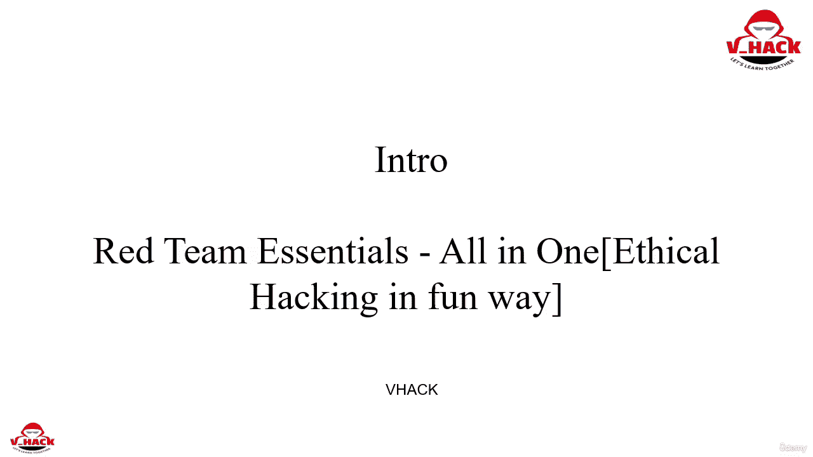
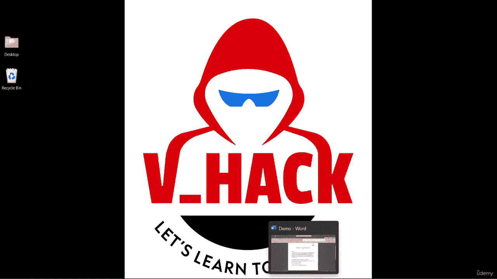
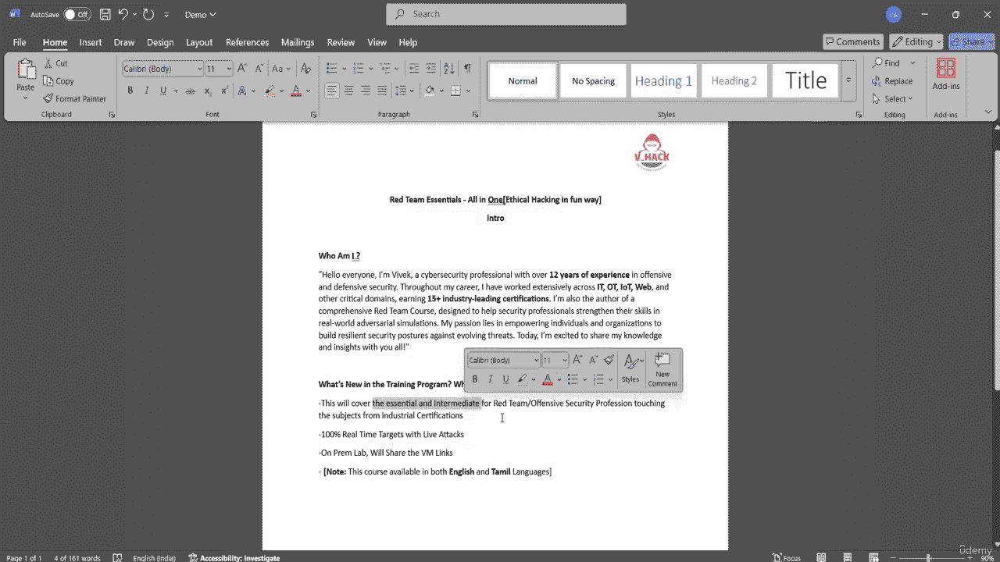
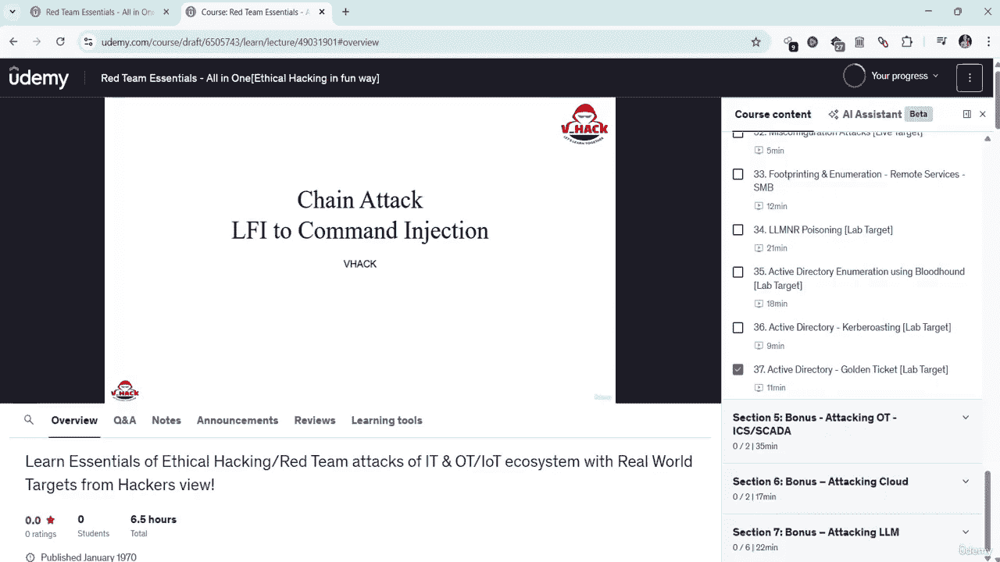
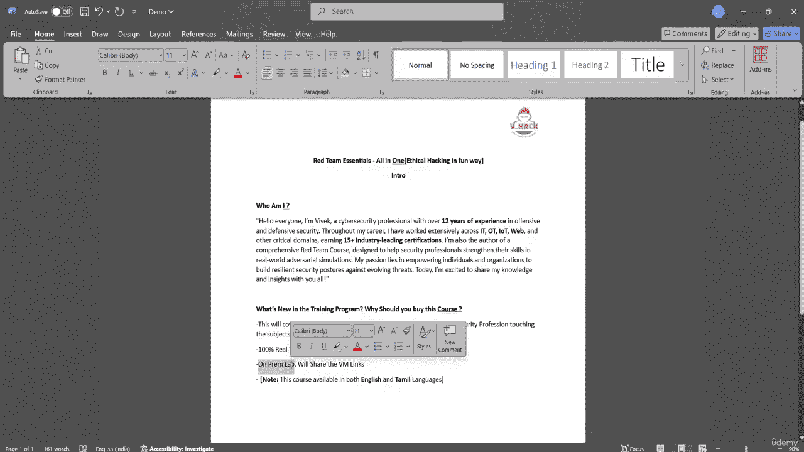
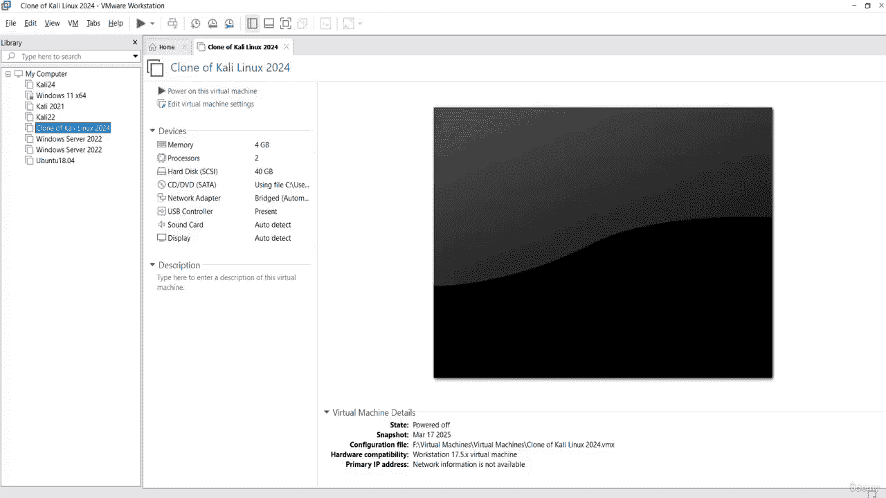
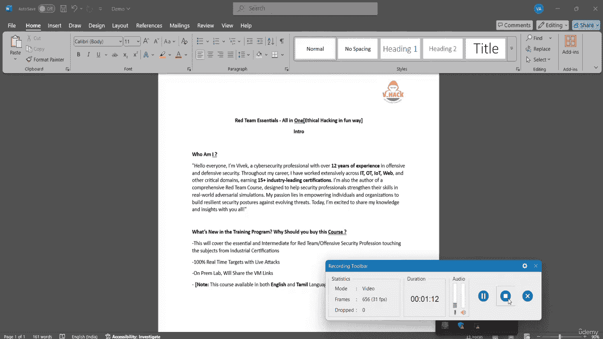

🛡️ 红队基础全能课程：01：课程简介与红队核心概述

## 课程概述

在本节课中，我们将学习这个培训项目的基本内容、适合的学习人群，以及为什么这门课程值得你投入时间。接下来的内容将帮助你快速了解整体框架。

欢迎来到ReEssentials全能道德黑客趣味训练课程。我是讲师Vi Kashan，在安全领域拥有将近两年的从业经验。我的职业生涯最初是渗透测试人员，主要负责基础设施评估工作。随后我接触了Web测试，涉及APA等现代技术，之后又逐步进入了物联网（IoT）和运营技术（OT）领域，并积累了接近工业认证的经验。

这门课程专门为那些希望解锁网络安全世界、进入攻防安全领域的人设计。如果你渴望深入钻研攻防安全技术，那么这门课非常适合你。课程会带你面对真实目标和现实场景进行实战训练，帮助你掌握识别、利用和缓解漏洞的核心技能。这些技能适用于Web应用、IT设备基础设施以及云环境等多个方向。

谈到课程本身，大家可能会问：培训项目里有什么新内容？为什么值得购买这个课程？如前所述，本课程涵盖了红队与攻防安全从基础到中级的完整知识体系。

## 课程涵盖的技术领域

上一节我们介绍了课程概述与讲师背景，本节我们来看看具体会教哪些技术方向。以下是课程重点覆盖的攻防模块。

- Web应用攻击：包括高级集成、攻击链、配置缺陷、账户接管、常见SQL服务器漏洞以及XSS等最常见的Web攻击。攻击流程可以简化为：`信息收集 → 漏洞利用 → 权限维持`。
- 身份与令牌攻击：涵盖JWT令牌账户接管，以及应用中的各种绕过技术。例如SQL注入可能写作：`SELECT * FROM users WHERE id = '1' OR '1'='1';`，而XSS payload示例为：``。
- 物联网与硬件攻击：讨论固件分析，使用UR和SI等工具进行硬件攻击，还包括智能锁、指纹系统等IoT设备上的Bluetooth攻击。固件分析过程可表示为：`firmware.bin → binwalk → 文件系统提取`。
- Active Directory攻击：不仅限于基础内容，还包括配置错误、LLMNR毒化、Kerberoasting票据攻击等不同的AD攻击技术。常见的AD攻击向量包括：`Kerberoasting`、`ASREPRoasting`、`LLMNR Poisoning`。
- 其他领域：还涉及OT（运营技术）、云环境以及LLM相关的安全内容。

## 实战目标与课程分布

了解了技术领域之后，我们继续看看课程的实战安排和内容分布。以下是关于实战目标与实验比例的说明。

课程中约有10%的内容是带有实时攻击的实时目标。我设计了课程大纲，主文件夹中列出了不同领域的战术和技术。其中绿色表示实时目标，橙色表示实验环境，同时还配套了CTF挑战。你可以看到课程以大量实时目标为主，辅以少量实验，特别是针对Active Directory攻击的部分，还会包含CTF题目。

进入每个具体方面时，课程会使用不同的子模块，并高亮标注关键项目。大部分内容都是基于真实世界目标的，同样的安排也适用于基础设施、Active Directory，以及物联网、LLM、云等多个领域及其终端设备。

## 本地实验室与虚拟机环境

除了实战目标，环境准备也是学习的关键。本节我们介绍课程提供的本地实验室资源。

最后但同样重要的是本地实验室。课程中展示的虚拟机将通过下载链接提供，为你准备好预配置的本地环境。这样一来，你可以随时练习，按自己的节奏提升技能。除了内置工具之外，课程还提供了一系列广泛的工具集合。

## 工具准备与语言支持

环境和工具准备好之后，还需要知道如何避免安装麻烦，以及课程支持哪些语言。以下是相关说明。

这些工具可以帮你节省处理安装问题、依赖冲突和兼容性错误的精力。课程中使用的不同工具可能需要不同的Python环境配置，但你不需要花大量时间排查这些环境问题，而是可以直接从订阅课程的第一天开始，使用提供的虚拟机去攻击实时目标。

此外，本课程提供英语和泰米尔语两种语言版本，方便不同语言背景的学习者使用。祝你课程后续学习顺利，欢迎在评论区反馈你的想法。祝学习愉快，谢谢大家。

## 总结

以上就是本节课的全部内容，下面进行总结。

本节课中我们一起学习了红队基础全能课程的简介、讲师背景、适合人群，以及涵盖的Web、IoT、OT、Active Directory、云和LLM等技术领域。我们还了解了实战目标、课程内容分布、本地虚拟机实验室、工具准备以及语言支持等安排。希望这篇介绍能让你对整个培训项目有一个清晰的认识。

