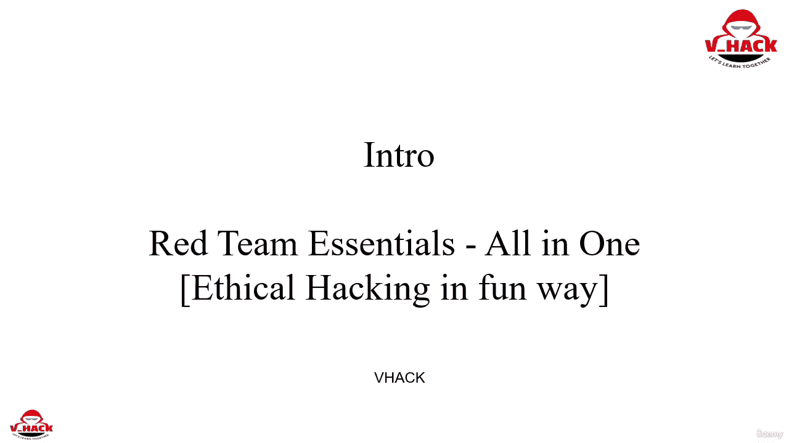

# 道德黑客50天挑战：第02章：红队基础入门 🚀

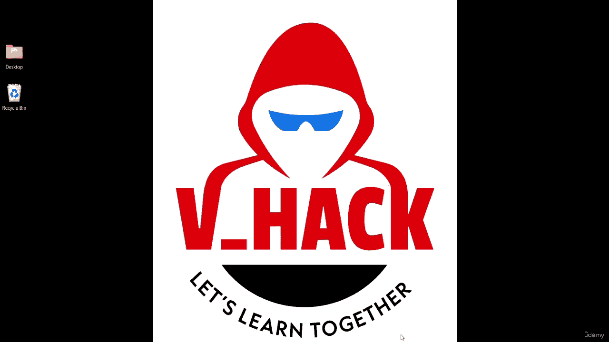

在本节课中，我们将一起学习红队测试的基础知识，了解讲师的从业经历，掌握本次培训课程涵盖的主要攻击领域，并熟悉附赠的实战资源与语言安排。

## 课程欢迎与项目背景

欢迎来到红队基础全方位道德黑客训练项目。这个课程专门为喜欢用有趣方式学习网络安全的朋友设计，适合零基础的初学者跟随学习。

讲师在网络安全领域拥有超过十五年的行业经验。他的职业生涯最初是从基础设施设备的渗透测试工程师开始的，之后逐步扩展到移动应用、数据库以及其他相关领域的安全测试，最终具备了在复杂环境中开展红队测试的能力。

课程体系围绕红队测试中的关键概念展开，并结合真实攻击场景进行讲解。培训材料中包含了扫描、漏洞分析等核心知识点，帮助学员快速掌握从入门到进阶的安全技能。

红队测试的核心目标可以用下面这个公式简单表达：

```
红队测试目标 = 模拟真实攻击者行为 + 检验目标系统防御能力
```

## 课程核心内容与技术流程

在正式开始实际攻击之前，我们需要先了解红队测试的基本流程。整个训练项目会把复杂的安全概念拆解成易于理解的实战案例，确保每位学员都能跟上节奏。

以下是课程中重点讲解的技术流程步骤：

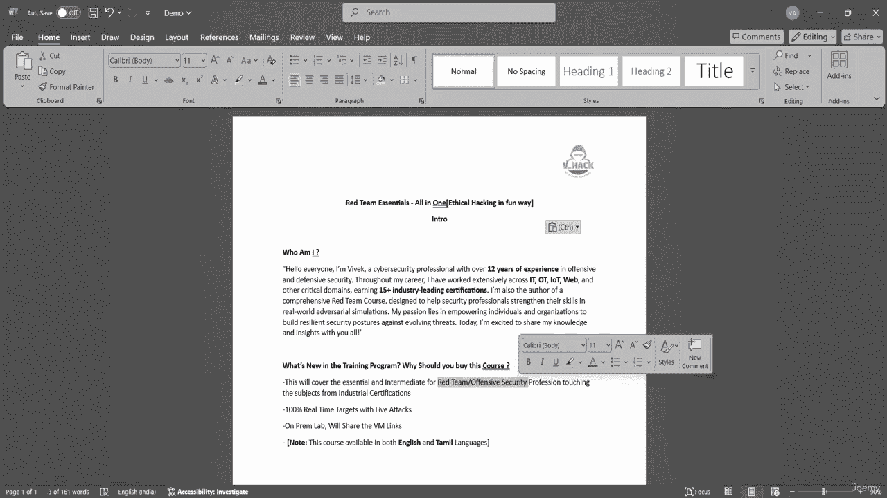

- 信息收集与目标分析
- 系统扫描与漏洞识别
- 攻击载荷投递与权限获取
- 权限维持与痕迹清理

渗透测试的典型执行顺序可以用下面这段伪代码表示：

```
执行 渗透测试:
    进行信息收集
    扫描目标系统
    识别可利用漏洞
    尝试获取系统权限
    维持访问权限
    清理攻击痕迹
```

红队测试涉及十五个以上行业领域，课程会将这些知识点按真实场景逐一拆解，让初学者也能快速上手。

## 攻击目标与覆盖领域

在开展Web应用程序和API攻击之前，课程会先带你浏览所有涵盖的技术栈。这些内容包括物联网设备、基础设施、活动目录、运营技术设备、云环境以及大语言模型等。

以下是课程中重点讲解的攻击领域列表：

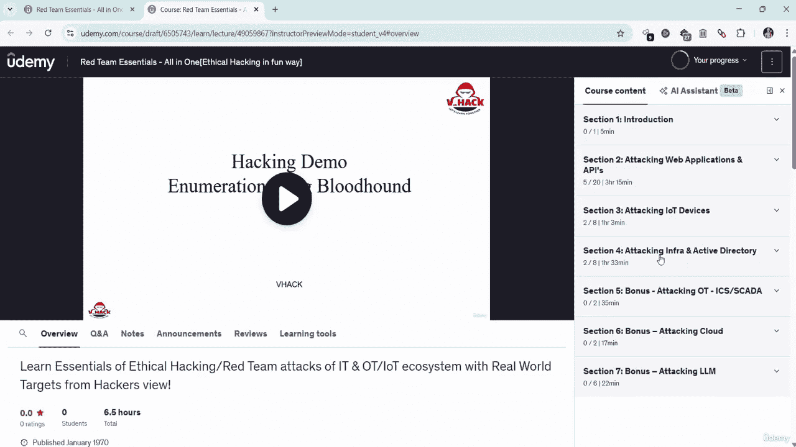

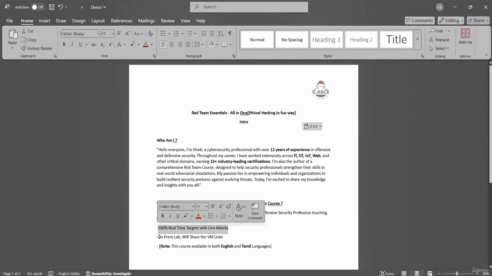

- Web应用程序安全
- API接口安全
- 物联网设备安全
- 基础设施安全
- Active Directory域安全
- 云环境安全
- 大语言模型安全

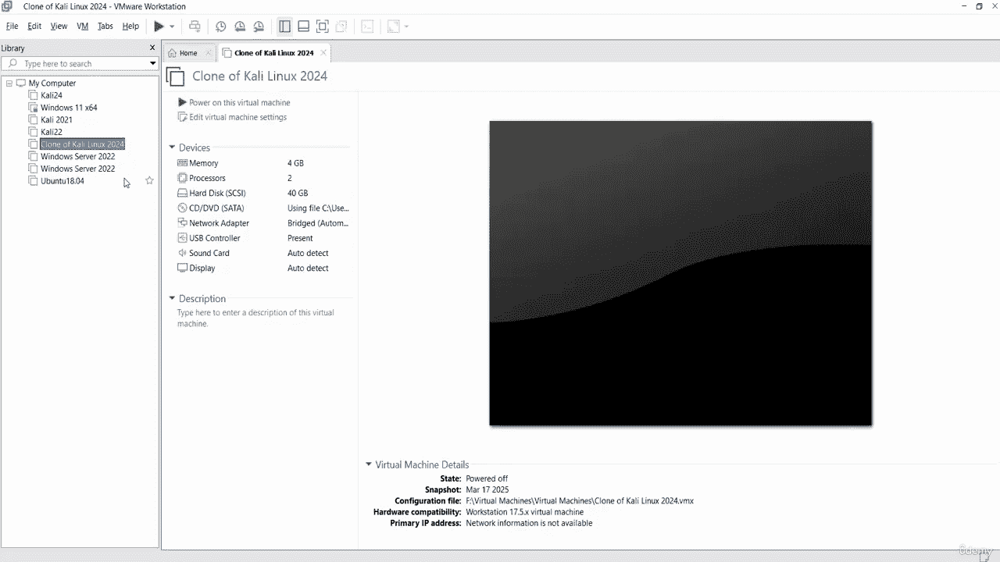

攻击面的覆盖范围可以用下面这个公式概括：

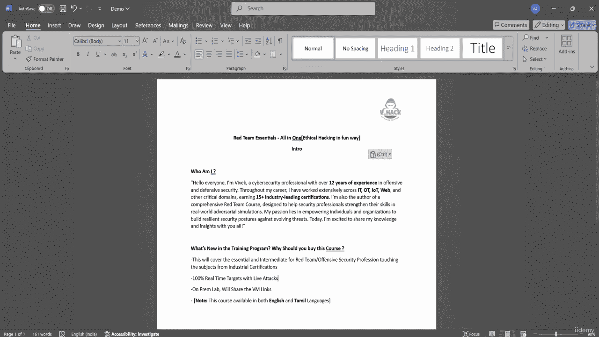

```
攻击面 = Web应用 + API + 物联网 + 基础设施 + Active Directory + 运营技术 + 云环境 + 大语言模型
```

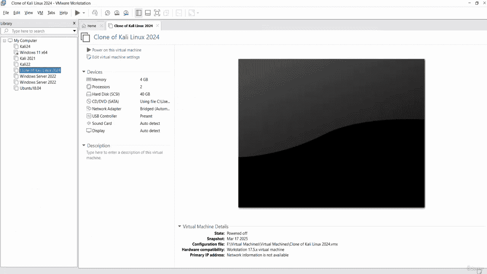

奖励环节将提供一百多个真实攻击案例，以及涵盖硬件、逆向工程、基础设施漏洞、活动目录攻击等类型的主题速查表。

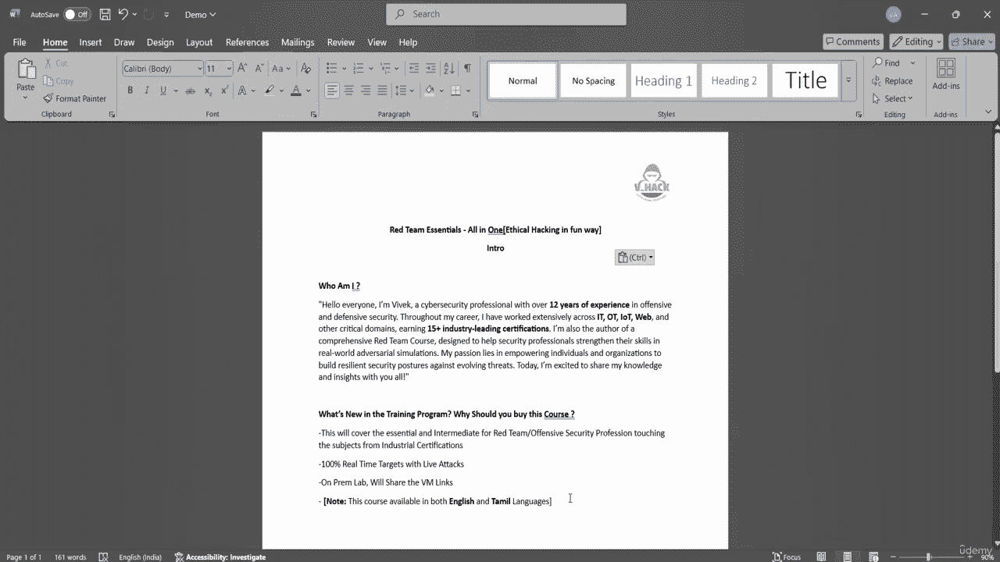

## 课程资源与学习安排

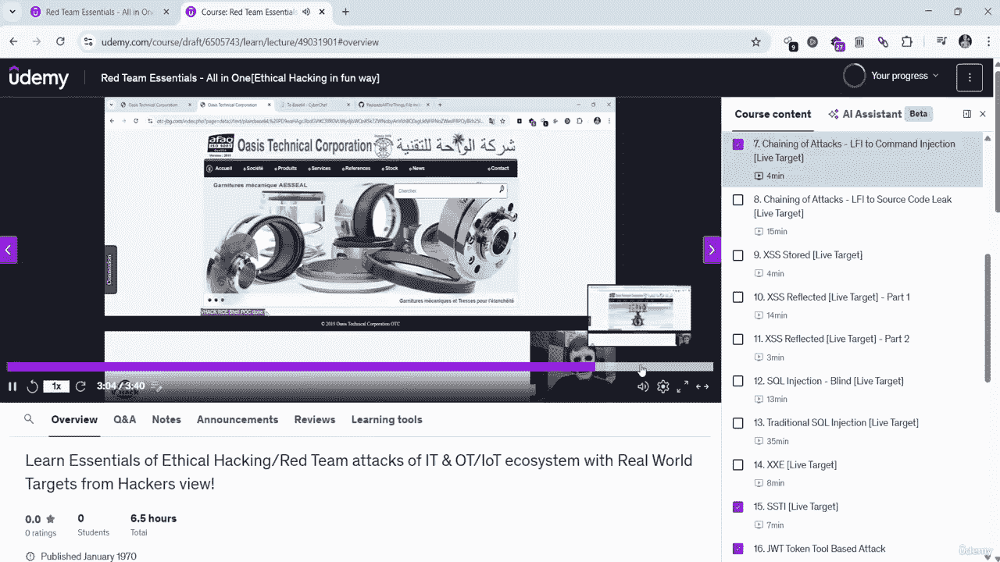

除了核心课程内容，培训项目还附赠多种配套软件和学习包，用于辅助你的实践操作。

以下是课程提供的资源类型：

- 英语与泰米尔语双语教学
- 近七小时英文授课内容
- 泰米尔语专项字幕与讲解
- 综合时长约十四小时的完整课程包

感谢你购买本课程，祝你学习愉快。

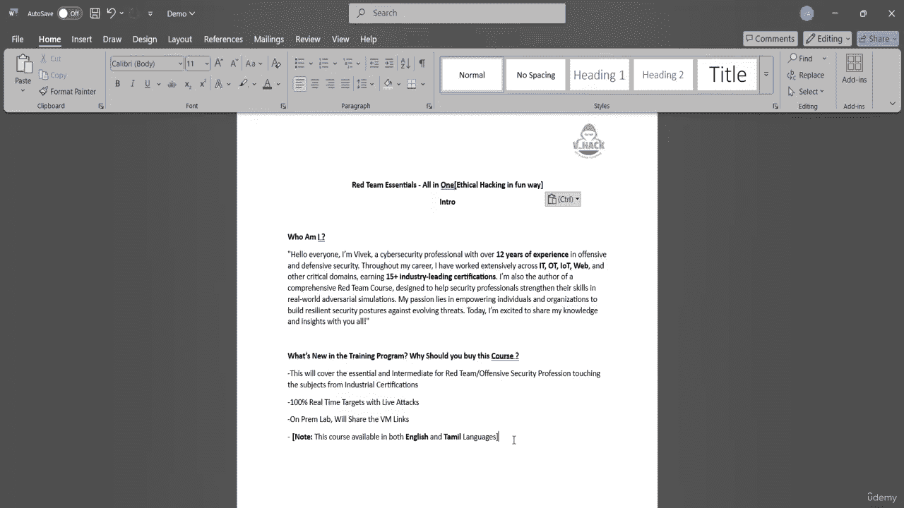

在本节课中，我们一起学习了红队基础入门、攻击覆盖领域、课程资源以及语言安排。希望这些内容能为你后续的实战学习打下坚实基础。

