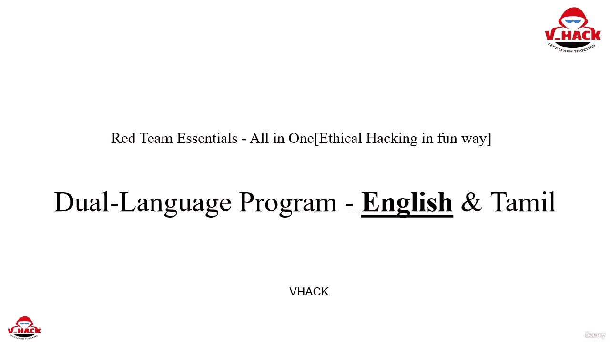
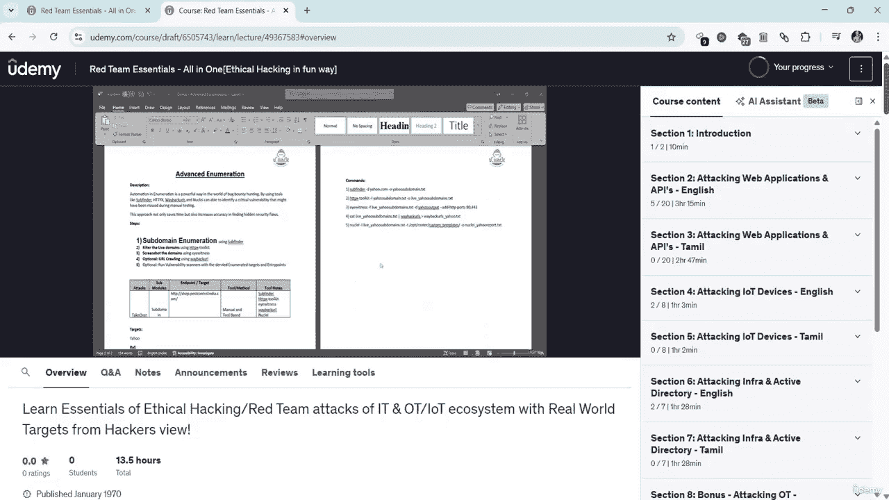
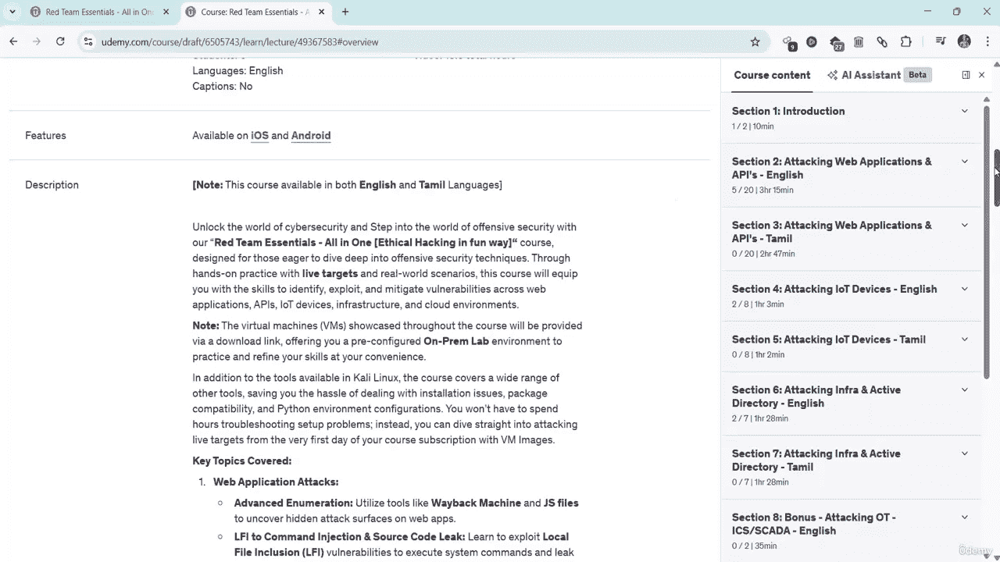
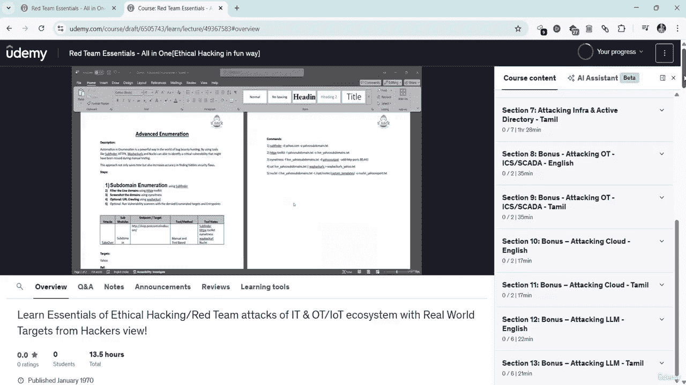
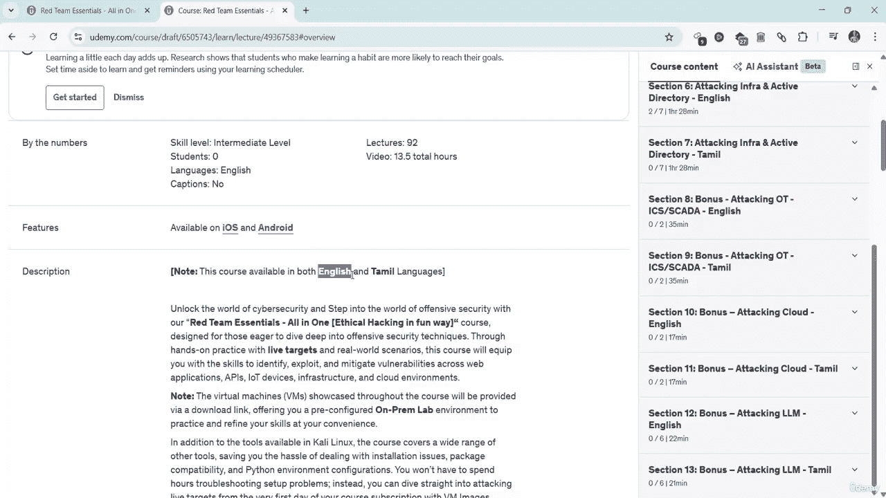
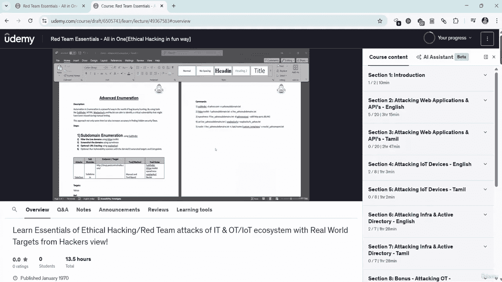
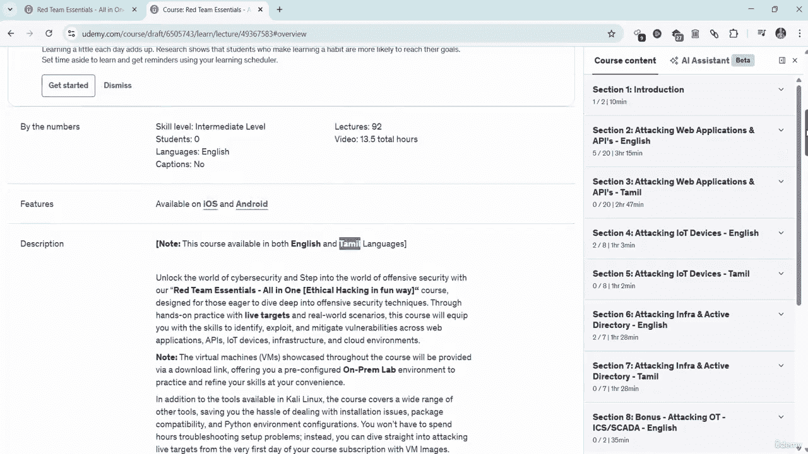
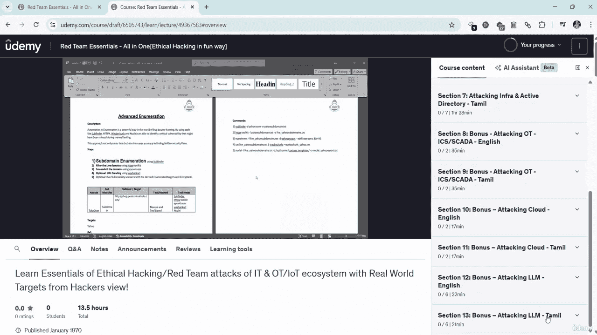
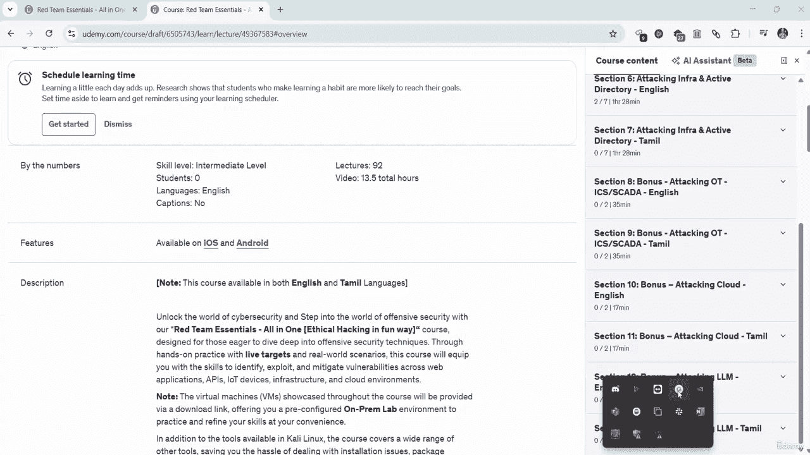

# Ethical Hacking：50-Day Hacker Challenge：03：双语课程介绍 🌐

## 课程概述

在这一节课程中，我们将要学习这个黑客攻击课程的一个重要特点，也就是语言支持功能。简单说，这个课程不是只有英语一种语言，它同时提供英语和泰米尔语两个版本。如果你购买了这个课程包，就可以一次性拿到两种语言的全部教学内容。这意味着，无论你更习惯用英语学习，还是更习惯用泰米尔语学习，都能找到合适的版本。接下来我们会详细说明这个双语功能是怎么运作的，以及课程大纲具体是怎么安排的。

## 双语课程功能说明

这个课程有一个特别有意思的地方，就是它同时提供英语和泰米尔语两种语言供学习者选择。

你可以用下面这个简单的公式来理解这个功能：

`可用语言 = 英语 + 泰米尔语`

换句话说，当你购买这一个课程捆绑包之后，平台会直接为你开通两种语言的课程资源。你不需要另外付钱，也不需要单独去买泰米尔语版本或英语版本，所有内容都包含在同一个购买订单里面。这样一来，不同母语的朋友都能用自己最顺手的语言来学习黑客攻击的知识。

## 课程大纲与模块顺序

进入学习页面之后，你可以在页面右侧看到课程大纲的完整列表。这个列表就像一张地图，告诉你整个课程从哪里开始，一直到哪里结束。

以下是课程大纲中各个模块的先后顺序：

- 攻击出版和 APA 模块，提供英语版本，包含 20 多个不同科目
- 攻击 Web 和 A 模块，提供泰米尔语版本
- 物联网设备攻击，提供英语版本，共 8 个模块
- 物联网设备攻击，提供泰米尔语版本
- 活动目录攻击，提供英语版本
- 活动目录攻击，提供泰米尔语版本
- 攻击 Vo 模块，属于奖励模块，提供英语和泰米尔语双语版本
- 云安全攻击，提供英语和泰米尔语双语版本
- LLM 相关内容，提供英语和泰米尔语双语版本，作为课程的最后部分

从这个安排可以看出，课程基本上是英语模块和泰米尔语模块交替出现的。每学完一个英语模块，通常后面会接着对应的泰米尔语版本，这样两种语言的学习者都能按照自己的进度来推进。

## 适用人群与学习建议

设计这个双语功能的目的，就是希望既能照顾英语使用者，也能照顾泰米尔语使用者。如果你平时更习惯用泰米尔语接收新知识，完全可以优先选择泰米尔语版本；如果你英语基础不错，也可以直接跟着英语版本学习。

为了让你学得更顺手，建议按照下面的步骤来进行：

1. 先确认自己最擅长的教学语言是英语还是泰米尔语
2. 按照大纲里的顺序，从第一个模块开始正式学习
3. 每完成一个英语模块后，可以对照学习同主题的泰米尔语模块，帮助加深理解
4. 最后完成云安全和 LLM 等收尾模块，结束整个课程

## 本节总结

本节课中我们一起学习了这个课程的双语特性，清楚地知道了购买后可以同时获得英语和泰米尔语两种语言的课程内容，也梳理了从攻击出版、物联网、活动目录到云安全和 LLM 的完整学习路线。希望这些信息能帮助你更好地开始黑客攻击的学习之旅，祝大家学习顺利。
