🛡️ 道德黑客课程：第04章：前置条件、资源下载与虚拟机环境搭建

## 本节课概述

在本节课中，我们将学习如何为道德黑客实验准备环境。课程会讲解什么是虚拟机，如何下载和解压虚拟机镜像，如何在 VMware 中导入虚拟机，以及不同实验场景下常用的登录账号和网络设置。本节课适合完全没有虚拟机经验的初学者，所有步骤都会用大白话解释清楚。

## 一、什么是虚拟机与 VMware 软件

虚拟机是一台在你的电脑里运行的“软件计算机”，它拥有自己的操作系统、内存和网络，但不需要额外的物理硬件。核心概念可以用下面的公式理解：

```
虚拟机 = 虚拟化软件模拟出来的一台独立计算机
```

本课程使用的虚拟化软件是 VMware Workstation，目前示例中使用的是 17 版本。讲师演示环境中一共准备了六台虚拟机，分别用于物联网、运营技术和 Web 应用等不同的渗透测试场景。

不过并不需要把这六台虚拟机全部开机。根据当前的实验需求，只开启正在使用的那台即可。比如，如果你在做 Web 渗透练习，可以使用 Kali Linux 2024；如果你在做活动目录练习，可以使用 Windows Server 或 Windows 11。其余没有在用的虚拟机可以先关闭。如果你的电脑配置较低，一次性开启全部六台虚拟机很容易导致内存不足，因此按需开启是比较稳妥的做法。

## 二、下载虚拟机镜像并解压

以下是获取虚拟机镜像文件的步骤：

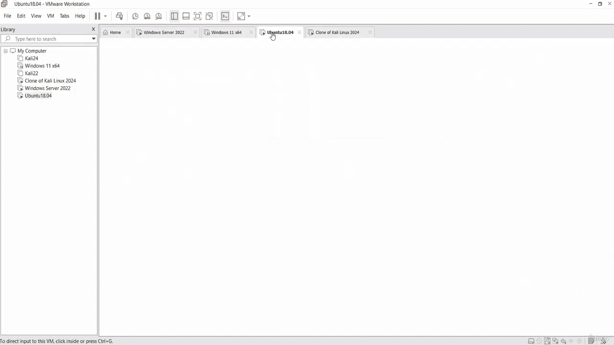

- 进入讲师提供的网盘文件夹，该文件夹中包含全部六台虚拟机的镜像。
- 大部分镜像文件使用 7-Zip 压缩格式保存，点击下载后得到压缩包。
- 下载完成后，使用 7-Zip 将压缩包解压到本地文件夹。

解压之后，你会看到很多文件，文件大小不一。其中最关键的是一个体积很小的配置文件，通常只有几 KB。例如，你可以找到名为 photo5 或 buildtu 的文件，点击打开即可。虽然文件夹里有很多碎片文件，但 VMware 只需要你打开这一个配置文件，它会自动识别并加载整台虚拟机。

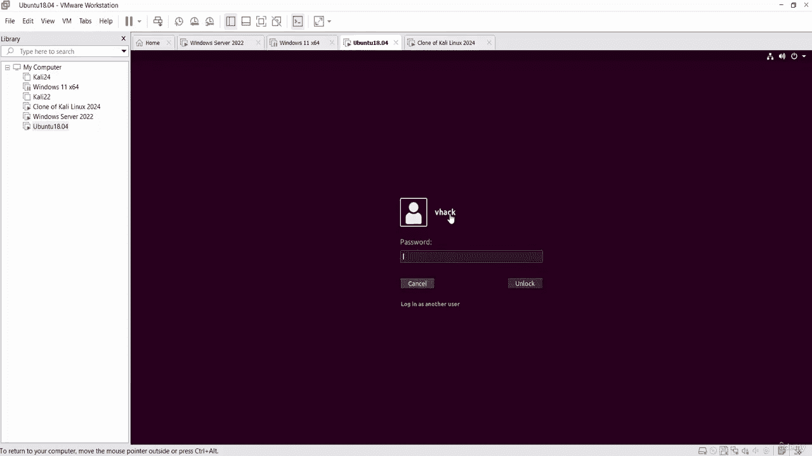

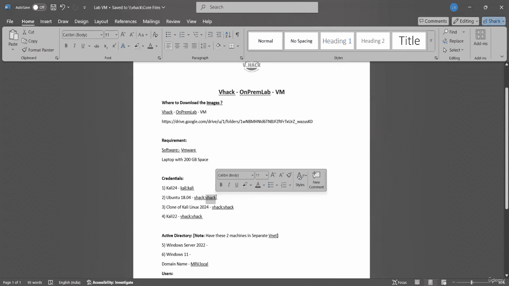

## 三、在 VMware 中导入虚拟机并登录

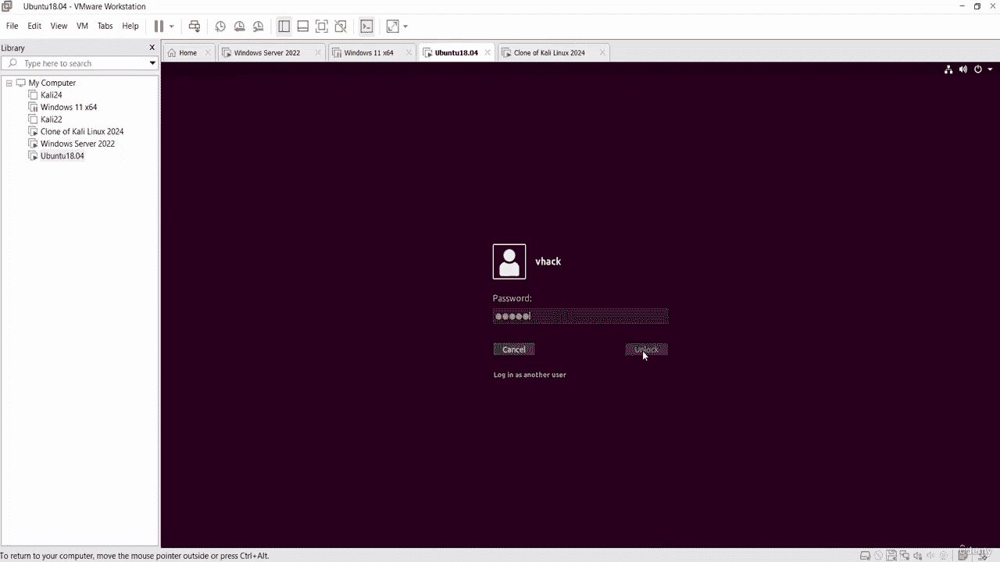

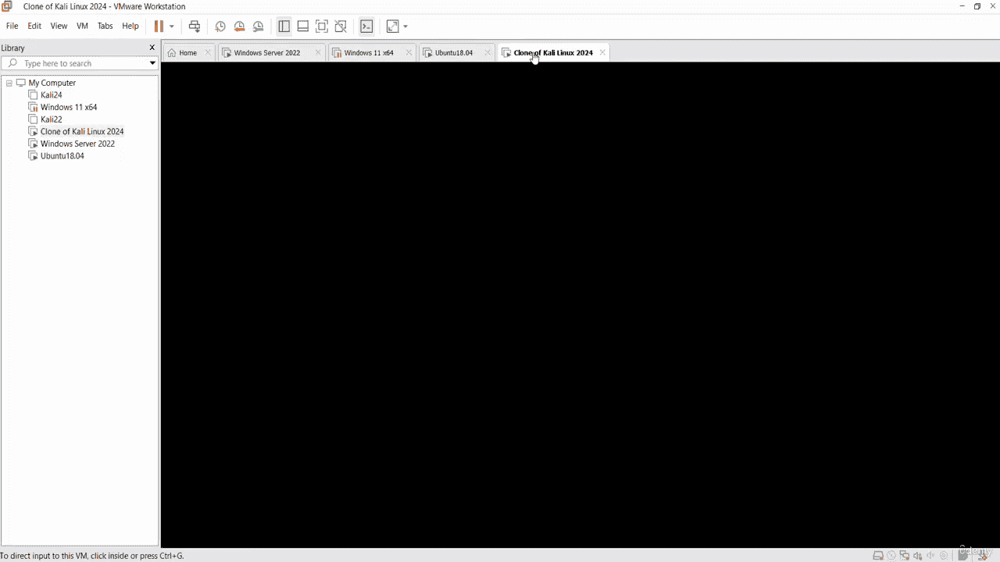

一旦你打开配置文件，VMware 会自动把虚拟机加载进去。这是因为这些镜像是讲师预先制作好的“即用型”虚拟机，已经包含了演示程序所需的全部设置。

导入完成后，你会直接看到登录页面。不同虚拟机的登录凭据如下：

```
示例一：用户名为 S Vha，密码可以使用 delinker，也可以使用 Vha。
示例二：用户名为 VHAc，密码为 VHAc。
```

这些账号信息适用于绝大多数普通实验虚拟机。登录成功后，你就拥有了一个可以直接上手的实验环境。

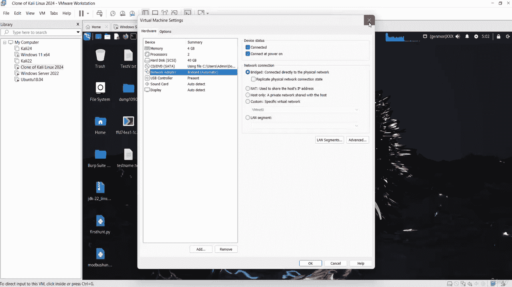

## 四、根据实验场景选择开启的虚拟机

每个实验需要的虚拟机不同，不需要全部运行。以下是常见场景与对应虚拟机的对应关系：

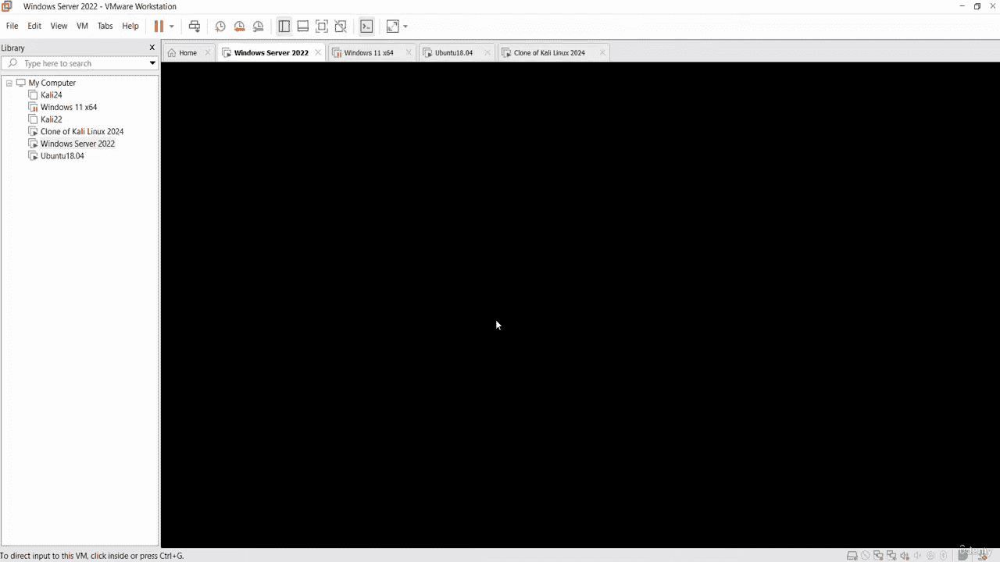

- Web 渗透实验：开启 Kali Linux 2024。
- 活动目录实验：开启 Windows Server 和 Windows 11。
- 其他未使用的虚拟机：保持关闭状态，节省内存资源。

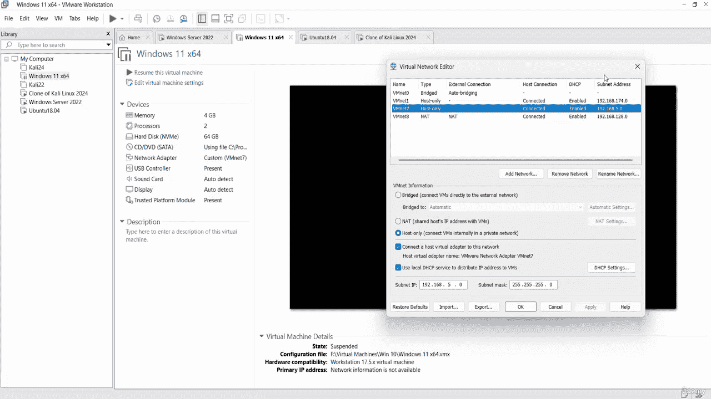

记住，始终根据当前实验需求来决定开启哪些机器，这样可以避免电脑卡顿或内存溢出。

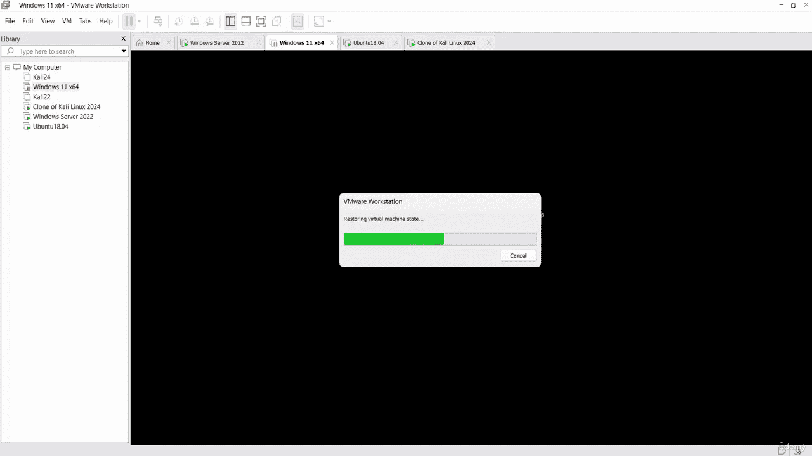

## 五、活动目录实验室的网络设置

活动目录实验有特殊的网络要求，需要把相关虚拟机放在独立的网络环境中，而不是直接使用主机的网络。

在 VMware 设置中，普通实验通常使用“桥接网络”，虚拟机会获取和物理机同一网段的 IP 地址。但活动目录实验使用的是“自定义虚拟网络”，讲师将其配置为独立的虚拟实验室，IP 段设置为 192.168.x.0 系列。

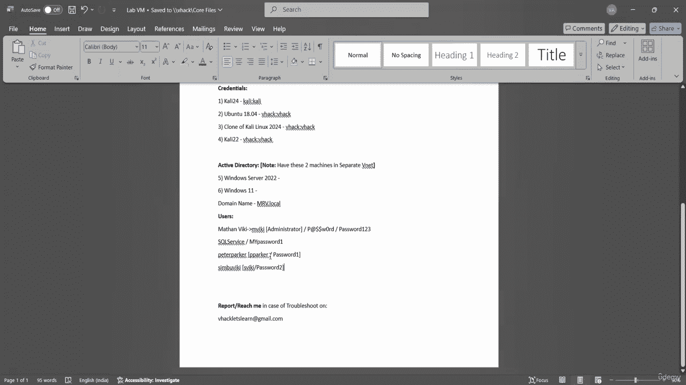

活动目录实验中常见的账号信息如下：


```
域名：mr.v.local
计算机名：Woovvan
管理员用户名：administrator
管理员密码：Password$$W0rp
Windows 11 用户：Peter Bar
```

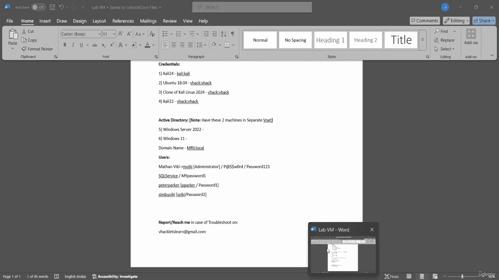

登录时，根据你使用的具体虚拟机，选择对应的用户名和密码即可。

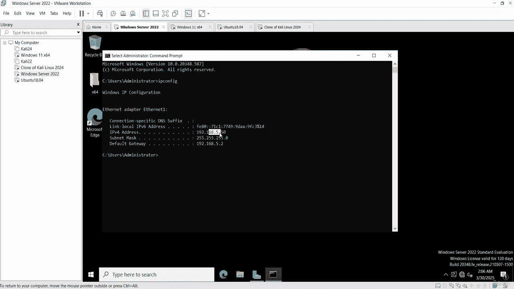

## 六、验证网络连通性与常见问题排查

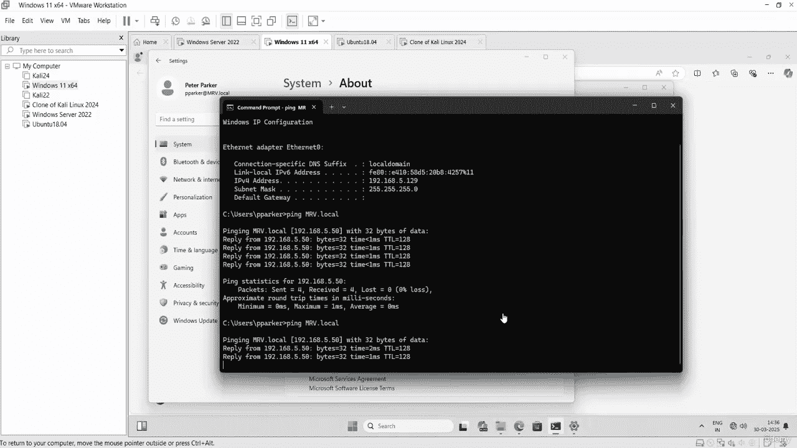

搭建完成后，你需要确认虚拟机之间可以正常通信。最简单的方法是使用 ping 命令测试网络连通性。例如，在活动目录实验中，你可以验证 IP 地址是否属于 192.168.15.x 网段，或者确认域名 mr.v.local 是否正确解析。

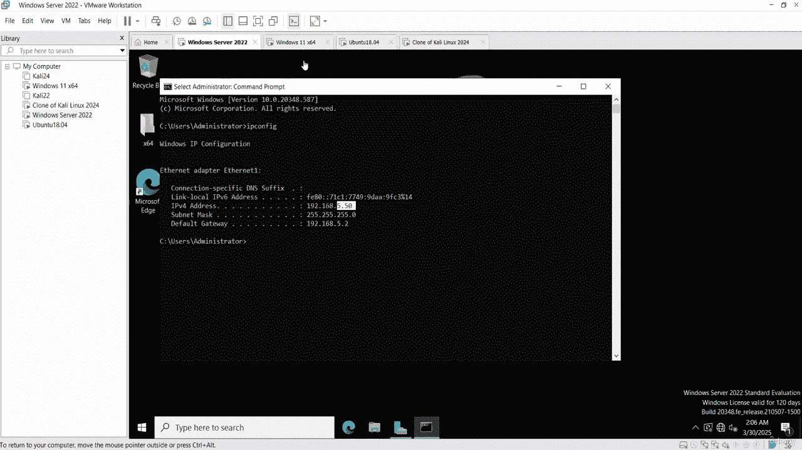

如果在导入或登录过程中遇到任何问题，可以参考课程提供的联系指南，讲师会协助你排查故障。整个搭建流程其实非常简单，核心就三步：下载虚拟机镜像文件，在 VMware 中打开配置文件，使用对应的用户名和密码登录。

## 本节课总结

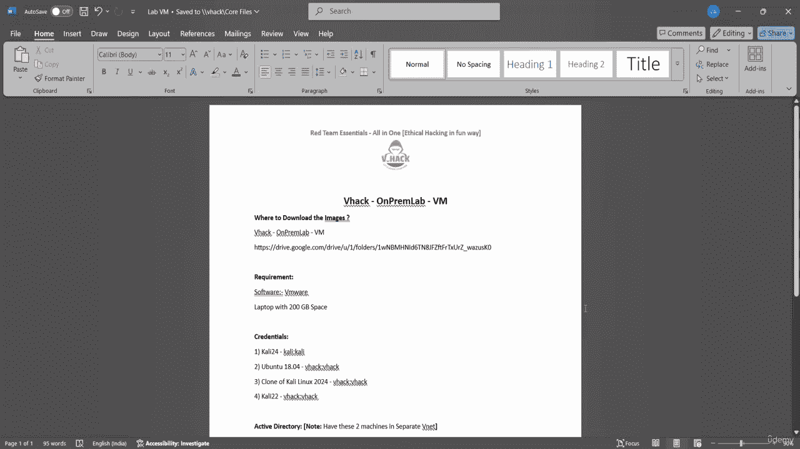

本节课中，我们一起学习了虚拟机的基本概念，掌握了 VMware 镜像的下载、解压与导入方法，了解了常用虚拟机的登录凭据，并学会了如何根据实验需求选择开启哪些机器。此外，还重点讲解了活动目录实验室的独立网络设置以及网络连通性验证方法。希望这些内容能帮助你顺利搭建好道德黑客实验环境，祝学习顺利。
