# 道德黑客：第02章：前置条件、下载与环境设置 🖥️


在本节课中我们将要学习这门道德黑客课程的前置条件，你需要下载哪些内容，以及如何把实验环境搭建好。这是一门 all-in-one 的综合课程，会把基础知识的不同方面都讲清楚，适合完全没有经验的新手。不用担心你之前没有黑客基础，只要你愿意动手操作，跟着步骤一步步来就可以了。我们先整体说说这节课要干什么，然后再进入具体的下载和安装环节。


## 一、课程前置条件与准备工作 📋

上一节我们简单介绍了课程的整体目标，本节中我们来看看在开始实战之前，你需要准备些什么。这门课程把渗透测试的核心技能都打包在一起了，所以不需要你提前掌握很复杂的编程或网络知识，但基本的电脑操作能力是必须的。如果你能正常使用浏览器、安装软件，并且懂得怎么复制粘贴命令，那就完全够用了。

以下是你需要准备的工具清单：

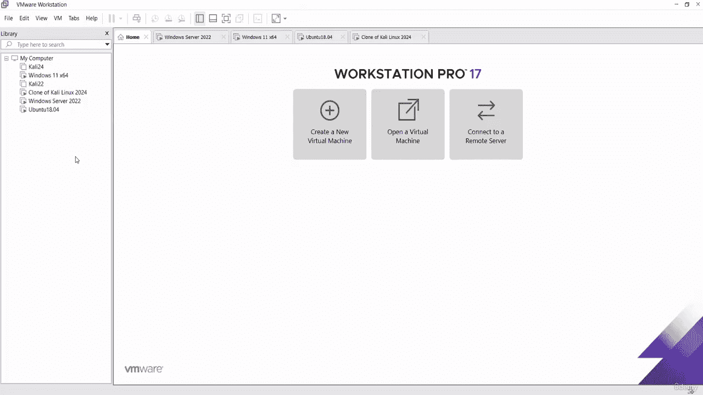

- 一台可以运行虚拟机的电脑，内存建议 8GB 以上，这样跑多个系统不会卡顿。
- 虚拟机软件，推荐安装 VirtualBox 或 VMware，用来跑 Linux 系统。
- Kali Linux 镜像文件，它会作为你的攻击机器，内置很多安全工具。
- 课程提供的靶机镜像，用来练习真实攻击场景。
- 稳定的网络连接，因为系统镜像文件通常比较大，下载需要时间。

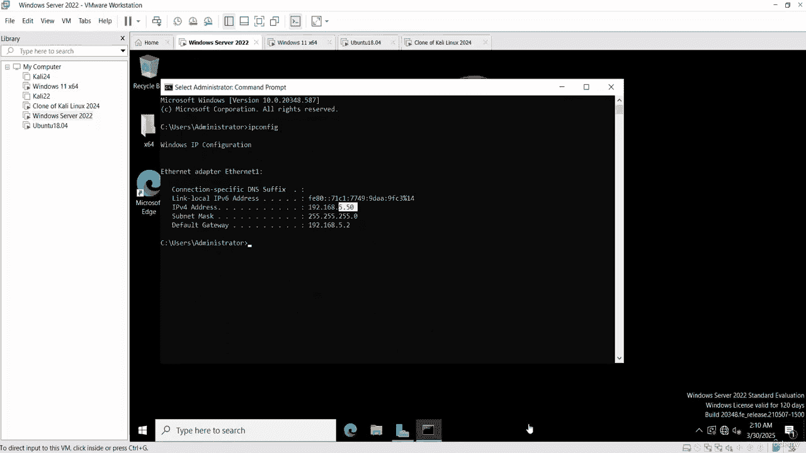

准备好这些东西之后，你就可以进入下载环节了。不要着手去安装复杂的系统，先把文件都下载到本地，这样后面配置起来会方便很多，也避免中途断网导致重新下载。


## 二、下载课程资源与常用命令 ⬇️

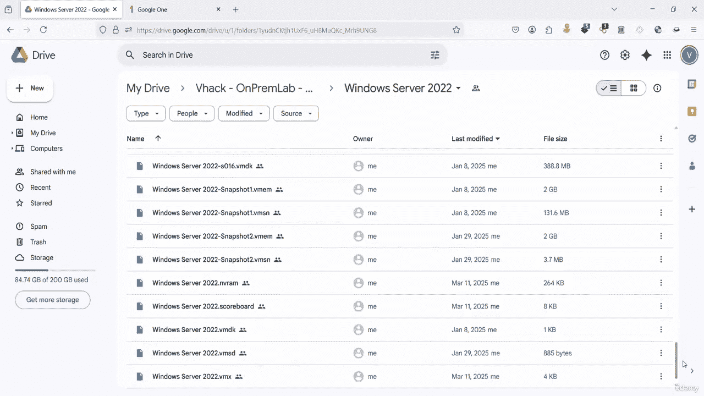

准备好工具之后，接下来我们看看如何获取课程需要的资源。如果你想下载某个文件，直接在终端里执行下载命令即可。这里的下载命令比较直接，不需要什么特殊的参数，复制粘贴就能用，即使你第一次接触终端也没有问题。

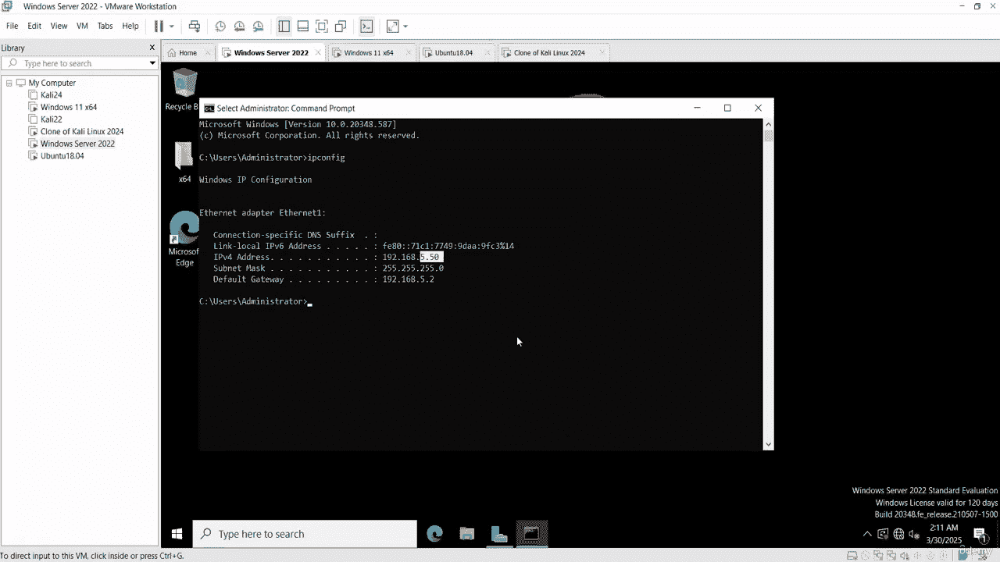

以下是常见的下载命令示例：

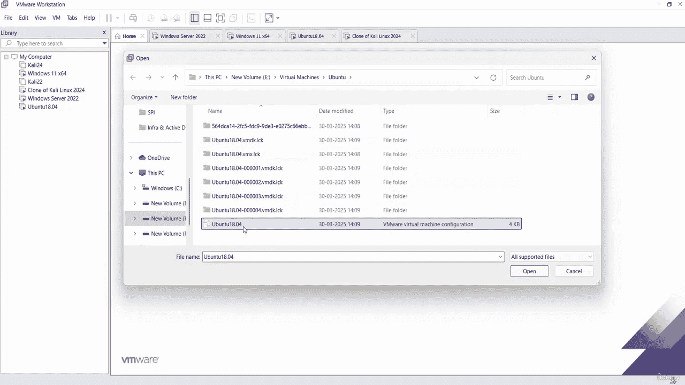

```bash
wget https://example.com/target-machine.iso
curl -O https://example.com/kali-linux.iso
git clone https://github.com/example/hacking-lab.git
```

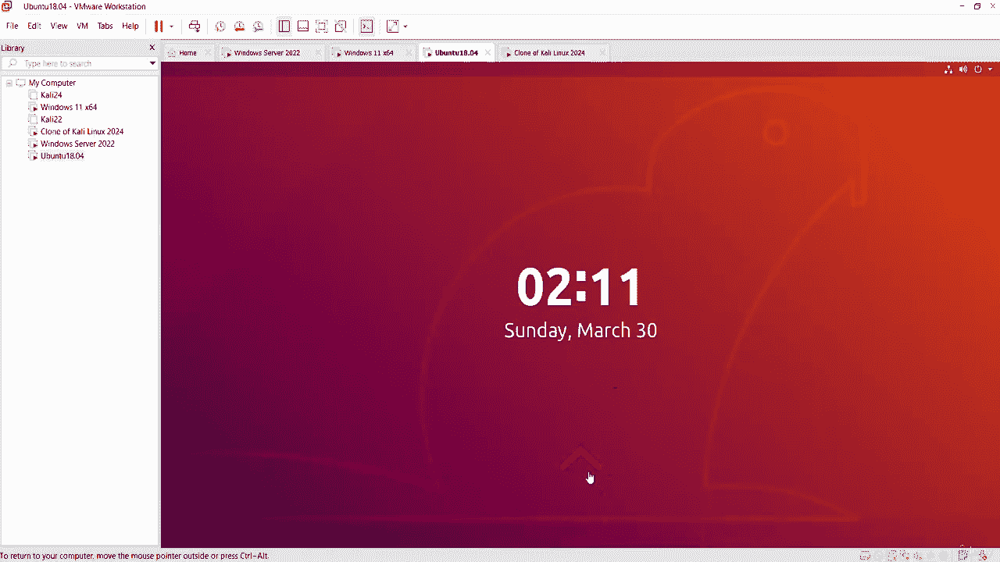

如果你不熟悉终端，不用担心，只要把命令复制进去回车就行。下载完成后，你会得到几个镜像文件和资源包，后面我们会用它们来搭建实验环境。下载速度取决于你的网络状况，建议在网络比较好的时候进行，避免中途断开导致文件损坏，那样会浪费很多时间。


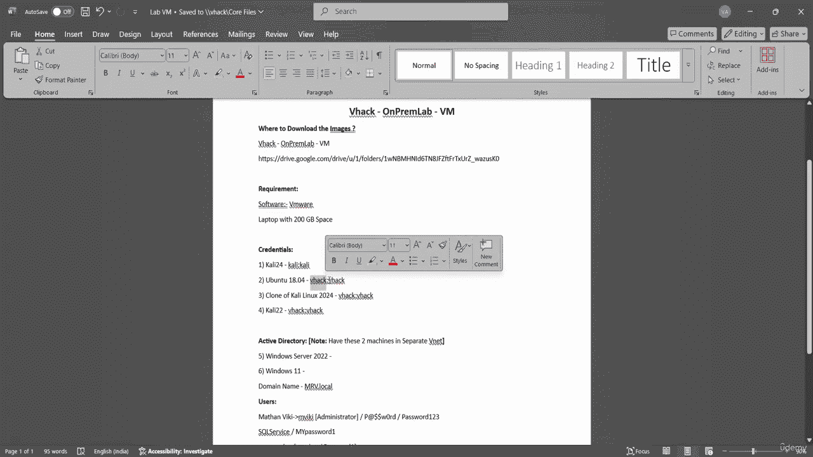

## 三、六台靶机与凭证密码设置 🔐

资源下载完毕之后，我们需要配置靶机环境。课程里总共提供了六台靶机，每台机器都有不同的用途，用来模拟真实网络中的漏洞环境。为了能登录进这些靶机，你需要知道对应的凭证密码，也就是用户名和密码的组合，没有正确的账号密码是进不去系统的。

以下是常见的凭证设置格式：

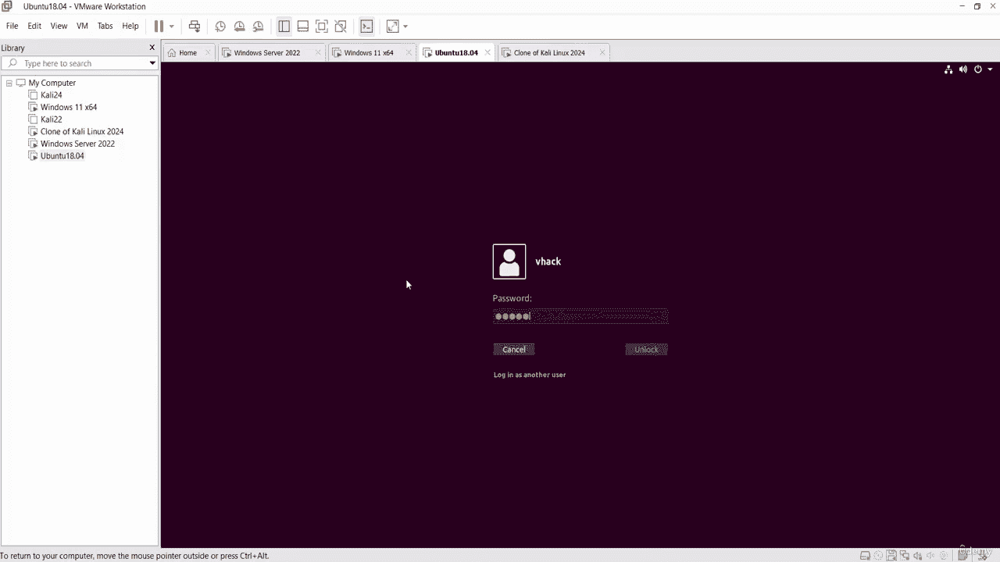

```text
用户名: admin
密码: password123
```

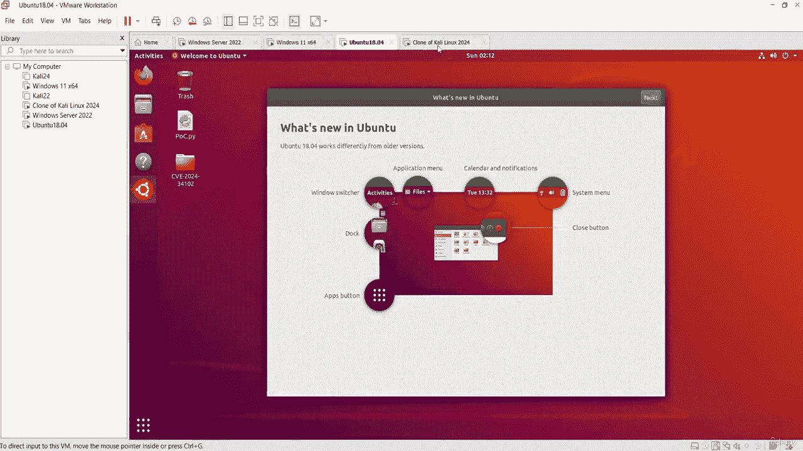

或者如果你需要使用 root 权限，可以用：

```text
用户名: root
密码: toor
```

记得把这些密码记在一个安全的地方，或者直接记在笔记本上，因为后面实验的时候会频繁用到。如果某台机器登录不上，先检查是不是密码输入错了，再考虑是不是机器没启动成功，不要轻易怀疑是课程出了问题。


## 四、网络渲染与权限限制 🌐

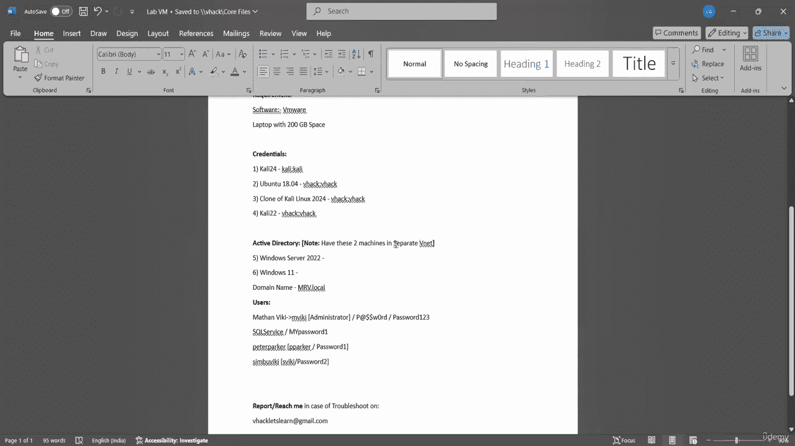

靶机配置好之后，我们需要了解网络是怎么连接的。课程里会把虚拟机放在一个内部网络里，攻击机和靶机需要在同一个网段才能互相访问。这个过程可以简单理解为“给网络渲染出一个可用的环境”，让你的 Kali 能够扫描到靶机的 IP 地址，从而发起后续的攻击测试。

以下是查看网络配置的命令示例：

```bash
ip addr
ifconfig
ping 192.168.56.101
```

需要注意的是，网络里面会存在一些限制，不是所有的端口都开放，也不是所有的机器都能直接访问。这些限制是故意设置的，目的是让你练习如何绕过防火墙或权限控制。如果遇到连不上的情况，先检查虚拟机的网络模式是否设置为“主机模式”或“内部网络”，这是新手最容易忽略的地方。


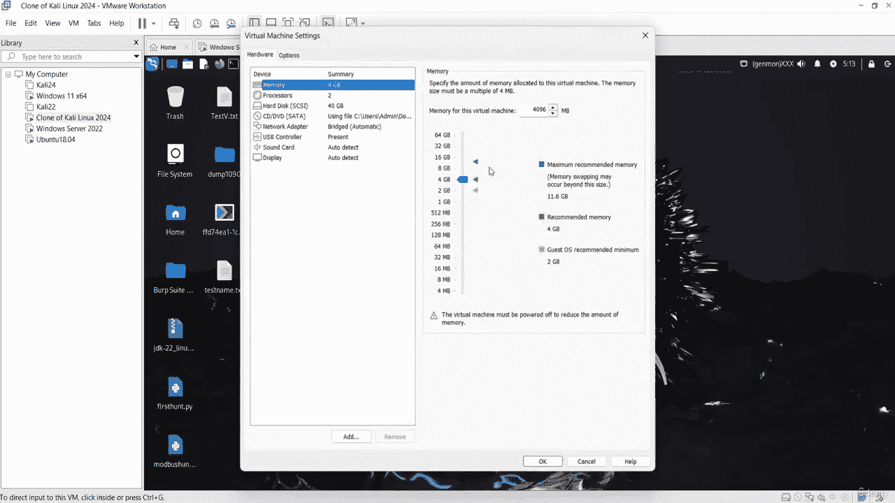

## 五、网络操作员权限与后续操作 ⚡

网络环境搭建好之后，你就可以在这个局域网里以操作员的身份进行操作了。也就是说，你的攻击机现在已经处于网络中，可以开始扫描、枚举和尝试攻击靶机。你可以随意使用这些工具，但要记得只在课程提供的靶机上操作，不要去扫描公共网络中的其他设备，那样是违法的。

以下是一个简单的网络扫描示例：

```bash
nmap -sV 192.168.56.0/24
```

如果你想切换到更高的权限，可以尝试提权命令，但这部分内容会在后面的章节详细讲解。现在你只需要确保自己的机器已经加入网络，并且能够正常和靶机通信即可，这就足够开始下一步的实验了。


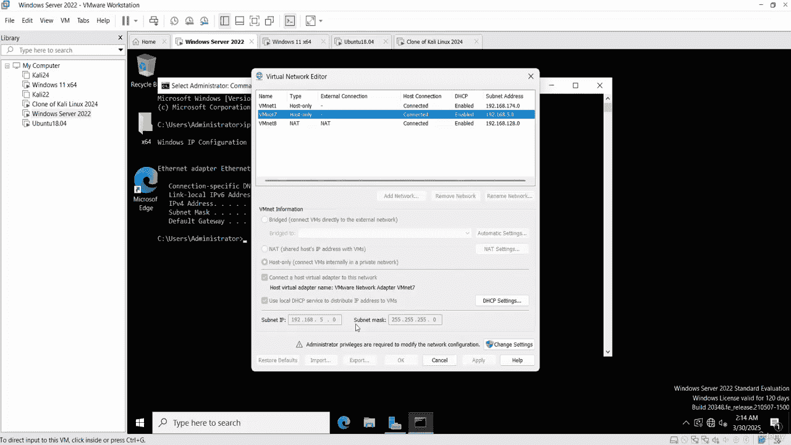

本节课中我们一起学习了前置条件、资源下载命令、六台靶机与凭证密码设置、网络渲染与权限限制，以及网络操作员的基本操作。你现在应该已经清楚怎么准备环境，也知道怎么下载文件和配置网络了。下一节课我们将进入第一个真实攻击场景的演示，记得把环境装好再来学习。

