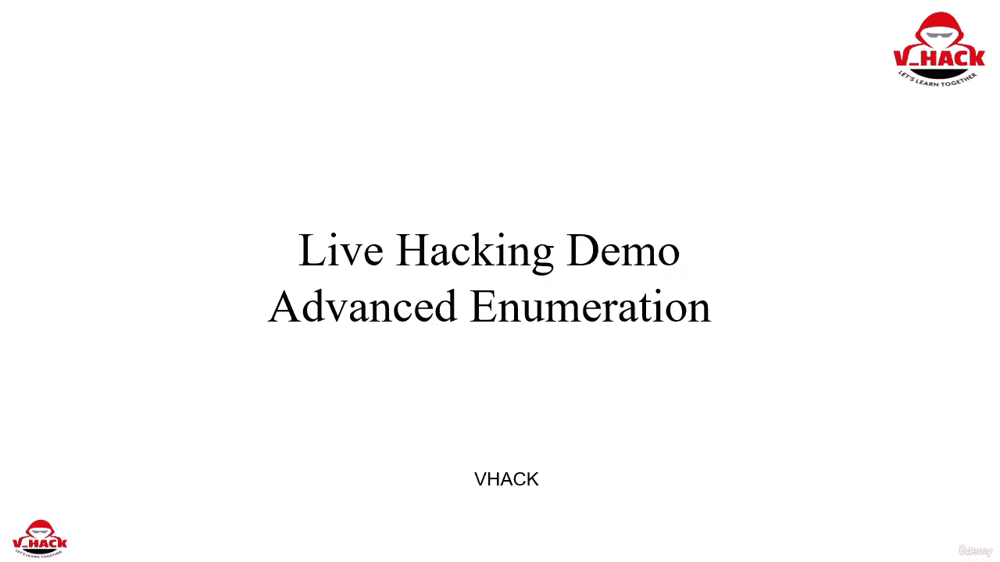
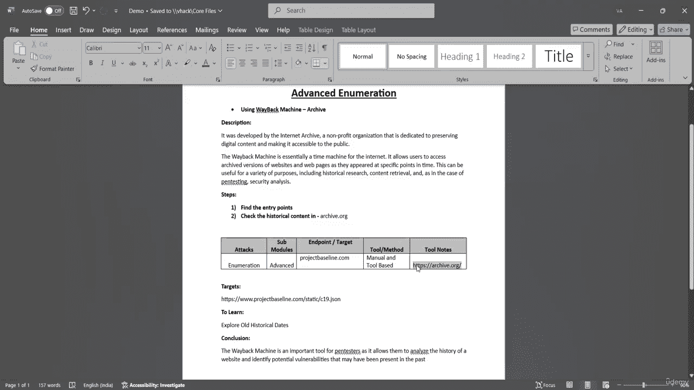
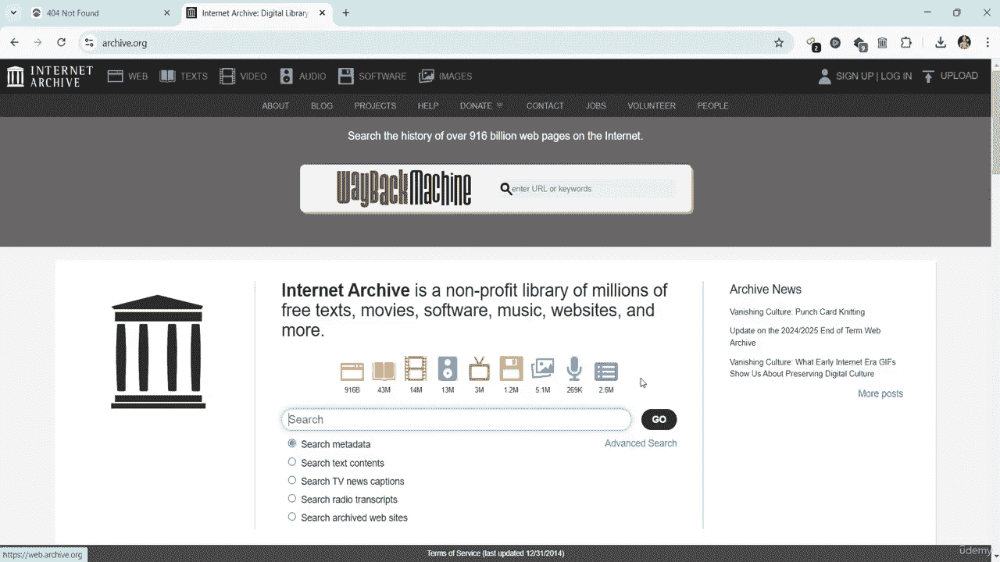
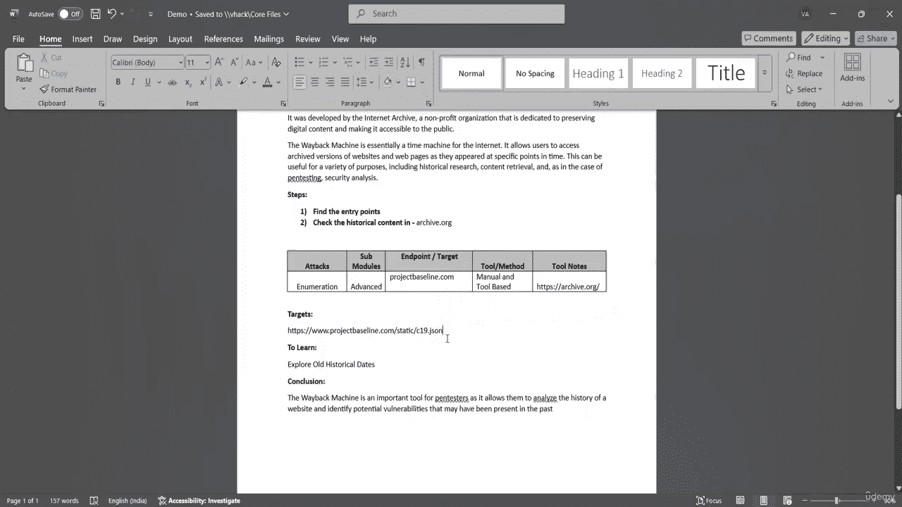
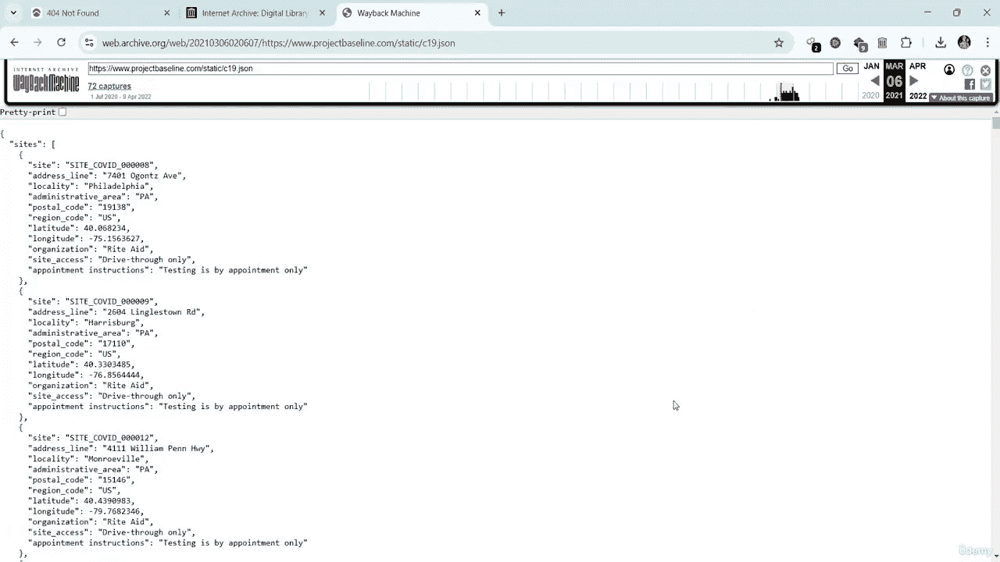
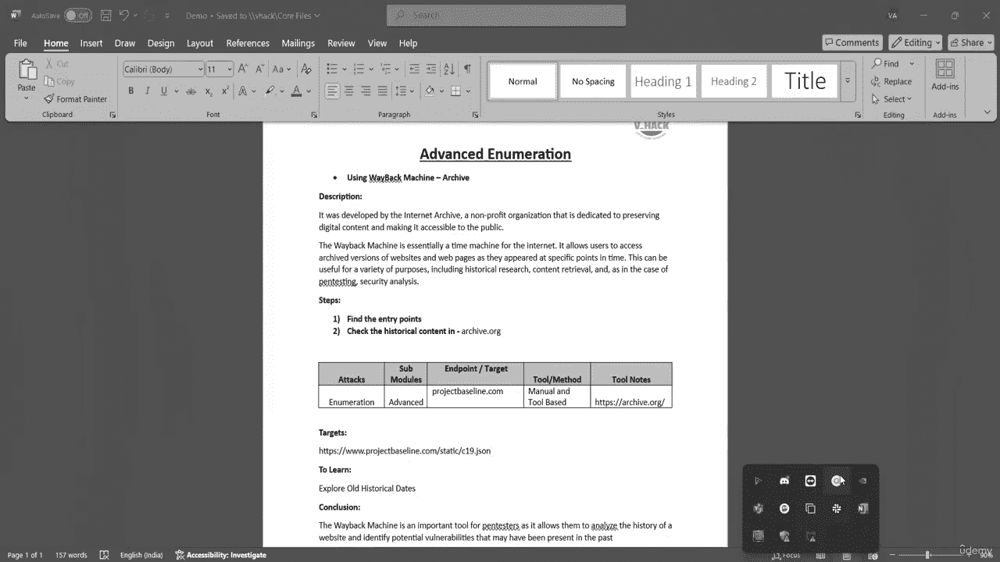

Ethical Hacking：50-Day Hacker Challenge：07-02：使用Wayback机器进行高级枚举（实战目标）🕷️

在本节课中我们将要学习如何利用互联网档案馆（Wayback Machine）来进行高级枚举，这是渗透测试和漏洞赏金猎杀中非常实用的一项技能。枚举的核心思想就是在不直接攻击目标的前提下，尽可能多地收集目标系统的信息，比如隐藏的页面、旧版本的文件以及曾经存在但现在已经被删除的敏感数据。我们会通过一个真实的靶场示例，一步步展示如何回溯历史快照，找到那些已经不可见但仍有价值的内容，帮助你理解被动信息收集的强大之处。

## 枚举在安全测试中的作用🔍

枚举可以用下面这个简单的公式来理解：

枚举 = 目标系统的所有可用入口 + 历史数据 + 隐藏页面 + 配置信息

以下是枚举的主要作用：
- 发现目标网站中当前无法直接访问的页面
- 恢复已经被删除或限制访问的历史文件
- 为后续的漏洞挖掘提供更多的攻击面线索
- 以被动方式收集信息，降低被目标系统发现的风险

## 什么是Wayback Machine🕰️

Wayback Machine，也就是archive.org，是一个公开的网页存档服务。它会定期抓取互联网上的网页，并以数字副本的形式保存下来，形成一个庞大的历史快照库。对于安全研究人员来说，这就像一台时光机，可以让你回到过去查看某个网页在特定时间点的样子。

以下是使用Wayback Machine的基本逻辑：

历史页面 = Wayback Machine(目标URL, 具体日期)

比如你想查看某个页面在2021年3月6日的样子，只需要输入对应的URL和日期，系统就会展示该时间点的存档快照。这种方式完全不需要和目标服务器进行实时交互，所有的请求都发给存档服务器，因此属于典型的被动侦察手段。

## 寻找受限或已删除页面的方法🔍

在实际渗透测试中，你经常会遇到这种情况：目标网站的某个页面现在返回404错误，说明该页面已经被管理员删除或限制访问。但这并不意味着页面里的信息就永远消失了，因为Wayback Machine可能之前已经保存过它的副本。

以下是操作步骤：
1. 确定你想要探索的入口页面，或者当前已被限制访问的页面
2. 访问archive.org，在搜索框中输入该页面的完整URL
3. 在日历界面选择一个历史日期，查看该页面是否有可用的快照
4. 打开快照，浏览其中保存的HTML、JavaScript、JSON或其他敏感文件内容

通过这套流程，你可以在不触发目标服务器告警的前提下，翻阅网站的历史版本，挖掘出被遗忘的数据。

## 实战演示：projectbaseline.com🎯

本次演示使用的目标URL是：

https://projectbaseline.com/static/c19.JN5

当我们直接访问这个地址时，页面显示404 Not Found，说明该文件在当前已经不存在。但这并不代表我们束手无策，只需要借助Wayback Machine的历史引擎，就可以回到过去查看该文件曾经的内容。

以下是具体的演示过程：
- 打开浏览器，访问archive.org
- 输入上述项目基线网站的URL
- 在日历中挑选一个有绿色标记的日期，比如2021年3月6日
- 进入该日期的快照页面，你会看到原本被删除的JSON文件数据完整地展示出来

这就是利用历史索引机器获取敏感数据的典型方法，即使文件现在已经被永久移除，或者访问受到了限制，我们依然能够通过存档记录找到曾经写入该文件的全部内容。

## 使用浏览器扩展辅助搜索🧩

为了提高效率，讲者在演示中安装了一个针对TEC的浏览器扩展程序。这个插件的作用是，只需点击一下按钮，就可以直接在archive.org下搜索当前页面的存档记录，而不需要手动复制URL并打开另一个网站。

使用这个扩展的步骤如下：
1. 在浏览器中安装相关的Wayback Machine辅助扩展
2. 打开目标网站的任意页面
3. 点击扩展图标，一键发起存档搜索
4. 系统会自动跳转到archive.org对应的搜索结果页面
5. 在返回的日历界面中，选择你想要查看的具体日期
6. 浏览该日期下的页面快照，提取其中的敏感信息

有了这个工具，你可以在任何时间点快速切换到历史视角，大大缩短信息收集的周期。

本节课中我们一起学习了如何使用Wayback Machine进行高级枚举。我们了解了枚举在深度安全测试中的关键作用，掌握了通过archive.org回溯网页历史快照的基本原理，并通过projectbaseline.com的真实案例演示了如何找到已经被删除或限制访问的页面。最后，我们还介绍了如何安装和使用浏览器扩展来简化这一过程。希望这些内容能帮助你在实际的渗透测试和漏洞赏金项目中，更高效地挖掘隐藏的敏感数据。

