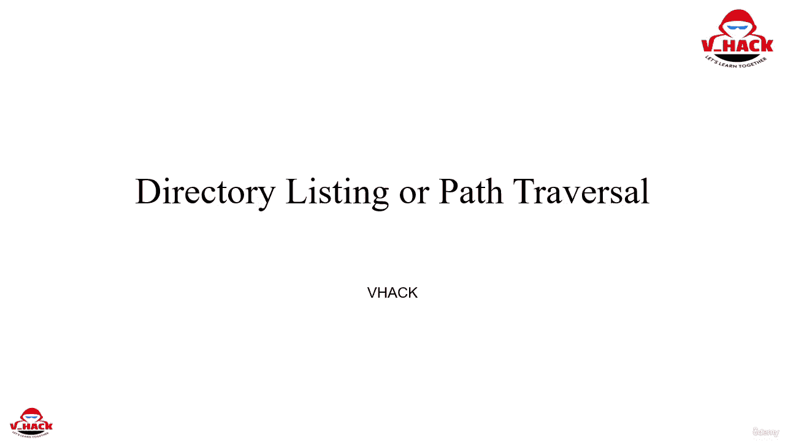
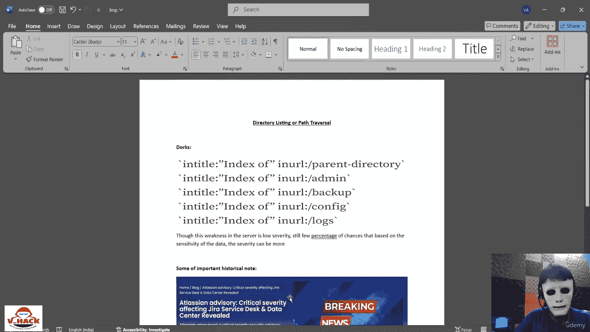
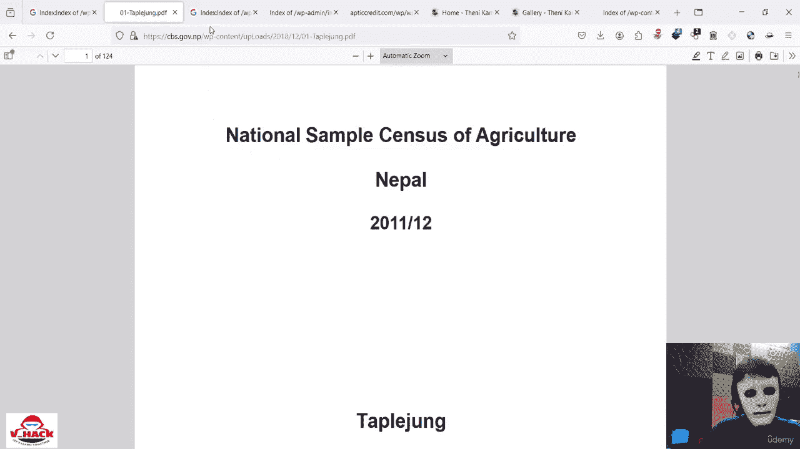
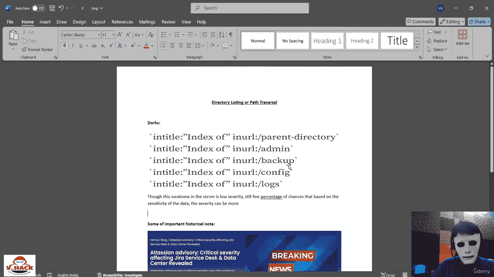
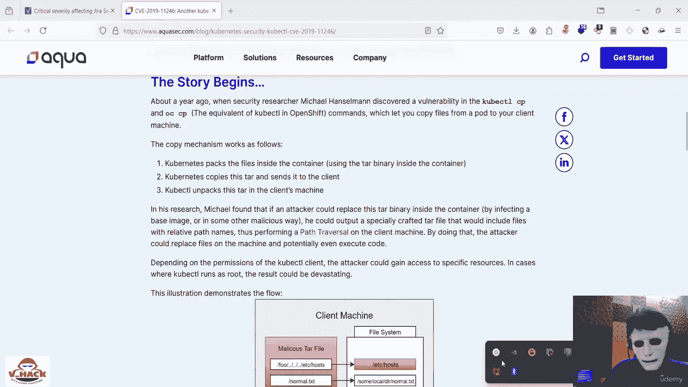

🛡️ 道德黑客：第 08 节：目录列表（Directory Listing）实战




在本节课中我们将要学习目录列表漏洞的基本概念，掌握如何通过 Google 搜索引擎发现服务器上的目录列表，了解该漏洞在真实渗透测试中的危害等级，并参考几个历史安全事件来理解为什么每一条信息都可能被攻击者利用。最后我们会介绍一些简单的防御建议，帮助你在实际工作中加固服务器配置。即使你是初学者，也能通过本节课快速理解目录列表的原理与危害。


什么是目录列表


上一节课我们介绍了渗透测试的基本信息收集方法，本节中我们来看看目录列表这个具体的漏洞类型。目录列表是指当 Web 服务器收到对某个文件夹的访问请求，但该文件夹中没有默认首页文件（比如 index.html 或 index.php）时，服务器会直接把文件夹里的所有文件和子文件夹列表返回给浏览器。这就像你打开一个文件柜，里面所有的文件名都一览无余。攻击者可以利用这个列表快速找到备份文件、配置文件、源代码或日志文件，从而为后续攻击收集情报。

核心概念可以用下面的公式来表示：

```text
信息泄露风险 = 目录列表是否开启 × 目录中敏感文件的数量 × 攻击者利用这些信息的难度
```

当目录列表被开启，并且文件夹中存在 config.php、backup.zip、database.sql 等敏感文件时，攻击者只需访问一个普通的 URL 路径，就能拿到关键信息。这在渗透测试中通常被归类为低危漏洞，但如果敏感数据非常重要，或者可以与其他漏洞组合使用，实际危害可能会很高。

下面是一个常见的目录列表页面示例：

```text
Index of /admin/

Name                    Last modified      Size
config.php              2023-05-10         2 KB
backup.zip              2023-04-20         5 MB
database.sql.bak        2023-03-15         10 MB
```

每一个出现在列表中的文件名，都可能是攻击者进一步入侵的切入点。


如何使用 Google 搜索发现目录列表


了解了目录列表的基本定义之后，我们继续探讨如何在不直接扫描目标服务器的情况下发现这个问题。渗透测试人员不一定需要直接扫描目标服务器，也可以利用 Google 搜索引擎来查找已经被索引的目录列表页面。这种方法属于被动信息收集，不会向目标服务器发送大量异常请求，因此不容易被防火墙或日志系统发现。



以下是一些常用的 Google 搜索语法示例：

- intitle:index.of admin
- intitle:index.of backup
- intitle:index.of config
- filetype:sql "parent directory"
- site:example.com intitle:index.of

这些搜索语句的意思是告诉 Google，只返回页面标题中包含 "index.of" 且与管理、备份、配置相关的网页。因为很多服务器默认的目录列表页面标题就是 "Index of /"，所以攻击者可以通过这些通用查询找到大量暴露在互联网上的目录。你不需要限定特定的国家或域名后缀，这些查询是开放的，可以针对任何网站进行尝试。



在实际操作中，当你在 Google 搜索结果中看到一个目录列表页面时，点击进去就可以浏览服务器上的文件结构。如果页面里出现了 WordPress 上传文件、旧数据库备份或管理脚本，就说明该目标存在目录列表信息泄露问题。




目录列表在真实攻击中的影响


学习完如何发现目录列表之后，我们需要评估这个漏洞到底有多严重。很多初学者会认为目录列表只是一个低危问题，不值得太关注。但实际上，危害程度完全取决于目录中暴露了什么样的数据，以及攻击者如何把这些信息串联起来。

以下是两个真实的历史案例，用来说明目录列表或路径遍历问题可能造成的严重后果：

第一个案例发生在 2019 年左右，涉及一个名为 Atlanhell 的票务门户网站。由于路径遍历问题，攻击者能够未经认证地访问客户数据，导致大量敏感信息被公开。这个事件之所以引起广泛关注，不是因为路径遍历本身多么复杂，而是因为泄露的数据非常敏感，直接造成了严重的客户信息安全事故。

第二个案例同样发生在 2019 年左右，涉及一个名为 Cupsitial 的工具，用于管理 Kubernetes 集群。攻击者利用同样的路径遍历问题，不仅能够访问容器内部的文件，甚至还能执行任意代码，最终获取对容器的控制权。这个案例表明，当目录列表与代码执行漏洞组合使用时，攻击的严重程度会迅速从低危提升到高危。

这两个案例共同说明一个原则：在渗透测试中，每一条看起来无害的信息都可能成为攻击链条中的关键一环。攻击者通常会先收集目录列表，再寻找源代码泄露，最后尝试本地文件包含或远程代码执行，逐步扩大攻击效果。


最佳实践与防御建议


分析完真实案例之后，我们来看看如何防止目录列表被攻击者利用。为了防止目录列表被攻击者利用，最直接的方法是在 Web 服务器中禁用目录列表功能。如果某个文件夹不需要向公众展示文件列表，就应该关闭自动索引。

下面是常见 Web 服务器的配置示例：

Apache 服务器可以在 .htaccess 或主配置文件中添加：

```apache
Options -Indexes
```

Nginx 服务器可以在 server 或 location 块中添加：

```nginx
autoindex off;
```

除了关闭目录列表，还建议采取以下措施：

- 不要将备份文件、源代码或配置文件放在 Web 根目录下的公开文件夹中。
- 对敏感目录添加身份验证或访问控制列表。
- 定期使用 Google 搜索语句检查自己的域名是否有目录列表页面被索引。
- 确保所有上传目录禁止脚本执行，防止攻击者上传恶意文件后直接运行。

这些防御措施虽然简单，却能有效降低信息泄露的风险，使攻击者在信息收集阶段就受到限制。


总结




通过前面的内容，我们已经了解了目录列表的检测方法与危害案例。本节课中我们一起学习了目录列表的定义与原理，掌握了如何使用 Google 搜索语法发现服务器上的目录列表，分析了 Atlanhell 与 Cupsitial 两个真实案例中的攻击影响，并介绍了 Apache 与 Nginx 的禁用配置以及常见的防御建议。希望这些内容能帮助你在实际的渗透测试工作中，更好地识别和修复目录列表相关的安全问题。


