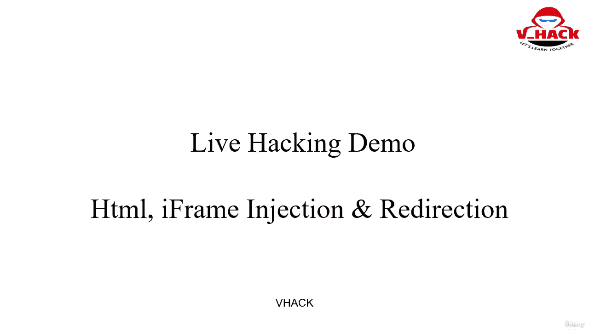
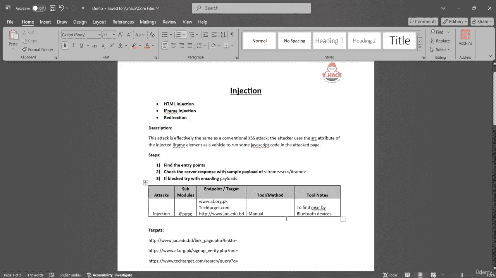
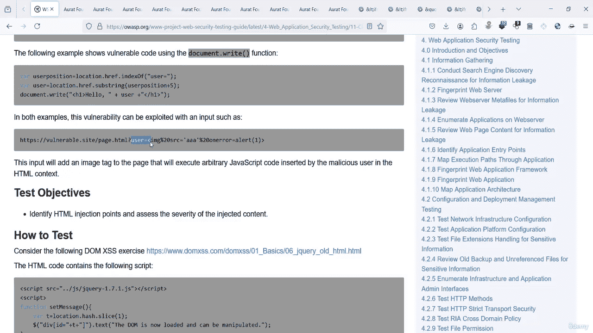
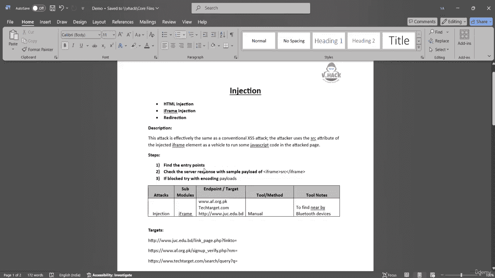
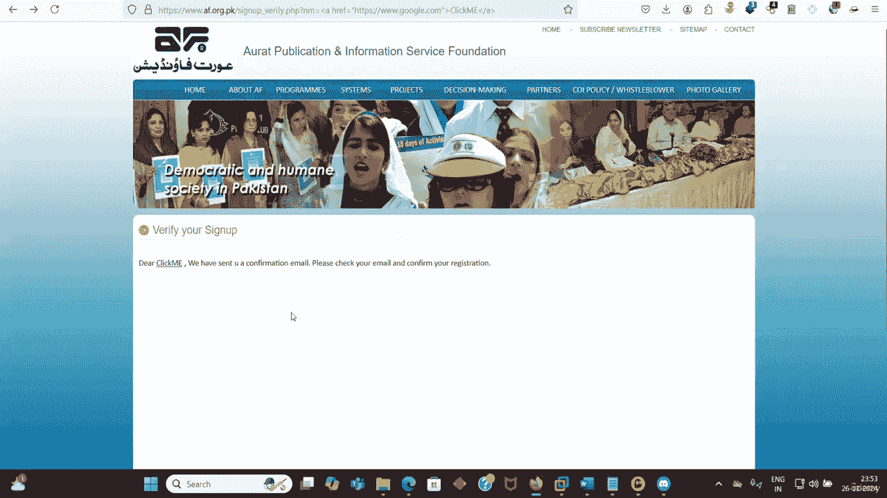
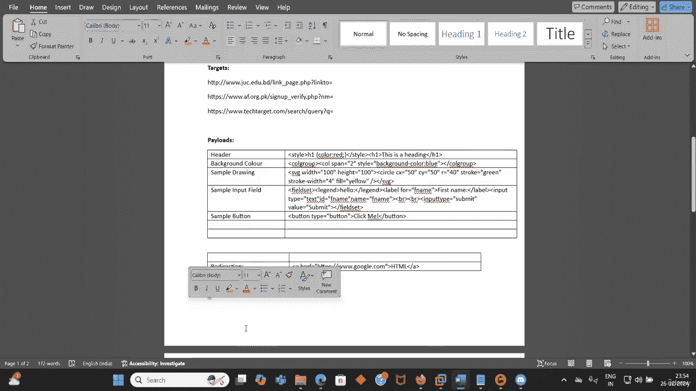
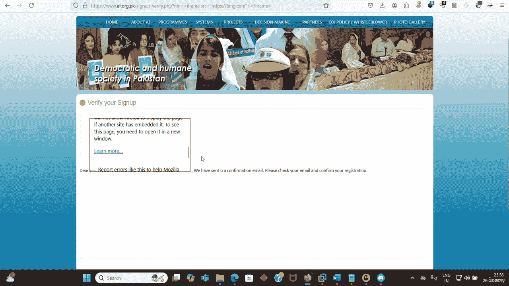
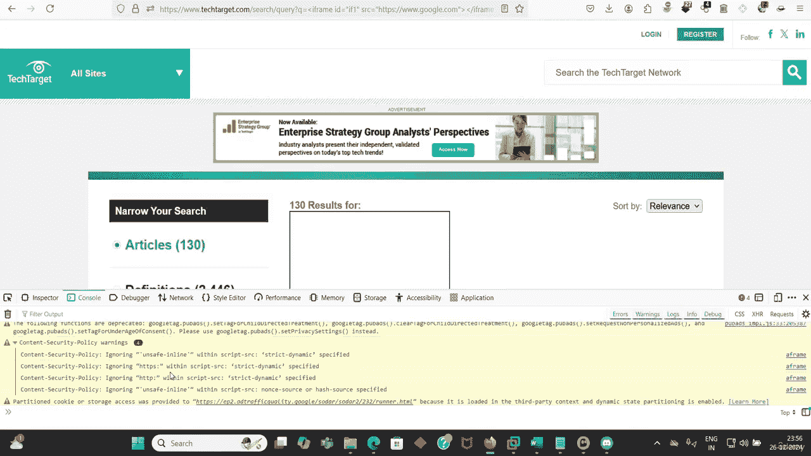
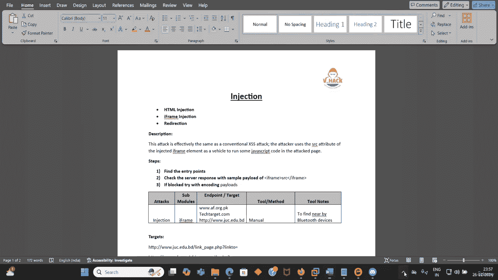

Web应用安全与注入攻击：04：HTML注入、iframe注入与重定向 🎯




在本节课中，我们将一起学习Web应用攻击中的注入类型。具体来说，我们将重点介绍HTML注入、iframe注入以及页面重定向这三种常见的漏洞。我们会看看攻击者如何寻找输入点，如何构造恶意代码，以及如何利用这些弱点诱导用户点击链接或收集敏感信息。此外，我们还会简单聊聊防火墙、编码绕过、X-Frame-Options和内容安全策略等防御手段，以及攻击者可能采取的绕过思路。所有内容都会用大白话来讲解，确保初学者也能听明白。


### 一、注入类型概述与入口点寻找 🔍

上一节我们介绍了命令注入，本节中我们来看看HTML注入、iframe注入和重定向等其他注入方式。

在Web应用攻击的大框架下，注入是一类非常重要的漏洞。除了之前单独讲解过的命令注入之外，本模块把几种相关的注入方式放在一起依次讲解，具体包括HTML注入、iframe注入、超链接注入和页面重定向。这些漏洞的共同特点在于，攻击者需要先找到一个可控的入口点，然后向服务器发送测试用的payload，再检查服务器的响应结果。大部分现代网站都会部署Web应用防火墙，也就是WAF。如果直接发送的请求被防火墙识别并拦截，攻击者还可以尝试使用一些编码技术来绕过防护。下面我们会通过真实靶场演示这些攻击手法，并把对应的payload一并记录下来，方便大家跟进练习。

从整体来看，一次注入攻击的成功可以用下面这个简单的公式来描述：

```
攻击成功 = 找到用户可控输入点 + 构造恶意payload + 服务器未做有效过滤
```


### 二、什么是HTML注入 🌐

在了解了注入的基本思路后，本节中我们来看看HTML注入具体是怎么回事。

从大白话角度来说，一个正常的网站应该拒绝用户提交的原始HTML代码。但是，如果某个页面存在HTML注入漏洞，攻击者就能把自己的HTML代码直接塞进页面里。这些代码可以做很多事情，比如修改页面背景颜色、改变标题大小、插入按钮、输入框或者表单字段。所有这些改动，本质上都是在页面源代码中添加了攻击者控制的内容。所以，找到可注入的入口点就是利用这类漏洞的第一步。OWASP关于HTML注入的定义也强调，核心在于发现可被控制的输入或入口点。

在代码层面，正常情况下用户输入应该被转义或拒绝，类似下面这样：

```
<h0>test</h0>
```

但是如果应用程序有漏洞，攻击者提交的内容会被直接渲染，变成类似下面的结果：





```
<h3>welcome</h3>
```



我们打开一个易受攻击的目标网站来演示一下。在某个输入字段中，原本放的是h0标签，值设为test。我们可以把它改成welcome，或者把标题等级改成h3。渲染页面之后，你会看到原来的test被替换成了welcome，并且h3标题出现在页面的某个位置。这说明应用程序直接接受了用户提供的查询内容，并没有做适当的过滤，这就是典型的HTML注入漏洞。这就是我们要找的那个bug，也正是应用程序超出安全范围的表现。


### 三、利用HTML注入增加危害 ⚠️

单纯修改文字颜色或标题大小可能看起来危害不大，本节中我们来看看攻击者如何把这个弱点变得更严重。

在实际攻击场景中，仅仅改改背景颜色或插入一张图片，对攻击者来说帮助有限。但如果页面能接受用户输入，攻击者就可以插入一个名为"点我"的按钮。这个按钮本身可能不带超链接，但在后续演示中，我们会展示如何给按钮添加超链接，把用户重定向到攻击者自己搭建的网站。这就是HTML注入能够产生实际影响的方式。

攻击者还可以利用这个漏洞创建下拉菜单、文本框，甚至模仿登录页面，诱导用户输入用户名和密码。不过，很多应用会限制输入字段的字符数量，比如用户名最多只能50个字符。在这种限制下，攻击者没法无限添加文本框来收集信息。这时候，另一种常用的方法就是插入iframe。

攻击者可以在页面中插入以下常见元素来扩大攻击面：

- 修改背景颜色或标题大小
- 插入按钮、输入框或下拉菜单
- 构造模拟登录表单收集用户名和密码
- 添加超链接引导用户跳转

在代码层面，一个简单的按钮示例如下：

```
<button>点我</button>
```

后续我们可以给它添加超链接，变成类似下面的形式：

```
<a href="http://attacker-site.com"><button>点我</button></a>
```


### 四、iframe注入与嵌入恶意页面 🖼️

当直接注入表单受到长度限制时，本节中我们来看看iframe注入是如何扩大攻击面的。

iframe可以理解为一个内置的框架，攻击者可以设置它的宽度和高度，甚至让它填满整个页面。通过iframe，攻击者可以把自己的网站嵌入到目标网站里。用户看到的表面上是正常的前台页面，但实际上，恶意站点已经被嵌入到了背后，这样攻击者就可以把用户的信息发送到自己控制的服务器上。这就是利用注入弱点来扩大影响的典型手法。

如果目标网站同时还存在本地文件包含漏洞，攻击者甚至可以通过iframe去读取敏感文件，例如Linux系统中的/etc/passwd。虽然本次演示的靶机不一定具备这个条件，但这里给大家一个概念，说明注入类型还可以和其他漏洞串联起来，形成攻击链。

在代码层面，嵌入外部网站的iframe示例如下：

```
<iframe src="http://attacker-site.com" width="100%" height="100%"></iframe>
```

如果存在本地文件包含，攻击者可能尝试读取敏感文件：



```
<iframe src="/etc/passwd"></iframe>
```


### 五、页面重定向与超链接攻击 🔗

讲完iframe之后，本节中我们来看看重定向攻击是如何配合注入漏洞使用的。

重定向攻击的思路也很简单。攻击者在页面里插入一个按钮或链接，文字可以是"点我"，超链接指向攻击者控制的域名，比如go.do.com。当用户点击后，浏览器就会跳转到这个地址。因为这个链接出现在受信任的宿主网站上，用户往往会下意识地认为它是网站源代码的一部分，从而放心点击，最终成为受害者。这就是注入漏洞结合重定向后，能够产生更高危害的原因。



攻击者可以构建多个概念验证，修改颜色、创建按钮、下拉菜单、表格、单选按钮，然后把这些元素都指向恶意超链接。

在代码层面，一个普通的超链接示例如下：

```
<a href="http://go.do.com">点我</a>
```

如果是恶意重定向，可能变成下面这样：

```
<a href="http://malicious-site.com">点我</a>
```


### 六、浏览器防御机制与绕过思路 🛡️

在了解了攻击手法之后，本节中我们来看看浏览器和服务器是如何防御这些注入行为的。

现代浏览器并不是完全无防备的。比如，很多浏览器都有安全机制，不允许随意嵌入第三方iframe。以tech target dot co为例，这个网站设置了X-Frame-Options响应头，禁止把Google等第三方网站嵌入到自己的页面里。除此之外，还有内容安全策略，也就是CSP，它可以过滤掉这类注入攻击。当然，安全总有被绕过的可能，关于如何绕过这些防护，我们会在后续视频中详细讲解。目前，大家只需要清楚HTML注入、iframe注入和重定向这几种类型，以及如何通过改变字体、背景、加入按钮、单选按钮、表格、下拉菜单、添加超链接或插入表单来收集用户信息。如果输入字符长度受限，还可以插入iframe来扩展攻击。

在代码层面，服务器可以通过响应头来防御iframe嵌入，示例如下：

```
X-Frame-Options: DENY
```



同时，内容安全策略也可以配置类似下面的规则：

```
Content-Security-Policy: default-src 'self'
```


### 七、总结与严重性评估 📋

最后，本节中我们来回顾一下本节课学到的内容。



通过本次演示，我们可以看到，HTML注入、iframe注入和重定向虽然看起来是简单的前端操作，但一起使用时，攻击者可以显著提高漏洞的严重性。从改背景色、改标题，到插入按钮、表单，再到嵌入恶意iframe或诱导用户重定向到钓鱼网站，每一步都可能给用户和企业带来实际风险。希望大家通过本节课的演示，能够对这些注入类型有一个直观的认识，并在后续学习中举一反三。




本节课中，我们一起学习了HTML注入、iframe注入和页面重定向这三种Web注入攻击方式。我们掌握了如何寻找入口点、如何构造payload、如何利用按钮和超链接进行重定向、如何使用iframe嵌入恶意页面，以及浏览器常见的X-Frame-Options和CSP防御机制。希望这些内容对你有所帮助，我们下节课见。
