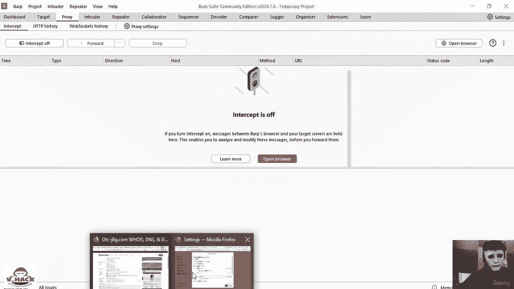
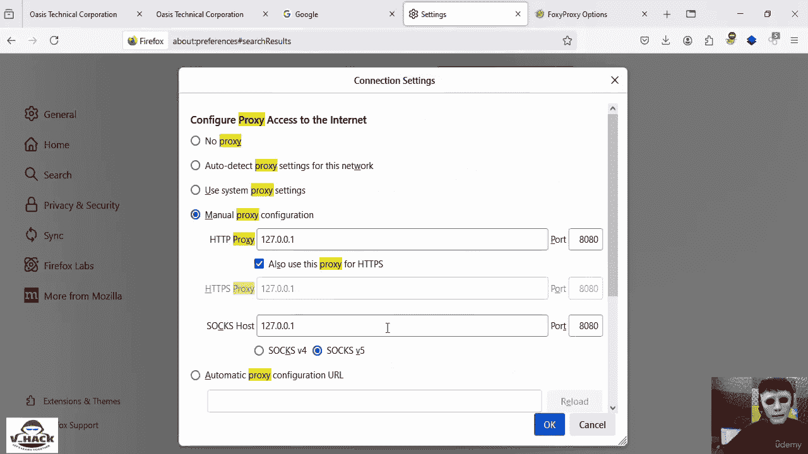
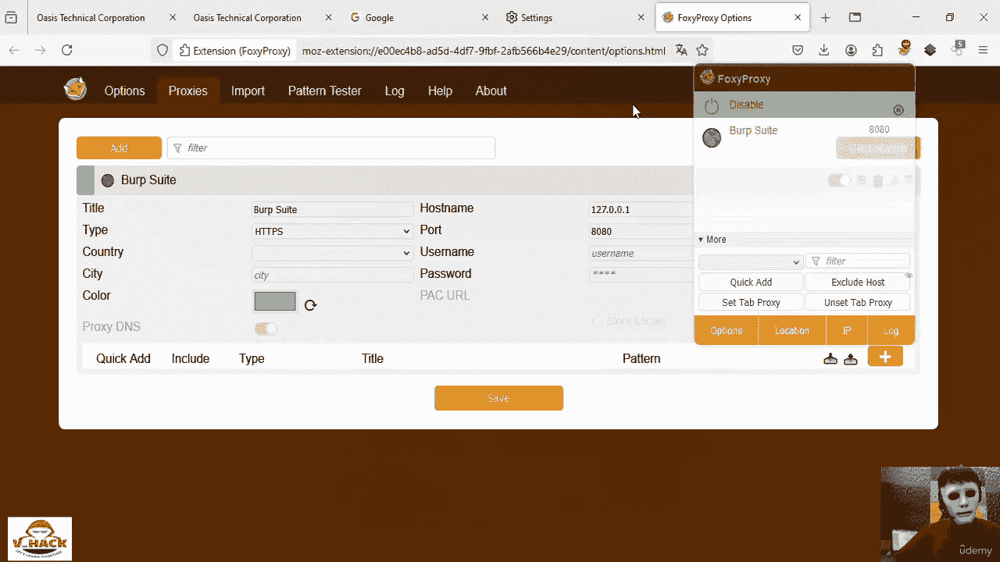
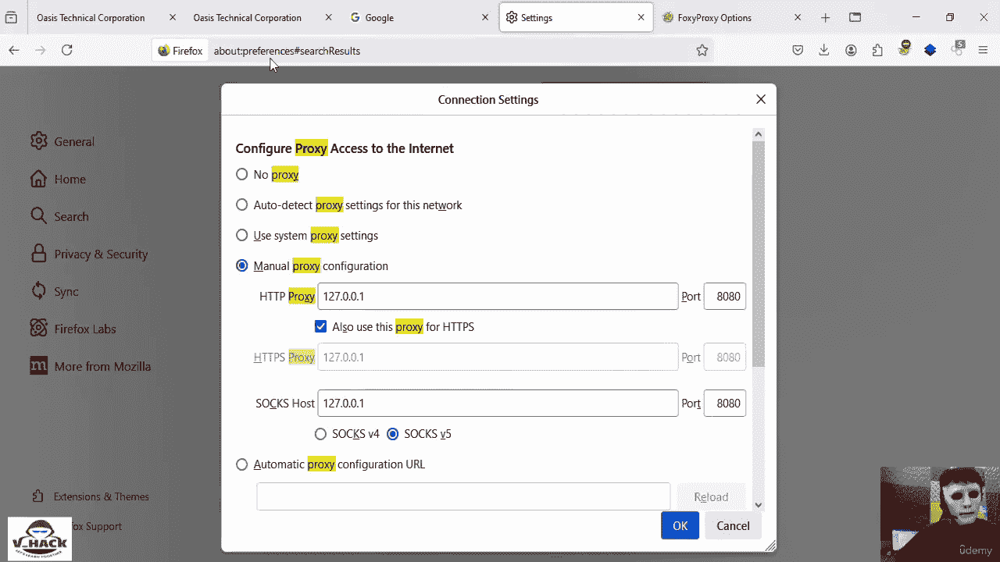
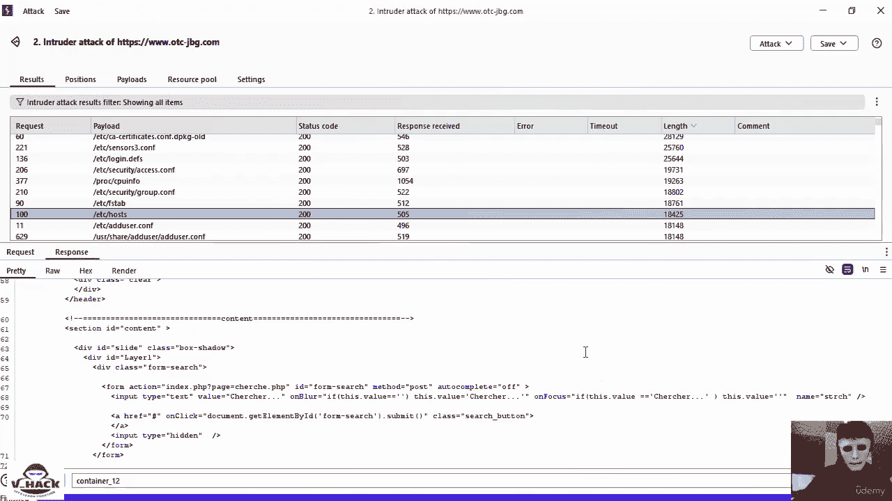

# 道德黑客攻防实战：第10章：本地文件包含漏洞实时目标演练 🔒

在本节课中，我们将继续学习本地文件包含漏洞（Local File Inclusion，简称 LFI）的实际利用方法。上一节我们已经初步介绍了 LFI 的基本概念，本节中我们将进入一台真实的靶场环境，通过 Burp Suite 社区版演示如何发现入口点、读取服务器上的敏感文件，并利用自动化功能批量测试多个系统文件。无论你是刚接触渗透测试的新手，还是希望巩固 Web 安全基础的学习者，本节的内容都会用大白话逐步拆解，让你掌握从手动探测到自动化扫描的完整流程，确保每个步骤都能看懂并动手实践。

## 1. 拦截工具与代理通信原理解析 🛡️

本节我们要使用的核心工具是 Burp Suite 社区版，这是录制本课程时的最新版本，内置了渗透测试中广泛使用的大部分功能，比如 Intruder 和 Repeater。它的作用在于充当客户端与服务器之间的“中间人”，拦截并修改双方通信的数据包，从而为后续的漏洞利用提供便利。

手动寻找注入入口点是一个非常耗时的过程，而 Burp Suite 可以帮助我们实现自动化，大幅提高效率。启动工具后，仪表板会显示整体视图以及已扫描的目标列表，这些目标来源于之前的扫描结果，方便我们快速定位要测试的目标。

默认情况下，Burp 已经启用了代理端口 8080，本地地址 `127.0.0.1` 即代表你自己的计算机。接下来我们将打开浏览器，并将其代理指向该工具，这样客户端与目标服务器之间的初始握手通信就会先经过 Burp 拦截。为了确保拦截生效，需要为 HTTP、HTTPS 甚至 SOCKS 协议启用相同的代理设置，完整的流向可以用这个公式表示：

**浏览器（客户端） → 127.0.0.1:8080（Burp 代理）→ 目标服务器**

## 2. 浏览器代理设置与插件配置 🌐

要让浏览器的流量经过 Burp，我们需要在浏览器设置中找到代理选项，并将其改为手动代理模式，指向 `127.0.0.1:8080`。这样一来，所有请求都会先被 Burp 拦截，而不是直接发送给目标服务器，从而实现流量的可视化和可编辑性。

如果你不想每次都手动修改浏览器配置，可以使用浏览器扩展插件 FoxyProxy，实现即插即用的切换。设置时只需给代理起一个名字，选择转发协议类型，并将扩展固定在浏览器工具栏上。以后只需单击一次即可启用或禁用代理，无需反复进入设置菜单进行繁琐的配置操作。

此时我们的代理环境已经准备就绪，只需在 Burp 界面中点击“拦截开启”按钮，就能开始捕获浏览器发出的请求了。默认状态下拦截器是关闭的，必须手动开启才能查看并修改数据包，确保每一步都在可控范围内进行。

## 3. 启动拦截并转发请求到 Repeater 🔄

开启拦截器后，当浏览器访问目标 URL 时，Burp 会捕获客户端试图与服务器端点通信的 HTTP 请求。我们的第一步是将这个请求转发到 Repeater 模块，以便后续详细查看、修改并重新发送请求，测试不同的参数值。

一个典型的 HTTP 请求包含多个部分，例如请求方法为 GET，请求的超链接对应某个主机名，以及 Cookie 会话信息。如果是未认证的会话，这些 Cookie 可能比较敏感；User-Agent 字段则标识了客户端类型，这里我们使用的是 Mozilla Firefox 131 版本。移动端和 Web 端的请求头会有所不同，服务器会根据这些信息决定如何渲染应用程序，返回相应的页面内容。

完整的请求结构可以简化为以下代码形式：

**GET /页面路径 HTTP/1.1**
**Host: 目标域名**
**Cookie: 会话标识**
**User-Agent: 浏览器标识**

将请求转发给服务器后，服务器会返回响应。浏览器收到响应后，会根据响应头和响应体渲染页面，其中包含 HTML 声明和 JavaScript 文件等内容，最终呈现给用户一个完整的网页界面。

## 4. 利用 LFI 漏洞读取系统敏感文件 📄

在之前的课程中，我们已经识别出了一个入口点。现在我们来实操，看看如何利用这个弱点读取服务器上的文件，理解攻击者是如何获取未授权信息的。

目标运行在 Apache 服务器上，应用程序本身的设计是爬取其托管目录下的文件，通常位于 `/var/www/html` 这样的路径中。但由于应用程序存在漏洞，我们可以越过正常的目录限制，访问 Linux 系统的其他位置，最典型的例子就是 `/etc/passwd` 文件。

发送请求后，我们在响应中看到了 `/etc/passwd` 文件列出的不同用户名。这是 Linux 系统存档用户信息的方式，文件中记录了机器上创建的所有用户，为攻击者提供了宝贵的系统信息。

这一步演示了如何通过本地文件包含漏洞，读取服务器上的敏感系统文件，为后续的权限提升或信息收集打下基础，也说明了输入验证不足所带来的严重后果。

## 5. 路径遍历与防火墙绕过 payload 🚪

查找文件的方法不止一种。在某些场景中，防火墙可能会限制直接访问，这时需要使用不同的绕过方式。无论防火墙是 Cloudflare、Imperva 还是其他类型，都可以通过构造特殊的 payload 来绕过限制，成功读取目标文件。

最常见的方法是使用路径遍历字符 `../`，不断向上跳转目录，直到到达根目录，再定位到目标文件。例如，如果防火墙拦截了直接请求，我们可以尝试对 payload 进行过滤处理或双重编码，从而绕过安全检查机制。

以下是几种常见的绕过 payload 示例：

**../../../../etc/passwd**
**..%2f..%2f..%2fetc/passwd**
**....//....//etc/passwd**

无论使用哪种方式，目标都是让服务器将用户输入拼接到文件路径中，从而读取到不应该被外部访问的系统文件，验证应用程序是否存在路径遍历漏洞。

## 6. 使用 Intruder 自动化批量扫描 🤖

手动一个个测试文件效率太低，因此我们需要引入 Intruder 模块实现自动化。在 Intruder 中，首先要选定入口点，并用美元符号标注需要替换的位置，例如 `page=§show§`，其中 `$` 或 `§` 符号表示 payload 的起始和结束位置，明确工具应当在哪里插入测试数据。

本次演示只针对一个入口字段，即 `page` 参数，当前值为 `show`。我们可以准备一个包含多个感兴趣文件路径的列表，将其粘贴到 payload 设置区域。列表中的每一行都会被工具当作一次独立的攻击动作，逐一尝试不同的文件路径。

启动扫描后，Intruder 会依次尝试列表中的每个文件路径，并显示所有响应结果。判断扫描是否成功有多种方法，通常可以观察 HTTP 状态码，如果状态码保持为 200，说明请求被服务器正常处理；另一种更直观的方法是查看响应长度，响应长度最大的项目往往就是我们要找的阳性结果。

为了节省时间，我已经提前完成了一次扫描，接下来我们将直接查看结果，避免重复等待工具运行的时间。

## 7. 分析扫描结果与常见系统文件 🔍

扫描完成后，我们可以按响应长度进行降序排序，优先查看长度最大的条目，因为这些条目更有可能包含有效数据。在结果中，`/etc/passwd` 的请求和对应响应清晰可见，HTML 响应体以 `</body>` 等标签结束，这正是我们之前在 Repeater 中看到的内容，验证了扫描的准确性。

同样地，我们还可以找到其他敏感文件，例如：

**/etc/group**
**/proc/cpuinfo**
**/etc/hosts**

通过 `/proc/cpuinfo` 我们可以看到服务器的处理器信息，比如属于 Intel CPU 型号 6，具体型号为 E52670。通过 `/etc/group` 可以看到系统中存在多少用户组，甚至可以发现 `crontab` 中的计划任务，了解系统是否有定期执行的更新或维护操作，进一步掌握服务器的运行状态。

## 8. 主机文件与 DNS 信息验证 📡

`/etc/hosts` 文件是一个非常有趣的目标，它通常包含系统的 DNS 声明，将私有 IP 地址与域名进行绑定。例如，系统可能将某个 FTP 服务器的名称直接映射到一个固定的 IP 地址，这样用户输入域名时，系统就会自动解析到对应的 IP，无需手动记忆复杂的地址，提高访问效率。

这种 DNS 记录的添加方式意味着，系统会优先在本地 `/etc/hosts` 中查找域名解析。在这个靶场中，所有内容都关联到 `PHP.net`，我们可以使用被动扫描工具（如 Netcraft 这种在线门户）来验证网站托管信息。扫描结果显示，该网站部署在法国服务器上（通过 `.fr` 后缀识别），反向 DNS 指向 PHP.net，这与主动扫描得到的结果一致，说明部分内部记录确实指向 PHP.net，可能是为了内部管理创建的活动目录。

## 本节总结

本节课中，我们一起学习了如何使用 Burp Suite 社区版对本地文件包含漏洞进行实战演练。我们完成了从配置浏览器代理、开启拦截器、分析 HTTP 请求与响应，到手动利用 LFI 读取 `/etc/passwd` 等敏感文件的全过程。随后我们掌握了路径遍历 payload 与防火墙绕过的基本思路，并引入 Intruder 模块实现了对多个系统文件的自动化批量扫描。最后，我们通过响应长度筛选阳性结果，并验证了 `/etc/hosts` 中的 DNS 记录与服务器托管信息。希望这节课能帮助你初步掌握 LFI 漏洞的发现与利用方法，为后续的渗透测试学习打下坚实基础。

