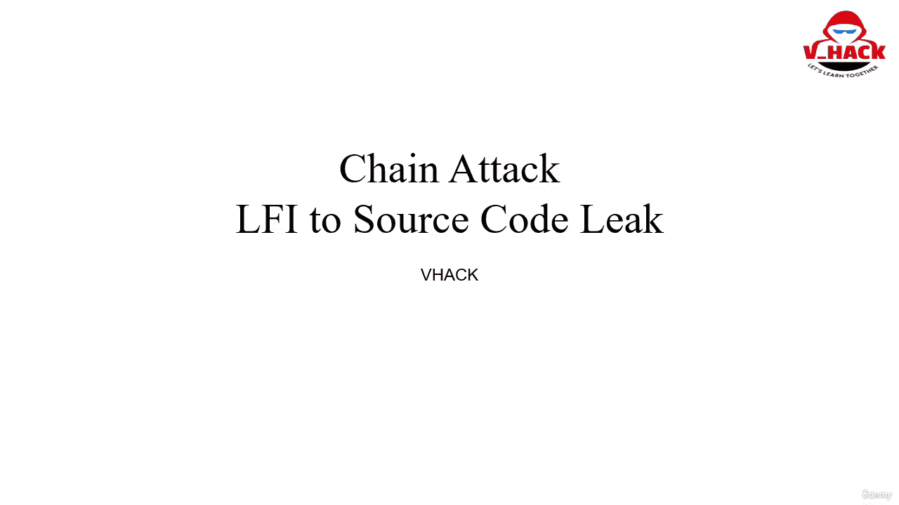
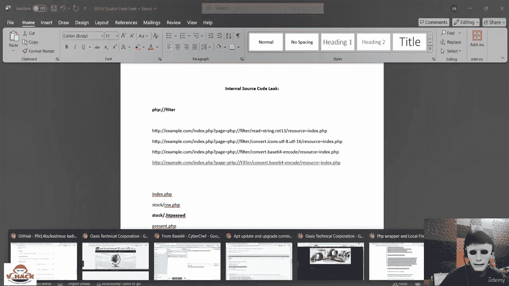
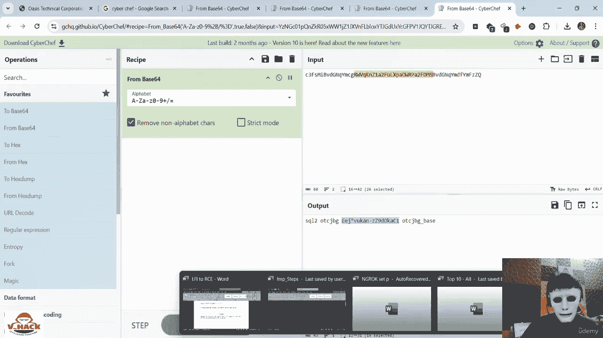
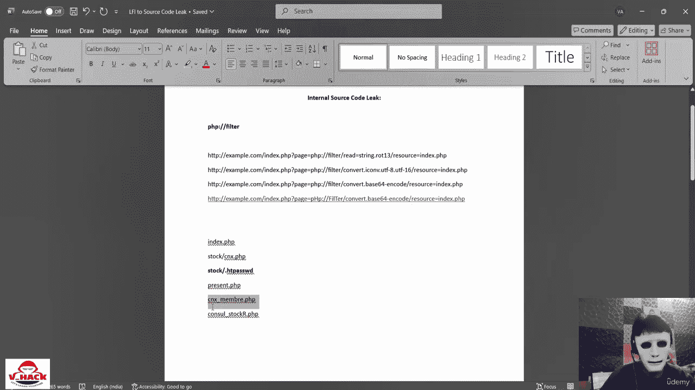
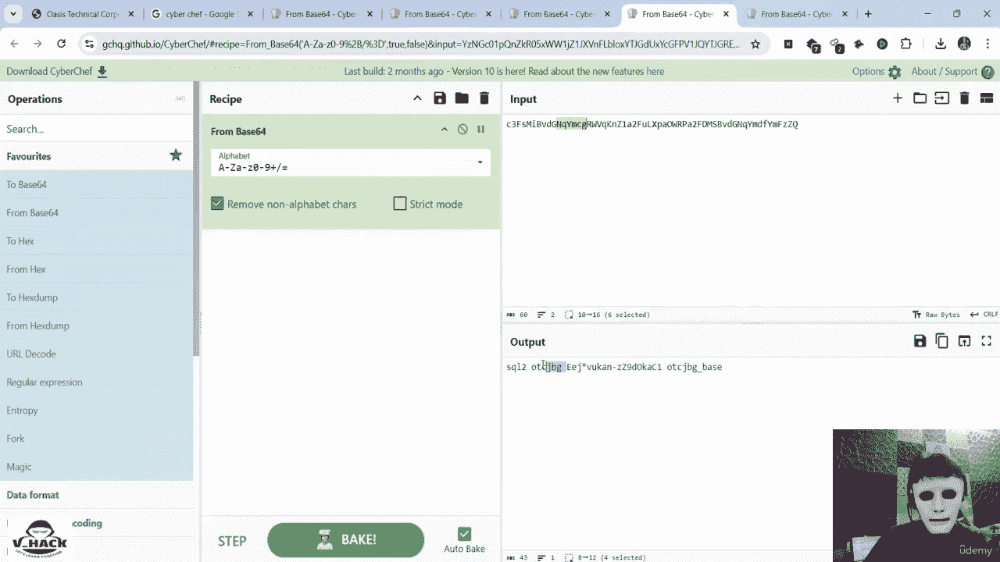
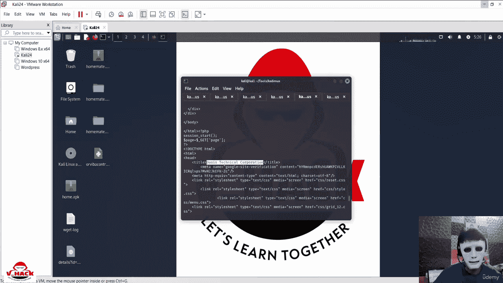

# 🔒 Web 应用安全：12：攻击链攻击——从 LFI 到源码泄露



## 本节课概述

在本节课中，我们将学习 Web 应用模块中关于攻击链（Chaining of Attacks）的内容。攻击链简单来说，就是把一个或多个漏洞组合在一起，让单个漏洞的影响从一个层级提升到另一个层级。本节的核心演示是如何利用本地文件包含（LFI）漏洞，一步步获取目标服务器上的完整源代码，并从中提取敏感信息，比如数据库用户名和密码。我们会先讲解理论基础，再演示手动提取方法，最后介绍一种基于工具的自动化方式，让初学者也能看懂整个利用过程。


## 一、什么是攻击链

本节我们接着上一节 Web 应用模块的内容来讲。所谓攻击链，就是攻击者把两个或多个攻击向量串联起来使用，让单个漏洞的威胁扩大到整个系统，而不是只停留在局部。

以下是攻击链的核心思想：

- 单个漏洞可能只带来有限的影响，比如只能读取一个无关紧要的文件
- 多个弱点组合后，可以实现从低危到高危的权限提升
- 攻击者会利用第一个漏洞进入系统，再利用第二个漏洞获取更多权限或更多信息

在实际渗透测试中，攻击链非常常见。比如你发现一个文件包含漏洞，单独看它可能只能读取某个普通配置文件；但如果你把它和配置错误、敏感信息泄漏结合起来，就可能拿到整个网站的源代码。这就是今天要演示的场景，也是攻击链的实际威胁所在。


## 二、安全影响的三个核心指标

讲完攻击链的概念，本节我们来看看如何衡量漏洞的严重程度。在安全领域，漏洞的影响通常由三个指标决定，这也是我们评估风险的基础。

以下是这三个核心指标及其具体含义：

- 机密性（Confidentiality）：攻击者能否读取数据。如果攻击者能读到源代码或数据库内容，就违反了机密性。
- 完整性（Integrity）：攻击者能否读取并修改数据。完整性是三个指标中最重要的，因为它意味着攻击者既能读又能写，可以篡改应用程序。
- 可用性（Availability）：应用程序能否正常对外提供服务。如果攻击导致服务器宕机，应用就不可用了。

在这三个指标中，完整性通常被认为风险最高，因为攻击者获得读写权限后，可以对系统造成最大破坏，甚至植入后门。


## 三、应用程序架构分析

讲完漏洞影响的衡量标准，本节我们来看看目标应用程序的架构。理解架构有助于我们判断哪些文件是前端可见的，哪些文件隐藏在服务器后面，从而更好地利用 LFI 漏洞。

常见的 Web 应用架构主要分为两类：

- 两层架构（Two-Tier）：前端和后端直接通信，中间没有独立的中间层。
- 三层架构（Three-Tier）：前端、中间层、后端分开。很多现代应用采用 MVC（模型-视图-控制器）架构，属于三层架构的一种。

无论是两层还是三层架构，整个源代码都不会直接暴露给前端用户。前端代码只包含渲染页面所需的信息，比如主页内容、超链接、页面主体、样式表等，用于在浏览器中可视化展示。真正的业务逻辑和数据库连接代码，都保存在控制器和后端数据库中，前端用户无法直接访问。

这也解释了为什么我们需要利用 LFI 漏洞：前端看不到的东西，可能通过服务器端的文件包含漏洞读取出来，从而突破可见性边界。


## 四、从 LFI 到源码泄露的原理

前面我们分析了应用架构，本节我们进入今天演示的核心——如何通过本地文件包含（LFI）漏洞提取源代码。LFI 漏洞允许攻击者读取服务器上的本地文件，而不仅仅是普通的配置文件。

当我们发现目标存在 LFI 时，不仅可以读取系统配置文件，还可以尝试读取应用程序本身的源代码。一旦拿到完整源代码，攻击者就可以：



- 查找硬编码的数据库凭据
- 分析业务逻辑中的其他漏洞
- 发现隐藏的管理页面或接口
- 将黑盒测试转化为白盒测试

以前我们的测试更像黑盒或灰盒测试：不清楚应用内部构建方式，只能通过被动扫描收集技术栈信息，再通过主动扫描发现目标运行在 Apache 上并定位入口点。如果拿到了完整源代码，就相当于获得了白盒测试的视角，能够更全面地审视整个应用，找到更多攻击入口。


## 五、PHP 过滤器包装器

讲完原理，本节我们看看如何具体利用 PHP 读取源代码。如果目标应用是用 PHP 编写的，我们可以利用 PHP 的过滤器包装器（PHP filter wrapper）来实现这个目标，把服务器上的 PHP 源码转换成我们可以阅读的格式。

以下是利用 PHP 过滤器读取源代码的典型写法：

```text
php://filter/convert.base64-encode/resource=index.php
```

PHP 包装器本质上是一组代码库，让应用程序能够与外部服务、应用或功能进行交互。常见的 PHP 包装器包括：

- ftp://
- http://
- file://
- data://
- php://filter

今天的演示我们将重点使用 php://filter。通过这个包装器，我们可以把目标页面（比如 index.php）的内容编码成 Base64 字符串，然后在浏览器或工具中解码，还原成可读的 PHP 源代码，从而绕过前端不可见的限制。


## 六、手动提取源代码演示



理论讲完了，本节我们来看具体的操作步骤。我们要提取的是目标应用首页 index.php 的源代码，它是整个应用的入口页面。



以下是手动提取的步骤：

1. 在浏览器中构造包含 LFI 参数的 URL，使用 PHP 过滤器包装器指向 index.php。
2. 服务器返回 Base64 编码后的源代码字符串。
3. 复制这段 Base64 字符串。
4. 打开在线工具 CyberChef，这是一个常用的在线编解码工具。
5. 将 Base64 字符串拖放到 CyberChef 中进行解码。
6. 得到 index.php 的完整 PHP 源代码。

解码后我们可以看到页面标题、样式表设置、页头布局等信息。继续翻看源码，还能发现其他页面文件，比如 fcent.php 和 present.php。




在 present.php 的源码中，我们发现它涉及数据库操作，并且部分注释是法语写的。源码显示它连接了后端 MySQL 数据库。继续深入，我们找到了数据库名称、用户名和密码的组合，虽然部分内容不可读，但关键凭证已经暴露：

- 数据库名：ODC JVC
- 用户名：ODC JVC
- 密码：在源码中直接可见

登录页面会验证用户名和密码，而数据库连接正是使用上面提到的 ODC JVC 数据库。这意味着我们不仅拿到了源码，还拿到了直接连接数据库的凭据，后续可以进一步利用。

同样的方法，我们可以继续提取其他所有文件。除了手动爬取，也可以使用爬虫工具自动发现更多可访问的页面。今天的演示没有设置人为限制，你完全可以下载整个网站的源代码，进行全面的白盒审计。


## 七、基于工具的自动化提取

手动演示完成后，本节我们介绍一种工具辅助方法，适合当你觉得手动操作比较繁琐时使用。工具可以加快发现过程，但不能完全替代人工分析。

我常用的一个 LFI 自动化工具是 LFIDRS。使用该工具提取源代码的命令示例如下：

```bash
./lfidrs -u <目标 URL> -s page -f index.php -o output.php
```

命令各参数含义如下：

- `-u`：指定目标地址
- `-s`：指定要利用的参数名，这里是 `page`
- `-f`：指定要提取的文件，比如 `index.php`
- `-o`：指定输出文件名

运行工具后，如果输出变绿，表示成功获取并转换了源代码。我们可以使用 Linux 的 `cat` 命令查看保存的文件：



```bash
cat output.php
```

工具提取的结果与手动方法一致，同样包含页面标题、样式表、主体声明以及其他源代码信息。如果你在手动操作中遇到困难，可以直接使用这个工具来辅助验证。

不过需要注意的是，工具主要用于指示是否存在 LFI 漏洞，而真正的攻击链利用往往需要人工分析。在大多数情况下，仅靠工具扫描不足以挖掘出完整的攻击链，只有通过手动测试和代码审计，才能发现如何将 LFI 与其他弱点串联起来，最终泄露源代码和敏感凭据。


## 本节课总结

本节课中我们一起学习了 Web 应用安全中的攻击链概念，重点掌握了如何利用本地文件包含（LFI）漏洞从服务器端泄露源代码。我们讲解了机密性、完整性、可用性三个安全影响指标，分析了两层和三层应用架构中源代码的可见性边界，并演示了使用 PHP 过滤器包装器结合 Base64 解码手动提取 index.php、present.php 等文件源码的过程，从中获取了数据库名称、用户名和密码。最后，我们还介绍了 LFIDRS 工具的自动化提取方法，并强调了手动测试在发现攻击链中的不可替代性。希望这节课对你有帮助，我们下一节演示中再见。
