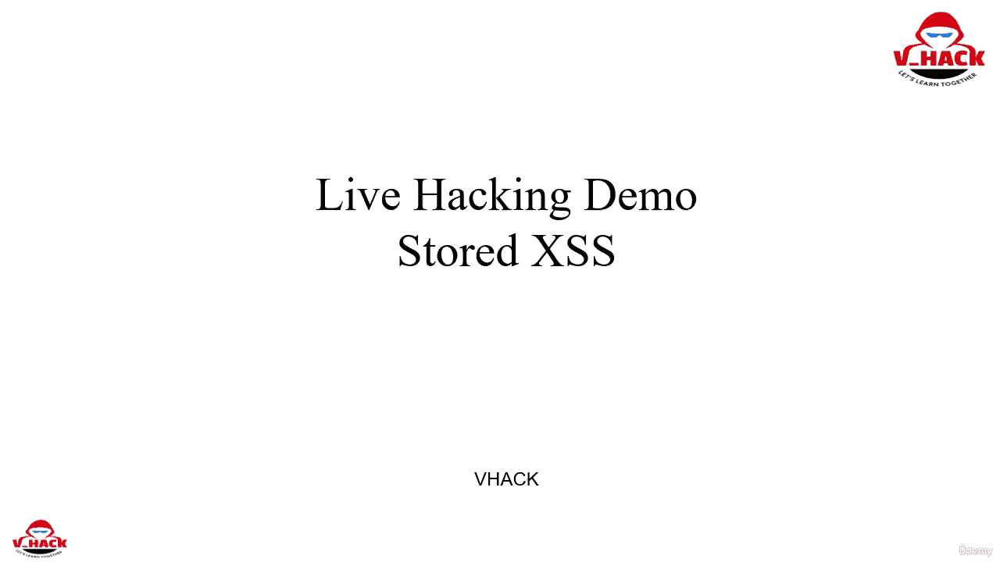
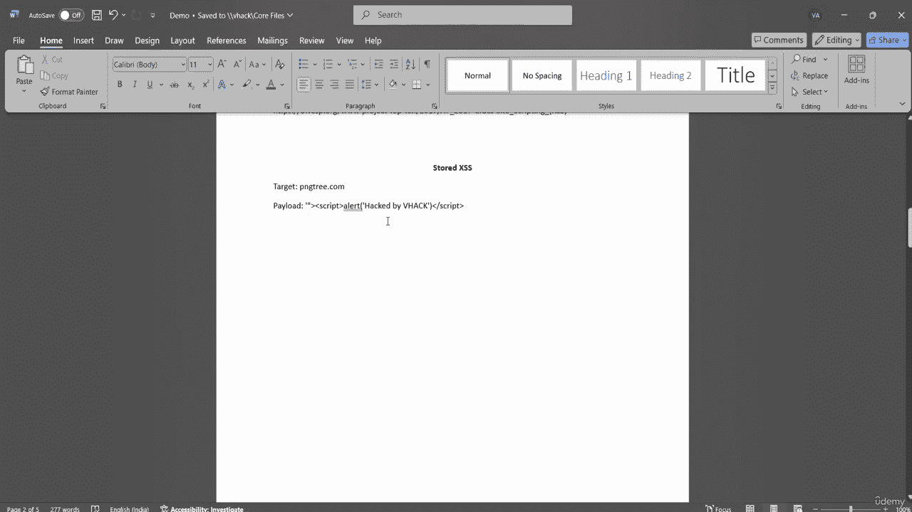
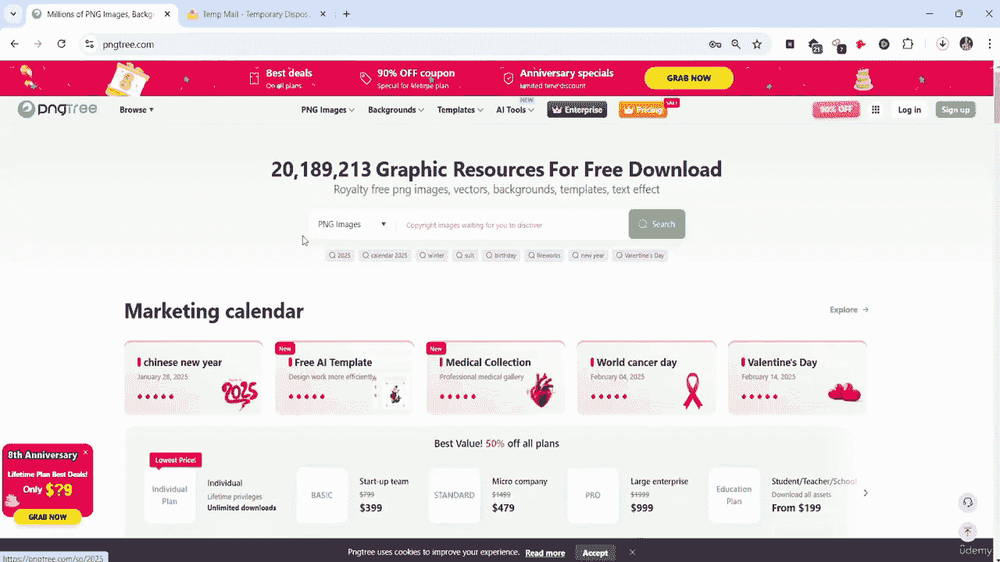
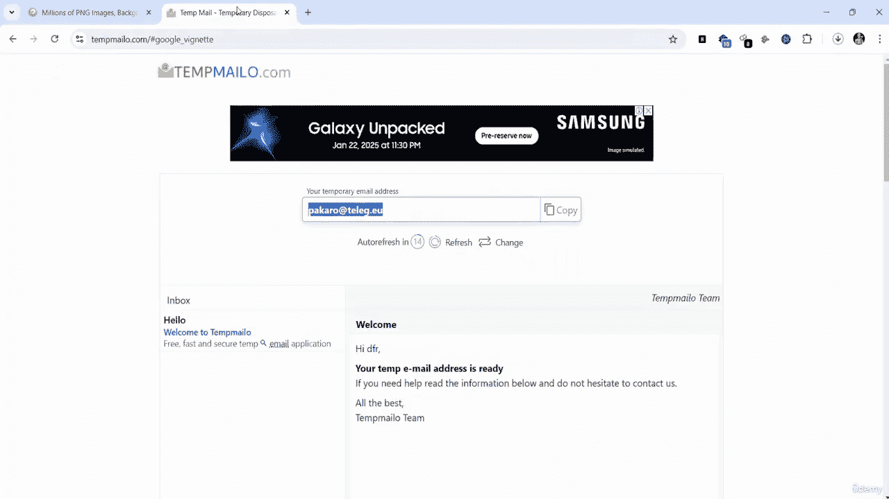
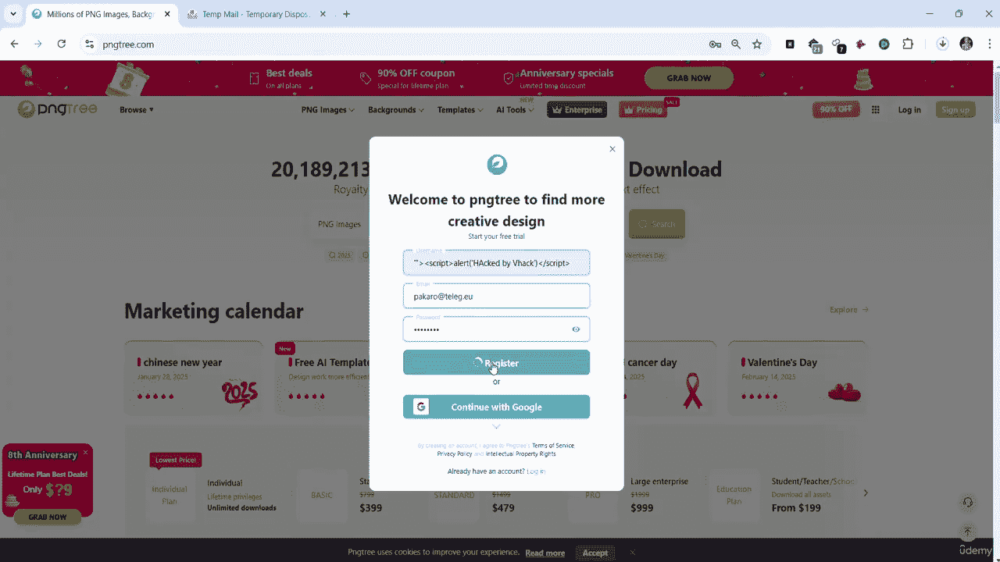
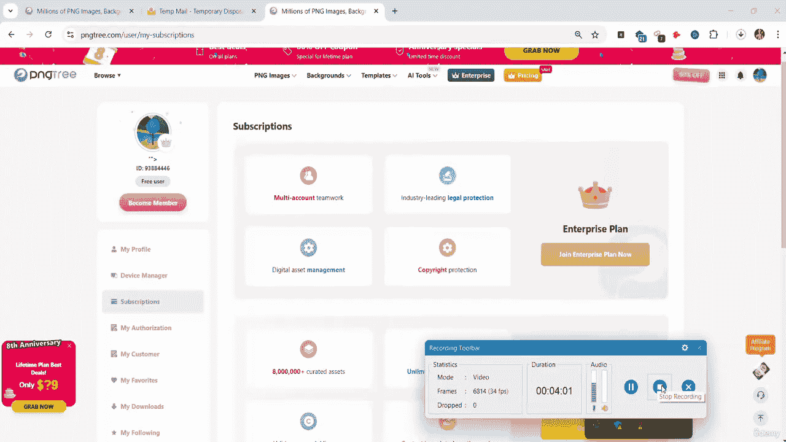

# Ethical Hacking：50-Day Hacker Challenge：50 Real Attacks：13-08：存储型XSS实战演示 🌐



在本节课中我们将要学习Web应用攻击中的跨站脚本漏洞，特别是存储型跨站脚本攻击，也就是Stored XSS。我们会先回顾之前讲过的反射型XSS，然后重点理解存储型XSS的工作原理，接着通过一个真实的靶场演示，看看攻击者是如何把恶意脚本存到服务器里，再让受害者浏览器自动执行的。最后我们会讨论这种漏洞为什么比反射型XSS更危险，以及它的严重性等级是如何提升的。


什么是存储型XSS？简单来说，就是攻击者提供的一段JavaScript代码被保存到了目标服务器上，并且在页面被访问时自动运行。我们可以用下面的公式来描述这个过程：


```text
存储型XSS = 恶意JavaScript + 服务器存储 + 页面渲染时自动执行
```


如果用代码来表示，攻击者通常会在输入框里提交类似下面这样的脚本：






```javascript
<script>alert('blah.blah.com');</script>
```




当服务器把这段脚本当成普通用户名或者个人资料内容存进数据库，以后每次页面加载这个字段时，浏览器就会把它当成合法代码执行，弹出提示窗口或者执行其他恶意操作。


上一节我们介绍了反射型XSS，也就是恶意脚本只在即时请求中传递，不会被服务器保存。本节中我们来看看存储型XSS和它的主要区别。以下是两种攻击方式的核心差异：


- 反射型XSS：脚本通过URL参数发送，服务器不保存，只在当次请求返回时执行，影响范围小。
- 存储型XSS：脚本被存入服务器数据库，任何访问该页面的用户都可能触发，影响范围大。
- 持久性：反射型XSS是一次性的，存储型XSS会一直存在直到被删除。


本节的演示目标是一个名为Png3.com的网络靶场。我们需要用到一个临时邮箱来完成账号注册，因为演示过程中需要收取验证邮件。以下是我们要完成的攻击步骤：




- 访问目标网站Png3.com，打开注册页面。
- 使用临时邮箱地址注册新账号。
- 在用户名字段中提交JavaScript脚本。
- 完成邮箱验证，登录账号。
- 访问个人资料页面，观察脚本是否执行。


现在我们开始具体操作。首先打开浏览器，访问Png3.com。进入网站后，找到注册入口，准备创建一个测试账号。因为我们需要接收验证邮件，所以先去申请一个临时邮箱，把临时邮箱地址复制下来，备用。


接着回到注册页面，填写注册信息。在用户名这个字段里，不要填普通名字，而是直接贴入我们准备好的JavaScript代码，比如弹出一个提示窗口的脚本。填好其他必填项后，提交注册表单，等待系统发送验证邮件到临时邮箱。


稍等片刻，我们去临时邮箱收件箱查看，应该能收到一封来自目标网站的验证邮件。点击邮件里的验证链接，完成账号激活。验证成功之后，我们就可以用这个账号登录系统，进入个人中心。


登录后，点击“我的个人资料”或者类似的页面。这时页面会去服务器请求并显示用户名字段。因为刚才注册时我们把JavaScript存进了用户名，所以页面渲染用户名的时候，浏览器会把这段脚本当成正常内容执行。你会看到一个弹出窗口，显示blah.blah.com，这就证明脚本已经成功运行了。


这个演示背后的原理非常直接。当用户名字段被页面调用时，无论是在个人资料页面还是其他任何显示用户名的地方，服务器都会把存储的内容原样返回给浏览器。浏览器无法分辨这是普通文本还是恶意脚本，于是就执行了我们注入的JavaScript。这就是存储型XSS的核心机制：恶意代码静静地躺在服务器里，等待每一个访问该页面的用户触发它。


存储型XSS的危害比反射型XSS严重得多，主要体现在以下几个方面：


- 受害者面更广：不需要诱导用户点击恶意链接，只要访问受感染页面就会中招。
- 持续攻击：脚本长期存留在服务器上，直到管理员发现并删除。
- 严重性提升：漏洞等级通常从中等危险提升到高危等级。


以上就是本次存储型XSS的完整演示。我们一起看到了，只要输入点没有做好过滤和转义，攻击者就能把脚本存进服务器，进而控制页面显示内容或者窃取用户信息。




本节课中我们一起学习了存储型XSS的定义、公式描述、与反射型XSS的区别，以及在Png3.com靶场上的实际攻击演示。希望通过这次实操，你能直观理解存储型XSS是如何运作的，也明白在Web开发中做好输入验证和输出编码的重要性。
