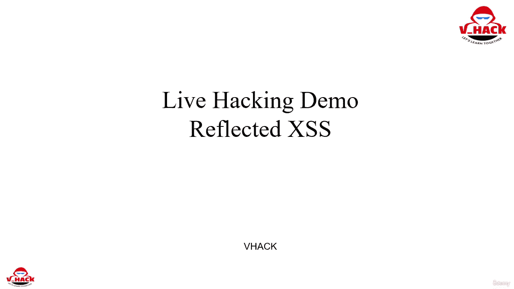
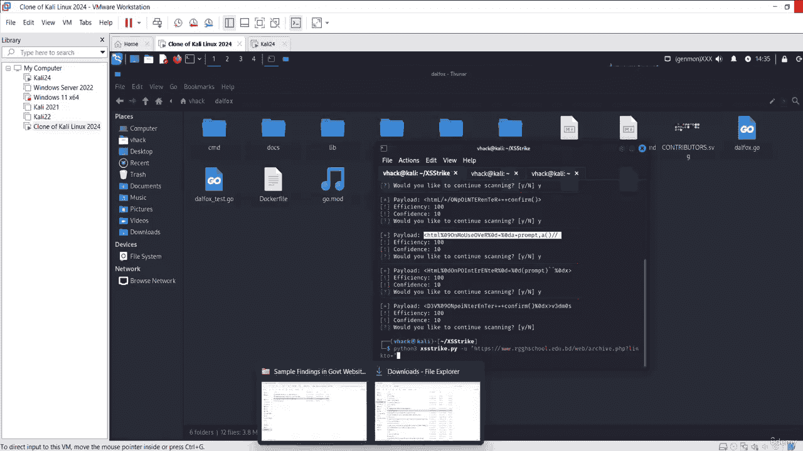
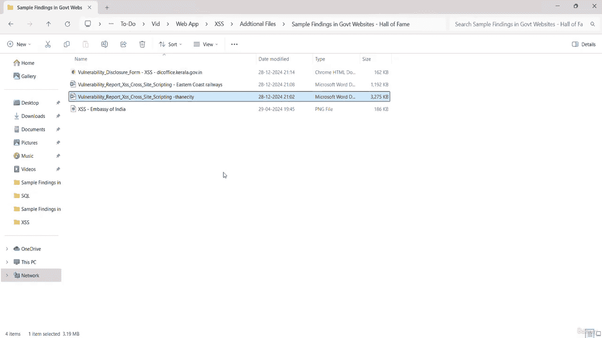
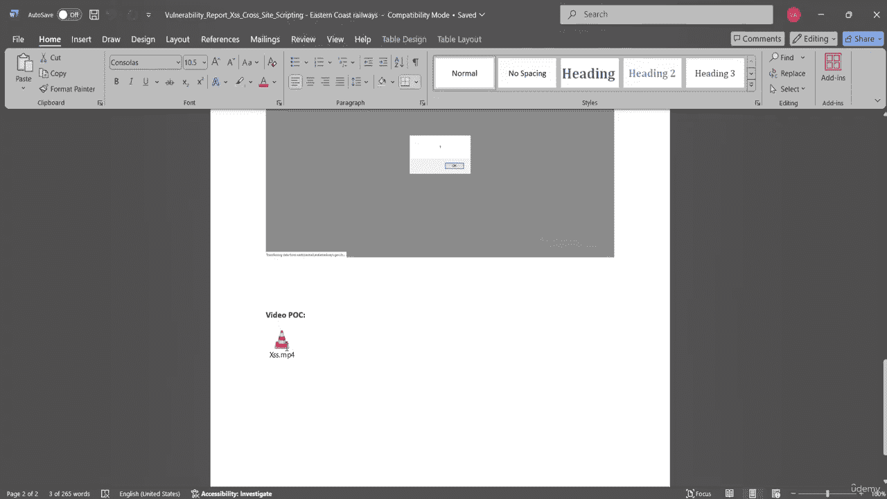
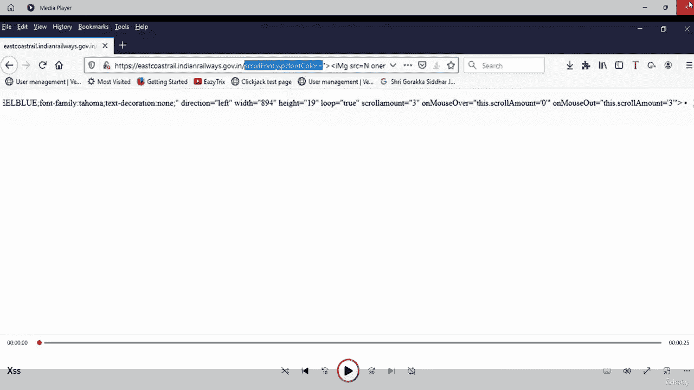
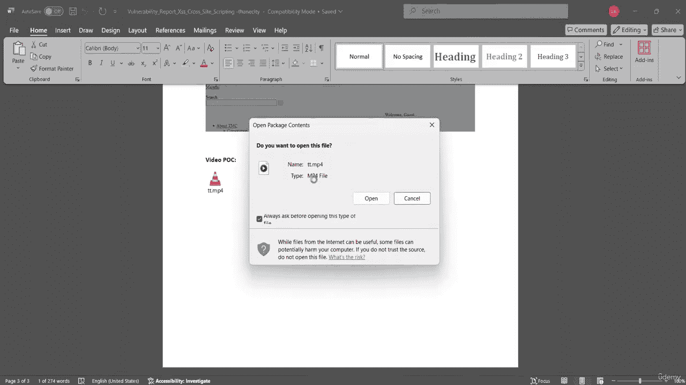
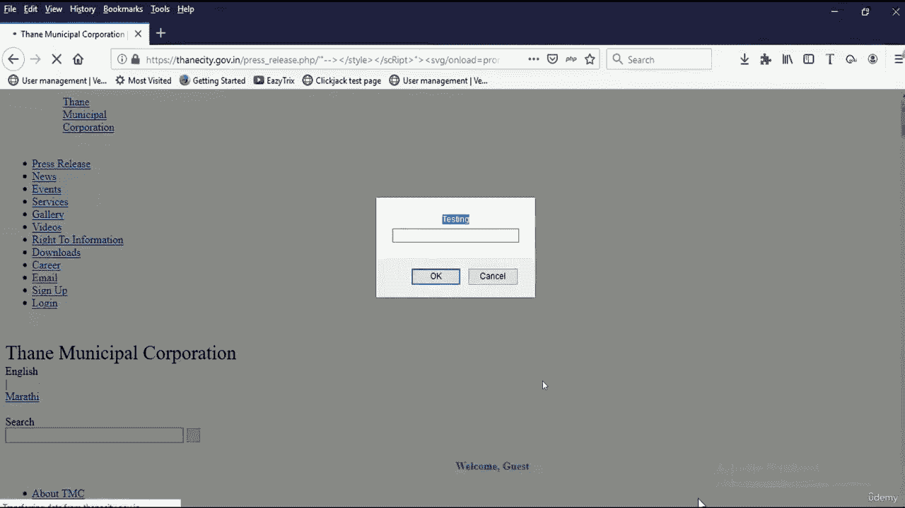
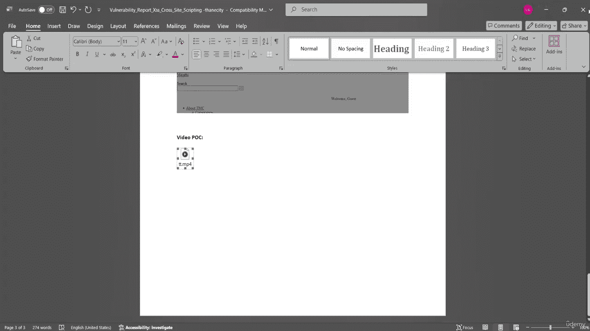

🛡️ 道德黑客：15：反射型XSS实战演练（第二部分）


在本节课中，我们将继续学习道德黑客的50天挑战，重点放在反射型XSS漏洞的真实攻击案例上。我们会分析几个已经上报给相关机构的政府网站案例，看看漏洞是如何被发现、如何被利用，以及在修补后如何进行负责任披露。内容会尽量用大白话解释，即使是初学者也能看懂，所以请跟着步骤一步步来，不要跳过任何细节。




## 回顾前文与目标网站概览

上一节我们介绍了XSS反射的基础概念，本节中我们来看看具体的政府网站案例。

以下是本节课将要分析的目标网站列表：

- 东海岸印度铁路官网
- T城市政府新闻稿页面

这些都是讲师在实战中发现，并正式上报给NCAC机构的漏洞，属于典型的已报告安全问题。




## 东海岸印度铁路案例分析



首先，我们来分析第一个案例，也就是东海岸印度铁路网站。这个案例的入口点比较典型，适合用来理解反射型XSS是如何触发的。

以下是该案例的关键信息：

- 入口点参数：`language`
- 传递的值：`等于`
- 漏洞类型：反射型XSS

当你在URL中提交`language`参数时，服务器会将你的输入直接反射回页面，而没有进行过滤。这意味着攻击者可以构造恶意脚本，诱使受害者点击链接，从而在受害者浏览器中执行脚本。整个过程不需要受害者安装任何软件，只需要打开一个特制的网页链接即可。

核心概念可以用简单的HTTP请求代码描述：

```http
GET /page?language=<script>alert('XSS')</script>
```

这里的`<script>`标签就是我们构造的攻击载荷，一旦页面渲染，脚本就会在受害者浏览器中执行。讲师还提到，他有配套的视频记录了整个演示过程，这有助于我们更直观地理解漏洞的触发方式，建议有条件的话可以对照视频观看。


## SWAT颜色入口点分析



接着，我们来看SWAT颜色这个入口点，以及图片源之间的关系。这部分主要展示不同参数如何都可能成为攻击入口。

以下是需要关注的点：

- 颜色参数：用于控制页面显示的颜色设置
- 图片源：页面中加载的外部图片资源
- 关系：两者之间存在输入反射的可能性

如果颜色参数或图片源没有做严格的输入验证，攻击者就可以注入恶意代码。虽然这里的描述比较片段，但核心思想是：任何可由用户控制的输入点，都可能成为XSS的入口，防御时不能只检查表单，还要检查URL参数和图片链接等所有位置。


## 漏洞修复与负责任披露

现在这些漏洞已经被补丁修补，讲师强调了负责任披露的重要性。这是安全研究人员必须遵守的职业准则。



负责任披露的流程可以概括为：

1. 发现漏洞
2. 私下联系目标机构
3. 等待机构修补漏洞
4. 在修补完成后公开细节

这种做法既保护了用户安全，也给了机构足够的时间来修复问题，避免了直接公开导致大规模攻击。作为初学者，即使你只是在学习环境中测试，也应该养成不随意公开未修补漏洞的习惯。


## T城市政府新闻稿案例分析

第二个案例是T城市政府的新闻稿页面，这里的情况与第一个案例略有不同，需要单独分析。

以下是该页面的结构信息：

- 涉及页面：`downloads.php` 和 `press release start.php`
- 识别到的脚本：两个页面中均存在可注入点
- 参数特点：没有像`a=b`这样的简单整数变量，也没有被直接调用的变量

（注：原文中“要是到呢时机”和“Tni city of110”保留了讲师口语中的片段，不影响对整体流程的理解。）


## 参数构造与XSS执行

尽管上述页面没有常规的变量赋值，但我们依然可以执行XSS攻击。这说明即使没有明显的`参数=值`形式，漏洞仍可能存在。



以下是攻击者使用的构造方式：

- 放置斜杠：`/` 作为路径或分隔符
- 传递参数：`B` 作为注入载荷

我们传递的参数是：

```html
<script>SVG onload prompt testing</script>
```

这段代码利用SVG标签的onload事件来触发脚本执行。即使页面没有明显的变量接收点，只要能控制输入并被页面反射，就存在XSS风险。你可以看到，我们传递的值已经被页面原样反射出来，这说明输入没有经过转义或过滤，防御时必须对所有用户输入进行严格检查。




## 总结



本节课中，我们一起学习了反射型XSS在政府网站上的真实案例，分析了东海岸印度铁路和T城市政府新闻稿两个目标的入口点与参数构造方式，并了解了负责任披露的基本流程。希望这些内容能帮助你更好地理解XSS漏洞的成因与防御思路，并在后续的实践中避免类似安全问题。
