# Web 安全教程：第 16 章：盲注 SQL 注入原理与实战 🕵️


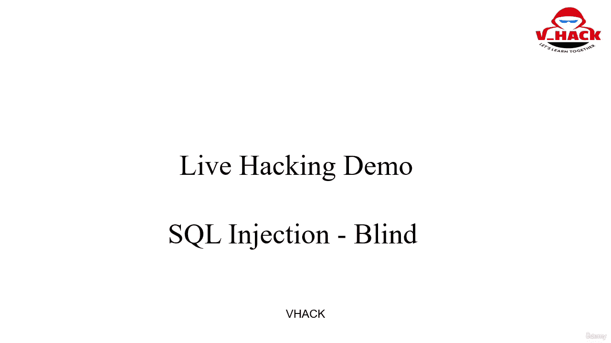

在本节课中我们将要学习盲注 SQL 注入的核心原理与实际利用方法。你将了解什么是盲注，它与普通 SQL 注入有什么不同，以及如何通过真假条件和时间延迟来探测漏洞。我们还会通过真实的靶场演示，看看攻击者如何利用盲注绕过登录、读取敏感信息，甚至修改数据。内容会尽量用大白话讲解，适合初学者跟随学习，不用担心之前没有相关基础。


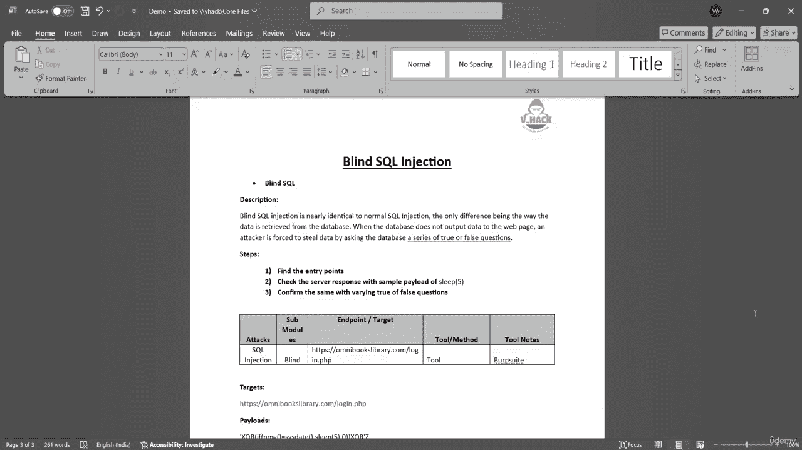

上一节我们介绍了普通 SQL 注入的基本概念，本节中我们来看看盲注 SQL 注入。根据 OWASP 的定义，盲注 SQL 注入与普通 SQL 注入几乎相同，唯一区别在于它通过一系列真假条件从数据库中获取信息。除此之外，盲注的核心就是基于真假条件的判断，而不是直接返回查询结果。


普通 SQL 注入通常会直接把数据库里的内容显示在页面上，而盲注 SQL 注入不会直接显示数据，而是让攻击者猜测。核心公式可以这样理解：

```text
普通 SQL 注入：直接返回查询结果
盲注 SQL 注入：通过真假条件间接推断结果
```


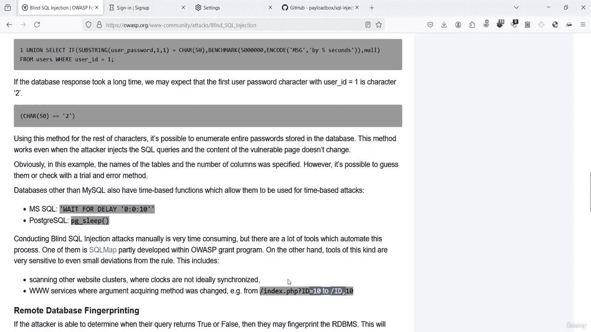

接下来我们详细看看盲注的两种常见类型，帮助你在实际测试中快速判断。以下是盲注 SQL 注入的两种主要分类：

- 基于内容（Content-based）：根据页面是否有正常内容返回，来判断条件是否成立。
- 基于时间（Time-based）：强制服务器延迟响应，比如休眠 5 秒或 10 秒，根据返回时间来判断条件是否成立。


基于内容的盲注是最容易理解的一种。假设有一个 ID 等于 2 的页面，我们可以在其中加入一个布尔条件，比如 1 等于 2。我们知道 1 不等于 2，这是一个假条件。如果应用程序存在盲注漏洞，它会验证这个条件，发现 1 不等于 2 是错误的，因此不会返回正常页面。找到这一点之后，你还可以验证 1 等于 1，这是一个真条件。此时你会发现页面渲染结果出现差异，说明应用程序正在对条件进行求值并做出反应。


第二种是基于时间的盲注。我们可以强制服务器在等待一段时间后再渲染页面，比如等待 10 秒或 5 秒。无论 ID 是什么，都可以继续进行盲注测试。核心负载示例如下：

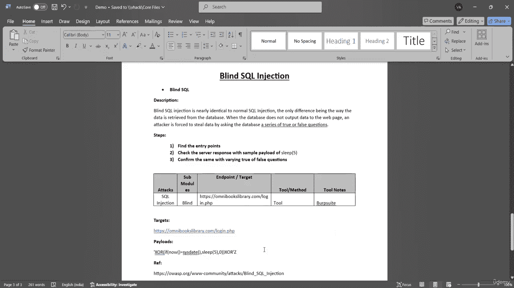

```sql
SLEEP(5)
SLEEP(10)
```


现在我们明白盲注是什么，接下来会结合真实案例说明盲注的威胁和严重程度。第一步是找到注入入点，通常像 ID、卡号、部门等参数都可以作为入点。你可以使用搜索引擎技巧，针对特定组织进行评估，也可以随机尝试。找到入点是后续测试的基础。


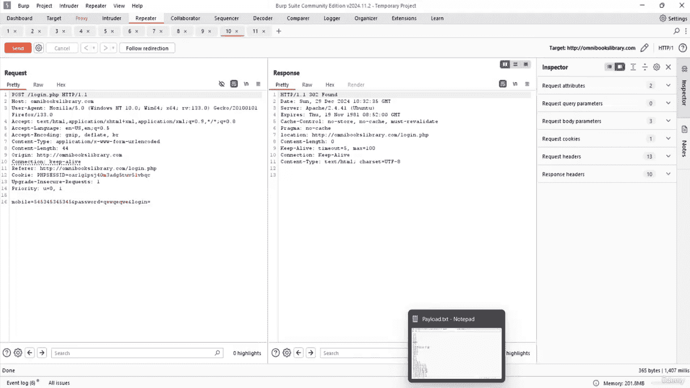

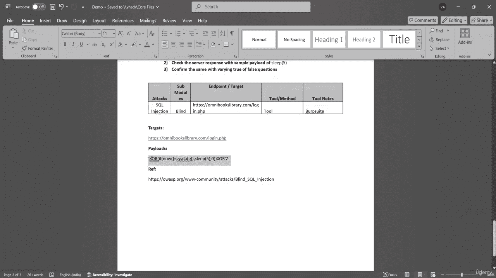

第二步是用示例负载检查服务器响应，这里以基于时间的盲注为例，发送 sleep 负载，实时体验响应时间差异。我选择了基于时间的盲注示例，并通过不同的真假条件进行验证，确保结论准确。


演示开始前，先回顾一下我们要用的环境。我们有一个真实端点，工具使用 Burp Suite，目标是特定网站，负载是发送 5 秒的 sleep 条件，这是我们之前看到的盲注参考案例。


演示目标是 Armybooks.com。输入随机数字，只拦截登录请求。这里可以看到提交的请求，将其发送到 Repeater。我们转发了三个请求，其中第一个是正常请求，没有修改任何内容。


观察右下角的响应时间，大约是 1.3 秒。再发送一次请求来确认正常时间，前一次是 1.3 秒，这次是 1.4 秒，正常渲染时间大约在 1.3 到 1.4 秒之间。


接下来加入 sleep 时间。在手机号字段插入 sleep 查询，让服务器延迟 5 秒响应。正常时间大约是 1.3 到 1.4 秒，加上 5 秒延迟，总时间应该在 6.4 到 6.5 秒左右。这里可以看到延迟，大约 6.5 秒，也可以看到 6.7 秒，也就是正常 1.5 秒加上 sleep 时间。


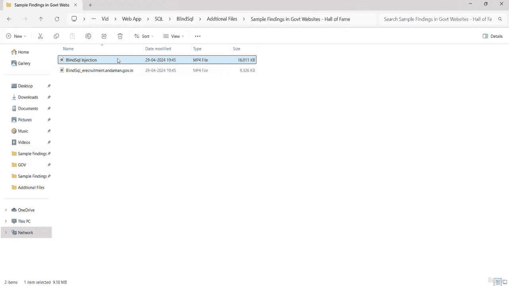

也可以用 10 秒验证，正常 1.5 秒加上 10 秒，预期输出在 11.5 到 11.7 秒左右，观察右下角。正好 11.5 秒。也可以尝试不同的值，比如正常 1.5 秒加上某个值，大约在 8.4 到 8.5 秒，确认是 8.4 秒。这就是验证方法，现在你可以明白这个应用程序存在盲注 SQL 注入漏洞。


验证漏洞存在之后，我们来看看攻击者在现实中如何利用盲注造成危害。以下是盲注带来的典型安全影响：

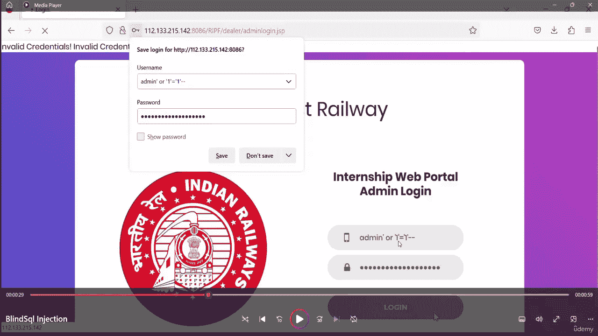

- 绕过登录：在用户名字段输入 `admin' OR 1=1 --`，系统验证 `1=1` 为真，直接以管理员身份登录。
- 读取敏感数据：登录后可查看所有用户信息，违反机密性原则。


现实中如何造成影响？除了 sleep 查询，还可以添加其他布尔值。比如登录页面，使用 `admin' OR 1=1`，条件 `1=1` 为真，应用程序读取后只要有一个条件满足就会判定为真，即使不知道用户名密码也能以管理员身份进入页面。


这是一个政府网站，我曾通过漏洞平台报告，这些网站现已下线或停用，不再可用。出于负责任披露原则，我提供响应供参考。这是登录页面，我们计划使用盲注进行测试，输入 `admin' OR 1=1`。使用随机凭据时会抛出“凭据无效”错误。现在输入 `admin' OR 1=1`，如果存在盲注弱点，系统会验证 `1=1` 为真，允许我们以管理员身份进入。


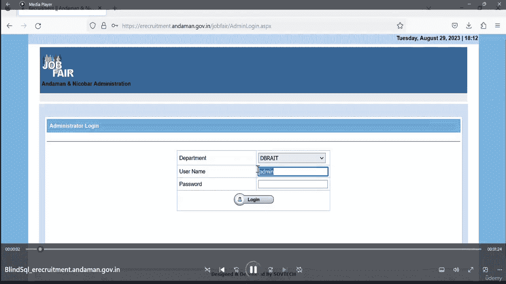

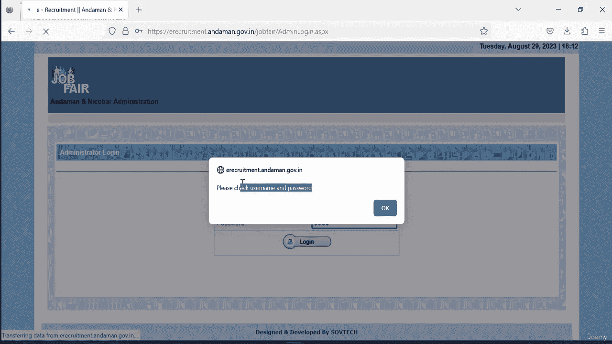

进入后，左上角可以看到退出按钮，说明已以管理员身份登录，可以看到所有属于东海岸铁路的用户文件。这些文件上传在服务器上，说明我们可以获取门户关联的所有信息，这就破坏了机密性。这就是盲注严重程度的影响。


再举一个例子，这次不仅破坏机密性，还可能破坏完整性，因为后台有编辑选项。这是一个门户的登录页面，使用未知凭据会报错，现在用同样的 `admin' OR 1=1`，验证通过，进入登录会话。


这是黑盒测试，我们不确定应用程序具体内容和背后关联的细节，也不确定注册号，但可以继续使用同样的条件 `admin' OR 1=1`，如果该参数验证也存在弱点，就会返回所有与注册号关联的信息。等待响应，可以看到所有关联信息。右上角光标移动很远，说明获得了完整管理员权限，而且还有编辑选项。这意味着不仅可以读取，还可以修改数据，因为是超级管理员。这同时破坏了完整性和机密性。


回到盲注 SQL 注入的定义，我们再次梳理今天学到的内容。盲注与普通 SQL 注入同样重要，通过真假条件构建查询，选择登录等参数可以以超级管理员身份登录，完全掌控数据库。


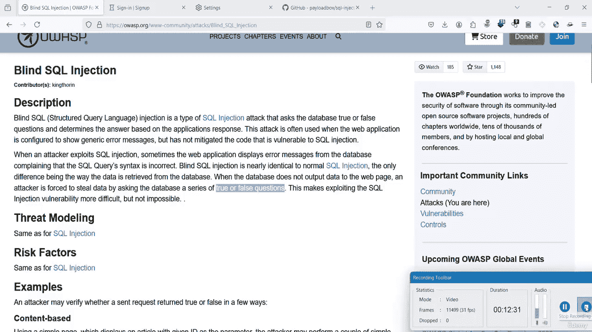

本节课中我们一起学习了盲注 SQL 注入的原理、类型、演示方法以及危害。盲注虽然不直接显示数据，但通过真假条件和时间延迟，攻击者依然可以绕过登录、窃取信息甚至篡改数据，危害性与普通 SQL 注入相当。希望你喜欢这次课程，我们下次课再见。


