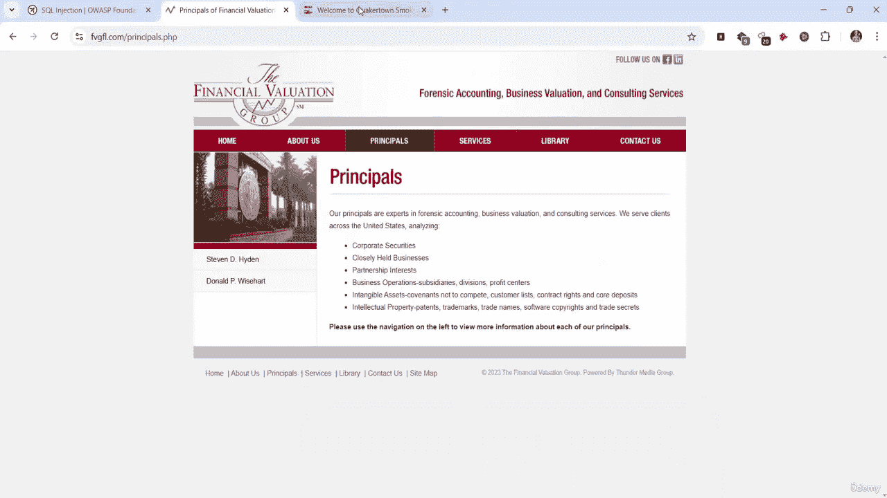
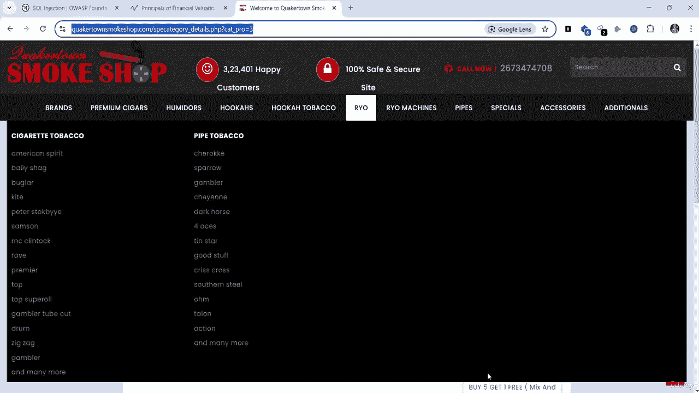
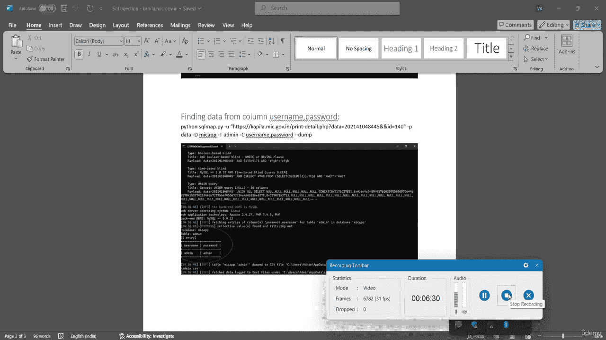

# Udemy - Ethical Hacking：50-Day Hacker Challenge：50 Real Attacks：12：Traditional SQL Injection [Live Target] 💉

## 本节课程概述

在本节课中我们将要学习传统SQL注入的完整原理与实战演示。我们会先解释什么是SQL注入，攻击者如何通过前端输入点将数据库查询语句发送给应用程序，以及如果应用程序无法区分用户提供的查询与正常数据会产生什么后果。接着我们会讲解常见数据库的类型，包括MySQL、MSSQL、PostgreSQL和Oracle，并说明它们在注入测试中的共同步骤。随后我们会演示如何手工寻找入口点、确定列数、提取表名与列名，最终获取敏感数据。最后我们会介绍如何使用SQLmap工具自动化这个过程，并结合真实漏洞报告案例，展示SQL注入在实际攻击中的危害。

---

## 一、什么是SQL注入 🧐

SQL注入是指攻击者将一段SQL查询语句插入到客户端发送给应用程序的输入数据中。如果应用程序执行这段查询，且没有对用户提供的输入与正常查询做出区分，攻击者就可以从数据库中读取敏感信息，甚至修改数据或执行管理命令，例如关闭数据库管理系统。

核心概念可以用公式描述：

```text
SQL注入 = 用户可控输入 + 未经过滤的SQL查询 + 数据库执行
```

当我们谈论数据库管理系统时，最常见的数据库是MySQL。不过我们也会看到MSSQL、PostgreSQL和Oracle等其他数据库的相关知识。对于所有数据库来说，通用步骤共有两项。第一是找到允许攻击者提供输入的入口点。第二是基于数据库的样本载荷来测试服务器响应，因为每个数据库的查询语句值都不同。

涉及的方法包括手工方式与工具方式。工具方面我们将使用SQLmap。

---

## 二、SQL注入的工作原理与通用步骤 🔍

在上一节我们初步了解了SQL注入的定义，本节中我们来看看它的具体工作流程与通用测试步骤。

SQL注入本质上是将SQL查询插入到从客户端发往应用程序的输入数据中。寻找入口点的方法与其他注入漏洞（如命令注入或跨站脚本）基本一致。

从高层次来看，SQL注入最严重时甚至会危及数据的机密性与完整性。如果攻击者能够写入、删除或修改已有数据模式，就可能造成严重破坏。

数据库的工作方式是拥有表和列，表中包含具体的值。从应用界面出发，我们连接到数据库，提取表及其对应列的值。

---

## 三、手工验证SQL注入漏洞的具体步骤 🛠️

上一节我们介绍了SQL注入的通用步骤，本节中我们来看看如何手工验证端点是否存在SQL注入弱点。

首先判断应用程序是否存在SQL注入弱点，方法是在各处提供单引号或双引号，直到看到数据库报错。如果应用程序没有处理机制，就会显示错误信息。这是发现漏洞的第一种方式。

一旦确认存在弱点，第二步是找出列的数量。一般来说，可以使用一个名为ORDER BY的运算符，依次增大数值，比如1、2、3、4，根据响应结果推断出列的总数。当继续增大列数而出现错误时，说明已超过实际列数。

确定列数之后，还要找出哪一列能够与应用程序交互并返回结果。为此，我们会使用UNION或SELECT语句。

以下是手工测试的关键操作点：

- 在参数中插入单引号或双引号，观察是否出现数据库报错
- 使用ORDER BY 1、ORDER BY 2、ORDER BY 3等递增数值，确定列数
- 使用UNION SELECT 1,2,3确定哪些列会回显数据
- 提取数据库版本、表名、列名以及最终的敏感数据

---

## 四、MySQL中的联合查询注入演示 🐬

上一节我们完成了手工验证的基本步骤，本节中我们来看看MySQL数据库中的联合查询注入。

在MySQL中，从数据库提取值的主要方式有两种。第一种是联合查询（UNION），第二种是报错注入。我们逐一说明，先从联合查询开始。

假设有一个测试网站，其中有一个名为list_products.php的超链接，参数为category等于1。这就是入口点，对应的注入参数是cat等于1。

我们需要确认该网站是否对SQL注入存在弱点。方法是在参数中提供单引号或双引号。如果提供单引号，页面会抛出一些错误，表明该应用程序存在SQL注入漏洞。

接下来要确定有多少列。我们可以使用UNION SELECT 1,2,3，并逐渐增加计数到3或4。当增加到4时出现错误，说明只有三列。在这三列中，第2列和第3列会列出结果，意味着这两列是应用程序用来返回数据的列。

在入口点处，我们可以将第2列或第3列用于提供SQL查询。例如，我们可以构造一个查询用来获取数据库版本。

具体查询示例如下：

```sql
UNION SELECT 1,2,3 FROM information_schema.tables WHERE table_schema=DATABASE()
```

通过此查询，我们能发现版本号，例如8.0.2。此时我们已经在识别出的参数上确认了SQL注入。

然后我们需要查找默认表列表，使用information_schema.tables。我们要找的是表名，可以继续构造UNION SELECT 1,2,3，将2或3替换为目标字段。这里传入3，使用GROUP_CONCAT(table_name)从information_schema.tables获取表名，条件是table_schema等于数据库函数。

请注意，必须使用一个不存在的值，例如10000。通过这个查询，我们可以发现大约7到8个不同的表。

接下来要查找列名。需要将table_name改为column_name，条件是table等于users。users表可能包含敏感信息，如登录名和密码。

执行后可以看到列名包括：username、password、address、email、name、phone等。我们感兴趣的是username或password。如果存在启用Gmail登录的字段，则关注email和password。

最后要提取值。选择1,2,3，在第三列使用username和密码，并用双引号作为分隔符，将用户名和密码连接起来，来源于users表。

构造查询示例：

```sql
UNION SELECT 1,2,CONCAT(username,':',password) FROM users
```

提交后可以看到类似test:command的结果。这就是在识别出的参数中建构SQL查询的方式。

---

## 五、MySQL中的报错注入演示 ❌

上一节我们演示了MySQL中的联合查询注入，本节中我们来看看MySQL中的报错注入。

如果MySQL版本为5.1或更高，可以使用EXTRACTVALUE函数来外泄数据。

具体方法是在参数中使用cat减1，后跟一个不存在的值，再接上SQL查询。通过报错注入，页面会持续抛出错误，但错误信息中会包含答案。我们之前见过的数据库版本即可通过这种方式获取。

同样，我们可以继续提取表名。发现的表包括artist、car、cat、feature、guestbook、pictures等。

如果想继续查找，可以使用数据库偏移量。不提供0，而是提供1，可以看到artist；提供2，可以看到car。继续使用偏移量1，可以找到cat、feature等。继续使用偏移量3、4，可以找到guestbook。使用偏移量5、6，可以找到product。最后第七个表是user。

第二种方法是使用窄方法，借助EXTRACTVALUE函数。同样的方式，需要先查找表名，再查找列名。我们找到的表名包括artist。同样方式，需要查找列名，可以看到列名包括username。

列出所有列时，可以使用偏移量，例如0、1、2、2、1、3、1、4、1等，这样能找到所有列。最后一步是查找值，即username和password这两个我们感兴趣的值。

这里跳过查找列的过程，因为方法与查找表名相同。我们感兴趣的是username和password这两个值，需要设置分隔符。

最终结果为test:command。这就是报错注入的第二种方式，适用于MySQL。

---

## 六、PostgreSQL注入 🐘

上一节我们介绍了MySQL的报错注入，本节中我们来看看PostgreSQL注入。

PostgreSQL与MySQL非常相似。关键区别在于，PostgreSQL没有GROUP_CONCAT函数。

对于单个表名，需要使用偏移量运算符。OFFSET 0会获取第一个表，OFFSET 1会获取第二个表，以此类推。步骤保持不变：先找到表名，再提取表，接着提取列，最后提取数据和值。

具体操作是使用UNION ALL SELECT 1,2,3。如果已知列类型，需要找到哪一列显示数值。例如1,2如果是期望值，则在第2列使用表名，来源于information_schema.tables，并设置别名。条件是table_schema不等于pg_catalog，因为pg_catalog和information_schema是PostgreSQL的默认数据库。

可以使用OFFSET 0，并将此值增大到1、2、3，以提取其他表名。要提取列名，重复上述步骤，将table_name替换为column_name，并将偏移量从0增大到1，就像使用报错注入方法一样。最后一步是UNION ALL SELECT，携带带有偏移量0的尾限制值，从而完成在PostgreSQL上的查找。

---

## 七、Oracle注入 🏛️

上一节我们介绍了PostgreSQL注入，本节中我们来看看Oracle注入。

在MySQL中，我们会查询information_schema.columns来获取属于某个表的列。在Oracle中，则使用all_tab_columns表来完成此操作。步骤保持不变，仍需先查找弱点。

查找弱点时，如果错误信息以ORA-开头，通常是Oracle数据库错误的一个良好迹象。

第二步是提取列。使用UNION ALL SELECT。列出表名时，需要在GROUP BY子句中按表名排序。如果找到表名users，即可用于提取表名。提取列名的查询保持不变，只是来源不再是information_schema，而是all_tab_columns，这是Oracle的默认表，也是我们感兴趣的列。

最后一步是提取数据或值。通过使用不同的值，就可以完成Oracle上的SQL注入查找。

---

## 八、使用SQLmap工具自动化注入 🗺️

上一节我们介绍了Oracle注入，本节中我们来看看不针对不同查询的另一种方法，即使用工具进行查找。

前面已经展示了两个SQLmap演示示例。在此之前，让我们继续。





第一步是找到是否存在这样的入口点。如果看到，可以使用单引号或双引号。可以使用单引号来确保是否出现错误。在漏洞网站上可以看到类似的错误信息，从而得出该应用程序对SQL注入存在弱点的结论。有些情况下可能不需要刻意出现错误，但可以观察到一些变化，例如提供单引号前有两张图片，提供查询后出现差异，这也是存在SQL注入弱点的指标。

让我们快速回到第一个示例。第一个示例中，需要使用SQLmap。参数是-u，后跟URL。接下来执行-i，--dbs，让它找到数据库名称。使用--yes来遵循此处提供的会话ID。

你会发现数据库名称为FGFL_master，而information_schema是默认数据库名。到目前为止我们讨论的是默认名称，即information_schema。

现在我们感兴趣的是数据库名称FGFL_master。接下来需要查找表。第二步是提取表，以及列名和敏感信息。

让它继续运行，你可以看到content和news。假设我们感兴趣的表是content。这里可以看到page和内容。可以选择page和content，因为这是一个较小的数据库，没有登录页面，因此我们将从page和content列中提取值。--dump用于倾倒所有值，即提取我们感兴趣的值的最后一步。

它已提供所有值。列表很庞大，我尽量展示其中一部分。contact值是HTML代码。这些都是示例服务相关的原则。可以看到principles_start PHP等。这些是与应用程序相关的不同名称，属于列。

接下来看第二个示例。第二个示例中，使用sqlmap，-u，后跟URL，--dbs，让我们继续。可以看到information_schema、performance_schema和allen_town_db。

在此之前，也可以从该应用程序中复制robots.txt。这里有一个admin页面，可能有一些与之关联的表。让我们继续查看allen_town表，看看是否有登录页面，因为它可能有一个登录页面。

你可以看到关于我们、easy_brand、categories、brand等小表。这是一个敏感的tl_admin表，因此让我们继续。我指出我们感兴趣的数据库和表。第三步是查找列。拖动到column names。

这里显示username、password、email等。我们感兴趣的可以随意选取，这里我随机选择了一个email，以及password，执行dump。

你可以看到与admin页面关联的email和password。这就是SQL注入能够从数据库中获取敏感数据的方式，甚至可以修改数据或关闭数据库。这就是如何通过客户端到应用程序的输入字段注入SQL查询。

希望你喜欢。在此之前，我们还可以看一些真实世界的示例，下一个演示中会展示真实世界示例。

---

## 九、真实世界漏洞报告案例 📋

上一节我们介绍了SQLmap工具的使用，本节中我们来看看真实世界的漏洞披露案例。

这是一个我发现于education_career.com的注入漏洞，我能够提取用户名和密码，并验证了提取的用户名和密码，随后通过登录页面提交，能够提取其他用户的敏感信息。涉及的域名是education_career.com，受影响的SQL是details，入口点是SQL to 1。

找到入口点后，我能够提取表，如Hatchm、Hum transfer 2010、12、13、14，涉及多个数据库。我感兴趣的数据库是Somewhere hatch和transfer 1920。我提取了许多其他列，如values。我感兴趣的是PBL master login，值为11,1。

我在提取该表的列时，列中包含了用户名和密码。我能够提取用户名和密码，在报告中只列出了少数几个。你可以看到成功登录后的快照，我再次登录网站，使用提供的凭证验证了这一点。这些是测试凭证，允许我用一个用户登录。我继续提取并测试了其他用户，某个页面包含更多敏感信息，如其他详细信息，我也验证了其他用户。这些是所有其他用户。

这是作为概念验证提交的视频录像之一。这是登录门户，其中提供了数据库信息。欢迎2600。这就是我继续的方式，涉及其他详细信息。这就是敏感信息泄露的方式。

这是一个示例，还有一个是Tacity，可以启用编辑。这也是我报告的另一个SQL注入。受影响的URL是page.php，ID等于29。数据库是默认的information_schema，还包括TNA_government、TNAD、TMC、ENG_MEER等。这些是SQLmap得到的值，表的数量将近66个。

这也是一个用于NCIE BC负责任漏洞披露的模板。同样的过程继续，具有默认的information_schema，还有MySQL、PHP、myadmin。数据库名称中，我感兴趣的是PHP myadmin。如果我在表名password中导航，会看到Z Wamp作为用户名和密码。

还有一个示例。这是California government 1，受影响的URL是print_iphone_detail.php，参数data和ID是入口点。你可以看到数据库是ascent_test、information_schema、myCAT_hackathon或hackathon tool。my_cap是我感兴趣的数据库，其中可以找到13个表，admin users是敏感表。继续查看表ID、admin ID、password，列也是这些列。

你可以看到关联的凭证为admin和admin。这就是如何将我们在其他示例中识别出的值与一些相关网站进行关联，正如我们所见过的那样。希望你喜欢这次演示。

这就是全部内容，谢谢。

---

## 本节课程总结



在本节课中我们一起学习了传统SQL注入的完整流程。我们了解了SQL注入的定义，即将SQL查询插入到客户端发往应用程序的输入数据中，若应用程序未做区分，攻击者可读取、修改敏感数据甚至执行管理命令。我们学习了MySQL、PostgreSQL和Oracle等常见数据库的通用注入步骤，包括寻找入口点、使用ORDER BY确定列数、利用UNION提取表名与列名，以及最终提取敏感值。我们还演示了MySQL中的联合查询注入与报错注入，并简要介绍了PostgreSQL和Oracle的差异。最后，我们掌握了如何使用SQLmap工具自动化提取数据库、表、列和数据，并通过真实世界的漏洞报告案例，验证了SQL注入在实际攻击中的危害。

