# 道德黑客：14：服务器端模板注入实战演练 🔒

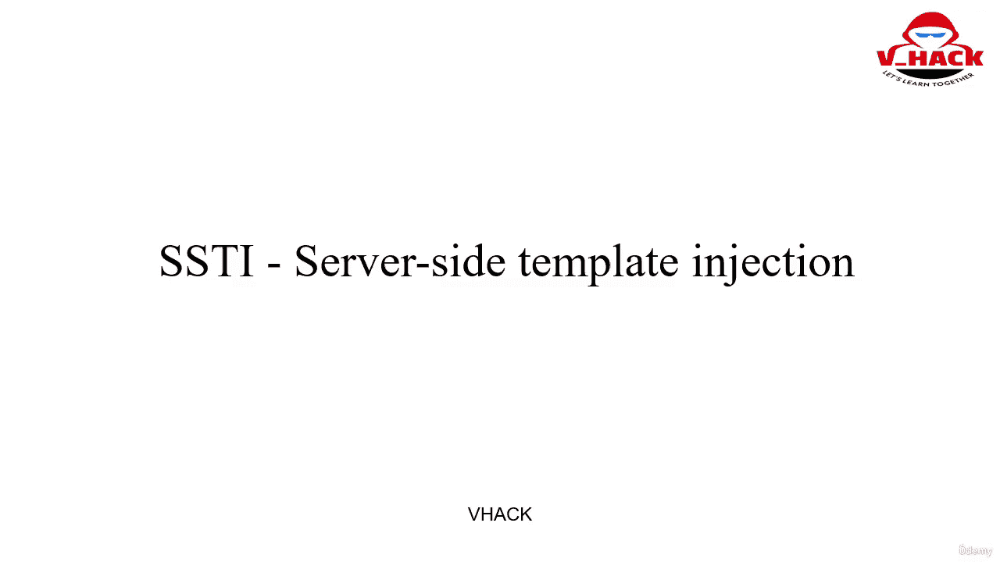

在本节课中，我们将学习什么是服务器端模板注入，通常简称为 SSTI。这是一种比较常见的 Web 漏洞类型，很多初学者在刚接触时容易觉得概念比较抽象。为了让你更容易理解，我们会通过一个真实的靶场演示，一步步拆解整个攻击过程。你会看到如何寻找注入入口点，如何构造测试载荷来确认漏洞存在，以及在输入被过滤时该如何继续测试。整个内容将尽量用大白话说明，避免过于晦涩的专业术语，方便你快速上手并掌握核心思路。

很多 Web 应用会使用模板引擎，例如 Jinja2、Freemarker 等，来根据用户请求动态生成 HTML 页面。如果你平时浏览网页，经常能看到一些根据个人信息变化的内容，比如欢迎语或订单列表，这些很可能就是模板引擎在背后工作。正常情况下，模板引擎只负责把数据填进页面占位符，然后把渲染好的结果返回给用户，整个过程是受控的。

但是，如果开发人员没有正确配置，把用户提交的内容直接拼接进模板中，而没有做足够的安全检查，问题就出现了。攻击者可以在输入里塞入模板语言指令，服务器在渲染模板时，会把这些指令当成正常代码来执行。这样一来，原本只是用来显示数据的页面，就变成了攻击者在服务器上运行任意指令的入口，后果可能非常严重。

**服务器端模板注入核心原理：**
```
用户输入 → 模板引擎解析 → 服务器端代码执行
```

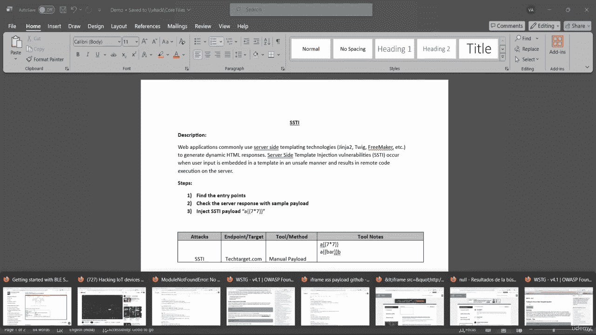

在实际测试中，发现并确认 SSTI 漏洞通常需要按照固定顺序进行。没有固定步骤的话，很容易在测试过程中遗漏关键信息，或者把正常的页面反应误判成漏洞。按照固定顺序操作，可以让你的测试过程更有条理，也更容易向他人解释你的发现。

以下是常见的利用步骤：

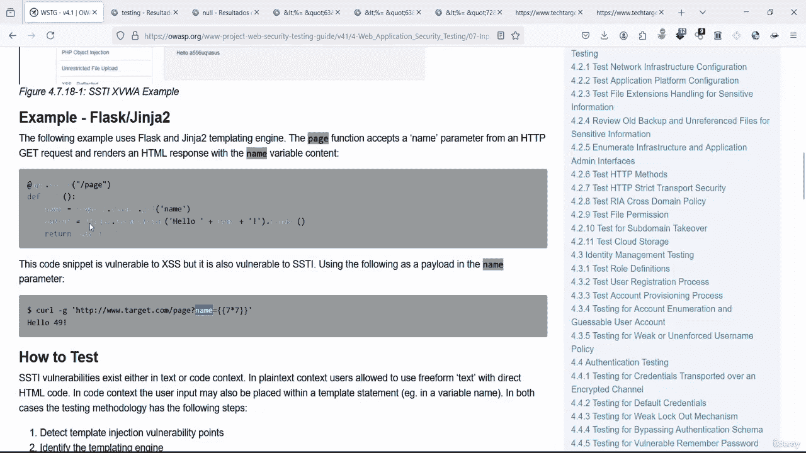

- 第一步：寻找入口点。也就是应用中会把用户输入放入模板的地方，常见于 URL 参数、表单字段或 HTTP 头。
- 第二步：发送一些简单的样本输入，观察服务器返回的响应是否包含我们发送的内容，即是否存在回显。
- 第三步：使用已知的 SSTI 测试代码进行确认，比如尝试让服务器执行简单的数学运算，看结果是否被计算并返回。

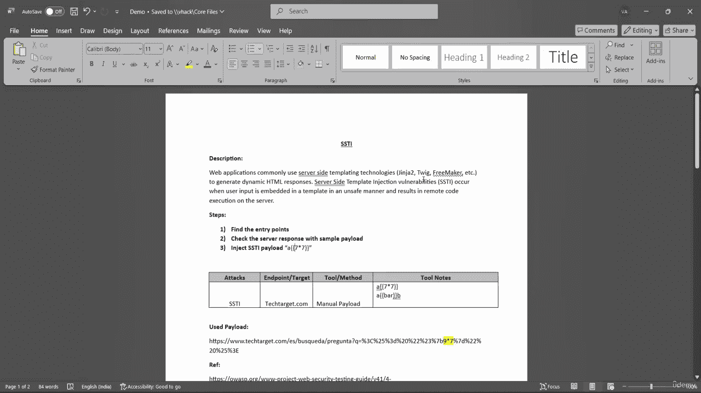

本节演示使用的目标网站是 techtarget.com。在页面中，我们发现一个名为 `q` 的参数，当前值为 `testing`。这个参数看起来就是用来搜索或过滤内容的，通常这类参数会被直接放入页面模板中渲染，所以是重点检查对象。

我们可以打开浏览器开发者工具，按下快捷键查看页面源代码，然后在源码里搜索 `testing` 这个关键词。如果搜索结果里能看到我们输入的 `testing` 原样出现在 HTML 里，说明这个参数存在回显，可以作为进一步测试的候选点。确认回显之后，就意味着用户的输入没有被妥善处理，直接被放回了页面。这为后续注入测试打开了大门。

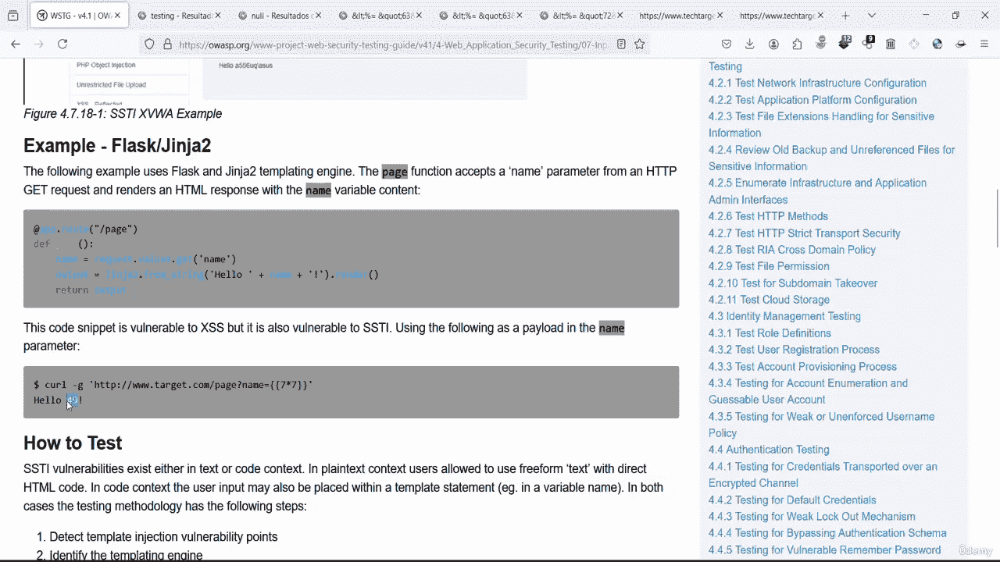

入口点找到之后，我们需要判断这个回显到底是不是模板注入。光靠看到自己的输入原样返回还不够，因为很多网站都会回显搜索关键词，但这不代表存在漏洞。我们需要进一步验证，看看服务器是否真的把我们的输入当成代码执行了。

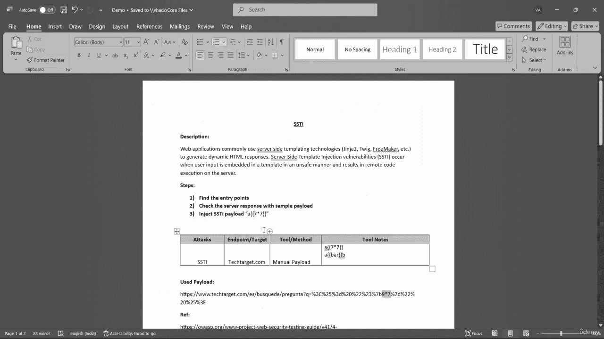

最简单的方法就是让服务器帮我们算一道数学题。如果输入的是数学表达式，而返回的结果是计算后的数字，而不是原始字符串，那就说明服务器端对输入进行了求值。这通常是模板注入的强烈证据。

演示中，我们依次尝试了以下表达式：

- 输入 `9 * 7`，服务器返回 `63`，因为 9 乘以 7 等于 63。
- 输入 `9 * 8`，服务器返回 `72`，因为 9 乘以 8 等于 72。

**验证逻辑可以表示为：**
```
如果 输入 "a * b" 且 响应包含 a × b 的计算结果
则 存在服务器端模板注入
```

连续多次得到正确计算结果，基本可以确定该应用存在 SSTI 漏洞，并且用户输入被不安全地带入了模板渲染过程。

在实际测试中，目标网站可能会对用户输入做一些清理或过滤，目的是阻止常见的脚本注入攻击。演示页面确实存在这样的机制，直接提交某些特殊字符可能会被拦截或忽略。不过，过滤并不代表绝对安全，很多时候开发人员只拦截了最常见的攻击载荷，而忽略了其他变体。

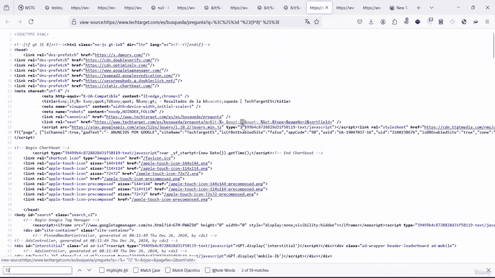

测试人员可以尝试以下几种方法继续探测：

- 使用 URL 编码或其他编码方式绕过简单的字符过滤。
- 更换 VPN 或代理服务器，切换 IP 地址，以应对基于 IP 的访问限制。
- 尝试更复杂的模板语句，比如嵌套循环或条件判断，寻找过滤规则没有覆盖的情况。

**绕过思路示例代码：**
```
原始载荷：9 * 7
编码后：%39%20%2A%20%37
更换 IP 后重新发送请求
```

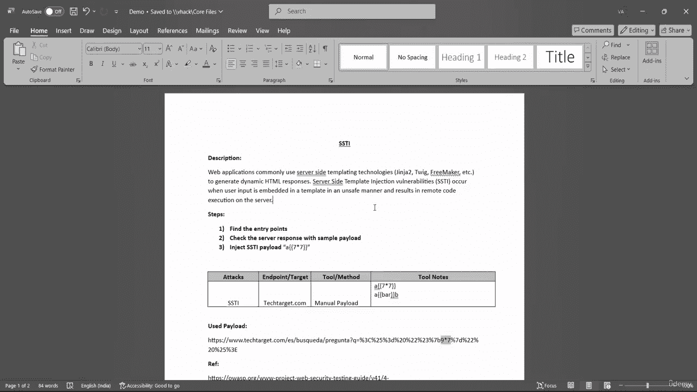

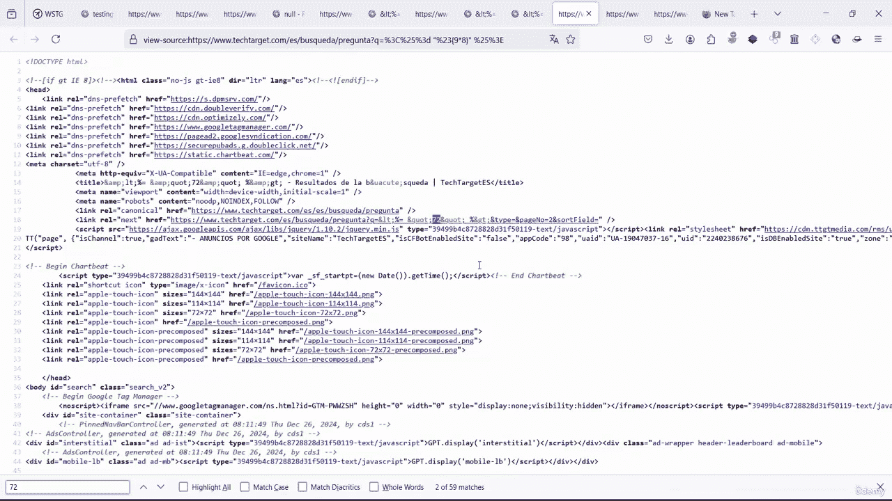

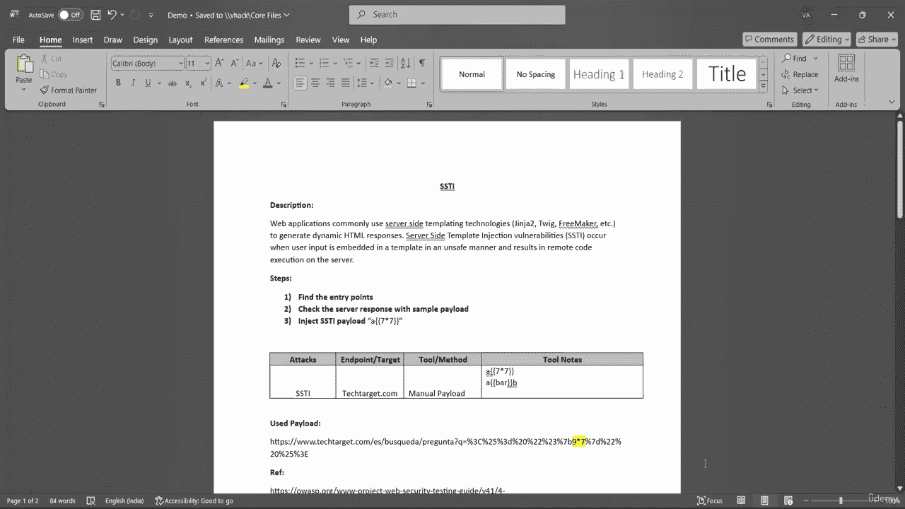

需要注意的是，即使成功绕过过滤，我们也只做概念验证，绝不尝试窃取服务器信息或破坏网站完整性。安全测试的目的是发现问题并修复，而不是造成损害。如果入口点被 IP 封锁，切换网络环境后依然可以使用上述技巧构造复杂查询，最终拿到我们想要的响应结果。

到这里，我们已经把整个 SSTI 检测流程走了一遍，从最初的入口点发现，到后续的数学验证，再到遇到过滤时的绕过思路，每一个环节都有实际的演示支撑。接下来对本节课的核心内容做一个简单回顾。

在本节课中，我们一起学习了服务器端模板注入的基本概念，掌握了寻找入口点、发送样本输入、验证回显以及利用数学表达式确认漏洞的完整流程。同时也了解了当输入被过滤时，可以通过编码或更换 IP 等方式继续测试，以及远程代码执行可能带来的风险。

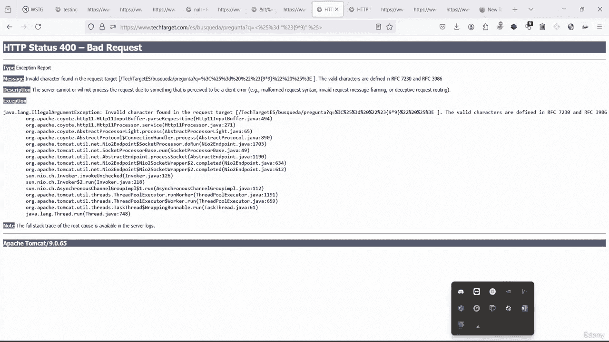

希望通过这次演示，你能对 SSTI 有直观的认识，并在未来的渗透测试中安全、合规地应用这些知识。
