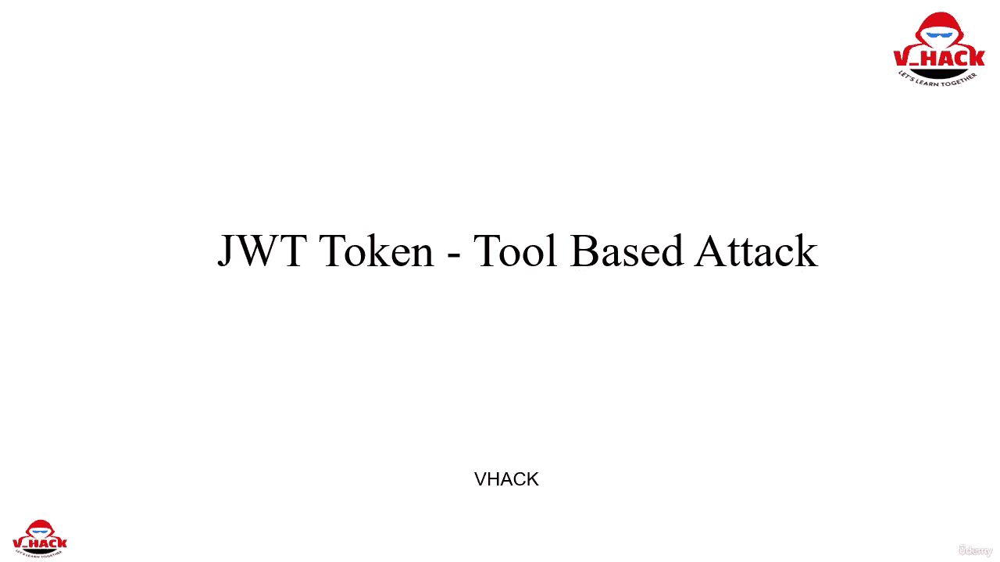

# 🔐 Udemy - Ethical Hacking：50-Day Hacker Challenge：15：JWT Token Tool Based Attack

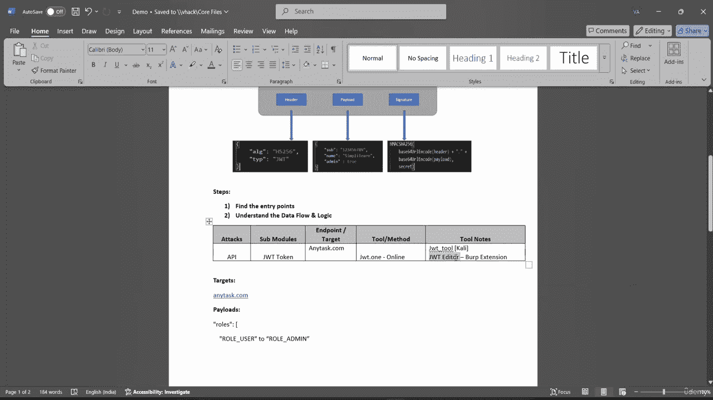

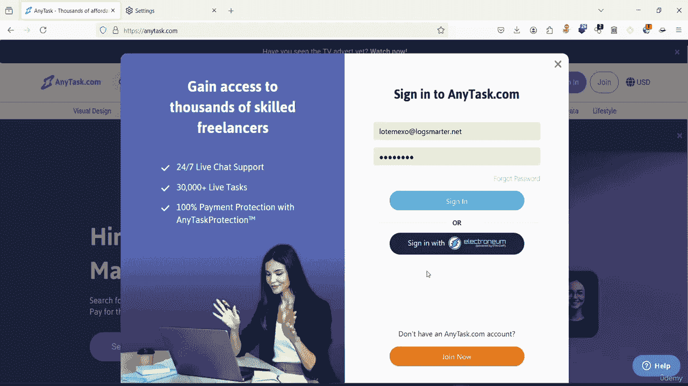

在本节课中，我们将要学习 JWT 令牌的基于工具的攻击方法。 JWT 是一种在网页应用中非常常见的身份验证方式，服务器会在用户登录后颁发一个令牌，之后每次请求都带上这个令牌来证明身份。如果攻击者能够拿到这个令牌，并对里面的内容进行修改，就有可能绕过权限检查，获得不应该拥有的访问权限。上一节课我们已经介绍过 JWT 的基本结构，也演示过一些在线编码工具的用法，本节课我们将继续深入，重点讲解两种实际攻击中常用的工具。第一种是浏览器扩展插件 JWT Editor，第二种是基于命令行的 Python 工具 JWT Tool。无论你是刚开始学习渗透测试的新手，还是已经掌握了一些基础知识的学习者，都可以跟着演示一步步操作，掌握如何利用这些工具完成 JWT 令牌的篡改攻击。

在具体演示之前，我们先来看看本节课会用到哪些工具，这对后面的操作非常重要。在之前的课程中，你已经接触过一些在线的 JWT 编码和解码网站，那些网站虽然方便，但在实际渗透测试中并不总是最合适的选择。有时候我们需要直接在浏览器里拦截请求，或者在终端里快速处理大量令牌，这时候就需要更专业的本地工具。本节课主要使用两款工具，第一款是 JWT Editor，它是一个安装在浏览器中的扩展插件，可以直接在开发者工具面板里查看和解析令牌；第二款是 JWT Tool，这是一个运行在 Linux 命令行中的 Python 包，专门用于解析和篡改 JWT 数据，适合在终端环境下快速操作。

以下是本节课会重点使用的两款核心工具：
- JWT Editor：浏览器扩展插件，用于拦截请求并查看令牌内容
- JWT Tool：Linux 命令行工具，用于解析令牌并篡改其中的字段

在开始动手之前，有必要简单回顾一下 JWT 令牌的组成结构，因为后面的所有操作都是围绕这个结构展开的。一个完整的 JWT 令牌由三部分组成，分别是头部、载荷和签名，三者之间用点号分隔。头部通常包含算法类型和令牌类型，载荷里存放用户身份信息，比如用户名、角色、邮箱等，而签名则是用来验证令牌没有被篡改的。理解这个结构之后，你就会知道为什么我们可以修改载荷里的角色字段，从而尝试提升自己的权限。

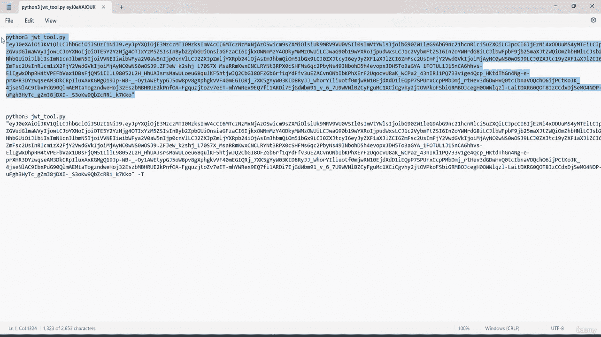

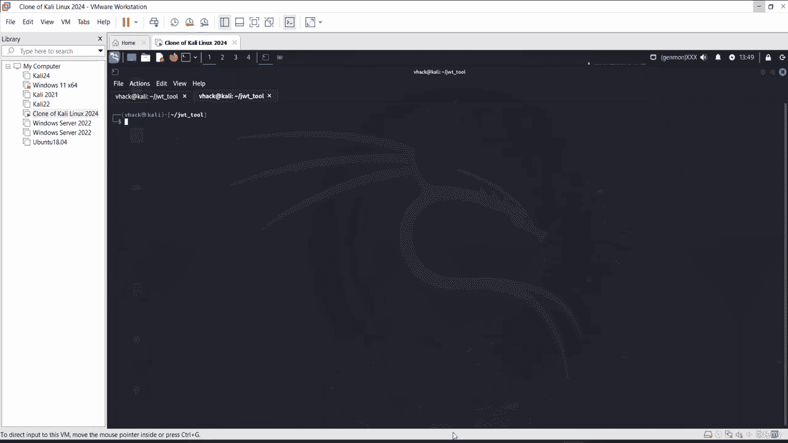

```
JWT = Header + Payload + Signature
```

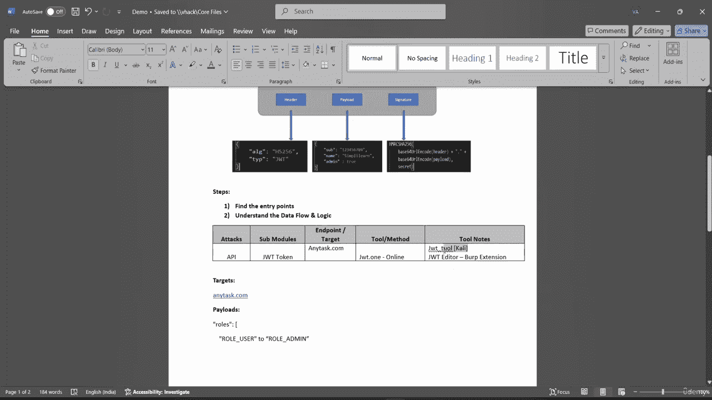

工具介绍和基础概念回顾完毕，接下来我们进入第一个演示环节，使用浏览器插件 JWT Editor 来查看令牌内容。首先，你需要在浏览器中安装 JWT Editor 扩展，安装完成后打开浏览器的开发者工具，你会看到一个新的标签页，名字叫做 JSON Web Token。当你发送一个携带令牌的请求并转发时，插件会自动捕获到这个令牌，并把它拆解成头部、载荷和签名三个部分展示出来。通过这个标签页，你可以非常清楚地看到令牌里面包含的用户名、角色、邮箱等敏感信息，而不需要登录任何在线门户网站，也不需要手动去解码。

以下是 JWT Editor 在响应中自动解析出的常见字段：
- 用户名：令牌中记录的当前登录用户身份
- 角色：例如 role user，表示当前拥有普通用户权限
- 邮箱：账号关联的电子邮件地址

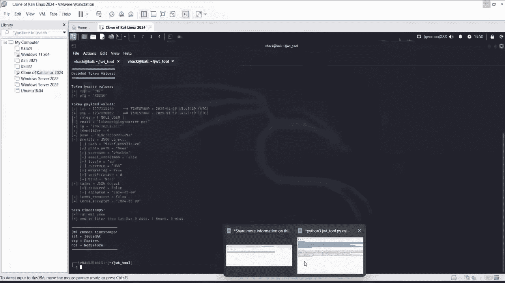

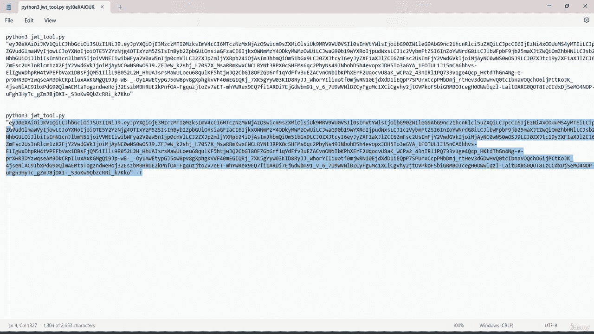

除了使用浏览器插件，命令行工具也是处理 JWT 的高效方式，很多安全研究人员更喜欢在终端里操作。接下来我们看看如何使用 JWT Tool 来完成同样的解析工作，这样你就有了两种不同的选择。JWT Tool 是一个运行在命令行中的 Python 脚本，它不需要图形界面，直接在终端里输入命令就能得到结果。使用方法非常简单，只需要在终端中输入 python3，后面跟上脚本文件名，再在双引号内粘贴你要分析的 JWT 令牌。执行命令后，工具会把令牌拆解成头部、载荷和签名，并显示出使用的算法，比如 RS256，以及里面的角色、邮箱和用户名等信息。这种方式和在线门户或者浏览器插件显示的数据是一致的，只是操作环境不同，适合在没有浏览器的服务器上使用。

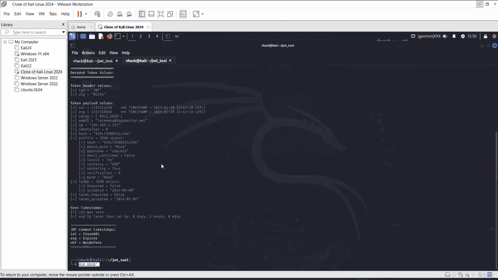

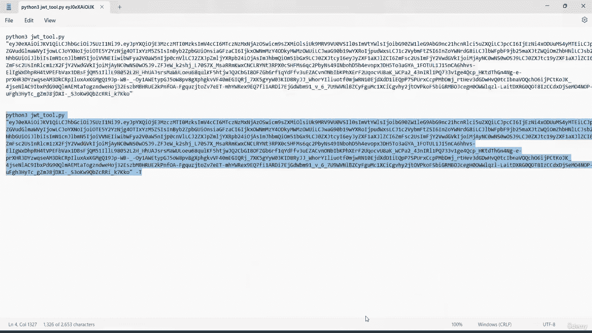

```bash
python3 jwt_tool.py "你的JWT令牌"
```

看完如何查看令牌，最关键的一步是修改令牌内容，尝试提升权限，这也是整个攻击演示的核心。下面我们演示如何把普通用户的角色改成管理员，从而尝试越权访问管理功能。在 JWT Tool 中，可以使用 -T 参数来篡改令牌里的数据，这个参数告诉工具我们需要修改令牌中的某个字段。假设当前令牌中的角色是 role user，我们想把它改成 role admin，就可以在这个命令的基础上加上篡改参数。操作时，先保持头部类型和算法使用默认设置，不要随意更改，然后按 0 键进入载荷编辑区。在载荷部分，找到角色字段，把 role user 修改为 role admin，确认修改后，工具就会生成一个新的、已经篡改过的 JWT 令牌。

篡改令牌时需要按照以下关键步骤依次操作：
1. 使用 -T 参数启用篡改模式
2. 按 0 键进入载荷（Payload）编辑区
3. 将角色字段从 role user 修改为 role admin
4. 确认修改并生成新令牌

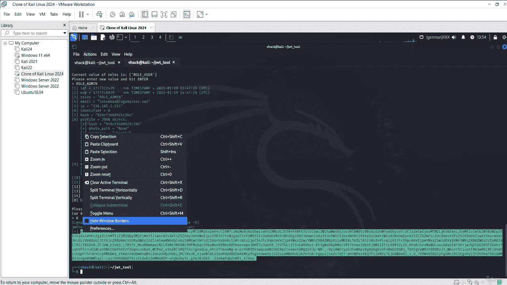

篡改完成后，我们需要验证新生成的令牌是否真的获得了管理员权限，否则整个攻击就没有实际意义。生成新令牌后，你可以把它复制回原本的请求中，再次发送到目标服务器。如果在服务器端的响应或者应用界面中，能够看到 role_ admin 字样，就说明篡改成功，你已经成功伪造了一个管理员令牌。这个过程清楚地证明，如果 JWT 没有进行正确的签名验证，攻击者就可以轻松修改令牌里的权限字段，从而越权访问本不属于自己的管理功能，造成严重的安全风险。

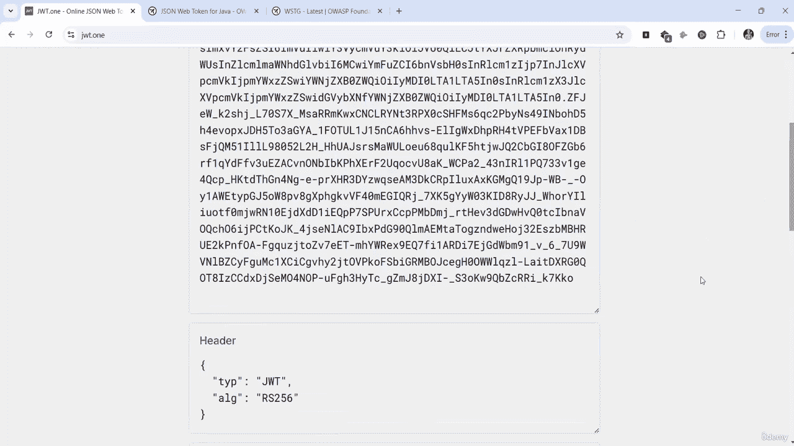

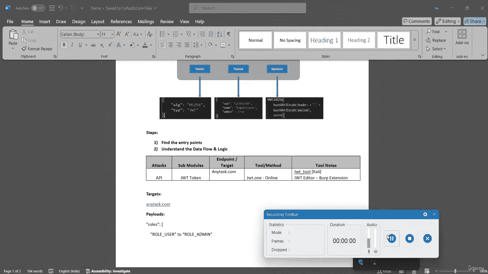

本节课中，我们一起学习了如何利用 JWT Editor 和 JWT Tool 这两款工具对 JWT 令牌进行攻击。首先介绍了两款工具的基本用途和适用场景，然后演示了如何使用浏览器插件查看令牌里的头部、载荷和签名，接着展示了如何用命令行脚本解析并篡改令牌数据，最后通过修改角色字段从普通用户变成管理员，并验证了新令牌的效果。希望通过本节课的演示，你能理解 JWT 令牌篡改的基本原理，并在后续的实践中注意相关的安全防护，避免自己的应用出现类似的漏洞。

